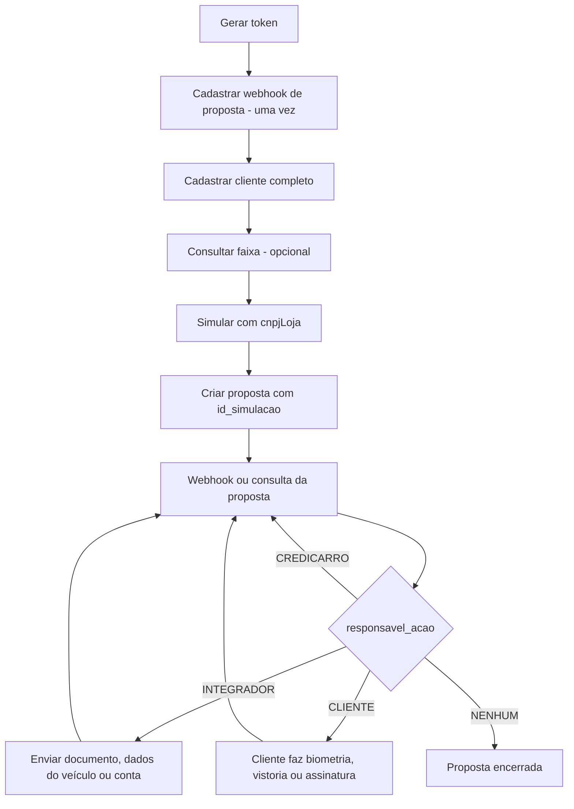
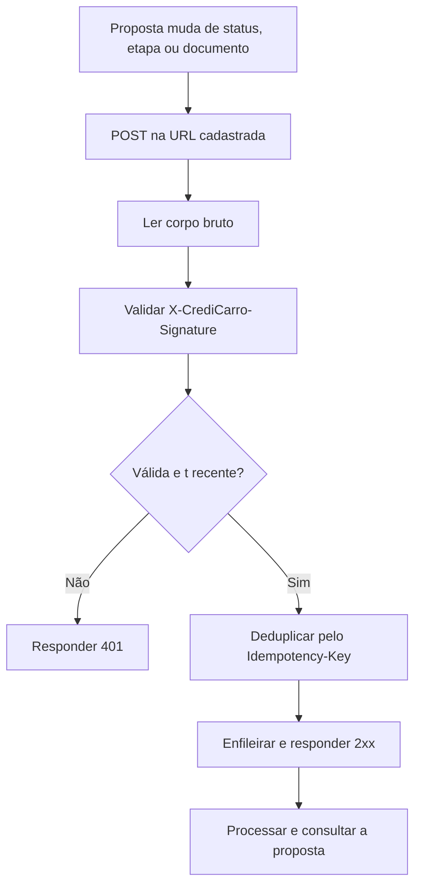

## Quando usar

Use esta skill em dois modos:

### 1. Modo integração
Quando o usuário quer **escrever código** que integra o Credicarro numa aplicação (.NET, Java, Node.js, Python, PHP, Go). Use o SDK oficial da linguagem (`Twila.Credicarro`, `br.com.twila:credicarro`, `@twila/credicarro`, `twila-credicarro`, `twila/credicarro`, `github.com/Twila-Digital/twila-credicarro-go-sdk`) com as regras, exemplos e boas práticas abaixo. Não invente classes nem métodos: use só o que a regra da linguagem mostra.

### 2. Agent Mode (API direta)
Quando o usuário quer **executar ações** — gerar token, cadastrar cliente, simular, criar ou consultar proposta, enviar documento, cadastrar webhook. Chame a API via `curl` no terminal. Veja rules/agent.md (ou o arquivo único SKILL-AGENT.md).

## Como usar

Antes de tratar status, etapas, documentos ou webhooks de proposta, leia [rules/proposal-steps.md](#regras-etapas-e-status-da-proposta). Ela define os códigos (`enum_status`, `enum_etapa`, `enum_situacao`, `enum_responsavel_acao`, biometria, documentos), o que enviar em cada etapa e o webhook de proposta.

Para **integração por código**, leia o arquivo do módulo e da linguagem:

- **Client** (instalação, configuração, ambientes, token, retry, `Idempotency-Key`, paginação, erros): dotnet / java / node / python / php / go
- **Customers** (cadastro unificado, dados pessoais, endereço, ocupação e renda): dotnet / java / node / python / php / go
- **Simulations** (faixas, simulação de financiamento e refinanciamento, consulta, listagem, rotas `/v1`): dotnet / java / node / python / php / go
- **Proposals** (criar, consultar, listar, ações pendentes, documentos, dados do veículo, conta de recebimento, rotas `/v1`): dotnet / java / node / python / php / go
- **Webhooks** (cadastrar, listar, editar, excluir, verificar assinatura, endpoint de recebimento): dotnet / java / node / python / php / go
- **Security** (credenciais, logs, LGPD, webhooks, resiliência): dotnet / java / node / python / php / go

Ferramentas de apoio:
- tools/auth.md — token de acesso, cache, renovação e erros de autenticação.
- tools/environments.md — staging x produção, variáveis de ambiente e o que testar.
- tools/production.md — checklist antes de ir para produção.
- tools/ecosystem.md — documentação oficial, SDKs, servidor MCP e suporte.
- tools/sdks/dotnet.md / java.md / node.md / python.md / php.md / go.md — instalação e compatibilidade de cada SDK.

---

## Regras: Etapas e status da proposta


Use estas regras ao consultar uma proposta (`GET /v2/proposal/{propostaId}`), ao processar o webhook de proposta e ao decidir o que o seu sistema precisa enviar. Elas valem para qualquer linguagem.

Todo valor vem em par: o número (`enum_...`) e o nome. **Compare pelo número** no código e use o nome em telas e logs. Novos valores podem surgir: guarde o número e o nome brutos e trate um valor desconhecido sem quebrar (sem `switch` exaustivo que lança exceção).

#### Status da proposta (`enum_status` / `status`)

| Código | Nome (`/v2`) | Nome (`/v1`) | Significado |
| --- | --- | --- | --- |
| 1 | `EM_ANALISE` | `Analysing` | Em análise automática. |
| 2 | `APROVADA` | `Approved` | Aprovada; segue para a formalização. |
| 3 | `RECUSADA` | `Refused` | Recusada. O motivo vem em `motivo_recusa`, quando houver. |
| 4 | `CANCELADA` | `Canceled` | Cancelada. |
| 5 | `ANALISE_MANUAL` | `ManualAnalysis` | Aguardando análise manual da Credicarro. |
| 6 | `FINALIZADA` | `Completed` | Concluída. |
| 7 | `EM_NEGOCIACAO` | `InNegotiation` | Em negociação. |
| 8 | `EXPIRADA` | `Expired` | Expirou (um mês depois de criada, se não concluída). Não continua: simule e crie outra proposta. |
| 9 | `PENDENTE` | `Pending` | Pendente. |

A consulta `/v2` e o webhook de propostas `/v2` usam os nomes em português. A listagem `GET /v1/proposal`, a consulta `GET /v1/proposal/{id}` e o webhook de propostas `/v1` usam os nomes em inglês. O número é o mesmo.

#### Etapas (`enum_etapa` / `etapa`)

Cada participante — `comprador`, `loja` e, quando houver, `vendedor` — tem a sua etapa ativa em `status_ativo` e o histórico em `etapas_concluidas` (sem a etapa ativa, cada etapa uma vez, com a data mais recente).

| Código | Nome | O que acontece |
| --- | --- | --- |
| 0 | `INDEFINIDO` | Etapa ainda não definida. |
| 1 | `PROPOSTA_CRIADA` | Proposta enviada para análise. |
| 2 | `PROPOSTA_APROVADA` | Proposta aprovada. |
| 3 | `NOTIFICACAO_VENDEDOR` | Notificação interna. Não exige ação do integrador. |
| 4 | `ANALISE_BIOMETRIA` | Biometria do participante. |
| 5 | `CONTA_RECEBIMENTO` | Aguardando a conta de recebimento (refinanciamento). |
| 6 | `ENVIO_DOCUMENTOS` | Aguardando o envio de documentos. |
| 7 | `CORRECAO_DOCUMENTOS` | Documento recusado; precisa ser reenviado. |
| 8 | `DADOS_VEICULO` | Aguardando os dados do veículo. |
| 9 | `VISTORIA` | Vistoria do veículo pelo cliente. |
| 10 | `ASSINATURA` | Assinatura do contrato pelo cliente. |
| 11 | `PAGAMENTO` | Pagamento em andamento. |
| 12 | `PROPOSTA_FINALIZADA` | Fluxo concluído. |

#### Situação (`enum_situacao` / `situacao`) e responsável (`enum_responsavel_acao` / `responsavel_acao`)

| Código | Situação | Significado |
| --- | --- | --- |
| 1 | `AGUARDANDO_ENVIO` | Aguardando dados ou arquivos do integrador. |
| 2 | `AGUARDANDO_CLIENTE` | Aguardando o cliente (biometria, vistoria ou assinatura). |
| 3 | `EM_PROCESSAMENTO` | A Credicarro está processando. |
| 4 | `PENDENTE_CORRECAO` | Documento recusado aguardando reenvio. |
| 5 | `BLOQUEADA` | Etapa bloqueada (ex.: biometria reprovada). |
| 6 | `CONCLUIDA` | Proposta finalizada. |
| 7 | `CANCELADA` | Proposta recusada, cancelada ou expirada. |

| Código | Responsável | Significado |
| --- | --- | --- |
| 0 | `NENHUM` | Ninguém precisa agir (proposta encerrada). |
| 1 | `CLIENTE` | O cliente precisa agir. |
| 2 | `INTEGRADOR` | **Seu sistema** precisa enviar algo pela API. |
| 3 | `CREDICARRO` | A Credicarro está cuidando da etapa. |

#### O que fazer em cada etapa

Para **cada** participante, leia `status_ativo` e decida:

| `enum_responsavel_acao` | `enum_etapa` | Ação |
| --- | --- | --- |
| `2` INTEGRADOR | `6` ENVIO_DOCUMENTOS | `POST /v2/proposal/{id}/document` para cada documento com status `PENDENTE` (5) daquele participante. |
| `2` INTEGRADOR | `7` CORRECAO_DOCUMENTOS | `POST /v2/proposal/{id}/document` só para os tipos com status `INVALIDO` (2), com uma `Idempotency-Key` **nova**. Mostre o `motivo`. |
| `2` INTEGRADOR | `8` DADOS_VEICULO | `POST /v2/proposal/{id}/vehicle-detail` — da **loja** no financiamento, do **comprador** no refinanciamento. |
| `2` INTEGRADOR | `5` CONTA_RECEBIMENTO | `POST /v2/proposal/{id}/deposit-account` — comprador, só refinanciamento. |
| `1` CLIENTE | qualquer | Oriente o cliente. Na `ANALISE_BIOMETRIA`, ele usa o link que a Credicarro envia por WhatsApp e e-mail (ou o `link_biometria`, se a sua integração conduz o contato). |
| `3` CREDICARRO | qualquer | Aguarde. |
| `0` NENHUM | qualquer | Nada a fazer — a proposta foi encerrada. |

Como a situação é definida: com a proposta recusada, cancelada ou expirada, `CANCELADA` + `NENHUM`; finalizada, `CONCLUIDA` + `NENHUM`. Nos demais casos:

| Etapa | Situação | Responsável |
| --- | --- | --- |
| `CONTA_RECEBIMENTO`, `ENVIO_DOCUMENTOS`, `DADOS_VEICULO` | `AGUARDANDO_ENVIO` | `INTEGRADOR` |
| `CORRECAO_DOCUMENTOS` | `PENDENTE_CORRECAO` | `INTEGRADOR` |
| `VISTORIA`, `ASSINATURA` | `AGUARDANDO_CLIENTE` | `CLIENTE` |
| `ANALISE_BIOMETRIA` com sessão criada | `AGUARDANDO_CLIENTE` | `CLIENTE` |
| `ANALISE_BIOMETRIA` com biometria reprovada | `BLOQUEADA` | `CREDICARRO` |
| `ANALISE_BIOMETRIA` nos demais casos, e as demais etapas | `EM_PROCESSAMENTO` | `CREDICARRO` |
| `PROPOSTA_FINALIZADA` | `CONCLUIDA` | `NENHUM` |

Na loja, a situação da `ANALISE_BIOMETRIA` acompanha a biometria do comprador.

#### Biometria (`enum_biometria` / `biometria`)

| Código | Nome | Significado |
| --- | --- | --- |
| 0 | `NAO_INICIADA` | Não iniciada. |
| 1 | `SESSAO_CRIADA` | Sessão criada; o cliente precisa acessar o link (o mesmo de `link_biometria`). |
| 2 | `EM_ANALISE` | Em análise. |
| 3 | `APROVADA` | Aprovada. |
| 4 | `REPROVADA` | Reprovada — a etapa fica bloqueada; fale com o time Credicarro. |

#### Documentos

Status do documento (`enum_status` / `status` dentro de `documentos`); `motivo` só aparece quando houver:

| Código | Nome | Significado |
| --- | --- | --- |
| 0 | `RECEBIDO` | Recebido. |
| 1 | `VALIDO` | Aprovado. |
| 2 | `INVALIDO` | Recusado. Mostre o `motivo` e reenvie o mesmo tipo. |
| 3 | `EM_ANALISE` | Em análise. |
| 4 | `EXCLUIDO` | Excluído. |
| 5 | `PENDENTE` | Exigido e ainda não enviado. Só aparece na consulta, para comprador e loja. |

Na consulta, comprador e loja listam **só os documentos exigidos**, cada um uma vez — enviado (com o status real) ou `PENDENTE`:

| Participante | Modalidade | Documentos exigidos, nesta ordem |
| --- | --- | --- |
| Comprador | Financiamento | `COMPROVANTE_RESIDENCIA`, `COMPROVANTE_RENDA`, `ATPV` (só veículo registrado no RS), `CNH` |
| Comprador | Refinanciamento | `COMPROVANTE_RESIDENCIA`, `DOCUMENTO_VEICULO`, `COMPROVANTE_RENDA`, `CNH` |
| Loja | Financiamento | `LAUDO_ECV`, `DOCUMENTO_VEICULO` |
| Loja | Refinanciamento | Nenhum (lista vazia) |

A `CNH` aceita `CNH` ou `CNH_DIGITAL`: se só a digital foi enviada, ela aparece no lugar da `CNH` pendente. Documentos enviados fora da tabela (ex.: `LAUDO_VISTORIA`) não aparecem para comprador e loja. O vendedor lista todos os documentos enviados, sem `PENDENTE`.

##### Tipos de documento

| Código | Nome | Comprador | Vendedor | Loja |
| --- | --- | :---: | :---: | :---: |
| 1 | `CNH` | ✓ | ✓ | |
| 2 | `CPF` | | ✓ | |
| 3 | `RG` | | ✓ | |
| 4 | `COMPROVANTE_RENDA` | ✓ | | |
| 5 | `COMPROVANTE_RESIDENCIA` | ✓ | ✓ | |
| 6 | `DOCUMENTO_VEICULO` | ✓ | ✓ | ✓ |
| 7 | `CNH_DIGITAL` | ✓ | ✓ | |
| 8 | `LAUDO_ECV` | | ✓ | ✓ |
| 9 | `LAUDO_VISTORIA` | ✓ | ✓ | |
| 11 | `CARTAO_CNPJ` | | ✓ | |
| 57 | `ATPV` | ✓ | | |

O webhook e a lista do vendedor podem trazer outros tipos anexados pela Credicarro, no mesmo par código e nome — não rejeite um tipo desconhecido.

Regras do envio: um arquivo por chamada; PDF, JPG/JPEG ou PNG; até 10 MiB decodificado; `nomeArquivo` sem caminho, até 255 caracteres, extensão igual ao conteúdo real (`422` `Document.InvalidContent`); Base64 puro, sem `data:` e sem quebras de linha; `Idempotency-Key` obrigatória. Fora das etapas 6/7: `422` `Document.InvalidProposalStage`. Na correção, um tipo que não está `INVALIDO`: `422` `Document.NotPendingCorrection`. Reenviar o mesmo tipo e participante substitui o anterior.

#### Webhook de proposta

Cada webhook ativo do tipo Proposal (`tipo` = 3) recebe o retrato da proposta sempre que muda o status, uma etapa ou um documento (propostas criadas por `POST /v2/proposal`):

```json
{
  "id_proposta": "bea8d060-f93d-48eb-b6c4-45f64483cdd9",
  "enum_status": 2,
  "status": "APROVADA",
  "motivo_evento": "DOCUMENTOS_ALTERADOS",
  "motivo_recusa": null,
  "data_evento": "2026-10-12T17:20:31.512+00:00",
  "comprador": {
    "cpf": "12345678909",
    "enum_biometria": 3,
    "biometria": "APROVADA",
    "status_ativo": {
      "enum_etapa": 7, "etapa": "CORRECAO_DOCUMENTOS",
      "enum_situacao": 4, "situacao": "PENDENTE_CORRECAO",
      "enum_responsavel_acao": 2, "responsavel_acao": "INTEGRADOR"
    },
    "etapas_concluidas": [
      { "enum_etapa": 1, "etapa": "PROPOSTA_CRIADA", "data": "2026-10-12T14:05:08-03:00" }
    ],
    "documentos": [
      { "enum_tipo": 1, "tipo": "CNH", "enum_status": 2, "status": "INVALIDO", "motivo": "Documento ilegível" }
    ]
  },
  "loja": {
    "cnpj": "11222333000181",
    "status_ativo": {
      "enum_etapa": 6, "etapa": "ENVIO_DOCUMENTOS",
      "enum_situacao": 1, "situacao": "AGUARDANDO_ENVIO",
      "enum_responsavel_acao": 2, "responsavel_acao": "INTEGRADOR"
    },
    "etapas_concluidas": [],
    "documentos": []
  },
  "vendedor": null
}
```

- `motivo_evento`: `STATUS_ALTERADO`, `ETAPAS_ALTERADAS` ou `DOCUMENTOS_ALTERADOS`.
- `data_evento`: momento em que o retrato foi montado (UTC). Muda a cada retentativa — não use para deduplicar.
- `loja` pode ser `null`; `vendedor` é reservado e hoje sempre `null`.
- No webhook, `documentos` não traz `PENDENTE` — para saber o que falta, consulte a proposta.
- Propostas criadas por `POST /v1/proposal` recebem só `{"id_proposta", "enum_status", "status"}`, com `status` em inglês.

##### Entrega

| Header | Conteúdo |
| --- | --- |
| `Authorization` | `Basic {credencial}` ou `Bearer {credencial}`, conforme o `tipo_autenticacao` (ausente quando `1`). |
| `X-CrediCarro-Signature` | `t={timestamp Unix em segundos},v1={HMAC-SHA256 em hex minúsculo}`. |
| `Idempotency-Key` | `{id_mensagem}:{id_webhook}` — igual em todas as retentativas da mesma notificação. |

Validação da assinatura: concatene `t`, um ponto e o **corpo bruto** (sem reformatar o JSON); calcule o HMAC-SHA256 com o `segredo_assinatura` como chave (o texto do segredo em UTF-8 — não decodifique); compare com `v1` em **tempo constante**; recuse `t` antigo (sugestão: 5 minutos). Cada retentativa é assinada de novo, com novo `t`.

Vetor de teste — sua implementação precisa chegar ao mesmo `v1`:

| Item | Valor |
| --- | --- |
| `segredo_assinatura` | `segredo-de-exemplo` |
| `t` | `1715792400` |
| Corpo bruto | `{"id_proposta":"bea8d060-f93d-48eb-b6c4-45f64483cdd9","enum_status":2,"status":"Approved"}` |
| `v1` esperado | `db66c554eb116ef2577deb63f72619793502a31520f622b2d59864b074eb8df2` |

Como o endpoint deve responder:

1. Leia o corpo bruto antes de qualquer desserialização, com um limite de tamanho. Os exemplos usam 1 MiB — escolha deles, não da API: o payload real tem poucos KB, mas um `413` não é retentado pela Credicarro, então não use um limite apertado.
2. Com autenticação Basic ou JWT, confira o header `Authorization` em tempo constante. Diferente → `401`.
3. Assinatura inválida, `t` fora do formato (só dígitos) ou antigo → `401`. Nunca valide com segredo vazio: sem `segredo_assinatura` configurado, o endpoint não deve subir.
4. Deduplique pelo header `Idempotency-Key`, enfileire o evento e só então responda `2xx` (limite de 15 s por entrega). Se não conseguir enfileirar, desfaça a marcação da chave e responda `503` para a Credicarro tentar de novo.
5. Processe de forma assíncrona, numa fila durável em produção; falha num evento não pode derrubar o processamento dos demais. As notificações podem chegar **fora de ordem**: para o estado mais recente, consulte a proposta.

Retentativas: `408`, `425`, `429`, `5xx`, falha de rede e timeout geram até 3 novas tentativas (cerca de 1 s, 5 s e 30 s). Os demais `4xx`, `3xx` e respostas acima de 1 MiB são falha definitiva, sem retentativa. A Credicarro não reenvia um retrato idêntico ao último entregue com sucesso para o mesmo webhook. Depois das retentativas, reconcilie consultando a proposta.

---

## Regras: Agent Mode — Uso direto da API


Quando o usuário pedir para **executar** uma ação (gerar token, cadastrar cliente, simular, criar ou consultar proposta, enviar documento, gerenciar webhook) em vez de **escrever código** de integração, chame a API do Credicarro diretamente via `curl`.

#### Autenticação

A API usa Bearer token. Troque `clientId` e `clientSecret` por um token de acesso antes de qualquer outra chamada:

```bash
: "${CREDICARRO_CLIENT_ID:?exporte CREDICARRO_CLIENT_ID}" "${CREDICARRO_CLIENT_SECRET:?exporte CREDICARRO_CLIENT_SECRET}"

TOKEN=$(jq -n '{clientId: env.CREDICARRO_CLIENT_ID, clientSecret: env.CREDICARRO_CLIENT_SECRET}' \
  | curl -s -X POST "$CREDICARRO_BASE_URL/v1/authentication/accesstoken" \
      -H "Content-Type: application/json" --data-binary @- \
  | jq -r '.token_de_acesso')
```

O `jq` lê as variáveis exportadas (`env.`) e o corpo segue pela entrada padrão: o `clientSecret` não aparece em nenhuma linha de comando (`ps`, histórico) e caracteres como `"` ou `\` no segredo não quebram o JSON. As variáveis precisam estar exportadas (`export CREDICARRO_CLIENT_SECRET=...` ou `set -a; . ./.env; set +a`) — sem isso, `env.` vira `null`; a primeira linha interrompe antes de chamar a API.

Resposta completa:
```json
{
  "token_de_acesso": "eyJhbGciOiJSUzI1NiIsInR5cCI6IkpXVCJ9...",
  "expira_em_segundos": 3600,
  "expira_em": "2025-08-12T18:06:28.088+00:00",
  "tipo_de_token": "Bearer",
  "escopo": "credicarro.integration.access/full"
}
```

Use o token nas chamadas seguintes:
```bash
curl -s -H "Authorization: Bearer $TOKEN" "$CREDICARRO_BASE_URL/v2/proposal/PROPOSTA_ID" | jq "$OCULTA_CPF"
```

`OCULTA_CPF` é o filtro `jq` que mascara CPFs antes de exibir — defina-o como em [Formato de resposta e erros](#formato-de-resposta-e-erros).

- Leia `CREDICARRO_CLIENT_ID`/`CREDICARRO_CLIENT_SECRET` de variáveis de ambiente ou de um `.env` fora do controle de versão. Se não existirem, peça ao usuário que as defina no próprio terminal (`export ...`) ou no `.env` — **não** peça para colar o `clientSecret` no chat.
- O mesmo token vale para todas as rotas. Reaproveite até `expira_em` (já vem com 60 s de margem) — não gere um token por chamada.
- Em `401` (sem corpo), gere um novo token e repita a chamada **uma** vez.
- **Nunca** exiba o `clientSecret` nem o token completo no terminal ou no chat.

#### Base URL

```
Staging:    https://api.staging.credicarro.com.br/integration
Produção:   https://api.credicarro.com.br/integration
```

Use sempre staging, a menos que o usuário peça produção explicitamente — no staging nenhuma proposta é real. Credenciais e webhooks de um ambiente não funcionam no outro: um token de staging retorna `401` em produção.

#### Formato de resposta e erros

Campos JSON em português: requisições em camelCase (`cnpjLoja`, `valorEntrada`), respostas em snake_case (`id_proposta`, `token_de_acesso`). Valores monetários são números em reais, com ponto decimal (`45000`, `6500.00`) — não são centavos.

Erros vêm com um código estável em `tipo`. Trate pelo `tipo`, nunca pelo texto de `detalhe`:
```json
{
  "tipo": "Validation.Cpf.Invalid",
  "titulo": "Requisição inválida",
  "status": 400,
  "detalhe": "O CPF informado em 'cpf' é inválido.",
  "campo": "cpf"
}
```

- `campo` aparece quando o erro é de um campo (ex.: `endereco.cep`). Erros de regra de negócio (`422`) vêm sem `campo`.
- `erros` (`[{codigo, mensagem, campo}]`) aparece só com JSON malformado ou valor de tipo errado (`Validation.InvalidFormat`).
- `401` vem sem corpo. Falhas inesperadas (`500`, alguns `502`) podem vir no Problem Details padrão (`type`, `title`, `status`, `detail`).
- `403` com `Integration.Access.Inactive` ou `Integration.Access.OrganizationNotFound` pode ocorrer em qualquer rota autenticada — não repita; fale com o time Credicarro.

Ao mostrar respostas no chat, mascare os CPFs (exige `jq` 1.6+):
```bash
OCULTA_CPF='walk(if type == "object" and (.cpf | type) == "string" then .cpf |= ("***" + .[3:9] + "**") else . end)'
```

Listas paginadas usam `pagina_inicial` (mínimo 1) e `limite` (1 a 100) e respondem `{"itens": [...], "pagina": {"numero", "tamanho", "total", "tem_proximo", "tem_anterior"}}`.

#### Idempotency-Key

As rotas de cliente, simulação e criação de proposta aceitam o header `Idempotency-Key` (1 a 200 caracteres). No envio de documento ele é **obrigatório**. Mesma chave + mesmo corpo devolve o resultado original; mesma chave + outro corpo retorna `409`.

```bash
CHAVE=$(uuidgen)   # gere antes e guarde: repita a MESMA operação com a mesma chave
-H "Idempotency-Key: $CHAVE"
```

Gere a chave uma vez por operação, numa variável, **antes** do comando — nunca `$(uuidgen)` dentro do `curl`, que gera uma chave nova a cada repetição. As rotas de webhook, dados do veículo e conta de recebimento não usam o header.

Quando repetir: só `408`, `429` (respeitando `Retry-After`), `500`, `502`, `503`, `504`, timeout ou falha de rede — nunca outros `4xx` — e só em operações seguras: `GET`, `POST` com a mesma `Idempotency-Key`, dados do veículo, conta de recebimento e `PUT`/`DELETE` de webhook. **Não repita** `POST /v1/webhook` (cadastraria outro webhook) nem `POST /v1/customer/unified` sem chave: liste os webhooks ou consulte o cadastro antes de tentar de novo.

---

#### Endpoints

O fluxo de uma proposta é: token → webhook (uma vez) → cliente → faixa (opcional) → simulação → proposta → etapas. Para integrações novas, use as rotas `/v2` (com `cnpjLoja`); a consulta e a listagem de simulações e a listagem de propostas continuam em `/v1`.

##### Clientes (Customer)

O cliente é identificado pelo **CPF** em todas as chamadas — não é preciso guardar o `id_cliente`.

**Criar ou atualizar cliente com dados completos (recomendado)**
```bash
curl -s -X POST "$CREDICARRO_BASE_URL/v1/customer/unified" \
  -H "Authorization: Bearer $TOKEN" -H "Content-Type: application/json" \
  -d '{
    "cpf": "12345678909",
    "nome": "Maria",
    "sobrenome": "Souza",
    "email": "maria.souza@exemplo.com.br",
    "celular": "+55 (11) 99876-5432",
    "dataDeNascimento": "1990-05-20T00:00:00-03:00",
    "endereco": {
      "rua": "Av. Paulista",
      "numero": "1578",
      "complemento": "Bloco B, Apto 1203",
      "bairro": "Bela Vista",
      "cidade": "São Paulo",
      "estado": "SP",
      "cep": "01311000"
    },
    "dadosProfissionais": { "tipoOcupacao": 3, "renda": 6500.00 }
  }' | jq
```
Resposta `200`: `{"id_cliente": "..."}`.

| Chamada | CPF novo | CPF já cadastrado |
| --- | --- | --- |
| `unified` **sem** `Idempotency-Key` | Cria | Atualiza |
| `unified` **com** `Idempotency-Key` | Cria | `409` `Cpf.CpfAlreadyAdded` |
| `POST /v1/customer` | Cria | `409` `Cpf.CpfAlreadyAdded` |
| `address` / `professional` | `404` `Customer.Account.NotFound` | Cria ou atualiza |

Regras dos campos: `celular` **exatamente** no formato `+55 (DD) 99999-9999`; `dataDeNascimento` em ISO-8601, com o cliente entre 18 e 75 anos; `cep` com 8 dígitos (com ou sem hífen); `estado` com a sigla da UF; `nome`/`sobrenome` até 100 caracteres. E-mail e celular também precisam ser únicos na criação (`Email.EmailAlreadyAdded`, `Phone.PhoneAlreadyAdded`).

`tipoOcupacao`: `1` aposentado, `2` pensionista, `3` assalariado, `4` autônomo, `6` freelancer, `7` proprietário (não existe `5`). `renda` é a renda mensal em reais, maior que zero.

**Criar cliente só com dados pessoais**
```bash
curl -s -X POST "$CREDICARRO_BASE_URL/v1/customer" \
  -H "Authorization: Bearer $TOKEN" -H "Content-Type: application/json" \
  -d '{
    "cpf": "12345678909", "nome": "Maria", "sobrenome": "Souza",
    "email": "maria.souza@exemplo.com.br", "celular": "+55 (11) 99876-5432",
    "dataDeNascimento": "1990-05-20T00:00:00-03:00"
  }' | jq
```

**Criar ou atualizar endereço** (resposta `202` sem corpo)
```bash
curl -s -o /dev/null -w '%{http_code}\n' -X POST "$CREDICARRO_BASE_URL/v1/customer/address" \
  -H "Authorization: Bearer $TOKEN" -H "Content-Type: application/json" \
  -d '{
    "cpf": "12345678909",
    "endereco": { "rua": "Av. Paulista", "numero": "1578", "bairro": "Bela Vista",
                  "cidade": "São Paulo", "estado": "SP", "cep": "01311000" }
  }'
```

**Criar ou atualizar ocupação e renda** (resposta `202` sem corpo)
```bash
curl -s -o /dev/null -w '%{http_code}\n' -X POST "$CREDICARRO_BASE_URL/v1/customer/professional" \
  -H "Authorization: Bearer $TOKEN" -H "Content-Type: application/json" \
  -d '{"cpf": "12345678909", "tipoOcupacao": 3, "renda": 6500.00}'
```

O que cada passo exige do cadastro: a simulação exige dados pessoais; no refinanciamento, o endereço é usado quando a placa não traz a UF; a **proposta** exige dados pessoais, endereço, ocupação e renda (senão `422` `Customer.Account.Incomplete`).

---

##### Simulações (Simulation)

A loja é informada por `cnpjLoja` (formatado ou só números). Ela precisa estar vinculada ao parceiro do token (`404` `Store.Integration.NotFound`) e não pode ter contrato de intermediação (`422` `Store.Integration.Intermediation`). O cliente precisa estar cadastrado antes (`404` `Customer.Account.NotFound`).

**Faixa financiável — entrada mínima por prazo (opcional)**
```bash
curl -s -H "Authorization: Bearer $TOKEN" \
  "$CREDICARRO_BASE_URL/v2/proposal/simulation/range/financing?placa=ABC1D23&cnpjLoja=11222333000181" | jq
```
Resposta: `{"opcoes_por_prazo": [{"prazo": 36, "valor_minimo_entrada": 5000.00}, ...]}`.

**Faixa refinanciável — valor mínimo e máximo por prazo (opcional)**
```bash
curl -s -H "Authorization: Bearer $TOKEN" \
  "$CREDICARRO_BASE_URL/v2/proposal/simulation/range/refinancing?placa=ABC1D23&cnpjLoja=11222333000181" | jq
```
Resposta: `{"opcoes_por_prazo": [{"prazo": 36, "valor_minimo_refinanciavel": 5000, "valor_maximo_refinanciavel": 35720}, ...]}`.

Sem prazos para o veículo, as duas faixas retornam `422` `Simulation.Terms.Unavailable`.

**Consultar retornos de comissão disponíveis (opcional, antes de simular)**
```bash
curl -s -H "Authorization: Bearer $TOKEN" \
  "$CREDICARRO_BASE_URL/v2/proposal/simulation/commission-returns?cnpjLoja=11222333000181" | jq
```
Resposta: `{"retornos_comissao": [{"tipo": "Financing", "alvo": "Store", "retorno_minimo": 0, "retorno_maximo": 6, "permite_taxa_padrao": true}, ...]}` — um item por tipo (`Financing`/`Refinancing`) que a loja tiver configurado. Use um valor dentro de `retorno_minimo`..`retorno_maximo` em `retornoComissao` ao simular. Se a loja não tiver nenhum item de um tipo, não envie `retornoComissao` nesse tipo (ver abaixo).

**Simular financiamento**
```bash
CHAVE=$(uuidgen)   # guarde para repetir esta mesma simulação
curl -s -X POST "$CREDICARRO_BASE_URL/v2/proposal/simulation/financing" \
  -H "Authorization: Bearer $TOKEN" -H "Content-Type: application/json" \
  -H "Idempotency-Key: $CHAVE" \
  -d '{
    "cpf": "12345678909",
    "placa": "ABC1D23",
    "valorVeiculo": 45000,
    "valorEntrada": 5000,
    "uf": "SP",
    "isVeiculoZeroKm": false,
    "retornoComissao": 2,
    "cnpjLoja": "11.222.333/0001-81"
  }' | jq
```
`valorEntrada` pode ser `0`, mas tem de ser menor que `valorVeiculo` e deixar ao menos 10% do veículo para financiar (`422` `Proposal.RequestAmountInvalid`). Se nenhum prazo aceita a entrada: `422` `Proposal.DownPaymentInvalid`. `uf` é a UF de registro do veículo, com 2 letras. `retornoComissao` é **opcional**: omita para usar a taxa padrão (quando a loja permitir, ver `permite_taxa_padrao` acima); fora da faixa configurada ou loja sem faixa para `Financing`: `422` `Store.CommissionReturn.OutOfRange` / `Store.CommissionReturn.NotConfigured`. Só existe na rota `/v2` (não envie em `/v1`).

**Simular refinanciamento**
```bash
CHAVE=$(uuidgen)   # guarde para repetir esta mesma simulação
curl -s -X POST "$CREDICARRO_BASE_URL/v2/proposal/simulation/refinancing" \
  -H "Authorization: Bearer $TOKEN" -H "Content-Type: application/json" \
  -H "Idempotency-Key: $CHAVE" \
  -d '{
    "cpf": "12345678909",
    "placa": "ABC1D23",
    "valorSolicitado": 25000,
    "retornoComissao": 2,
    "cnpjLoja": "11.222.333/0001-81"
  }' | jq
```
`valorSolicitado` tem de caber na faixa refinanciável de algum prazo (`422` `Simulation.Refinancing.AmountOutOfRange` ou `Proposal.RequestAmountInvalid`). Sem UF da placa nem do endereço do cliente: `422` `Simulation.Refinancing.UfUnavailable`. `retornoComissao` segue a mesma regra do financiamento, para o tipo `Refinancing`.

As duas simulações respondem `201` com **uma opção por prazo elegível**:
```json
{
  "simulacoes": [
    {
      "id_simulacao": "123e4567-e89b-12d3-a456-426614174000",
      "valor_solicitado": 40000, "prazo": 36, "valor_parcela": 2042.42,
      "valor_tac": 1500, "valor_boleto": 3.5, "valor_seguro": 0,
      "valor_iof": 872, "percentual_iof": 1.92,
      "valor_credito_total": 42722, "valor_divida_total": 73527.12,
      "percentual_cet_mensal": 3.75, "percentual_cet_anual": 55.52,
      "percentual_juros_mensal": 3.29, "percentual_juros_anual": 47.47
    }
  ]
}
```
Mostre as opções ao usuário (prazo, parcela e **CET**) e use o `id_simulacao` escolhido para criar a proposta. `valor_retencao_diaria_aproximado` só aparece quando se aplica.

**Consultar simulação**
```bash
curl -s -H "Authorization: Bearer $TOKEN" "$CREDICARRO_BASE_URL/v1/proposal/simulation/SIMULACAO_ID" | jq "$OCULTA_CPF"
```

**Listar simulações (paginado)**
```bash
curl -s -H "Authorization: Bearer $TOKEN" \
  "$CREDICARRO_BASE_URL/v1/proposal/simulation?pagina_inicial=1&limite=10" | jq "$OCULTA_CPF"
```

---

##### Propostas (Proposal)

**Criar proposta**
```bash
CHAVE=$(uuidgen)   # guarde para repetir esta mesma criação
curl -s -X POST "$CREDICARRO_BASE_URL/v2/proposal" \
  -H "Authorization: Bearer $TOKEN" -H "Content-Type: application/json" \
  -H "Idempotency-Key: $CHAVE" \
  -d '{"cpf": "12345678909", "simulacaoId": "SIMULACAO_ID"}' | jq
```
Resposta `201`: `{"id_proposta": "..."}`. Erros comuns (`422`): `Customer.Account.Incomplete` (complete endereço, ocupação e renda), `Proposal.SimulationAlreadyActivated` (o `id_simulacao` já virou proposta), `Proposal.SimulationAlreadyExpired` (simule de novo), `Simulation.Access.NotFromStore` (simulação feita sem `cnpjLoja`), `Proposal.BuyerAgeNotAllowed`.

**Consultar proposta (retrato atual com etapas e documentos)**
```bash
curl -s -H "Authorization: Bearer $TOKEN" "$CREDICARRO_BASE_URL/v2/proposal/PROPOSTA_ID" | jq "$OCULTA_CPF"
```
Traz `enum_status`/`status`, `tipo` (`Financing`/`Refinancing`), `motivo_recusa`, `link_biometria` e, para `comprador`, `loja` e `vendedor` (quando houver): `status_ativo`, `etapas_concluidas` e `documentos`. Uma proposta criada por `/v1/proposal` retorna `422` `Proposal.Access.NotIntegrationV2` nesta rota.

Para saber **o que fazer agora**, leia o `status_ativo` de cada participante e siga [Etapas e status da proposta](#regras-etapas-e-status-da-proposta):

```bash
curl -s -H "Authorization: Bearer $TOKEN" "$CREDICARRO_BASE_URL/v2/proposal/PROPOSTA_ID" \
  | jq '{status, comprador: .comprador.status_ativo, loja: .loja.status_ativo}'
```

**Listar propostas (paginado)**
```bash
curl -s -H "Authorization: Bearer $TOKEN" \
  "$CREDICARRO_BASE_URL/v1/proposal?pagina_inicial=1&limite=10" | jq "$OCULTA_CPF"
```
A listagem usa os nomes de status em inglês (`Analysing`, `Approved`, `Refused`...). Para etapas e documentos, consulte cada proposta em `/v2/proposal/{id}`.

**Enviar documento** (etapa `ENVIO_DOCUMENTOS` ou `CORRECAO_DOCUMENTOS`; `Idempotency-Key` obrigatória; resposta `204`)

Monte o corpo num arquivo temporário privado — um Base64 grande não cabe como argumento de linha de comando, e o arquivo tem dados pessoais:
```bash
CHAVE_DOC=$(uuidgen)   # guarde: reutilize só se precisar repetir ESTE envio

(  # subshell: umask e trap não alteram a sessão do usuário
  umask 077
  DOC_JSON=$(mktemp) && trap 'rm -f "$DOC_JSON"' EXIT

  jq -n --arg participante COMPRADOR --argjson tipo 1 --arg nome "cnh-comprador.pdf" \
    --rawfile conteudo <(base64 -w0 cnh-comprador.pdf) \
    '{participante: $participante, tipoDocumento: $tipo, nomeArquivo: $nome, conteudoBase64: $conteudo}' > "$DOC_JSON"

  curl -s -o /dev/null -w '%{http_code}\n' -X POST "$CREDICARRO_BASE_URL/v2/proposal/PROPOSTA_ID/document" \
    -H "Authorization: Bearer $TOKEN" -H "Content-Type: application/json" \
    -H "Idempotency-Key: $CHAVE_DOC" \
    --data-binary @"$DOC_JSON"
)
```
- No macOS, troque `base64 -w0 arquivo` por `base64 -i arquivo`. `--rawfile` exige `jq` 1.6+.
- `participante`: `COMPRADOR`, `VENDEDOR` ou `LOJA`. `tipoDocumento` por participante: comprador `1, 4, 5, 6, 7, 9, 57`; vendedor `1, 2, 3, 5, 6, 7, 8, 9, 11`; loja `6, 8`. Veja a tabela de [tipos de documento](#regras-etapas-e-status-da-proposta).
- Arquivo PDF, JPG/JPEG ou PNG, até 10 MiB decodificado; `nomeArquivo` sem caminho, até 255 caracteres, com extensão que corresponda ao conteúdo real; Base64 puro, sem prefixo `data:` e sem quebras de linha.
- Um arquivo por chamada. Reenviar o mesmo tipo e participante substitui o anterior.
- Uma chave por envio, nunca derivada só de proposta + participante + tipo: mesma chave e mesmo corpo em até 24 h não reprocessam (`204` sem efeito), e mesma chave com outro arquivo retorna `409` `Idempotency.KeyConflict`. Em `502` `Document.UploadFailed`, repita com a **mesma** chave. Na correção, gere uma chave **nova**.

**Incluir dados do veículo** (etapa `DADOS_VEICULO`: da loja no financiamento, do comprador no refinanciamento; resposta `204`)
```bash
curl -s -o /dev/null -w '%{http_code}\n' -X POST "$CREDICARRO_BASE_URL/v2/proposal/PROPOSTA_ID/vehicle-detail" \
  -H "Authorization: Bearer $TOKEN" -H "Content-Type: application/json" \
  -d '{"renavam": "12345678900", "chassi": "9BWZZZ377VT004251", "placa": "ABC1D23", "cor": "PRATA"}'
```
`renavam` até 11 dígitos com dígito verificador válido; `chassi` com 17 caracteres, sem I, O e Q; `cor` sem números, até 30 caracteres. Fora da etapa: `422` `Proposal.InvalidStatus`.

**Incluir conta de recebimento** (só refinanciamento, etapa `CONTA_RECEBIMENTO` do comprador; resposta `204`)
```bash
curl -s -o /dev/null -w '%{http_code}\n' -X POST "$CREDICARRO_BASE_URL/v2/proposal/PROPOSTA_ID/deposit-account" \
  -H "Authorization: Bearer $TOKEN" -H "Content-Type: application/json" \
  -d '{
    "cpfTitular": "12345678909",
    "codigoBanco": "001",
    "agencia": "1234",
    "digitoAgencia": "5",
    "conta": "123456",
    "digitoConta": "7",
    "tipoConta": "CORRENTE"
  }'
```
`cpfTitular` tem de ser o CPF do cliente da proposta (`Proposal.DepositAccount.HolderNotBuyer`). `codigoBanco` com 3 dígitos, `agencia` até 4, `conta` de 4 a 13, dígitos `0`–`9` ou `X`. `tipoConta`: `CORRENTE`, `POUPANCA` ou `PAGAMENTO`. Reenviar substitui a conta enquanto a etapa estiver ativa.

---

##### Webhooks

Só o tipo **Proposal** (`3`) envia notificações hoje; `1` (Customer) e `2` (Simulation) podem ser cadastrados, mas não enviam nada. Mais de um webhook por tipo é permitido.

**Cadastrar webhook**
```bash
: "${CREDICARRO_WEBHOOK_CREDENTIAL:?exporte CREDICARRO_WEBHOOK_CREDENTIAL}"

(  # subshell: o umask não altera a sessão do usuário
  umask 077
  RESPOSTA_WEBHOOK=$(mktemp "${TMPDIR:-/tmp}/credicarro-webhook.XXXXXX")   # fora do repositório
  jq -n --arg url "https://parceiro.com.br/webhooks/credicarro" \
      '{tipo: 3, url: $url, tipo_autenticacao: 3, credencial: env.CREDICARRO_WEBHOOK_CREDENTIAL}' \
    | curl -s -X POST "$CREDICARRO_BASE_URL/v1/webhook" \
        -H "Authorization: Bearer $TOKEN" -H "Content-Type: application/json" --data-binary @- \
    > "$RESPOSTA_WEBHOOK"

  jq '{id_webhook}' "$RESPOSTA_WEBHOOK"; echo "Resposta completa em: $RESPOSTA_WEBHOOK"
)
```
Resposta `201`: `{"id_webhook": "...", "segredo_assinatura": "..."}`. O `segredo_assinatura` aparece **só nesta resposta**. Grave a resposta num arquivo privado fora do repositório (como acima), mostre só o `id_webhook` e o caminho do arquivo, e peça ao usuário para mover o segredo para o cofre e apagar o arquivo. Não exiba o segredo no terminal nem no chat. `CREDICARRO_WEBHOOK_CREDENTIAL` (exportada) é a credencial que o endpoint do parceiro espera: o token, no tipo `3`; o Base64 de `usuario:senha`, no tipo `2`. O endpoint confere o header recebido contra `CREDICARRO_WEBHOOK_AUTHORIZATION` (`Bearer <credencial>` ou `Basic <credencial>`).

- `tipo_autenticacao`: `1` nenhuma (não recomendado), `2` Basic (`credencial` = Base64 de `usuario:senha`), `3` JWT (`credencial` = token enviado como `Bearer`). Tipo e credencial **não podem ser alterados**; para trocar, exclua e cadastre outro.
- `url`: HTTPS pública, até 2048 caracteres, sem localhost, IP privado, usuário/senha ou `#fragmento` (`422` `Organization.Webhook.InvalidEndpoint`).

**Listar webhooks (paginado)**
```bash
curl -s -H "Authorization: Bearer $TOKEN" "$CREDICARRO_BASE_URL/v1/webhook?pagina_inicial=1&limite=10" | jq
```
Na listagem, `tipo`, `tipo_autenticacao` e `status` vêm como texto (`Proposal`, `Basic`, `Active`). A credencial e o segredo não são retornados.

**Editar webhook** (tipo, URL e status; resposta `204`)
```bash
curl -s -o /dev/null -w '%{http_code}\n' -X PUT "$CREDICARRO_BASE_URL/v1/webhook/WEBHOOK_ID" \
  -H "Authorization: Bearer $TOKEN" -H "Content-Type: application/json" \
  -d '{"tipo": 3, "url": "https://parceiro.com.br/webhooks/credicarro", "status": 2}'
```
`status`: `1` ativo, `2` inativo (pausa sem perder o cadastro). Omitido, mantém o atual. `409` `Organization.Webhook.ConcurrencyConflict`: tente de novo.

**Excluir webhook** (resposta `204`)
```bash
curl -s -o /dev/null -w '%{http_code}\n' -X DELETE "$CREDICARRO_BASE_URL/v1/webhook/WEBHOOK_ID" \
  -H "Authorization: Bearer $TOKEN"
```

Cada notificação é um `POST` JSON assinado com `X-CrediCarro-Signature: t={unix},v1={hex}` (HMAC-SHA256 de `"{t}.{corpo bruto}"` com o `segredo_assinatura`). Para conferir uma assinatura recebida:

```bash
printf '%s' "$T.$CORPO_BRUTO" | openssl dgst -sha256 -hmac "$CREDICARRO_WEBHOOK_SECRET" | awk '{print $NF}'
```

Use isso só para depurar no staging (o segredo passa pela linha de comando do `openssl`). Em produção, a verificação fica no código do endpoint — veja `rules/<linguagem>/webhooks.md`.

O payload, o header `Idempotency-Key` das entregas e as retentativas estão em [Etapas e status da proposta](#regras-etapas-e-status-da-proposta).

---

##### Rotas `/v1` de simulação e proposta

Integrações anteriores ao fluxo `/v2` usam `GET /v1/proposal/simulation/range/financing|refinancing?placa=...`, `POST /v1/proposal/simulation/financing|refinancing` e `POST /v1/proposal` — iguais às rotas `/v2`, mas **sem** `cnpjLoja` (usam a loja de integração vinculada ao parceiro). `GET /v1/proposal/{propostaId}` traz `status` em inglês (`Analysing`, `Approved`...), sem etapas nem documentos, e o webhook dessas propostas envia só `{"id_proposta", "enum_status", "status"}`. Não misture: uma proposta `/v1` não aceita as rotas `/v2/proposal/{id}/...`.

---

#### Diretrizes do Agent Mode

1. Confirme com o usuário antes de criar, atualizar ou excluir recursos (cliente, simulação, proposta, documento, webhook) — cada chamada tem efeito real. Em produção, confirme também o ambiente.
2. Prefira staging para qualquer teste ou exploração.
3. Formate valores monetários como `R$ X.XXX,XX` e mostre o CET ao apresentar simulações.
4. Use `jq` para formatar e filtrar respostas JSON.
5. Em erro, mostre `tipo`, `detalhe` e `campo` e sugira a correção pelo `tipo` (ex.: `Customer.Account.Incomplete` → completar o cadastro em `/v1/customer/unified`).
6. Nunca invente `id_simulacao`, `id_proposta`, `id_webhook` ou `cnpjLoja` — obtenha-os de respostas anteriores ou pergunte ao usuário.
7. Não exiba CPF completo, token, `clientSecret`, `segredo_assinatura` nem conteúdo de documentos além do necessário.

---

## Regras: .NET

### Client

O SDK oficial `Twila.Credicarro` (namespace raiz `Credicarro`) cuida do que todo módulo precisa: token em cache com renovação, cabeçalhos, resiliência (retry e circuit breaker), idempotência automática, erros tipados e enums com fallback. Você não monta `HttpClient`, JSON nem cabeçalhos. Veja o SDK .NET.

### Instalação

```bash
dotnet add package Twila.Credicarro
```

Compatível com .NET Core 2.0+ e .NET Framework 4.6.2+ (`netstandard2.0` e `net8.0`).

### Modelos

```csharp
public sealed class CredicarroOptions
{
    public string ClientId { get; set; }
    public string ClientSecret { get; set; }              // nunca aparece em log, ToString ou mensagem de erro
    public CredicarroEnvironment Environment { get; set; } // Staging | Production (padrão Production)
    public Uri? BaseUrl { get; set; }                      // substitui o ambiente; só https (http apenas para localhost e 127.0.0.1)
    public CredicarroResilienceOptions Resilience { get; set; }
}

public sealed class CredicarroResilienceOptions
{
    public TimeSpan TotalTimeout { get; set; }                 // 30 s
    public TimeSpan AttemptTimeout { get; set; }               // 10 s
    public TimeSpan DocumentUploadAttemptTimeout { get; set; } // 60 s por tentativa; orçamento total do upload = 60 s × MaxRetryAttempts = 180 s
    public int MaxRetryAttempts { get; set; }                  // 3, contando a tentativa original
    public TimeSpan RetryBaseDelay { get; set; }               // 500 ms, backoff exponencial com jitter
    public bool RetryOn500 { get; set; }                       // true
    public bool DisableAutomaticIdempotencyKey { get; set; }   // false
    // CircuitBreakerFailureRatio 0,5 | SamplingDuration 30 s | MinimumThroughput 10 | BreakDuration 15 s
}

public sealed record ListRequest(int Page = 1, int PageSize = 10);   // pagina_inicial, limite
public sealed class PagedResult<T> { IReadOnlyList<T> Items; int Page; int PageSize; long TotalCount; bool HasNext; bool HasPrevious; }
```

### Interface

```csharp
public interface ICredicarroClient
{
    ICustomersClient Customers { get; }
    ISimulationsClient Simulations { get; }
    IProposalsClient Proposals { get; }
    IWebhooksClient Webhooks { get; }
    IV1Client V1 { get; }          // rotas v1 sem cnpjLoja
}

public static IHttpClientBuilder AddCredicarro(this IServiceCollection services, Action<CredicarroOptions> configureOptions);
```

Hierarquia de erros (namespace `Credicarro.Errors`):

```csharp
CredicarroException                              // base
├── CredicarroConfigurationException             // opções inválidas
├── CredicarroAuthenticationException            // StatusCode?, ErrorCode (falha ao gerar o token ou 401 persistente)
├── CredicarroTimeoutException                   // timeout ou circuit breaker aberto
├── CredicarroWebhookSignatureException          // assinatura de webhook inválida
└── CredicarroApiException                       // StatusCode, ErrorCode, Title, Detail, Field, Errors, RawBody
    ├── CredicarroValidationException            // 400
    ├── CredicarroBusinessRuleException          // 422
    └── CredicarroRateLimitException             // 429, RetryAfter
```

### Features

- **Configuração:** `services.AddCredicarro(options => ...)` registra o `IHttpClientFactory`, a autenticação, a resiliência e o `ICredicarroClient` como **singleton**. Leia `ClientId` e `ClientSecret` de variável de ambiente, User Secrets (só em desenvolvimento) ou cofre. O SDK não lê variáveis de ambiente sozinho. Veja security.md.
- **Ambientes:** `Staging` (`https://api.staging.credicarro.com.br/integration/`) e `Production` (`https://api.credicarro.com.br/integration/`, padrão). Use credenciais separadas por ambiente. `BaseUrl` só para testes ou proxies, sempre `https`.
- **Validação:** as opções são validadas na primeira vez que o client é resolvido (`CredicarroConfigurationException`, com o nome do campo e nunca o valor). Resolva `ICredicarroClient` na inicialização para falhar cedo.
- **Singleton:** um `ICredicarroClient` por processo. O token em cache e o estado do circuit breaker vivem nele. Não crie um client por requisição nem monte `HttpClient` à mão.
- **Token:** o SDK chama `POST v1/authentication/accesstoken`, guarda o token até `expira_em` (sem ele, usa `max(expira_em_segundos / 2, expira_em_segundos − 60)`) e renova de forma *single-flight*. Em `401` numa rota autenticada, renova e repete **uma** vez. Credenciais inválidas viram `CredicarroAuthenticationException`.
- **Idempotência automática:** o SDK gera uma `Idempotency-Key` (UUID) **por chamada lógica** e a repete em todas as tentativas, em `Customers.CreateAsync`, `UpsertAddressAsync`, `UpsertProfessionalDataAsync`, nas simulações e propostas (v1 e v2) e em `Proposals.UploadDocumentAsync`.
- **`Customers.UpsertAsync` é a exceção.** O SDK **nunca** gera chave para `POST v1/customer/unified`, porque a chave muda o comportamento da rota: **sem** `idempotencyKey` cria ou atualiza o cliente (upsert) e a chamada **não é repetida** em falha de rede; **com** `idempotencyKey` só cria (CPF existente responde `409 Cpf.CpfAlreadyAdded`) e o SDK repete com a mesma chave. Para atualizar um cliente existente, não passe a chave.
- **`Webhooks.CreateAsync` não é repetido**, para não cadastrar o webhook duas vezes. Se der timeout, liste os webhooks antes de tentar de novo.
- **Retentativas:** `GET`, a geração do token, `POST` com chave, `SendVehicleDetailsAsync`, `SendDepositAccountAsync`, `Webhooks.UpdateAsync` e `DeleteAsync` são repetidos em `408`, `429` (respeitando `Retry-After`, em segundos ou data HTTP; valor inválido, ≤ 0 ou absurdo é ignorado e o máximo aceito é 24 h; se for maior que o orçamento restante o SDK **não espera** e lança já `CredicarroRateLimitException` com `RetryAfter`), `500` (`RetryOn500`, padrão `true`), `502`, `503`, `504`, falha de rede e timeout de tentativa, com backoff exponencial e jitter. Outros `4xx` nunca são repetidos. Não coloque Polly nem laço seu por cima do client.
- **`DisableAutomaticIdempotencyKey = true`** tira a chave automática das criações e, com isso, a repetição delas. O envio de documento continua levando chave (o header é obrigatório).
- **Cancelamento e timeout:** todo método aceita `CancellationToken`. Passe sempre o do chamador. `TotalTimeout` limita a chamada inteira (no envio de documento o orçamento é `DocumentUploadAttemptTimeout × MaxRetryAttempts`, 180 s no padrão); `AttemptTimeout`, cada tentativa. O `HttpClient.Timeout` do SDK é infinito: quem manda é a pipeline.
- **Paginação:** `Simulations.ListAsync`, `Proposals.ListAsync` e `Webhooks.ListAsync` devolvem `PagedResult<T>`. Não há auto-paginação: avance `Page` enquanto `HasNext` for `true`. `Page` começa em 1 e `PageSize` vai de 1 a 100 (validado antes da chamada, com `ArgumentOutOfRangeException`).
- **Enums:** os enums de resposta têm `Unknown = -1`. Um valor novo da API nunca lança exceção; o valor original fica em `...Raw` e `...Name`.

### Exemplo

(Fonte: `examples/dotnet/client.cs`)

```csharp
services.AddCredicarro(options =>
{
    options.ClientId = Environment.GetEnvironmentVariable("CREDICARRO_CLIENT_ID") ?? string.Empty;
    options.ClientSecret = Environment.GetEnvironmentVariable("CREDICARRO_CLIENT_SECRET") ?? string.Empty;
    options.Environment = CredicarroEnvironment.Staging;
});
// ...
var client = provider.GetRequiredService<ICredicarroClient>();   // resolva na inicialização para validar as opções
var page = await client.Proposals.ListAsync(new ListRequest(Page: 1, PageSize: 100), ct);
```

### Erros e casos de borda

- Trate `CredicarroApiException.ErrorCode` (o `tipo`, estável, por exemplo `Proposal.Access.NotFound`). A mensagem da exceção traz só status, `tipo` e `titulo`; `Detail` e `RawBody` são propriedades que podem repetir dados pessoais, então **não os registre em log**.
- Capture do mais específico para o mais genérico: `CredicarroBusinessRuleException`, `CredicarroValidationException`, `CredicarroRateLimitException`, `CredicarroApiException`.
- `Errors` (lista com `Code`, `Message` e `Field`) vem, por exemplo, em `Validation.InvalidFormat`.
- `500` e alguns `502` chegam no formato padrão (`type`, `title`, `detail`); o SDK mapeia para `ErrorCode`, `Title` e `Detail`. `401` sem corpo vira `CredicarroAuthenticationException`.
- `403 Integration.Access.Inactive`: não repita; fale com o time Credicarro.
- `CredicarroTimeoutException` sinaliza timeout, circuit breaker aberto **e falha de rede** (conexão recusada, DNS, reset) depois das tentativas; a causa vem sem URL, cabeçalhos nem corpo. Espere antes de insistir.
- Redirects (`3xx`) não são seguidos (o Bearer não pode ir para outro host): viram `CredicarroApiException`.
- `ToString` das requisições e respostas (CPF, e-mail, celular, renda, conta, veículo, credencial, segredo) mostra valores mascarados (CPF `***.456.789-**`, o resto `***`); ainda assim, não registre objetos inteiros em log.
- Não registre o token nem o `ClientSecret`. Veja security.md.
### Customers

`ICustomersClient` (como `client.Customers`) cadastra o comprador. O CPF identifica o cliente em todas as chamadas; você não precisa guardar o `id_cliente`.

### Modelos

```csharp
public enum OccupationType { Retired = 1, Pensioner = 2, Employee = 3, SelfEmployed = 4, Freelancer = 6, BusinessOwner = 7 } // não existe 5

public sealed record CustomerAddress(string Street, string Neighborhood, string City, string State, string PostalCode,
    string? Number = null, string? Complement = null);              // rua, bairro, cidade, estado, cep, numero, complemento
public sealed record ProfessionalData(OccupationType Occupation, decimal MonthlyIncome); // tipoOcupacao, renda

public sealed record UpsertCustomerRequest(string Cpf, string FirstName, string LastName, string Email, string PhoneNumber,
    DateTimeOffset DateOfBirth, CustomerAddress Address, ProfessionalData ProfessionalData);
    // cpf, nome, sobrenome, email, celular, dataDeNascimento, endereco, dadosProfissionais
public sealed record CreateCustomerRequest(string Cpf, string FirstName, string LastName, string Email, string PhoneNumber,
    DateTimeOffset DateOfBirth);                                     // só os 6 dados pessoais
```

### Interface

```csharp
public interface ICustomersClient
{
    Task<Guid> UpsertAsync(UpsertCustomerRequest request, string? idempotencyKey = null, CancellationToken cancellationToken = default);  // POST v1/customer/unified -> id_cliente
    Task<Guid> CreateAsync(CreateCustomerRequest request, string? idempotencyKey = null, CancellationToken cancellationToken = default);                                 // POST v1/customer -> id_cliente
    Task UpsertAddressAsync(string cpf, CustomerAddress address, string? idempotencyKey = null, CancellationToken cancellationToken = default);                          // POST v1/customer/address -> 202
    Task UpsertProfessionalDataAsync(string cpf, ProfessionalData data, string? idempotencyKey = null, CancellationToken cancellationToken = default);                   // POST v1/customer/professional -> 202
}
```

### Features

- **`UpsertAsync`:** prefira este método. Envia dados pessoais, endereço e dados profissionais e deixa o cliente pronto para a proposta.
- **Regra crítica da `idempotencyKey`:** **sem** chave (o padrão), `UpsertAsync` cria ou atualiza o cliente e o SDK **não repete** a chamada em falha de rede. **Com** chave, só cria, e o CPF existente responde `409 Cpf.CpfAlreadyAdded`. Para atualizar, não passe a chave.
- **`CreateAsync`:** só os dados pessoais, e só cria (CPF, e-mail ou celular repetido responde `409`). O SDK envia a chave sozinho e repete em falha transitória; passe `idempotencyKey` (1 a 200 caracteres ASCII imprimíveis) só se quiser controlá-la.
- **`UpsertAddressAsync` e `UpsertProfessionalDataAsync`:** exigem cliente já cadastrado e respondem `202` sem corpo. O SDK envia a chave sozinho (ou a sua, em `idempotencyKey`).
- `PhoneNumber` no formato exato `+55 (DD) 99999-9999`. `DateOfBirth` com offset (o SDK serializa em ISO-8601); cliente com 18 a 75 anos. `PostalCode` com 8 dígitos (hífen opcional). `State` é a sigla da UF.
- `MonthlyIncome` em reais, maior que zero. Use `decimal`.
- Os dados precisam bater com os documentos enviados depois (nome, CPF, endereço).

### Exemplo

(Fonte: `examples/dotnet/customers.cs`)

```csharp
var customerId = await client.Customers.UpsertAsync(new UpsertCustomerRequest(
    Cpf: "12345678909", FirstName: "Maria", LastName: "Souza", Email: "maria.souza@exemplo.com.br",
    PhoneNumber: "+55 (11) 99876-5432",
    DateOfBirth: new DateTimeOffset(1990, 5, 20, 0, 0, 0, TimeSpan.FromHours(-3)),
    Address: new CustomerAddress("Av. Paulista", "Bela Vista", "São Paulo", "SP", "01311000", Number: "1578"),
    ProfessionalData: new ProfessionalData(OccupationType.Employee, 6500.00m)),
    cancellationToken: ct);
```

### Erros e casos de borda

- `CredicarroValidationException` (`400`) com `Validation.Cpf.Invalid`, `Validation.Phone.Invalid`, `Validation.ZipCode.Invalid`, `Validation.BirthDate.BelowMinimumAge` e outros: o campo vem em `Field` (por exemplo, `endereco.cep`).
- `CredicarroApiException` com `404 Customer.Account.NotFound` em endereço e dados profissionais: cadastre o cliente antes.
- `409` com `Cpf.CpfAlreadyAdded`, `Email.EmailAlreadyAdded`, `Phone.PhoneAlreadyAdded` ou `Account.IdempotencyKeyReused` (chave reutilizada com outro conteúdo).
- Não registre CPF completo, e-mail nem celular em log. Veja security.md.
### Simulations

`ISimulationsClient` (como `client.Simulations`) consulta as faixas e cria simulações de financiamento e de refinanciamento. A resposta traz **uma opção por prazo elegível**; a opção escolhida pelo cliente vira a proposta. As rotas v1 (sem `cnpjLoja`) ficam em `client.V1.Simulations`.

### Modelos

```csharp
public sealed record FinancingRangeOption(int Term, decimal MinimumDownPayment);                         // prazo, valor_minimo_entrada
public sealed record RefinancingRangeOption(int Term, decimal MinimumAmount, decimal MaximumAmount);   // valor_minimo_refinanciavel / valor_maximo_refinanciavel

public sealed record CreateFinancingSimulationRequest(string Cpf, string LicensePlate, decimal VehicleAmount,
    decimal DownPayment, string State, bool IsZeroKm, string StoreCnpj, int? CommissionReturn = null);
    // cpf, placa, valorVeiculo, valorEntrada, uf, isVeiculoZeroKm, cnpjLoja, retornoComissao (opcional)
public sealed record CreateRefinancingSimulationRequest(string Cpf, string LicensePlate, decimal RequestedAmount, string StoreCnpj, int? CommissionReturn = null);
    // cpf, placa, valorSolicitado, cnpjLoja, retornoComissao (opcional)

public enum CommissionReturnType { Financing = 1, Refinancing = 2, Unknown = -1 }
public enum CommissionReturnTarget { Store = 1, Organization = 2, Unknown = -1 }
public sealed record CommissionReturn(CommissionReturnType Type, CommissionReturnTarget Target,
    int MinimumReturn, int MaximumReturn, bool AllowDefaultRate);

public sealed record SimulationOption(Guid SimulationId, decimal RequestedAmount, int Term, decimal InstallmentAmount,
    decimal TacAmount, decimal BoletoAmount, decimal InsuranceAmount, decimal IofAmount, decimal IofRate,
    decimal TotalCreditAmount, decimal TotalDebtAmount, decimal MonthlyCet, decimal AnnualCet,
    decimal MonthlyInterestRate, decimal AnnualInterestRate, decimal? ApproximateDailyRetention);

public enum SimulationType { Financing = 1, Refinancing = 2, AmountSimulation = 3, Unknown = -1 }
public sealed record Simulation(Guid SimulationId, int Term, decimal InstallmentAmount, decimal RequestedAmount,
    decimal DownPayment, decimal AssetAmount, decimal TacAmount, decimal NegotiatedInterestRate, decimal RegistrationAmount,
    string? State, SimulationType Type, SimulationTransaction? Transaction, SimulationInterest? Interest, SimulationCet? Cet,
    SimulationIof? Iof, SimulationVehicle? Vehicle, string? CustomerCpf, DateTimeOffset? CreatedAt);

// Rotas v1 (namespace Credicarro.V1.Models): as mesmas requisições, sem StoreCnpj.
public sealed record CreateFinancingSimulationV1Request(string Cpf, string LicensePlate, decimal VehicleAmount,
    decimal DownPayment, string State, bool IsZeroKm);
public sealed record CreateRefinancingSimulationV1Request(string Cpf, string LicensePlate, decimal RequestedAmount);
```

### Interface

```csharp
public interface ISimulationsClient
{
    Task<IReadOnlyList<FinancingRangeOption>> GetFinancingRangeAsync(string licensePlate, string storeCnpj, CancellationToken cancellationToken = default);     // GET v2/proposal/simulation/range/financing
    Task<IReadOnlyList<RefinancingRangeOption>> GetRefinancingRangeAsync(string licensePlate, string storeCnpj, CancellationToken cancellationToken = default); // GET v2/proposal/simulation/range/refinancing
    Task<IReadOnlyList<CommissionReturn>> GetCommissionReturnsAsync(string storeCnpj, CancellationToken cancellationToken = default); // GET v2/proposal/simulation/commission-returns
    Task<IReadOnlyList<SimulationOption>> CreateFinancingAsync(CreateFinancingSimulationRequest request, CancellationToken cancellationToken = default);       // POST v2/proposal/simulation/financing
    Task<IReadOnlyList<SimulationOption>> CreateRefinancingAsync(CreateRefinancingSimulationRequest request, CancellationToken cancellationToken = default);   // POST v2/proposal/simulation/refinancing
    Task<Simulation> GetAsync(Guid simulationId, CancellationToken cancellationToken = default);                       // GET v1/proposal/simulation/{id}
    Task<PagedResult<Simulation>> ListAsync(ListRequest? request = null, CancellationToken cancellationToken = default); // GET v1/proposal/simulation
}

public interface IV1SimulationsClient   // client.V1.Simulations
{
    Task<IReadOnlyList<FinancingRangeOption>> GetFinancingRangeAsync(string licensePlate, CancellationToken cancellationToken = default);
    Task<IReadOnlyList<RefinancingRangeOption>> GetRefinancingRangeAsync(string licensePlate, CancellationToken cancellationToken = default);
    Task<IReadOnlyList<SimulationOption>> CreateFinancingAsync(CreateFinancingSimulationV1Request request, CancellationToken cancellationToken = default);
    Task<IReadOnlyList<SimulationOption>> CreateRefinancingAsync(CreateRefinancingSimulationV1Request request, CancellationToken cancellationToken = default);
}
```

### Features

- Cadastre o cliente antes (veja customers.md). No refinanciamento, o endereço fornece a UF quando a placa não a traz.
- Use as rotas v2 com `StoreCnpj` (formatado ou só números). A loja precisa estar vinculada ao parceiro e não pode ter contrato de intermediação. As rotas `client.V1.Simulations` existem para integrações antigas; use as v2.
- Financiamento: `DownPayment` pode ser `0`, deve ser menor que `VehicleAmount` e precisa deixar ao menos 10% do veículo para financiar. `State` tem 2 letras.
- Refinanciamento: `RequestedAmount` precisa estar dentro da faixa de `GetRefinancingRangeAsync`. Consulte a faixa antes de simular para evitar `422`.
- Mostre o CET ao cliente (`MonthlyCet` e `AnnualCet`).
- `CommissionReturn` (`retornoComissao`) é opcional: consulte a faixa aceita com `GetCommissionReturnsAsync(storeCnpj)` antes de informar um valor. Omitido (`null`), usa a taxa padrão (quando a loja permitir, ver `AllowDefaultRate`). Só existe nas rotas v2.
- Guarde o `SimulationId` da opção escolhida: ele vira o `SimulationId` da proposta, e cada opção gera uma única proposta.
- **Idempotência:** o SDK envia a `Idempotency-Key` sozinho e a repete em todas as tentativas. Não gere a sua.
- `ListAsync` e `GetAsync` devolvem o retrato completo de simulações já criadas (`Simulation`). `Type` vem do nome e cai em `SimulationType.Unknown` para valor novo.

### Exemplo

(Fonte: `examples/dotnet/simulations.cs`)

```csharp
var range = await client.Simulations.GetFinancingRangeAsync("ABC1D23", "11.222.333/0001-81", ct);
var options = await client.Simulations.CreateFinancingAsync(new CreateFinancingSimulationRequest(
    Cpf: "12345678909", LicensePlate: "ABC1D23", VehicleAmount: 45000m, DownPayment: 9000m,
    State: "SP", IsZeroKm: false, StoreCnpj: "11.222.333/0001-81"), ct);
var chosen = options.OrderBy(o => o.InstallmentAmount).First();
```

### Erros e casos de borda

- `404 Customer.Account.NotFound`: cliente sem cadastro. `404 Store.Integration.NotFound`: `StoreCnpj` inexistente ou de outro parceiro.
- `CredicarroBusinessRuleException` (`422`): `Store.Integration.Intermediation`, `Simulation.Terms.Unavailable`, `Proposal.DownPaymentInvalid`, `Proposal.RequestAmountInvalid`, `Simulation.Refinancing.AmountOutOfRange`, `Simulation.Refinancing.UfUnavailable`, `Store.CommissionReturn.NotConfigured`, `Store.CommissionReturn.OutOfRange`.
- `409 Proposal.SimulationIdempotencyConflict`: chave reutilizada com outro conteúdo.
- `CredicarroValidationException` (`400`): `Validation.DownPayment.NotBelowVehicleAmount`, `Validation.LicensePlate.Invalid`, `Validation.Cnpj.Invalid`.
- `ApproximateDailyRetention` é `null` quando não se aplica: mantenha o campo nulo.
- Em `Simulation`, `Transaction`, `Interest`, `Cet`, `Iof` e `Vehicle` podem vir `null`; teste antes de acessar.
### Proposals

`IProposalsClient` (como `client.Proposals`) cria a proposta, acompanha as etapas e envia o que a Credicarro pede ao integrador (documentos, dados do veículo e conta de recebimento). O significado de status, etapas e situações está em [Etapas e status da proposta](#regras-etapas-e-status-da-proposta). As rotas v1 ficam em `client.V1.Proposals`.

### Modelos

```csharp
public sealed record CreateProposalRequest(string Cpf, Guid SimulationId);   // cpf, simulacaoId

public sealed record ProposalDetails(Guid Id, long Number, Guid SimulationId, ProposalStatus Status, int StatusRaw, string? StatusName,
    ProposalType Type, DateTimeOffset? CreatedAt, string? RefusalReason, string? BiometryLink,
    ProposalParticipantState? Buyer, ProposalParticipantState? Seller, ProposalParticipantState? Store)
{
    public IReadOnlyList<PendingAction> GetPendingActions();    // só o que cabe ao integrador
}
public sealed record ProposalParticipantState(string? Document, BiometryStatus? Biometry, int? BiometryRaw, string? BiometryName,
    ActiveStep? ActiveStep, IReadOnlyList<CompletedStep> CompletedSteps, IReadOnlyList<ProposalDocument> Documents);
public sealed record ActiveStep(ProposalStep Step, int StepRaw, string? StepName, StepSituation Situation, int SituationRaw,
    string? SituationName, ActionOwner ActionOwner, int ActionOwnerRaw, string? ActionOwnerName);
public sealed record ProposalDocument(DocumentType Type, int TypeRaw, string? TypeName, DocumentStatus Status, int StatusRaw,
    string? StatusName, string? Reason);

public enum PendingActionKind { SendDocuments = 1, CorrectDocuments = 2, SendVehicleDetails = 3, SendDepositAccount = 4 }
public sealed record PendingAction(ProposalParticipant Participant, ProposalStep Step, PendingActionKind Kind, IReadOnlyList<DocumentType> DocumentTypes);

public sealed record VehicleDetails(string Renavam, string Chassis, string LicensePlate, string Color);
public sealed record DepositAccount(string HolderCpf, string BankCode, string Branch, string BranchDigit,
    string AccountNumber, string AccountDigit, DepositAccountType AccountType);   // Checking | Savings | Payment (CORRENTE | POUPANCA | PAGAMENTO)
public enum ProposalParticipant { Buyer = 1, Seller = 2, Store = 3 }              // COMPRADOR | VENDEDOR | LOJA
public sealed record ProposalDocumentUpload(ProposalParticipant Participant, DocumentType DocumentType, DocumentFile File);

public sealed record ProposalSummary(Guid Id, long Number, Guid SimulationId, ProposalType Type, ProposalStatus Status,
    string? StatusName, string? BuyerCpf, string? SellerCpf, DateTimeOffset? CreatedAt);   // GET v1/proposal e v1/proposal/{id}
```

`DocumentFile` (`DocumentFile.FromBytes(content, fileName)`, `FromStream`, `FromStreamAsync`, `FromFile(path)`) valida o nome (sem caminho, até 255 caracteres), a extensão (`.pdf`, `.jpg`, `.jpeg`, `.png`) e o tamanho (1 byte a 10 MiB) e gera o Base64 puro, sem `data:`. `FromFile` e `FromStream` leem em laço com limite de 10 MiB + 1 byte (nunca confiam em `Length`) e o conteúdo é materializado **uma vez**: o mesmo `byte[]` é reaproveitado em todas as tentativas e no replay do 401. Não altere o array depois de criar o `DocumentFile`. O envio é orçado em `DocumentUploadAttemptTimeout × MaxRetryAttempts` (180 s no padrão).

### Interface

```csharp
public interface IProposalsClient
{
    Task<Guid> CreateAsync(CreateProposalRequest request, CancellationToken cancellationToken = default);                              // POST v2/proposal -> id_proposta
    Task<ProposalDetails> GetAsync(Guid proposalId, CancellationToken cancellationToken = default);                                   // GET v2/proposal/{id}
    Task<PagedResult<ProposalSummary>> ListAsync(ListRequest? request = null, CancellationToken cancellationToken = default);         // GET v1/proposal
    Task SendVehicleDetailsAsync(Guid proposalId, VehicleDetails details, CancellationToken cancellationToken = default);            // POST .../vehicle-detail -> 204
    Task SendDepositAccountAsync(Guid proposalId, DepositAccount account, CancellationToken cancellationToken = default);            // POST .../deposit-account -> 204
    Task UploadDocumentAsync(Guid proposalId, ProposalDocumentUpload upload, string? idempotencyKey = null, CancellationToken cancellationToken = default); // POST .../document -> 204
}

public interface IV1ProposalsClient   // client.V1.Proposals
{
    Task<Guid> CreateAsync(CreateProposalRequest request, CancellationToken cancellationToken = default);       // POST v1/proposal
    Task<ProposalSummary> GetAsync(Guid proposalId, CancellationToken cancellationToken = default);              // GET v1/proposal/{id}
}
```

### Features

- O cliente precisa ter cadastro completo (endereço, ocupação e renda) e a simulação deve ser de uma loja de integração.
- **Compare enums, não texto.** Os enums (`ProposalStatus`, `ProposalStep`, `StepSituation`, `ActionOwner`, `DocumentType`...) têm `Unknown = -1` para valor novo da API; o número e o nome originais ficam em `...Raw` e `...Name`. Use o nome só em tela e log e trate `Unknown` como "sem ação".
- **`GetPendingActions()`** percorre `Buyer`, `Seller` e `Store` e devolve só as etapas ativas com `ActionOwner == Integrator`: `DocumentSubmission` vira `SendDocuments` (tipos com status `Pending`), `DocumentCorrection` vira `CorrectDocuments` (tipos com status `Invalid`, e o motivo está em `ProposalDocument.Reason`), `VehicleDetails` vira `SendVehicleDetails` e `DepositAccount` vira `SendDepositAccount`.
- `SendVehicleDetailsAsync` só funciona com a etapa `VehicleDetails` ativa. `SendDepositAccountAsync` só em refinanciamento, com a etapa `DepositAccount` ativa, e o titular deve ser o cliente. Reenviar substitui, e o SDK repete a chamada em falha transitória.
- **`UploadDocumentAsync`** sempre leva `Idempotency-Key`. Sem `idempotencyKey`, o SDK gera uma por chamada e a repete nas tentativas **dessa** chamada. Para sobreviver a reinício do seu processo, **gere um UUID por envio, guarde-o junto ao envio pendente e passe-o** em `idempotencyKey`. Na correção (etapa `DocumentCorrection`), use uma chave **nova**. **Nunca use uma chave determinística** (como `doc-{proposta}-{participante}-{tipo}`): a mesma chave com outro arquivo retorna `409 Idempotency.KeyConflict`; com o mesmo arquivo em 24 h, a API devolve `204` sem reprocessar.
- Participantes: `Buyer`, `Seller`, `Store`. Tipos de documento: comprador `Cnh`, `ProofOfIncome`, `ProofOfAddress`, `VehicleDocument`, `DigitalCnh`, `InspectionReport`, `Atpv`; vendedor `Cnh`, `Cpf`, `Rg`, `ProofOfAddress`, `VehicleDocument`, `DigitalCnh`, `EcvReport`, `InspectionReport`, `CnpjCard`; loja `VehicleDocument`, `EcvReport`.
- Prefira o webhook para saber de mudanças; use `GetAsync` para o estado atual. Veja webhooks.md.
- `Proposals.ListAsync` (`v1/proposal`) e `V1.Proposals.GetAsync` devolvem o formato resumido (`ProposalSummary`), com `Status` a partir do nome em inglês; o retrato v2 (`ProposalDetails`) traz etapas e documentos.

### Exemplo

(Fonte: `examples/dotnet/proposals.cs`)

```csharp
var proposalId = await client.Proposals.CreateAsync(new CreateProposalRequest(cpf, simulationId), ct);
var proposal = await client.Proposals.GetAsync(proposalId, ct);

// O despachante só LISTA/ENFILEIRA o que está pendente. Os dados (veículo, conta, arquivo por participante)
// vêm do sistema do integrador, nas funções de envio abaixo; nada de dados literais aqui.
foreach (var action in proposal.GetPendingActions())
    await pendingQueue.EnqueueAsync(proposalId, action, ct);

// Envio de documento: o PendingUpload (arquivo + UUID por envio) foi persistido ANTES; nova chave na correção.
await client.Proposals.UploadDocumentAsync(pending.ProposalId,
    new ProposalDocumentUpload(pending.Participant, pending.DocumentType, DocumentFile.FromFile(pending.FilePath)),
    idempotencyKey: pending.IdempotencyKey,
    cancellationToken: ct);
```

### Erros e casos de borda

- `404`: `Proposal.Access.NotFound`, `Customer.Account.NotFound`, `Simulation.Access.NotFound`, `Store.Integration.NotFound`.
- `CredicarroBusinessRuleException` (`422`) na criação: `Customer.Account.Incomplete`, `Simulation.Access.NotFromStore`, `Proposal.SimulationAlreadyActivated`, `Proposal.SimulationAlreadyExpired`, `Proposal.BuyerAgeNotAllowed`, `Store.Integration.Intermediation`.
- `422` nos envios: `Proposal.InvalidStatus`, `Proposal.ProposalIsNotInDepositAccountStatus`, `Proposal.DepositAccount.OnlyRefinancing`, `Proposal.DepositAccount.HolderNotBuyer`, `Document.InvalidProposalStage`, `Document.NotPendingCorrection`, `Document.InvalidContent`, `Document.InvalidProposalModality`.
- `409`: `Proposal.IdempotencyKeyReused` (criação) e `Idempotency.KeyConflict` (documento).
- `502 Document.UploadFailed`: o SDK repete com a mesma chave; se persistir, repita o envio com a chave guardada.
- `DocumentFile` lança `ArgumentException` para nome, extensão ou tamanho inválidos, antes de qualquer chamada. A extensão precisa corresponder ao conteúdo real (`422 Document.InvalidContent`).
- `Buyer`, `Seller` e `Store` podem vir `null`; teste antes de acessar.
- Não registre CPF completo nem conteúdo de documento em log. Veja security.md.
### Webhooks

`IWebhooksClient` (como `client.Webhooks`) gerencia os webhooks, e `CredicarroWebhookEvent` verifica e decodifica as notificações recebidas. Hoje só o tipo **Proposal** (3) envia eventos. O significado dos códigos do payload está em [Etapas e status da proposta](#regras-etapas-e-status-da-proposta).

### Modelos

```csharp
public enum WebhookType { Customer = 1, Simulation = 2, Proposal = 3, Unknown = -1 }
public enum WebhookAuthenticationType { None = 1, Basic = 2, Jwt = 3, Unknown = -1 }
public enum WebhookStatus { Active = 1, Inactive = 2, Unknown = -1 }
public enum ProposalEventReason { StatusChanged = 1, StepsChanged = 2, DocumentsChanged = 3, Unknown = -1 }

public sealed record CreateWebhookRequest(WebhookType Type, string Url, WebhookAuthenticationType AuthenticationType, string? Credential = null);
    // tipo, url, tipo_autenticacao, credencial
public sealed record CreateWebhookResult(Guid WebhookId, string SigningSecret);   // id_webhook, segredo_assinatura (ToString não o imprime)
public sealed record UpdateWebhookRequest(WebhookType Type, string Url, WebhookStatus? Status = null);
public sealed record Webhook(Guid Id, WebhookType Type, string Url, WebhookAuthenticationType AuthenticationType, WebhookStatus Status);

public sealed record ProposalWebhookEvent(Guid ProposalId, ProposalStatus Status, int StatusRaw, string? StatusName,
    ProposalEventReason? EventReason, string? EventReasonRaw, string? RefusalReason, DateTimeOffset? EventDate,
    ProposalParticipantState? Buyer, ProposalParticipantState? Seller, ProposalParticipantState? Store, bool IsDetailed);
```

`Buyer`, `Seller` e `Store` são do mesmo tipo de `ProposalDetails` (veja proposals.md). O payload v2 é o detalhado (`IsDetailed == true`); o v1 traz só `id_proposta`, `enum_status` e `status` em inglês.

### Interface

```csharp
public interface IWebhooksClient
{
    Task<CreateWebhookResult> CreateAsync(CreateWebhookRequest request, CancellationToken cancellationToken = default);             // POST v1/webhook -> 201
    Task<PagedResult<Webhook>> ListAsync(ListRequest? request = null, CancellationToken cancellationToken = default);               // GET v1/webhook
    Task UpdateAsync(Guid webhookId, UpdateWebhookRequest request, CancellationToken cancellationToken = default);                   // PUT v1/webhook/{id} -> 204
    Task DeleteAsync(Guid webhookId, CancellationToken cancellationToken = default);                                                 // DELETE v1/webhook/{id} -> 204
}

public static class CredicarroWebhookEvent   // namespace Credicarro.Webhooks
{
    public static ProposalWebhookEvent Parse(string rawBody, string signatureHeader, string signingSecret, TimeSpan? tolerance = null); // verifica e decodifica
    public static ProposalWebhookEvent ParseUnverified(string rawBody);                                                                // sem verificação: só para testes
    public static bool VerifySignature(string rawBody, string signatureHeader, string signingSecret, TimeSpan? tolerance = null);      // tolerância padrão: 5 minutos
    public static bool VerifyAuthorization(string? receivedHeader, string? expectedHeader);                                           // tempo constante
}
```

### Features

- **Cadastro:** `Url` HTTPS pública (sem localhost, IP privado, usuário/senha ou fragmento). Autenticação: Basic (`Credential` = Base64 de `usuario:senha`, enviada como `Basic {credencial}`) ou Jwt (token, enviado como `Bearer {credencial}`). O tipo de autenticação não muda depois; para trocar, exclua e cadastre outro. `CreateAsync` não é repetido pelo SDK.
- **Segredo:** `SigningSecret` só vem na resposta do cadastro. Guarde-o na hora em cofre ou variável de ambiente.
- **Assinatura:** o header `X-CrediCarro-Signature: t={unix},v1={hex}`. O SDK calcula o HMAC-SHA256 de `"{t}.{corpo bruto}"` com o segredo como texto UTF-8, em hexadecimal minúsculo, compara em tempo constante, aceita `t` só com 1 a 10 dígitos e usa o texto bruto de `t`. A tolerância vale nos dois sentidos (padrão 5 minutos); segredo vazio nunca valida. **Não reimplemente isso.** Use `VerifySignature` (ou `Parse` com assinatura) sobre o **corpo bruto**, como string, antes de desserializar. `t` ou `v1` repetidos no header tornam-no inválido; tolerância negativa lança `ArgumentOutOfRangeException`.
- **`Authorization`:** `CredicarroWebhookEvent.VerifyAuthorization(recebido, esperado)` compara em tempo constante e devolve `false` se algum lado estiver vazio. Chame só quando houver valor esperado configurado.
- **Variáveis de ambiente:** `CREDICARRO_WEBHOOK_SECRET` é obrigatório; o exemplo (`WebhookOptions.FromEnvironment()`) falha na inicialização se faltar. `CREDICARRO_WEBHOOK_AUTHORIZATION` guarda o valor **completo** esperado do header `Authorization` (`Basic ...` ou `Bearer ...`, igual à `Credential` cadastrada com o prefixo). Com autenticação Basic ou Jwt, configure-a: o endpoint responde `401` se diferir. Nunca coloque credencial literal no código.
- **Endpoint:** confira o `Authorization`, leia o corpo bruto (limite de 1 MiB; acima disso, `413`), valide a assinatura (inválida: `401`), decodifique, deduplique pelo header `Idempotency-Key` (`{id_mensagem}:{id_webhook}`) e enfileire. Só responda `2xx` **depois** de enfileirar; se o enfileiramento falhar, desfaça a deduplicação e responda `503` (a Credicarro retenta). Fila cheia responde `503` na hora (`TryWrite`). O limite de entrega é 15 s: processe de forma assíncrona.
- **Worker:** trate exceção **por job** (`try/catch`), registre só o id da proposta e o tipo do erro, e siga o laço. Uma exceção solta em `BackgroundService.ExecuteAsync` derruba o host.
- **Fora de ordem:** as entregas podem chegar trocadas. No worker, chame `client.Proposals.GetAsync` e use `GetPendingActions()` sobre o estado mais recente (veja proposals.md).
- **Retentativas da Credicarro:** `408`, `425`, `429`, `5xx`, falha de rede e timeout, até 3 novas tentativas (cerca de 1 s, 5 s e 30 s). Outros `4xx` e `3xx` não são repetidos.
- Payload v2: `id_proposta`, `enum_status`, `status`, `motivo_evento` (`STATUS_ALTERADO`, `ETAPAS_ALTERADAS`, `DOCUMENTOS_ALTERADOS`), `motivo_recusa`, `data_evento`, `comprador`, `loja`, `vendedor` (sempre `null` hoje).

### Vetor de teste

| Item | Valor |
| --- | --- |
| Segredo | `segredo-de-exemplo` |
| `t` | `1715792400` |
| Corpo bruto | `{"id_proposta":"bea8d060-f93d-48eb-b6c4-45f64483cdd9","enum_status":2,"status":"Approved"}` |
| `v1` esperado | `db66c554eb116ef2577deb63f72619793502a31520f622b2d59864b074eb8df2` |

O SDK usa o relógio atual, e o timestamp do vetor é antigo: para testar, passe `tolerance: TimeSpan.MaxValue`.

### Exemplo

(Fonte: `examples/dotnet/webhooks.cs`)

```csharp
var builder = WebApplication.CreateBuilder(args);
builder.Services.AddCredicarro(options => { /* ClientId, ClientSecret, Environment */ });
builder.Services.AddCredicarroWebhooks();   // WebhookOptions, Channel<WebhookJob>, deduplicação e WebhookWorker (hosted service)

var app = builder.Build();
app.MapCredicarroWebhook();                 // POST /webhooks/credicarro
app.Run();
```

Dentro do endpoint:

```csharp
if (!CredicarroWebhookEvent.VerifySignature(rawBody, request.Headers["X-CrediCarro-Signature"].ToString(), options.Secret))
    return Results.Unauthorized();

var evt = CredicarroWebhookEvent.ParseUnverified(rawBody);   // já verificado acima
```

### Erros e casos de borda

- `CredicarroWebhookSignatureException`: assinatura inválida, expirada, cabeçalho malformado ou corpo que não é JSON válido. No endpoint, responda `401` (assinatura) ou `400` (corpo) sem detalhes.
- `Validation.Url.Invalid` (`400`), `Organization.Webhook.InvalidEndpoint` e `Organization.Webhook.ActivationIntegrationInactive` (`422`) no cadastro e na edição.
- `Validation.Field.Required` quando `Credential` falta em Basic ou Jwt.
- `404 Webhook.Registration.NotFound`; `409 Organization.Webhook.ConcurrencyConflict` e `503 Organization.Webhook.CredentialProtectionUnavailable`: tente de novo.
- `ParseUnverified(rawBody)` (sem verificação) existe só para testes. Em produção, verifique antes.
- `Parse(rawBody, header, secret)` exige header e segredo (vazio ou ausente = `CredicarroWebhookSignatureException`) e um `id_proposta` UUID válido no corpo; sem ele o corpo é recusado.
- `ProposalWebhookEvent.GetPendingActions()` aplica a mesma regra de `ProposalDetails.GetPendingActions()` ao evento **detalhado**; o evento simples não traz etapas (lista vazia), então consulte a proposta. O `ToString` do evento mascara CPF e motivo da recusa.
- Troque o `ConcurrentDictionary` do exemplo por Redis ou banco com expiração; ele só vale para uma instância.
- Webhooks de staging e de produção são separados. Veja security.md.
### Security

Regras para integrar com o Credicarro em .NET, com o SDK `Twila.Credicarro`, sem expor credenciais nem dados pessoais.

### Credenciais

- Guarde `ClientId` e `ClientSecret` em variáveis de ambiente, User Secrets (só em desenvolvimento) ou em um cofre (AWS Secrets Manager, Azure Key Vault). Nunca no código nem em `appsettings.json` versionado.
- Use uma credencial por ambiente: staging e produção têm credenciais diferentes.
- Use o SDK só no backend. Nunca exponha o `ClientSecret` em app mobile, SPA ou página web.
- Nunca peça nem envie credenciais por e-mail ou chat. A Credicarro também não pede.

```csharp
services.AddCredicarro(options =>
{
    options.ClientId = Environment.GetEnvironmentVariable("CREDICARRO_CLIENT_ID") ?? string.Empty;
    options.ClientSecret = Environment.GetEnvironmentVariable("CREDICARRO_CLIENT_SECRET") ?? string.Empty;
    options.Environment = CredicarroEnvironment.Staging;   // padrão: Production
});
// As opções são validadas na primeira resolução do ICredicarroClient: resolva-o na inicialização.
// CredicarroConfigurationException cita só o nome do campo; o ClientSecret nunca aparece em log, ToString ou mensagem.
var webhook = WebhookOptions.FromEnvironment();   // exemplo de webhooks.cs: CREDICARRO_WEBHOOK_SECRET obrigatório; CREDICARRO_WEBHOOK_AUTHORIZATION opcional
```

### Logs e LGPD

- Não registre o token, o `ClientSecret`, o `SigningSecret` nem o `Authorization` de webhook.
- Não registre CPF completo, e-mail, celular, endereço, renda nem o conteúdo (Base64) de documentos. Registre o id da proposta, o `ErrorCode` do erro, o `StatusCode` HTTP e, no máximo, os 3 últimos dígitos do CPF.
- Em `CredicarroApiException`, logue `StatusCode`, `ErrorCode` e `Field`. Evite `RawBody` e `Detail`, que podem repetir dados enviados. A mensagem da exceção é segura (só status, tipo e título).
- A serialização (System.Text.Json) dos modelos leva os valores reais (para persistir em fila ou cache); `CredicarroOptions` recusa serializar. O `ToString` de requisições e respostas já mascara CPF (`***.456.789-**`), e-mail, celular, renda, conta, veículo, credenciais, segredos e conteúdo de documento. Não dependa disso: registre identificadores, não objetos inteiros.
- Use o log estruturado (`ILogger` com parâmetros nomeados), não concatenação de string.
- Envie só os dados necessários e mantenha-os pelo tempo que a finalidade exigir.

### Webhooks

- Exponha a URL só em HTTPS público. Cadastre autenticação Basic ou Jwt, **além** da assinatura HMAC.
- Valide `X-CrediCarro-Signature` com `CredicarroWebhookEvent.VerifySignature` (ou `Parse` com assinatura) sobre o corpo bruto. O SDK compara em tempo constante e recusa `t` fora da tolerância (padrão 5 minutos). Não reimplemente a comparação.
- Limite o corpo lido a 1 MiB (o exemplo lê em blocos e responde `413`).
- `CREDICARRO_WEBHOOK_SECRET` é obrigatório: a aplicação não sobe sem ele, e nunca se valida com segredo vazio.
- Com autenticação Basic ou Jwt, configure `CREDICARRO_WEBHOOK_AUTHORIZATION` (valor completo do header `Authorization`) e confira com `CredicarroWebhookEvent.VerifyAuthorization`, que compara em tempo constante.
- Valide a assinatura **antes** de desserializar. Se for inválida, responda `401` sem detalhes.
- Deduplique pelo `Idempotency-Key` e trate as notificações como idempotentes. Responda `2xx` só depois de enfileirar; se falhar, desfaça a deduplicação e responda `503`.
- Confie na consulta da proposta (`client.Proposals.GetAsync`) para o estado final, não só no payload.

### Resiliência e envio de documentos

- O SDK já repete as chamadas seguras (com a mesma `Idempotency-Key`) em `408`, `429`, `500`, `502`, `503`, `504`, falha de rede e timeout. Não empilhe retentativas (Polly ou laço seu) por cima do client.
- Nunca construa `Idempotency-Key` de documento de forma determinística. Gere um UUID **por envio**, guarde-o com o envio pendente e use uma chave **nova** na correção.
- Use `CancellationToken` em toda chamada. Não bloqueie com `.Result` ou `.Wait()`.
- Em `403` (`Integration.Access.Inactive`) pare e fale com o time Credicarro.

### Checklist

- [ ] Credenciais fora do repositório, uma por ambiente.
- [ ] `ICredicarroClient` singleton, resolvido na inicialização.
- [ ] Logs sem token, segredo, CPF completo, `Detail`/`RawBody` nem documentos.
- [ ] Webhook em HTTPS, com Basic/Jwt, assinatura HMAC pelo SDK, corpo limitado a 1 MiB e deduplicação.
- [ ] Chave de documento: UUID por envio guardado com o envio pendente; nova na correção.

---

## Regras: Java

### Client

O Credicarro tem SDK oficial em Java (`br.com.twila:credicarro`, pacote raiz `twila.credicarro`). **Use o SDK; não escreva HTTP à mão.** Ele cuida do token de acesso, da `Idempotency-Key`, da retentativa, do circuit breaker e dos erros tipados. Todos os módulos usam o mesmo `CredicarroClient`.

### Instalação

```xml
<dependency>
    <groupId>br.com.twila</groupId>
    <artifactId>credicarro</artifactId>
    <version>1.0.0</version>
</dependency>
```

Gradle (Kotlin DSL): `implementation("br.com.twila:credicarro:1.0.0")`. Compila com `--release 8` (roda em JDK 8 ou superior); o HTTP é OkHttp (dependência transitiva). Veja tools/sdks/java.md.

### Modelos

```java
public interface CredicarroClient extends AutoCloseable {
    CustomersClient customers();
    SimulationsClient simulations();
    ProposalsClient proposals();
    WebhooksClient webhooks();
    V1Client v1();                 // rotas v1: v1().simulations(), v1().proposals()
    void close();
    static Builder builder();      // clientId, clientSecret, environment, baseUrl(URI), resilience, build()
}

public enum CredicarroEnvironment { STAGING, PRODUCTION }

@Value @Builder
public class CredicarroResilienceOptions {
    Duration totalTimeout;                  // 30 s
    Duration attemptTimeout;                // 10 s
    Duration documentUploadAttemptTimeout;  // 60 s
    int maxRetryAttempts;                   // 3
    Duration retryBaseDelay;                // 500 ms, com jitter
    double circuitBreakerFailureRatio;      // 0.5
    int circuitBreakerSlidingWindowSize;    // 30
    int circuitBreakerMinimumThroughput;    // 10
    Duration circuitBreakerBreakDuration;   // 15 s
    boolean retryOn500;                     // true
    boolean disableAutomaticIdempotencyKey; // false
}

@Value
public class ListRequest {                  // ListRequest.of(page, pageSize), ListRequest.defaults()
    int page;                               // padrão 1, mínimo 1
    int pageSize;                           // padrão 10, de 1 a 100
}

@Value
public class PagedResult<T> {
    List<T> items; boolean hasNext; boolean hasPrevious; int page; int pageSize; long totalCount;
}
```

Hierarquia de erros (`twila.credicarro.errors`), todas `RuntimeException`:

```text
CredicarroException
├── CredicarroConfigurationException     builder inválido (clientId/clientSecret ausentes, baseUrl sem https)
├── CredicarroAuthenticationException    credenciais inválidas ou 401 persistente depois de renovar o token
├── CredicarroTimeoutException           timeout (da tentativa ou total), falha de rede ou circuit breaker aberto
├── CredicarroWebhookSignatureException  assinatura de webhook inválida/expirada ou corpo ilegível
└── CredicarroApiException               qualquer erro HTTP da API (403, 404, 409, 5xx...)
    ├── CredicarroValidationException    400
    ├── CredicarroBusinessRuleException  422
    └── CredicarroRateLimitException     429, com getRetryAfter()
```

`CredicarroApiException` expõe `getStatusCode()`, `getErrorCode()` (o campo `tipo`, no formato `Modulo.Contexto.Motivo`), `getTitle()`, `getDetail()`, `getField()`, `getErrors()` (itens `CredicarroApiError` com `getCode()`, `getMessage()`, `getField()`) e `getRawBody()`.

### Funcionalidades

- **Ambientes**: `environment(CredicarroEnvironment.STAGING)` usa `https://api.staging.credicarro.com.br/integration/`; `PRODUCTION` usa `https://api.credicarro.com.br/integration/`. **Sem `environment(...)` o SDK usa `PRODUCTION`.** `baseUrl(URI)` sobrescreve a URL (por exemplo, um proxy) e precisa ser HTTPS, exceto `localhost` e `127.0.0.1`. Credenciais e webhooks são de cada ambiente; veja tools/environments.md.
- **Token**: gerado e renovado pelo SDK (`POST v1/authentication/accesstoken`). Fica em cache até o `expira_em`, a renovação acontece uma única vez mesmo com várias threads, e um `401` numa rota autenticada renova o token e repete a chamada **uma** vez. Você não chama o endpoint de token.
- **Singleton**: `CredicarroClient` é thread-safe. Crie **um** por aplicação (bean do Spring, por exemplo) e feche só no shutdown (`destroyMethod = "close"`). Ele guarda o pool de conexões, o cache do token e o circuit breaker; um cliente por requisição joga tudo isso fora.
- **Idempotência automática**: o SDK gera uma `Idempotency-Key` (UUID) por chamada lógica, **a mesma em todas as tentativas**, em `customers.create`, `upsertAddress`, `upsertProfessionalData`, `simulations.createFinancing/createRefinancing`, `proposals.create` (v1 e v2) e `proposals.uploadDocument`.

  | Chamada | Chave | Repetida automaticamente? |
  | --- | --- | --- |
  | Todo `GET` e o token | — | Sim |
  | Criações acima | Gerada pelo SDK | Sim, com a mesma chave |
  | `proposals.uploadDocument(id, upload, chave)` | A que você informar (sem ela, o SDK gera uma) | Sim |
  | `customers.upsert(request, chave)` | A que você informar | Sim |
  | `customers.upsert(request)` | **Nunca** | **Não** |
  | `proposals.sendVehicleDetails`, `sendDepositAccount` | — (reenviar substitui) | Sim |
  | `webhooks.update`, `webhooks.delete` | — | Sim |
  | `webhooks.create` | — (a rota não aceita chave) | **Não** |

- **`customers.upsert`: criar ou atualizar**. Sem chave, a rota `POST v1/customer/unified` cria ou atualiza o cadastro. Com chave, ela **só cria** e um CPF já cadastrado responde `409 Cpf.CpfAlreadyAdded`. Por isso o SDK nunca gera chave nessa rota e não repete a chamada quando você não informa uma. Veja customers.
- **Retentativa**: `408`, `429` (respeitando `Retry-After`), `500` (`retryOn500`, ligado por padrão), `502`, `503`, `504`, falha de rede e timeout de tentativa, até `maxRetryAttempts` (3), com backoff exponencial e jitter. Os demais `4xx` nunca são repetidos. O token também tem retry próprio. `Retry-After` vale em segundos ou data HTTP; valor inválido, zero ou negativo é ignorado, e se for maior que o tempo restante a chamada falha na hora com `CredicarroRateLimitException` (`getRetryAfter()`), sem dormir.
- **Orçamento de tempo**: `totalTimeout` (30 s) cobre a chamada inteira, incluindo token e esperas; cada requisição usa `min(attemptTimeout, restante)`. No envio de documento o orçamento é `documentUploadAttemptTimeout × maxRetryAttempts` (180 s). Tudo roda na thread do chamador (sem pool interno). Redirects (`3xx`) não são seguidos e viram `CredicarroApiException`. Falha de rede ou timeout depois das tentativas vira `CredicarroTimeoutException` com causa sanitizada.
- **Circuit breaker**: abre com 50% de falhas numa janela de 30 segundos (mínimo de 10 chamadas) e fica aberto por 15 s; enquanto isso as chamadas lançam `CredicarroTimeoutException`.
- **`disableAutomaticIdempotencyKey(true)`** desliga a chave automática: as rotas afetadas deixam de ser repetidas. O envio de documento continua sempre com chave, pois ela é obrigatória na API.
- **Paginação**: `simulations().list`, `proposals().list` e `webhooks().list` recebem `ListRequest` e devolvem `PagedResult<T>`. Não há auto-paginação; avance a página enquanto `isHasNext()` for verdadeiro.

### Exemplo

(Fonte: `examples/java/client.java`)

```java
CredicarroClient client = CredicarroClient.builder()
        .clientId(System.getenv("CREDICARRO_CLIENT_ID"))
        .clientSecret(System.getenv("CREDICARRO_CLIENT_SECRET"))
        .environment(CredicarroEnvironment.STAGING)
        .build();                                   // singleton da aplicação

UUID id = client.proposals().create(CreateProposalRequest.builder()
        .cpf("12345678909").simulationId(simulationId).build());
PagedResult<ProposalSummary> page = client.proposals().list(ListRequest.of(1, 50));
```

### Erros e casos de borda

- Trate o erro pelo **`getErrorCode()`** (por exemplo `Store.Integration.NotFound`), nunca pelo texto da mensagem nem de `getDetail()`: eles podem mudar. Capture as subclasses antes de `CredicarroApiException`.
- A **mensagem** da exceção traz só o status, o `tipo` e o `titulo`. `getDetail()` e `getRawBody()` podem conter dados pessoais: não os registre em log. Em log, use `ex.getClass().getSimpleName()`, `getStatusCode()` e `getErrorCode()`.
- `401` vem sem corpo e vira `CredicarroAuthenticationException`. Falhas inesperadas no formato padrão (`type`/`title`/`detail`) são lidas do mesmo jeito.
- `getErrors()` aparece só quando o JSON enviado está malformado ou tem valor de tipo errado.
- As validações locais do SDK lançam `IllegalArgumentException` (`ListRequest` com página fora do intervalo, `DocumentFile` inválido); `UncheckedIOException` na leitura de arquivo.
- Valores novos que o SDK ainda não conhece em enums viram `UNKNOWN`, e o valor original continua em `getXxxRaw()`/`getXxxName()`. Não quebre o código com `switch` sem `default`.
- A serialização Jackson dos modelos usa os valores reais (a máscara é só do `toString`); o cliente e o provedor de token recusam serialização.
- `toString` de requisições e respostas mascara CPF (`***.456.789-**`), e-mail, celular, renda, conta, credencial e segredo; ainda assim não registre objetos inteiros em log.
- Dinheiro é `BigDecimal`, em reais, nunca `double`.
- **Não coloque retry em outra camada** (Resilience4j, Spring Retry, proxy) sobre o mesmo cliente: retentativas empilhadas multiplicam a carga durante um incidente.
- `CredicarroConfigurationException` na construção significa configuração errada (variável de ambiente ausente, `baseUrl` sem HTTPS): falhe na inicialização.
### Customers

O cliente (comprador) precisa estar cadastrado antes de simular. `twila.credicarro.customers` cadastra e atualiza dados pessoais, endereço e dados profissionais. Usa o `CredicarroClient` de client.

### Modelos

```java
public interface CustomersClient {
    UUID upsert(UpsertCustomerRequest request);                      // POST v1/customer/unified
    UUID upsert(UpsertCustomerRequest request, String idempotencyKey);
    UUID create(CreateCustomerRequest request);                      // POST v1/customer
    void upsertAddress(String cpf, CustomerAddress address);         // POST v1/customer/address -> 202
    void upsertProfessionalData(String cpf, ProfessionalData professionalData); // POST v1/customer/professional -> 202
}

@Value @Builder
public class UpsertCustomerRequest {
    String cpf;
    String firstName;
    String lastName;
    String email;
    String phoneNumber;            // +55 (DD) 99999-9999
    OffsetDateTime dateOfBirth;
    CustomerAddress address;
    ProfessionalData professionalData;
}

@Value @Builder
public class CreateCustomerRequest { // só os seis dados pessoais
    String cpf; String firstName; String lastName; String email; String phoneNumber; OffsetDateTime dateOfBirth;
}

@Value @Builder
public class CustomerAddress {
    String street; String number; String complement; // number e complement são opcionais
    String neighborhood; String city; String state; String postalCode;
}

@Value @Builder
public class ProfessionalData {
    OccupationType occupation;
    BigDecimal monthlyIncome;
}
```

`OccupationType`: `RETIRED(1)`, `PENSIONER(2)`, `EMPLOYEE(3)`, `SELF_EMPLOYED(4)`, `FREELANCER(6)`, `BUSINESS_OWNER(7)`, `UNKNOWN(-1)` (não existe 5).

### Funcionalidades

- `upsert(request)` cadastra o cliente completo (dados pessoais, endereço e dados profissionais) numa chamada e devolve o `id_cliente` (`UUID`). **Sem chave, cria ou atualiza.** O CPF identifica o cliente nas demais chamadas; guardar o `UUID` é opcional.
- `upsert(request, idempotencyKey)` **só cria**: se o CPF já existe, a API responde `409 Cpf.CpfAlreadyAdded` (`CredicarroApiException`). Use para repetir uma criação com segurança; guarde a chave com o pedido e reaproveite-a nas repetições.
- `create(request)` envia só os seis dados pessoais (`POST v1/customer`); o SDK gera a chave de idempotência e repete em falhas transitórias. Complete endereço e ocupação depois.
- `upsertAddress(cpf, address)` e `upsertProfessionalData(cpf, data)` atualizam endereço e ocupação/renda de um CPF já cadastrado.

### Exemplo

(Fonte: `examples/java/customers.java`)

```java
UUID clienteId = client.customers().upsert(UpsertCustomerRequest.builder()
        .cpf("12345678909").firstName("Maria").lastName("Souza")
        .email("maria.souza@exemplo.com.br").phoneNumber("+55 (11) 99876-5432")
        .dateOfBirth(OffsetDateTime.of(1990, 5, 20, 0, 0, 0, 0, ZoneOffset.of("-03:00")))
        .address(CustomerAddress.builder().street("Av. Paulista").number("1578")
                .neighborhood("Bela Vista").city("São Paulo").state("SP").postalCode("01311000").build())
        .professionalData(ProfessionalData.builder()
                .occupation(OccupationType.EMPLOYEE).monthlyIncome(new BigDecimal("6500.00")).build())
        .build());
```

### Erros e casos de borda

- **Regra crítica**: `upsert(request)` (sem chave) cria ou atualiza; `upsert(request, chave)` só cria. Para atualizar um cliente existente, chame **sem** a chave. O SDK nunca gera a chave nessa rota e não repete `upsert(request)` em falha: se der timeout, consulte a situação antes de tentar de novo (ou repita com sua própria chave, sabendo que um CPF existente retorna `409`).
- Outros `409` na criação: `Email.EmailAlreadyAdded`, `Phone.PhoneAlreadyAdded` e `Account.IdempotencyKeyReused` (chave usada com outro conteúdo). Todos chegam como `CredicarroApiException`; trate por `getErrorCode()`.
- `phoneNumber` precisa estar exatamente no formato `+55 (DD) 99999-9999`; outro formato gera `CredicarroValidationException` com `Validation.Phone.Invalid`.
- `dateOfBirth` é `OffsetDateTime` (o SDK envia em ISO-8601 com offset). O cliente precisa ter de 18 a 75 anos (`Validation.BirthDate.BelowMinimumAge` / `AboveMaximumAge`).
- `cpf` aceita com ou sem pontuação (11 dígitos) e tem os dígitos verificadores validados. `postalCode` tem 8 dígitos, com ou sem hífen. Obrigatórios em `CustomerAddress`: `street`, `neighborhood`, `city`, `state`, `postalCode`.
- `monthlyIncome` em reais, `BigDecimal`.
- `upsertAddress` e `upsertProfessionalData` respondem `404 Customer.Account.NotFound` (`CredicarroApiException`) se o CPF não tem cadastro. Cadastre antes. Retornam `void` (a API responde `202` sem corpo).
- Antes de criar a proposta, o cadastro precisa ter endereço, ocupação e renda. Sem isso, `proposals().create` responde `422 Customer.Account.Incomplete` (`CredicarroBusinessRuleException`).
- Os dados enviados devem bater com os documentos do cliente; divergências de nome, CPF ou endereço podem causar recusa de documentos.
- Não registre CPF completo nem endereço em log. Veja segurança.
### Simulations

A simulação calcula as condições de crédito para um cliente, um veículo e uma loja. A resposta traz **uma opção para cada prazo elegível**, cada uma com seu `simulationId`. A opção que o cliente escolher vira a proposta. `twila.credicarro.simulations` (e `twila.credicarro.v1` para as rotas v1) usa o `CredicarroClient` de client.

### Modelos

```java
public interface SimulationsClient {                                  // v2 (rotas por loja) + leituras v1
    List<FinancingRangeOption> getFinancingRange(String licensePlate, String storeCnpj);
    List<RefinancingRangeOption> getRefinancingRange(String licensePlate, String storeCnpj);
    List<CommissionReturn> getCommissionReturns(String storeCnpj);   // GET v2/proposal/simulation/commission-returns
    List<SimulationOption> createFinancing(CreateFinancingSimulationRequest request);
    List<SimulationOption> createRefinancing(CreateRefinancingSimulationRequest request);
    Simulation get(UUID simulationId);                                // GET v1/proposal/simulation/{id}
    PagedResult<Simulation> list();                                   // padrão: página 1, 10 itens
    PagedResult<Simulation> list(ListRequest request);
}

public interface V1SimulationsClient {                                // client.v1().simulations(): sem CNPJ da loja
    List<FinancingRangeOption> getFinancingRange(String licensePlate);
    List<RefinancingRangeOption> getRefinancingRange(String licensePlate);
    List<SimulationOption> createFinancing(V1CreateFinancingSimulationRequest request);
    List<SimulationOption> createRefinancing(V1CreateRefinancingSimulationRequest request);
}

@Value @Builder
public class CreateFinancingSimulationRequest {
    String cpf; String licensePlate; BigDecimal vehicleAmount; BigDecimal downPayment;
    String state;        // UF, 2 letras
    boolean isZeroKm;    // builder: .isZeroKm(false)
    String storeCnpj;
    Integer commissionReturn; // retornoComissao: opcional, builder: .commissionReturn(2)
}

@Value @Builder
public class CreateRefinancingSimulationRequest {
    String cpf; String licensePlate; BigDecimal requestedAmount; String storeCnpj;
    Integer commissionReturn; // opcional
}
// V1CreateFinancingSimulationRequest / V1CreateRefinancingSimulationRequest: os mesmos campos, sem storeCnpj nem commissionReturn.

public enum CommissionReturnType { FINANCING, REFINANCING, UNKNOWN }
public enum CommissionReturnTarget { STORE, ORGANIZATION, UNKNOWN }
@Value
public class CommissionReturn {
    CommissionReturnType type; CommissionReturnTarget target;
    int minimumReturn; int maximumReturn;
    boolean allowDefaultRate; // loja aceita simular sem informar commissionReturn
}

@Value public class FinancingRangeOption   { int term; BigDecimal minimumDownPayment; }
@Value public class RefinancingRangeOption { int term; BigDecimal minimumAmount; BigDecimal maximumAmount; }

@Value
public class SimulationOption {
    UUID simulationId; BigDecimal requestedAmount; Integer term; BigDecimal installmentAmount;
    BigDecimal tacAmount; BigDecimal boletoAmount; BigDecimal insuranceAmount;
    BigDecimal iofAmount; BigDecimal iofRate;
    BigDecimal totalCreditAmount; BigDecimal totalDebtAmount;
    BigDecimal monthlyCet; BigDecimal annualCet; BigDecimal monthlyInterestRate; BigDecimal annualInterestRate;
    BigDecimal approximateDailyRetention; // pode ser null
}

@Value
public class Simulation { // GET v1/proposal/simulation/{id}
    UUID simulationId; Long term; BigDecimal installmentAmount; BigDecimal requestedAmount;
    BigDecimal downPayment; BigDecimal assetAmount; BigDecimal tacAmount;
    BigDecimal negotiatedInterestRate; BigDecimal registrationAmount; String state;
    SimulationType type;                      // FINANCING, REFINANCING, AMOUNT_SIMULATION, UNKNOWN
    SimulationTransaction transaction;        // getTotalCredit(), getTotalDebit()
    SimulationRate interest; SimulationRate cet; // getMonthlyRate(), getAnnualRate()
    SimulationIof iof;                        // getAmount(), getRate()
    SimulationVehicle vehicle;                // brand, model, version, year, value, licensePlate, zeroKm, chassis, renavam, color
    String customerCpf; OffsetDateTime createdAt;
}
```

| Campo | Financiamento | Refinanciamento |
| --- | :---: | :---: |
| `cpf`, `licensePlate` | sim | sim |
| `storeCnpj` (v2) | sim | sim |
| `vehicleAmount`, `downPayment`, `state`, `isZeroKm` | sim | não |
| `requestedAmount` | não | sim |

### Funcionalidades

- `getFinancingRange` / `getRefinancingRange` devolvem os prazos possíveis para a placa e a loja antes de simular: a entrada mínima (financiamento) ou a faixa de valor (refinanciamento) de cada prazo.
- `createFinancing` / `createRefinancing` devolvem a lista de `SimulationOption`, uma por prazo elegível. O SDK gera a `Idempotency-Key` e a reaproveita nas retentativas.
- `get(simulationId)` e `list(...)` consultam simulações já feitas (`Simulation`, com veículo, CET, IOF e juros).
- `commissionReturn` (`retornoComissao`) é opcional: consulte a faixa aceita com `getCommissionReturns(storeCnpj)` antes de informar um valor. Omitido (`null`), usa a taxa padrão (quando a loja permitir, ver `isAllowDefaultRate()`). Só existe nas rotas v2.
- As rotas **v1** (`client.v1().simulations()`) não recebem o CNPJ da loja. Para integrações novas, use a v2.

### Exemplo

(Fonte: `examples/java/simulations.java`)

```java
List<FinancingRangeOption> faixa = client.simulations().getFinancingRange("ABC1D23", "11.222.333/0001-81");

List<SimulationOption> opcoes = client.simulations().createFinancing(CreateFinancingSimulationRequest.builder()
        .cpf("12345678909").licensePlate("ABC1D23")
        .vehicleAmount(new BigDecimal("45000.00")).downPayment(new BigDecimal("5000.00"))
        .state("SP").isZeroKm(false).storeCnpj("11.222.333/0001-81")
        .build());

for (SimulationOption opcao : opcoes)
    System.out.printf("%dx de %s (CET a.a. %s%%)%n", opcao.getTerm(), opcao.getInstallmentAmount(), opcao.getAnnualCet());
```

### Erros e casos de borda

- `storeCnpj` aceita CNPJ formatado ou só números. Erro de formato: `CredicarroValidationException` com `Validation.Cnpj.Invalid`.
- `404 Store.Integration.NotFound`: a loja não existe ou não está vinculada ao seu cadastro de parceiro. `404 Customer.Account.NotFound`: cadastre o cliente antes (veja clientes). Ambos chegam como `CredicarroApiException`.
- `422` (`CredicarroBusinessRuleException`): `Store.Integration.Intermediation` (loja com contrato de intermediação, que não serve para a integração), `Simulation.Terms.Unavailable` (sem prazos para o veículo), `Proposal.DownPaymentInvalid` (nenhum prazo aceita a entrada), `Proposal.RequestAmountInvalid` (entrada que deixa menos de 10% do veículo para financiar, ou valor fora da faixa).
- Refinanciamento: `Simulation.Refinancing.AmountOutOfRange` (valor fora da faixa de todos os prazos) e `Simulation.Refinancing.UfUnavailable` (sem UF na placa nem no endereço do cliente).
- `commissionReturn` inválido: `Store.CommissionReturn.NotConfigured` (loja sem faixa configurada para o tipo) ou `Store.CommissionReturn.OutOfRange` (fora da faixa).
- `downPayment` pode ser `0`, mas precisa ser menor que `vehicleAmount` (`Validation.DownPayment.NotBelowVehicleAmount`). `vehicleAmount` deve ser maior que zero.
- `licensePlate` aceita o padrão antigo (`ABC-1234`) e Mercosul (`ABC1D23`). `state` tem 2 letras.
- `409 Proposal.SimulationIdempotencyConflict`: a `Idempotency-Key` já foi usada com outro conteúdo. Você não informa a chave nas simulações; o SDK gera uma por chamada, então o conflito só aparece se a mesma chamada lógica mudar de conteúdo entre tentativas.
- Só os prazos elegíveis voltam. Se a lista vier vazia ou o prazo desejado não aparecer, ajuste entrada ou valor.
- Use um `simulationId` de simulações feitas pela integração. Uma simulação fora de loja gera `Simulation.Access.NotFromStore` ao criar a proposta.
- Mostre `getMonthlyCet()` e `getAnnualCet()` ao cliente: o CET reúne juros, tarifas e impostos.
- Campos monetários e percentuais são `BigDecimal`, em reais. `getApproximateDailyRetention()` pode ser `null`. Em `Simulation`, `getTerm()` é `Long` e `SimulationVehicle` expõe `getZeroKm()` (`Boolean`, pode ser `null`).
### Proposals

A proposta é a solicitação de crédito criada a partir de uma opção de simulação. Ela traz o status geral e, para cada participante (comprador, loja e vendedor), a etapa ativa e quem precisa agir. Para o significado de cada status, etapa e situação, leia [Etapas e status da proposta](#regras-etapas-e-status-da-proposta). `twila.credicarro.proposals` (e `twila.credicarro.v1` para as rotas v1) usa o `CredicarroClient` de client.

### Modelos

```java
public interface ProposalsClient {
    UUID create(CreateProposalRequest request);                       // POST v2/proposal -> id_proposta
    ProposalDetails get(UUID proposalId);                             // GET v2/proposal/{id}
    PagedResult<ProposalSummary> list();                              // GET v1/proposal (página 1, 10 itens)
    PagedResult<ProposalSummary> list(ListRequest request);
    void sendVehicleDetails(UUID proposalId, VehicleDetails details); // POST .../vehicle-detail -> 204
    void sendDepositAccount(UUID proposalId, DepositAccount account); // POST .../deposit-account -> 204 (só refinanciamento)
    void uploadDocument(UUID proposalId, ProposalDocumentUpload upload);                      // chave gerada pelo SDK
    void uploadDocument(UUID proposalId, ProposalDocumentUpload upload, String idempotencyKey); // POST .../document -> 204
}

public interface V1ProposalsClient {                                  // client.v1().proposals()
    UUID create(CreateProposalRequest request);                       // POST v1/proposal
    ProposalSummary get(UUID proposalId);                             // GET v1/proposal/{id}
}

@Value @Builder public class CreateProposalRequest { String cpf; UUID simulationId; }
@Value @Builder public class VehicleDetails { String renavam; String chassis; String licensePlate; String color; }

@Value @Builder
public class DepositAccount {
    String holderCpf; String bankCode; String branch; String branchDigit;
    String accountNumber; String accountDigit;
    DepositAccountType accountType; // CHECKING("CORRENTE"), SAVINGS("POUPANCA"), PAYMENT("PAGAMENTO")
}

@Value @Builder
public class ProposalDocumentUpload {
    ProposalParticipant participant; // BUYER("COMPRADOR"), SELLER("VENDEDOR"), STORE("LOJA")
    DocumentType documentType;
    DocumentFile file;               // DocumentFile.fromFile(Path) | fromBytes(byte[], String) | fromStream(InputStream, String)
}

@Value
public class ProposalDetails {       // retrato v2
    UUID id; Long number; UUID simulationId;
    ProposalStatus status; int statusRaw; String statusName;
    ProposalType type;               // FINANCING, REFINANCING
    OffsetDateTime createdAt; String refusalReason; String biometryLink;
    ProposalParticipantState buyer; ProposalParticipantState seller; ProposalParticipantState store;
    List<PendingAction> getPendingActions();
}

@Value
public class ProposalParticipantState {
    String document;                 // CPF (comprador/vendedor) ou CNPJ (loja)
    BiometryStatus biometry; Integer biometryRaw; String biometryName;
    ProposalActiveStep activeStep;   // step/stepRaw/stepName, situation/..., actionOwner/...
    List<ProposalCompletedStep> completedSteps;  // step, stepRaw, stepName, date
    List<ProposalDocumentState> documents;       // type/typeRaw/typeName, status/statusRaw/statusName, reason
}

@Value
public class PendingAction {
    ProposalParticipant participant; ProposalStep step;
    PendingActionKind kind;          // SEND_DOCUMENTS, CORRECT_DOCUMENTS, SEND_VEHICLE_DETAILS, SEND_DEPOSIT_ACCOUNT
    List<DocumentType> documentTypes;
}

@Value
public class ProposalSummary {       // listagem e rotas v1
    UUID id; Long number; UUID simulationId; ProposalType type;
    ProposalStatus status; String statusName; String buyerCpf; String sellerCpf; OffsetDateTime createdAt;
}
```

Enums do SDK (`twila.credicarro.proposals.model`), todos com `UNKNOWN(-1)` para valores novos: `ProposalStatus`, `ProposalStep`, `StepSituation`, `ActionOwner` (`NONE`, `CUSTOMER`, `INTEGRATOR`, `CREDICARRO`), `BiometryStatus`, `DocumentStatus`, `DocumentType`. A tabela completa de códigos está em [Etapas e status da proposta](#regras-etapas-e-status-da-proposta).

### Funcionalidades

- `create` transforma uma opção de simulação em proposta e devolve o `UUID`. O SDK gera a `Idempotency-Key` e a reaproveita nas retentativas.
- `get` devolve o retrato v2. Todo status, etapa, situação, responsável, biometria e documento vem como enum **mais** o código bruto e o nome (`getStatus()`, `getStatusRaw()`, `getStatusName()`).
- **`getPendingActions()`** lista só o que depende do integrador (`ActionOwner.INTEGRATOR`), por participante: etapa `DOCUMENT_SUBMISSION` (6) vira `SEND_DOCUMENTS` (tipos com status `PENDING`); `DOCUMENT_CORRECTION` (7) vira `CORRECT_DOCUMENTS` (tipos com status `INVALID`); `VEHICLE_DETAILS` (8) vira `SEND_VEHICLE_DETAILS`; `DEPOSIT_ACCOUNT` (5) vira `SEND_DEPOSIT_ACCOUNT`. Use-o em vez de varrer as etapas à mão.
- `uploadDocument` envia **um arquivo por chamada**. A `Idempotency-Key` é obrigatória na API: informe a sua (recomendado) ou deixe o SDK gerar uma e reaproveitá-la nas tentativas da própria chamada.
- `sendVehicleDetails` e `sendDepositAccount` substituem o que foi enviado antes, então a repetição é segura.
- `list` (v1) devolve `ProposalSummary`. As rotas v1 (`client.v1().proposals()`) criam e consultam a proposta sem o retrato de etapas; para integrações novas, use a v2.

### Exemplo

(Fonte: `examples/java/proposals.java`)

```java
UUID id = client.proposals().create(CreateProposalRequest.builder().cpf("12345678909").simulationId(simulacaoId).build());
ProposalDetails proposta = client.proposals().get(id);

// O despachante só lista e enfileira; quem envia recebe os dados do sistema do integrador (arquivo, veículo, conta).
for (PendingAction acao : proposta.getPendingActions())
    filaDeTrabalho.enfileirar(id, acao);

// No worker, com um envio persistido (PendingUpload) que já traz a chave e o arquivo daquele participante:
client.proposals().uploadDocument(envio.proposalId, ProposalDocumentUpload.builder()
        .participant(envio.participant).documentType(envio.documentType)
        .file(DocumentFile.fromFile(envio.file)).build(), envio.idempotencyKey);
```

### Erros e casos de borda

- Compare **pelos enums** do SDK (`getStatus()`, `getActiveStep().getStep()`, `getActionOwner()`); os nomes servem para tela e log. Valor novo da API vira `UNKNOWN` e o original continua em `getStatusRaw()`/`getStatusName()`: sempre tenha um `default` nos `switch`.
- Avalie **cada** participante. A loja pode estar em `DOCUMENT_SUBMISSION` enquanto o comprador aguarda a biometria. `getPendingActions()` já faz isso.
- Criação: `404` (`Customer.Account.NotFound`, `Simulation.Access.NotFound`, `Store.Integration.NotFound`); `409 Proposal.IdempotencyKeyReused`; `422` (`Customer.Account.Incomplete`, `Simulation.Access.NotFromStore`, `Proposal.SimulationAlreadyExpired`, `Proposal.SimulationAlreadyActivated`, `Proposal.BuyerAgeNotAllowed`). Cada opção de simulação gera uma única proposta.
- `get`: `404 Proposal.Access.NotFound`; `422 Proposal.Access.NotIntegrationV2` (proposta fora desta rota; consulte-a por `client.v1().proposals().get`).
- Dados do veículo: só na etapa `VEHICLE_DETAILS` (8). Fora dela, `422 Proposal.InvalidStatus`. Chassi com 17 caracteres, sem I, O e Q.
- Conta de recebimento: só refinanciamento, na etapa `DEPOSIT_ACCOUNT` (5). Erros: `Proposal.DepositAccount.OnlyRefinancing`, `Proposal.DepositAccount.HolderNotBuyer`, `Proposal.ProposalIsNotInDepositAccountStatus`. Reenviar substitui a conta anterior.
- **Chave do documento**: nunca determinística (hash do arquivo, CPF, ID da proposta). Gere **um UUID por envio**, guarde-o junto do envio pendente e reutilize só nas retentativas daquele envio. Chave nova a cada tentativa reenvia e substitui o documento; na **correção** de um documento recusado, use chave **nova**. A chave tem de 1 a 200 caracteres (`IllegalArgumentException` se não tiver). Mesma chave e mesmo conteúdo em até 24 horas não são processados de novo.
- Arquivo: `DocumentFile` valida antes de enviar (nome sem caminho de até 255 caracteres, extensão `.pdf`, `.jpg`, `.jpeg` ou `.png`, de 1 byte a 10 MiB) e lança `IllegalArgumentException`. O Base64 é puro, sem `data:`. A extensão precisa bater com o conteúdo real (`Document.InvalidContent`).
- Tipos por participante: comprador 1, 4, 5, 6, 7, 9, 57; vendedor 1, 2, 3, 5, 6, 7, 8, 9, 11; loja 6, 8. Fora disso: `Validation.Document.TypeNotAllowed`.
- Na etapa `DOCUMENT_CORRECTION` (7), reenvie só os tipos de `CORRECT_DOCUMENTS` (status `INVALID`); senão `Document.NotPendingCorrection`. Mostre o motivo (`ProposalDocumentState.getReason()`) ao usuário.
- Outros erros de documento: `Document.InvalidProposalStage`, `Document.InvalidProposalModality`, `409 Idempotency.KeyConflict` e `502 Document.UploadFailed` (o SDK já repete com a mesma chave; se persistir, repita o envio com a mesma chave).
- `getRefusalReason()` e `getBiometryLink()` são `null` quando vazios. Trate `null`.
- `list` (v1) devolve `ProposalSummary` com `getStatus()` já normalizado e `getStatusName()` em inglês (`Approved`, `Analysing`...); o retrato v2 devolve `APROVADA`, `EM_ANALISE`... em `getStatusName()`. Compare pelo enum, não pelo nome.
### Webhooks

Webhooks avisam seu sistema, de forma assíncrona, quando uma proposta muda de status, etapa ou documento. Cada webhook ativo do tipo Proposal recebe o retrato da proposta. Para os códigos de status e etapa do payload, leia [Etapas e status da proposta](#regras-etapas-e-status-da-proposta). `twila.credicarro.webhooks` usa o `CredicarroClient` de client.

### Modelos

```java
public interface WebhooksClient {
    CreateWebhookResult create(CreateWebhookRequest request);     // POST v1/webhook -> 201
    PagedResult<Webhook> list();                                  // GET v1/webhook
    PagedResult<Webhook> list(ListRequest request);
    void update(UUID webhookId, UpdateWebhookRequest request);    // PUT v1/webhook/{id} -> 204
    void delete(UUID webhookId);                                  // DELETE v1/webhook/{id} -> 204
}

@Value @Builder
public class CreateWebhookRequest {
    WebhookType type;                         // PROPOSAL
    String url;                               // https público
    WebhookAuthenticationType authenticationType; // NONE, BASIC, JWT
    String credential;                        // obrigatória em BASIC (Base64 de usuario:senha) e JWT
}

@Value public class CreateWebhookResult { UUID webhookId; String signingSecret; } // guarde o segredo: só vem aqui
@Value public class Webhook { UUID id; WebhookType type; String url; WebhookAuthenticationType authenticationType; WebhookStatus status; }
@Value @Builder public class UpdateWebhookRequest { WebhookType type; String url; WebhookStatus status; }

public final class CredicarroWebhookEvent {                       // twila.credicarro.webhooks
    static ProposalWebhookEvent parse(String rawBody, String signatureHeader, String signingSecret); // lança CredicarroWebhookSignatureException
    static ProposalWebhookEvent parse(String rawBody, String signatureHeader, String signingSecret, Duration tolerance);
    static ProposalWebhookEvent parseUnverified(String rawBody);  // SEM verificar a assinatura: só em testes
    static boolean verifySignature(String rawBody, String signatureHeader, String signingSecret);          // tolerância de 5 min
    static boolean verifySignature(String rawBody, String signatureHeader, String signingSecret, Duration tolerance);
    static boolean verifyAuthorization(String receivedHeader, String expectedHeader);                       // tempo constante
}

@Value
public class ProposalWebhookEvent {
    UUID proposalId;
    ProposalStatus status; int statusRaw; String statusName;
    ProposalEventReason eventReason; String eventReasonRaw; // STATUS_CHANGED, STEPS_CHANGED, DOCUMENTS_CHANGED, UNKNOWN
    String refusalReason; OffsetDateTime eventDate;
    ProposalParticipantState buyer; ProposalParticipantState seller; ProposalParticipantState store; // mesmo tipo de ProposalDetails
    boolean isDetailed;              // getter: isDetailed() (payload v2)
}
```

Enums: `WebhookType` `CUSTOMER(1)`, `SIMULATION(2)`, `PROPOSAL(3)`; `WebhookAuthenticationType` `NONE(1)`, `BASIC(2)`, `JWT(3)`; `WebhookStatus` `ACTIVE(1)`, `INACTIVE(2)`; todos com `UNKNOWN(-1)`.

### Funcionalidades

- **Cadastro**: `create` devolve o `signingSecret` **uma única vez**. Guarde-o em um cofre de segredos na hora. A rota não aceita `Idempotency-Key` e o SDK **não repete** `create`: se der timeout, consulte `list()` antes de tentar de novo. `update` e `delete` são repetidos com segurança.
- **Verificação**: `CredicarroWebhookEvent` confere o header `X-CrediCarro-Signature: t={timestamp},v1={assinatura}`: HMAC-SHA256 de `"{t}.{corpo bruto}"`, com o `signingSecret` (texto UTF-8) como chave, hex minúsculo, em comparação de tempo constante. A tolerância de replay é de 5 minutos nos dois sentidos (o 4º argumento muda). Segredo vazio é sempre inválido. Não reimplemente o HMAC.
- `parse(rawBody, header, secret)` verifica e já devolve o evento (lança `CredicarroWebhookSignatureException` em qualquer falha). `verifySignature(...)` devolve `boolean` e é a opção do endpoint, que decide o status HTTP. `parseUnverified(rawBody)` lê **sem** verificar: só em testes. Cabeçalho e segredo são obrigatórios em `parse`; `t` ou `v1` repetidos invalidam a assinatura; a tolerância precisa ser maior ou igual a zero; o corpo precisa trazer `id_proposta` UUID válido. `verifyAuthorization` compara o SHA-256 dos dois valores e nunca aceita esperado vazio. `ProposalWebhookEvent.getPendingActions()` funciona no payload v2 (no v1 vem vazio: consulte a proposta).
- `verifyAuthorization(recebido, esperado)` compara o header `Authorization` configurado no cadastro (Basic ou Bearer) em tempo constante. Com `authenticationType` BASIC ou JWT, defina `CREDICARRO_WEBHOOK_AUTHORIZATION` com o valor completo esperado (`Basic ...` ou `Bearer ...`).
- O evento aceita os payloads v1 (`id_proposta`, `enum_status`, `status` em inglês) e v2 (nomes em português, `motivo_evento`, `comprador`, `loja`, `vendedor`); `isDetailed()` indica o v2.

Vetor de teste da documentação (a verificação do SDK precisa aceitá-lo):

| Item | Valor |
| --- | --- |
| `segredo_assinatura` | `segredo-de-exemplo` |
| `t` | `1715792400` |
| Corpo bruto | `{"id_proposta":"bea8d060-f93d-48eb-b6c4-45f64483cdd9","enum_status":2,"status":"Approved"}` |
| `v1` esperado | `db66c554eb116ef2577deb63f72619793502a31520f622b2d59864b074eb8df2` |

O `t` do vetor é antigo: a tolerância padrão o rejeita. Em teste, passe uma tolerância longa: `CredicarroWebhookEvent.parse(corpo, "t=1715792400,v1=db66...8df2", "segredo-de-exemplo", Duration.ofDays(100000))` devolve o evento com `APPROVED`. O `t` do cabeçalho de produção é validado; nunca use `parseUnverified` num endpoint.

### Exemplo

(Fonte: `examples/java/webhooks.java`)

```java
CreateWebhookResult criado = client.webhooks().create(CreateWebhookRequest.builder()
        .type(WebhookType.PROPOSAL)
        .url("https://parceiro.com.br/webhooks/credicarro")
        .authenticationType(WebhookAuthenticationType.BASIC)
        .credential(System.getenv("CREDICARRO_WEBHOOK_CREDENTIAL")) // Base64 de usuario:senha, lida de configuração
        .build());
// Guarde criado.getSigningSecret() em um cofre: ele só aparece nesta resposta.
```

O endpoint de exemplo é um `@RestController` do Spring Boot 3 que recebe o `HttpServletRequest` (sem `@RequestBody`) e lê `request.getInputStream()` com limite. Configuração:

- `CREDICARRO_WEBHOOK_SECRET` (obrigatória): o `segredo_assinatura`. Sem ela a aplicação falha ao iniciar.
- `CREDICARRO_WEBHOOK_AUTHORIZATION` (opcional): valor completo esperado do header `Authorization`. Com BASIC ou JWT, **defina-a**: o endpoint compara com `verifyAuthorization` e responde `401` se for diferente.

O endpoint rejeita `Content-Length` acima de 1 MiB (`413`), confere o `Authorization`, lê no máximo 1 MiB + 1 byte (se passar, `413`), valida a assinatura com `verifySignature` (inválida responde `401`), deduplica pelo header `Idempotency-Key`, enfileira numa fila limitada e só então responde `2xx`. Se a fila estiver cheia, desfaz a deduplicação e responde `503`. O worker relê o evento, consulta a proposta e, em falha, registra só o ID da proposta e o tipo do erro.

### Erros e casos de borda

- **Responda `2xx` rápido**: o limite de cada entrega é 15 s. Respostas `2xx` com corpo de até 1 MiB confirmam o recebimento. Processe em fila ou executor.
- Retentativas automáticas (até 3, após cerca de 1 s, 5 s e 30 s) valem para `408`, `425`, `429`, `5xx`, falha de rede e timeout. Outros `4xx` e `3xx` não são repetidos, então nunca responda `401` por engano em um evento legítimo.
- Assinatura inválida: responda `401`, nunca `200`. Cada retentativa é assinada de novo, com novo `t`.
- **Deduplicação**: a chave é o header `Idempotency-Key` (`{id_mensagem}:{id_webhook}`). Retentativas repetem a chave. Em produção, guarde as chaves em Redis ou banco com TTL, não em memória. Se falhar ao enfileirar, remova a chave e responda `503`.
- **Fora de ordem**: as entregas podem chegar fora de ordem. Consulte `proposals().get(id)` para o estado mais recente e não confie só no payload.
- **Corpo bruto**: o SDK recebe o corpo como `String`. Leia os bytes do `InputStream` e converta com `new String(bytes, StandardCharsets.UTF_8)` sem alterar nada (nem reformatar o JSON). Nenhum filtro pode alterar nem consumir o corpo antes do controller. Bytes que não sejam UTF-8 válido mudam o hash e a assinatura é recusada (`401`), o que é o comportamento certo.
- **Não use `@RequestBody byte[]`/`String`**: o Spring lê o corpo inteiro na memória antes de chamar o controller, então qualquer checagem de tamanho chega tarde (corpo enorme ou `chunked` sem `Content-Length` entraria sem autenticação). Leia o `InputStream` você mesmo, com `readNBytes(1 MiB + 1)`, e responda `413` se passar do limite.
- **Limite de 1 MiB**: o exemplo checa `Content-Length` (`-1` quando é `chunked`), autentica por header antes de ler o corpo e faz leitura limitada. Um limite no proxy/gateway é só uma camada extra.
- `parse` e `parseUnverified` também lançam `CredicarroWebhookSignatureException` se o JSON for ilegível. No worker, capture a falha e registre só o ID da proposta e o tipo do erro; a consulta periódica da proposta cobre a lacuna.
- `getEventReason()` é `null` quando o payload não traz `motivo_evento` (v1); `UNKNOWN` só para um valor presente e desconhecido (o texto original fica em `getEventReasonRaw()`).
- Payload v2: `motivo_evento` (`STATUS_ALTERADO`, `ETAPAS_ALTERADAS` ou `DOCUMENTOS_ALTERADOS`, em `getEventReason()`), `getRefusalReason()` (pode ser `null`), `getEventDate()` (UTC) e os participantes. O `getSeller()` vem sempre `null` hoje.
- Cadastro: a `url` precisa ser HTTPS pública (sem localhost, IP privado, usuário/senha ou fragmento): `422 Organization.Webhook.InvalidEndpoint` (`CredicarroBusinessRuleException`). `credential` é obrigatória em BASIC e JWT; senão `400 Validation.Field.Required`. Pode haver mais de um webhook por tipo.
- `update` troca `type`, `url` e `status`, mas não a autenticação. Para trocá-la, exclua e cadastre outro (e guarde o novo segredo). Erros: `404 Webhook.Registration.NotFound`, `409 Organization.Webhook.ConcurrencyConflict` (tente de novo).
- A listagem não devolve credencial nem segredo.
### Security

Boas práticas para integrar com o Credicarro em Java usando o SDK. Valem para o `CredicarroClient` (client) e para o endpoint de webhook (webhooks).

### Credenciais

- Guarde `clientId` e `clientSecret` em variáveis de ambiente (`CREDICARRO_CLIENT_ID`, `CREDICARRO_CLIENT_SECRET`) ou em um gerenciador de segredos, e passe-os ao `CredicarroClient.builder()`. Nunca no código nem no repositório.
- `clientSecret` é **só do servidor**. Nunca o coloque em app Android, applet ou código que roda no dispositivo do usuário. O SDK não deve ser empacotado em cliente.
- Use credenciais diferentes em staging e produção. Cada ambiente tem as suas. Lembre que, sem `environment(...)`, o SDK aponta para **produção**: configure o ambiente explicitamente.
- Troque a credencial se ela vazar (log, commit por engano). A Credicarro nunca pede suas credenciais por e-mail ou telefone.
- O `signingSecret` do webhook tem o mesmo nível de cuidado: guarde em cofre assim que o `create` responder, pois ele não pode ser recuperado depois.

### Token e logs

- O SDK nunca coloca o `clientSecret` em `toString`, mensagem ou log; o token fica só em memória. Não registre o token nem o header `Authorization` se usar um interceptador de log HTTP próprio.
- Não registre o corpo de requisições com CPF, endereço ou renda. Mascare o CPF (`***.456.789-**`) e nunca registre o conteúdo (Base64) de um documento.
- A **mensagem** das exceções do SDK traz só status, `tipo` e `titulo`. `getDetail()` e `getRawBody()` podem conter dados pessoais: não os registre em nível de info.
- Ao logar exceções, use `ex.getClass().getSimpleName()`, `getStatusCode()` e `getErrorCode()`, mais o ID da proposta. Não despeje o payload nem a exceção inteira com `printStackTrace` em produção.

### LGPD

- Colete só os campos que a integração precisa. CPF, endereço, renda e documentos são dados pessoais.
- Criptografe em repouso o que você gravar localmente (cadastros, documentos, `biometryLink`).
- Atenda pedidos de acesso e exclusão conforme a sua política de retenção.
- Os dados enviados devem bater com os documentos do cliente: divergências de nome, CPF ou endereço podem causar recusa de documentos.

### Webhook

- Exponha uma URL **HTTPS pública**. A API recusa localhost, IP privado, usuário/senha e fragmento.
- Defina autenticação BASIC ou JWT no cadastro **e** valide a assinatura HMAC. Uma camada não substitui a outra. Com BASIC ou JWT, configure `CREDICARRO_WEBHOOK_AUTHORIZATION` (valor completo do header `Authorization`) e confira com `CredicarroWebhookEvent.verifyAuthorization`, que compara em tempo constante; a credencial vem de configuração, nunca literal no código.
- `CREDICARRO_WEBHOOK_SECRET` é obrigatória: a aplicação não deve subir sem ela, e o SDK trata segredo vazio como assinatura inválida.
- Valide a assinatura com o SDK (`CredicarroWebhookEvent.verifySignature` ou `parse(corpo, cabecalho, segredo)`), contra o corpo bruto, sempre antes de desserializar. Ele compara em tempo constante, aceita `t` só com 1 a 10 dígitos e rejeita `t` fora da tolerância de 5 minutos. Nunca use `parseUnverified(rawBody)` (sem assinatura) num endpoint público, nem compare assinaturas com `String.equals`.
- Rejeite corpos acima de 1 MiB: confira o `Content-Length`, **não** use `@RequestBody byte[]` e leia o `InputStream` com `readNBytes(1 MiB + 1)`.
- Assinatura inválida responde `401`. O processamento pesado vai para uma fila limitada; só responda `2xx` depois de enfileirar e responda `503` (desfazendo a deduplicação) se a fila estiver cheia.
- Deduplique pelo header `Idempotency-Key` da entrega. No worker, registre falhas por job (ID da proposta e tipo do erro, sem payload).

### Idempotência e resiliência

- O SDK gera a `Idempotency-Key` (um UUID por chamada lógica, o mesmo em todas as tentativas) nas criações. Você não precisa gerá-la, nem repetir `POST` por conta própria.
- No envio de documento a chave é obrigatória e nunca determinística: informe um `UUID.randomUUID()` por envio, guardado com o envio pendente e reaproveitado só nas retentativas dele. Chave nova a cada tentativa substitui o documento enviado; na correção, use chave nova.
- `customers().upsert(request)` sem chave não é repetido pelo SDK e `webhooks().create` também não: um timeout pode ter criado o registro. Consulte antes de criar de novo.
- O SDK repete só `408`, `429`, `500`, `502`, `503`, `504`, falha de rede e timeout, com espera crescente e jitter, no máximo `maxRetryAttempts` (3). Nunca `4xx`.
- Não empilhe retentativas (Resilience4j, Spring Retry, proxy) sobre as do SDK.

### Desempenho

- Mantenha um único `CredicarroClient` (singleton). Ele guarda o token em cache, o pool de conexões OkHttp e o circuit breaker; um cliente por requisição re-autentica e joga o pool fora.
- Os timeouts são configuráveis em `CredicarroResilienceOptions` (`totalTimeout` 30 s, `attemptTimeout` 10 s, `documentUploadAttemptTimeout` 60 s). Em requisições de usuário, considere reduzir `totalTimeout` e deixar um job repetir a operação.
- Com várias instâncias da aplicação, cada uma mantém o próprio token. É válido; o custo é uma chamada de autenticação por instância a cada renovação.

---

## Regras: Node.js

### Client

O SDK oficial `@twila/credicarro` cuida de autenticação, cache de token, JSON, `Idempotency-Key`, retentativa, circuit breaker e erros tipados. Você usa `CredicarroClient` e os clientes por recurso (`customers`, `simulations`, `proposals`, `webhooks`, `v1`). Não escreva chamadas HTTP à mão.

### Instalação

```bash
npm install @twila/credicarro
```

- Node.js 14 ou superior; publica CommonJS (`require`) e ES Modules (`import`) no mesmo pacote, com tipos TypeScript.
- Uso **só server-side**: o `clientSecret` nunca vai para navegador, app mobile ou SPA.

### Tipos

```typescript
import {
  CredicarroClient,
  CredicarroEnvironment,          // Staging | Production
  type CredicarroClientOptions,
  type CredicarroResilienceOptions,
  type PagedResult,
  type ListRequest,
} from '@twila/credicarro';

interface CredicarroClientOptions {
  clientId: string;
  clientSecret: string;                              // nunca aparece em log, erro ou serialização
  environment?: CredicarroEnvironment;               // padrão: Production
  baseUrl?: string;                                  // sobrescreve o ambiente; precisa ser https
  resilience?: Partial<CredicarroResilienceOptions>;
}

interface PagedResult<T> { items: T[]; page: number; pageSize: number; totalCount: number; hasNext: boolean; hasPrevious: boolean }
interface ListRequest { page?: number; pageSize?: number }   // padrão 1 e 10; pageSize de 1 a 100
```

### Interface

```typescript
class CredicarroClient {
  constructor(options: CredicarroClientOptions);
  readonly customers: CustomersClient;
  readonly simulations: SimulationsClient;
  readonly proposals: ProposalsClient;
  readonly webhooks: WebhooksClient;
  readonly v1: V1Client;   // rotas v1 sem cnpjLoja: v1.simulations e v1.proposals
}
```

### Features

- **Ambientes:** `CredicarroEnvironment.Staging` → `https://api.staging.credicarro.com.br/integration/`; `Production` → `https://api.credicarro.com.br/integration/`. **Sem `environment` nem `baseUrl`, o SDK usa Produção.** Nos testes, passe `Staging` de forma explícita.
- **`baseUrl`:** só `https` (`http` apenas para `localhost` e `127.0.0.1`). Configuração inválida lança `CredicarroConfigurationError` já no `new CredicarroClient(...)`; `clientId` e `clientSecret` vazios também.
- **Singleton:** crie **um** cliente por processo e reutilize. Ele guarda o token em cache (renovado antes de `expira_em`, com uma única renovação mesmo sob concorrência) e o estado do circuit breaker. Um cliente por requisição joga os dois fora.
- **Token:** o SDK gera e renova sozinho. Num `401` de rota autenticada ele renova e repete **uma** vez. Credencial errada ou `401` persistente vira `CredicarroAuthenticationError`.
- **Resiliência** (`resilience`, todos opcionais): `totalTimeoutMs` 30 000, `attemptTimeoutMs` 10 000, `documentUploadAttemptTimeoutMs` 60 000, `maxRetryAttempts` 3, `retryBaseDelayMs` 500 (backoff exponencial com jitter), circuit breaker (`circuitBreakerFailureRatio` 0,5, `circuitBreakerSamplingDurationMs` 30 000, `circuitBreakerMinimumThroughput` 10, `circuitBreakerBreakDurationMs` 15 000), `retryOn500` (padrão `true`) e `disableAutomaticIdempotencyKey`.
- **O que é repetido:** só o que é seguro repetir: `GET`; gerar token; `POST` com `Idempotency-Key`; `POST v2/proposal/{id}/vehicle-detail` e `deposit-account` (substituem o enviado); `PUT` e `DELETE v1/webhook/{id}`. **Não** são repetidos `POST v1/webhook` e `POST v1/customer/unified` sem chave.
- **O que dispara nova tentativa:** `408`, `429` (respeita `Retry-After` em segundos ou data HTTP; inválido ou não positivo é ignorado, limitado a 24 h, e se passar do orçamento restante o SDK não espera e lança `CredicarroRateLimitError` com `retryAfterMs`), `500` (`retryOn500`), `502`, `503`, `504`, falha de rede e timeout de tentativa. Nunca outros `4xx`.
- **`Idempotency-Key` automática:** um UUID por chamada lógica, **o mesmo em todas as tentativas**, em `customers.create`, `upsertAddress`, `upsertProfessionalData`, `simulations.createFinancing` e `createRefinancing`, `proposals.create`, `proposals.uploadDocument` e nas rotas v1 equivalentes. Você não gera nem repete a chave.
- **`customers.upsert` é a exceção:** sem chave, **cria ou atualiza** o cliente (upsert); com chave, **só cria** (CPF existente → `409 Cpf.CpfAlreadyAdded`). Por isso o SDK **nunca** gera a chave nesta rota, e sem chave a chamada **não é repetida** em falha. Veja customers.md.
- **Chave de documento:** `proposals.uploadDocument` aceita `idempotencyKey` opcional. Persista um UUID por envio e reuse-o só no mesmo envio; use chave nova na correção. Veja proposals.md.
- **`disableAutomaticIdempotencyKey: true`** desliga a geração automática (menos no envio de documento, onde o header é obrigatório). Sem a chave, essas chamadas deixam de ser repetidas. Só use se tiver motivo.
- **Paginação:** `simulations.list`, `proposals.list` e `webhooks.list` devolvem `PagedResult<T>`. Não há auto-paginação: avance `page` enquanto `hasNext`. `pageSize` fora de 1 a 100 (ou `page < 1`) lança `RangeError` antes de chamar a API.
- **Enums:** todo enum tem `Unknown = -1` e os modelos guardam o valor bruto (`statusRaw`, `statusName`). Um valor novo da API não quebra o código; compare pelo enum e trate `Unknown`.
- **Valores monetários** vêm como `number`. Para cálculo (somas, comparação exata), use centavos inteiros ou biblioteca decimal.
- **Datas** vêm como texto ISO-8601 (`createdAt`).

#### Hierarquia de erros

Tudo estende `CredicarroError`.

| Classe | Quando |
| --- | --- |
| `CredicarroConfigurationError` | Configuração inválida do cliente (credencial vazia, `baseUrl` sem https, resiliência inconsistente) |
| `CredicarroAuthenticationError` | Falha ao gerar o token (`401`/`400`) ou `401` persistente depois da renovação |
| `CredicarroApiError` | Qualquer erro da API (`statusCode`, `errorCode`, `title`, `detail`, `field`, `errors`, `rawBody`) |
| `CredicarroValidationError` | `400` (estende `CredicarroApiError`); use `field` e `errors` |
| `CredicarroBusinessRuleError` | `422` (estende `CredicarroApiError`); trate pelo `errorCode` |
| `CredicarroRateLimitError` | `429` (estende `CredicarroApiError`), com `retryAfterMs` |
| `CredicarroTimeoutError` | Timeout (de tentativa ou total), falha de rede ou circuit breaker aberto |
| `CredicarroWebhookSignatureError` | Assinatura de webhook inválida ou corpo ilegível |

### Exemplo
(Fonte: `examples/node/client.ts`)

```typescript
import { CredicarroClient, CredicarroEnvironment, CredicarroBusinessRuleError } from '@twila/credicarro';

// Módulo único, importado pelo resto da aplicação.
export const client = new CredicarroClient({
  clientId: process.env.CREDICARRO_CLIENT_ID!,
  clientSecret: process.env.CREDICARRO_CLIENT_SECRET!,
  environment: CredicarroEnvironment.Staging, // sem isto, o padrão é Production
});

try {
  const proposalId = await client.proposals.create({ cpf, simulationId });
} catch (error) {
  if (error instanceof CredicarroBusinessRuleError && error.errorCode === 'Proposal.SimulationAlreadyExpired') {
    // simule de novo
  } else {
    throw error;
  }
}

// Sem auto-paginação: avance a página enquanto hasNext.
let page = await client.proposals.list({ page: 1, pageSize: 100 });
```

### Erros e casos de borda

- Trate o erro pelo `errorCode` (o `tipo` estável da API, ex.: `Cpf.CpfAlreadyAdded`), nunca pelo `detail`, que pode mudar.
- `message` da exceção traz só status, `tipo` e título. `detail`, `problemDetails` e `rawBody` ficam em propriedades **não enumeráveis** porque podem ter dados do cliente: **não os coloque em log**. Redirecionamentos (3xx) não são seguidos e viram `CredicarroApiError`; respostas acima de 10 MiB são recusadas; `idempotencyKey` explícita aceita 1 a 200 caracteres ASCII imprimíveis.
- `401` chega sem corpo; `500` e alguns `502` podem vir no formato padrão (`type`, `title`, `detail`). O SDK normaliza os dois.
- `errors` só aparece com JSON malformado ou valor de tipo errado.
- Não envolva chamadas do SDK em outro laço de retentativa: o SDK já repete o que é seguro, e duas camadas geram tempestade de requisições numa instabilidade. Veja segurança.
- Staging e produção têm credenciais, propostas e webhooks separados. Um token de staging dá `401` em produção.
- `RangeError` (paginação, arquivo de documento, `accountType`) é erro de uso e ocorre antes de qualquer chamada de rede.
### Customers

O cliente é o comprador. Ele é identificado pelo **CPF** em todas as chamadas; você não precisa guardar o `id_cliente`. O cadastro precisa estar completo (dados pessoais, endereço, ocupação e renda) antes de simular e criar a proposta. Acesse por `client.customers`, usando o cliente único de client.md.

### Tipos

```typescript
import { OccupationType, type CreateCustomerRequest, type UpsertCustomerRequest, type CustomerAddress, type ProfessionalData } from '@twila/credicarro';

enum OccupationType { Retired = 1, Pensioner = 2, Employee = 3, SelfEmployed = 4, Freelancer = 6, BusinessOwner = 7, Unknown = -1 } // não existe 5

interface CustomerAddress {
  street: string; number?: string; complement?: string;
  neighborhood: string; city: string; state: string;
  postalCode: string;                  // 8 dígitos, com ou sem hífen
}
interface ProfessionalData { occupation: OccupationType; monthlyIncome: number } // renda mensal em reais

interface CreateCustomerRequest {
  cpf: string; firstName: string; lastName: string; email: string;
  phoneNumber: string;                 // exatamente "+55 (DD) 99999-9999"
  dateOfBirth: string | Date;          // ISO-8601 com offset; cliente com 18 a 75 anos
}
interface UpsertCustomerRequest extends CreateCustomerRequest { address: CustomerAddress; professionalData: ProfessionalData }
```

### Interface

```typescript
interface CustomersClient {
  upsert(request: UpsertCustomerRequest, idempotencyKey?: string): Promise<string>; // POST v1/customer/unified -> id_cliente
  create(request: CreateCustomerRequest): Promise<string>;                          // POST v1/customer -> id_cliente
  upsertAddress(cpf: string, address: CustomerAddress): Promise<void>;              // POST v1/customer/address -> 202
  upsertProfessionalData(cpf: string, data: ProfessionalData): Promise<void>;       // POST v1/customer/professional -> 202
}
```

### Features

- **Prefira `upsert`:** cadastra tudo numa chamada e já deixa o cliente pronto para a proposta.
- **Regra crítica da chave:** `upsert` **sem** `idempotencyKey` **cria ou atualiza** o cliente (upsert). **Com** a chave, **só cria**: CPF existente dá `409 Cpf.CpfAlreadyAdded`. Para atualizar um cadastro, **não passe a chave**.
- O SDK **nunca** gera a chave em `upsert`. Consequência: sem chave a chamada **não é repetida** em falha de rede ou `5xx`; com chave explícita ela passa a ser repetida, sempre com a mesma chave.
- `create` só cria e aceita os seis campos pessoais. O SDK já envia a `Idempotency-Key` sozinho e repete a chamada em falha transitória.
- `upsertAddress` e `upsertProfessionalData` também enviam a chave sozinhos e devolvem `202` sem corpo.
- `dateOfBirth` aceita `string` ISO-8601 com offset ou `Date`.

### Exemplo
(Fonte: `examples/node/customers.ts`)

```typescript
const idCliente = await client.customers.upsert({
  cpf: '12345678909',
  firstName: 'Maria',
  lastName: 'Souza',
  email: 'maria.souza@exemplo.com.br',
  phoneNumber: '+55 (11) 99876-5432',
  dateOfBirth: '1990-05-20T00:00:00-03:00',
  address: { street: 'Av. Paulista', number: '1578', neighborhood: 'Bela Vista', city: 'São Paulo', state: 'SP', postalCode: '01311000' },
  professionalData: { occupation: OccupationType.Employee, monthlyIncome: 6500 },
});

// Só criar (com chave): se o CPF já existe, a API responde 409.
await client.customers.upsert(request, idempotencyKey);
```

### Erros e casos de borda

- `create` só cria. CPF, e-mail ou celular repetidos dão `409` (`Cpf.CpfAlreadyAdded`, `Email.EmailAlreadyAdded`, `Phone.PhoneAlreadyAdded`).
- `upsertAddress` e `upsertProfessionalData` exigem cadastro prévio; senão `404 Customer.Account.NotFound`.
- Validações (`400`, `CredicarroValidationError`, com o campo em `field`): `Validation.Cpf.Invalid`, `Validation.Phone.Invalid`, `Validation.ZipCode.Invalid`, `Validation.BirthDate.BelowMinimumAge`, `Validation.BirthDate.AboveMaximumAge`, `Validation.Field.InvalidOption` (ocupação).
- `postalCode` com 8 dígitos (com ou sem hífen); `monthlyIncome` maior que zero, em reais.
- Os dados precisam bater com os documentos enviados depois (nome, CPF, endereço); divergência causa recusa de documento.
- `create` não aceita `address` nem `professionalData` (a API recusa campos extras): use `upsert`, ou `upsertAddress` e `upsertProfessionalData` depois.
- Não registre o CPF completo em logs. Veja segurança.
### Simulations

A simulação calcula as condições de crédito para um cliente, um veículo e uma loja. A resposta traz **uma opção por prazo elegível**, cada uma com um `simulationId`. A opção que o cliente escolher vira a proposta. Acesse por `client.simulations` (rotas v2, com `storeCnpj`) e `client.v1.simulations` (rotas v1, sem `storeCnpj`), usando o cliente único de client.md.

### Tipos

```typescript
import type {
  FinancingRangeOption, RefinancingRangeOption, CommissionReturn,
  CreateFinancingSimulationRequest, CreateRefinancingSimulationRequest,
  CreateFinancingSimulationRequestV1, CreateRefinancingSimulationRequestV1,
  SimulationOption, Simulation, SimulationType,
} from '@twila/credicarro';

interface FinancingRangeOption { term: number; minimumDownPayment: number }
interface RefinancingRangeOption { term: number; minimumAmount: number; maximumAmount: number }

interface CommissionReturn {
  type: 'Financing' | 'Refinancing';
  target: 'Store' | 'Organization';
  minimumReturn: number; maximumReturn: number;
  allowDefaultRate: boolean; // loja aceita simular sem informar commissionReturn
}

interface CreateFinancingSimulationRequest {
  cpf: string; licensePlate: string; vehicleAmount: number;
  downPayment: number;      // pode ser 0, mas precisa deixar >= 10% do veículo para financiar
  state: string;            // UF com 2 letras
  isZeroKm: boolean;
  storeCnpj: string;        // formatado ou só números
  commissionReturn?: number; // retornoComissao: opcional, dentro da faixa de getCommissionReturns
}
interface CreateRefinancingSimulationRequest {
  cpf: string; licensePlate: string; requestedAmount: number; storeCnpj: string; commissionReturn?: number;
}
// V1: Omit também remove commissionReturn (as rotas v1 não têm esse campo).
type CreateFinancingSimulationRequestV1 = Omit<CreateFinancingSimulationRequest, 'storeCnpj' | 'commissionReturn'>;
type CreateRefinancingSimulationRequestV1 = Omit<CreateRefinancingSimulationRequest, 'storeCnpj' | 'commissionReturn'>;

interface SimulationOption {
  simulationId: string; requestedAmount: number; term: number; installmentAmount: number;
  tacAmount: number; boletoAmount: number; insuranceAmount: number; iofAmount: number; iofRate: number;
  totalCreditAmount: number; totalDebtAmount: number;
  monthlyCet: number; annualCet: number; monthlyInterestRate: number; annualInterestRate: number;
  approximateDailyRetention?: number;   // omitido quando não se aplica
}

// Simulação consultada (get e list): outro formato
interface Simulation {
  simulationId: string; term: number; installmentAmount: number; requestedAmount: number;
  downPayment: number; assetAmount: number; tacAmount: number; negotiatedInterestRate: number; registrationAmount: number;
  state: string; type: SimulationType;    // Financing | Refinancing | AmountSimulation | Unknown
  transaction?: { totalCredit: number; totalDebit: number };
  interest?: { monthlyRate: number; annualRate: number };
  cet?: { monthlyRate: number; annualRate: number };
  iof?: { amount: number; rate: number };
  vehicle?: { brand: string; model: string; version: string; year?: number; value?: number; licensePlate: string; isZeroKm?: boolean; chassis: string; renavam: string; color: string };
  customerCpf?: string; createdAt: string;
}
```

### Interface

```typescript
interface SimulationsClient {   // client.simulations
  getFinancingRange(licensePlate: string, storeCnpj: string): Promise<FinancingRangeOption[]>;     // GET v2/proposal/simulation/range/financing
  getRefinancingRange(licensePlate: string, storeCnpj: string): Promise<RefinancingRangeOption[]>; // GET v2/proposal/simulation/range/refinancing
  getCommissionReturns(storeCnpj: string): Promise<CommissionReturn[]>;                            // GET v2/proposal/simulation/commission-returns
  createFinancing(request: CreateFinancingSimulationRequest): Promise<SimulationOption[]>;         // POST v2/proposal/simulation/financing
  createRefinancing(request: CreateRefinancingSimulationRequest): Promise<SimulationOption[]>;     // POST v2/proposal/simulation/refinancing
  get(simulationId: string): Promise<Simulation>;                                                  // GET v1/proposal/simulation/{id}
  list(request?: ListRequest): Promise<PagedResult<Simulation>>;                                   // GET v1/proposal/simulation
}

interface V1SimulationsClient {  // client.v1.simulations: rotas v1, sem storeCnpj
  getFinancingRange(licensePlate: string): Promise<FinancingRangeOption[]>;
  getRefinancingRange(licensePlate: string): Promise<RefinancingRangeOption[]>;
  createFinancing(request: CreateFinancingSimulationRequestV1): Promise<SimulationOption[]>;
  createRefinancing(request: CreateRefinancingSimulationRequestV1): Promise<SimulationOption[]>;
}
```

### Features

- Consulte a faixa (`getFinancingRange`, `getRefinancingRange`) antes de simular: ela diz a entrada mínima ou o valor refinanciável de cada prazo.
- O SDK envia a `Idempotency-Key` das simulações sozinho (a mesma em todas as tentativas); você não passa chave.
- Use o `simulationId` da opção escolhida em `client.proposals.create`. Cada opção gera **uma única proposta** e expira.
- As rotas v1 (`client.v1.simulations`) não têm `storeCnpj`: a loja de integração é a vinculada ao parceiro. Prefira as rotas v2; use a v1 só em integrações antigas. Numa integração v1, crie e consulte a proposta por `client.v1.proposals`.
- `get` e `list` devolvem `Simulation` (consulta), formato diferente de `SimulationOption`. `list` usa paginação explícita (`PagedResult<Simulation>`).
- Mostre o CET (`monthlyCet`, `annualCet`) ao cliente: é o número certo para comparar opções.
- `commissionReturn` (`retornoComissao`) é opcional: consulte a faixa aceita com `getCommissionReturns(storeCnpj)` antes de informar um valor. Omitido, usa a taxa padrão (quando a loja permitir, ver `allowDefaultRate`). Só existe nas rotas v2.

### Exemplo
(Fonte: `examples/node/simulations.ts`)

```typescript
const faixa = await client.simulations.getFinancingRange('ABC1D23', '11.222.333/0001-81');

const opcoes = await client.simulations.createFinancing({
  cpf: '12345678909', licensePlate: 'ABC1D23', vehicleAmount: 45000, downPayment: 5000,
  state: 'SP', isZeroKm: false, storeCnpj: '11.222.333/0001-81',
});
const escolhida = opcoes.find((opcao) => opcao.term === 48);   // opcao.simulationId cria a proposta

// Rota v1: sem storeCnpj
const opcoesV1 = await client.v1.simulations.createRefinancing({ cpf: '12345678909', licensePlate: 'ABC1D23', requestedAmount: 20000 });
```

### Erros e casos de borda

- O cliente precisa estar cadastrado: senão `404 Customer.Account.NotFound`.
- `storeCnpj` precisa estar vinculado ao parceiro: `404 Store.Integration.NotFound`; loja com intermediação: `422 Store.Integration.Intermediation`.
- Financiamento: nenhum prazo aceita a entrada: `422 Proposal.DownPaymentInvalid`. Consulte `getFinancingRange` antes.
- Refinanciamento: `requestedAmount` fora da faixa: `422 Proposal.RequestAmountInvalid` ou `Simulation.Refinancing.AmountOutOfRange`; UF não identificada: `422 Simulation.Refinancing.UfUnavailable`.
- Sem prazos para o veículo: `422 Simulation.Terms.Unavailable`.
- `get` de simulação de outro parceiro: `404 Simulation.Access.NotFound`.
- Todos os `422` chegam como `CredicarroBusinessRuleError`; trate pelo `errorCode`.
- `409 Proposal.SimulationIdempotencyConflict` indica chave reusada com outro corpo; como o SDK gera a chave por chamada, só aparece se você desligar `disableAutomaticIdempotencyKey` e reaproveitar chaves por conta própria.
- `Simulation.type` pode vir como `SimulationType.Unknown` se a API ganhar um tipo novo; não lance erro.
- `commissionReturn` inválido: `422 Store.CommissionReturn.NotConfigured` (loja sem faixa configurada para o tipo) ou `422 Store.CommissionReturn.OutOfRange` (fora da faixa).
### Proposals

A proposta é a solicitação de crédito, criada a partir de uma opção de simulação. Para cada participante (comprador, loja e, quando houver, vendedor), ela traz a etapa ativa e quem precisa agir. Os códigos de status, etapa, situação, responsável, biometria e documento estão em [Etapas e status da proposta](#regras-etapas-e-status-da-proposta). Acesse por `client.proposals` (v2) e `client.v1.proposals` (v1), usando o cliente único de client.md.

### Tipos

```typescript
import {
  ProposalStatus, ProposalType, ProposalStep, StepSituation, ActionOwner, BiometryStatus, DocumentStatus, DocumentType,
  ProposalParticipant, DepositAccountType, PendingActionKind, DocumentFile,
  type ProposalDetails, type ProposalSummary, type ProposalParticipantState, type PendingAction,
} from '@twila/credicarro';

// Todos os enums têm Unknown = -1. Compare pelo enum; o valor bruto fica em *Raw e *Name.
// ProposalStatus: Analysing 1, Approved 2, Refused 3, Canceled 4, ManualAnalysis 5, Completed 6, InNegotiation 7, Expired 8, Pending 9
// ProposalStep: Undefined 0, ProposalCreated 1, ProposalApproved 2, SellerNotification 3, BiometryAnalysis 4, DepositAccount 5,
//   DocumentSubmission 6, DocumentCorrection 7, VehicleDetails 8, Inspection 9, Signature 10, Payment 11, ProposalCompleted 12
// StepSituation: AwaitingSubmission 1, AwaitingCustomer 2, Processing 3, PendingCorrection 4, Blocked 5, Completed 6, Canceled 7
// BiometryStatus: NotStarted 0, SessionCreated 1, InAnalysis 2, Approved 3, Rejected 4
// ActionOwner: None 0, Customer 1, Integrator 2, Credicarro 3
// DocumentStatus: Received 0, Valid 1, Invalid 2, InAnalysis 3, Deleted 4, Pending 5
// DocumentType: Cnh 1, Cpf 2, Rg 3, ProofOfIncome 4, ProofOfAddress 5, VehicleDocument 6, DigitalCnh 7, EcvReport 8, InspectionReport 9, CnpjCard 11, Atpv 57
// ProposalParticipant: Buyer, Seller, Store      DepositAccountType: Checking, Savings, Payment

interface ProposalDetails {          // GET v2/proposal/{id}
  id: string; number: number; simulationId: string;
  status: ProposalStatus; statusRaw: number; statusName: string; type: ProposalType;
  createdAt: string; refusalReason?: string; biometryLink?: string;
  buyer?: ProposalParticipantState; seller?: ProposalParticipantState; store?: ProposalParticipantState;
}
interface ProposalParticipantState {
  document: string;                  // CPF (comprador, vendedor) ou CNPJ (loja)
  biometry?: BiometryStatus; biometryRaw?: number; biometryName?: string;
  activeStep?: { step: ProposalStep; situation: StepSituation; actionOwner: ActionOwner /* + *Raw e *Name */ };
  completedSteps: { step: ProposalStep; stepRaw: number; stepName: string; date?: string }[];
  documents: { type: DocumentType; status: DocumentStatus; reason?: string /* + *Raw e *Name */ }[];
}
interface ProposalSummary {          // list e v1.get
  id: string; number: number; simulationId: string; type: ProposalType;
  status: ProposalStatus; statusName: string; buyerCpf: string; sellerCpf?: string; createdAt: string;
}

interface CreateProposalRequest { cpf: string; simulationId: string }
interface VehicleDetails { renavam: string; chassis: string; licensePlate: string; color: string }
interface DepositAccount {
  holderCpf: string; bankCode: string; branch: string; branchDigit: string;
  accountNumber: string; accountDigit: string; accountType: DepositAccountType;
}
interface ProposalDocumentUpload { participant: ProposalParticipant; documentType: DocumentType; file: DocumentFile }
interface PendingAction { participant: ProposalParticipant; step: ProposalStep; kind: PendingActionKind; documentTypes: DocumentType[]; documentTypesRaw: number[] }
enum PendingActionKind { SendDocuments = 1, CorrectDocuments = 2, SendVehicleDetails = 3, SendDepositAccount = 4 }
```

### Interface

```typescript
interface ProposalsClient {          // client.proposals (v2)
  create(request: CreateProposalRequest): Promise<string>;                 // POST v2/proposal -> id_proposta
  get(proposalId: string): Promise<ProposalDetails>;                       // GET v2/proposal/{id}
  list(request?: ListRequest): Promise<PagedResult<ProposalSummary>>;      // GET v1/proposal
  sendVehicleDetails(proposalId: string, details: VehicleDetails): Promise<void>;  // 204
  sendDepositAccount(proposalId: string, account: DepositAccount): Promise<void>;  // 204, só refinanciamento
  uploadDocument(proposalId: string, upload: ProposalDocumentUpload, idempotencyKey?: string): Promise<void>; // 204
}

interface V1ProposalsClient {        // client.v1.proposals
  create(request: CreateProposalRequest): Promise<string>;                 // POST v1/proposal
  get(proposalId: string): Promise<ProposalSummary>;                       // GET v1/proposal/{id}
}

function getPendingActions(proposal: ProposalParticipants): PendingAction[];  // helper do SDK; aceita ProposalDetails ou ProposalWebhookEvent (v2)

DocumentFile.fromFile(path: string, fileName?: string): Promise<DocumentFile>;
DocumentFile.fromBytes(content: Buffer | Uint8Array, fileName: string): DocumentFile;
DocumentFile.fromStream(stream: Readable, fileName: string): Promise<DocumentFile>;
```

### Features

- **`getPendingActions(proposal)`** olha só os participantes cuja etapa ativa tem o **integrador** como responsável (`ActionOwner.Integrator`): etapa 6 → `SendDocuments` (documentos `Pending`); 7 → `CorrectDocuments` (documentos `Invalid`); 8 → `SendVehicleDetails`; 5 → `SendDepositAccount`. Não reimplemente essa regra.
- **`DocumentFile`** (`fromBytes`, `fromStream`, `fromFile`) lê em laço com limite de 10 MiB + 1 byte (nunca confia no tamanho informado) e `util.inspect` não mostra o conteúdo (`JSON.stringify` o inclui, para persistir o envio pendente). Valida antes de enviar: nome sem caminho com até 255 caracteres, extensão `.pdf`, `.jpg`, `.jpeg` ou `.png`, de 1 byte a 10 MiB, Base64 puro (sem `data:`). Falha com `RangeError`, sem chamar a API.
- **`uploadDocument` e a chave:** a `Idempotency-Key` é obrigatória na API. Passe `idempotencyKey` (UUID) **por envio**, guardada com o envio pendente e reaproveitada só ao repetir esse mesmo envio. Na correção de um documento recusado (etapa 7), gere uma chave **nova**. Nunca derive a chave do conteúdo, do nome ou do tipo. Sem `idempotencyKey`, o SDK gera uma por chamada e a repete em todas as tentativas daquela chamada.
- `documentTypesRaw` (em `PendingAction`) preserva o código de tipos de documento que o SDK ainda não conhece (o enum vira `Unknown`).
- **Acompanhar a proposta não envia dados fixos:** o despachante (`followProposal`) só lista/enfileira as ações; as funções de envio recebem os dados (veículo, conta, arquivo por participante, `PendingUpload` persistido) do sistema do integrador.
- O orçamento do envio de documento é tentativa × tentativas (padrão 180 s), e o SDK reaproveita o mesmo corpo em todas as tentativas.
- `sendVehicleDetails` e `sendDepositAccount` substituem o que foi enviado antes; por isso o SDK os repete em falha transitória.
- `create`, no v2 e no v1, envia a `Idempotency-Key` sozinho.
- `list` devolve o formato resumido (`ProposalSummary`, status mapeado do nome em inglês). Use `get` para etapas e documentos.
- Olhe o `activeStep` de **cada** participante: loja e comprador podem estar em etapas diferentes.
- Rotas v1 (`client.v1.proposals`): só `create` e `get`. Uma proposta criada em `/v1` **não** aceita `client.proposals.get` nem os envios v2 (`422 Proposal.Access.NotIntegrationV2`).

### Exemplo
(Fonte: `examples/node/proposals.ts`)

```typescript
const proposalId = await client.proposals.create({ cpf, simulationId });
const proposta = await client.proposals.get(proposalId);

// O despachante só enfileira; o consumidor da fila busca os dados no seu sistema.
for (const acao of getPendingActions(proposta)) {
  await fila.enqueue({ proposalId, acao }); // SendDocuments/CorrectDocuments -> sendPendingUpload(PendingUpload persistido)
}

// Consumidor (dados vêm do sistema do integrador, nunca literais):
await sendVehicleDetails(proposalId, veiculoDoSistema); // VehicleDetails
await sendDepositAccount(proposalId, contaDoSistema); // DepositAccount
await sendPendingUpload(envioPersistido); // { proposalId, participant, documentType, filePath, idempotencyKey }
```

### Erros e casos de borda

- Criação: `422 Customer.Account.Incomplete`, `Proposal.SimulationAlreadyActivated`, `Proposal.SimulationAlreadyExpired`, `Proposal.BuyerAgeNotAllowed`, `Simulation.Access.NotFromStore`; `409 Proposal.IdempotencyKeyReused`.
- Dados do veículo fora da etapa `VehicleDetails`: `422 Proposal.InvalidStatus`. Conta fora de `DepositAccount`: `422 Proposal.ProposalIsNotInDepositAccountStatus`; em financiamento: `Proposal.DepositAccount.OnlyRefinancing`; `holderCpf` diferente do cliente: `Proposal.DepositAccount.HolderNotBuyer`.
- **Documento:** tipos aceitos por participante: comprador 1, 4, 5, 6, 7, 9, 57; vendedor 1, 2, 3, 5, 6, 7, 8, 9, 11; loja 6, 8. Envio na etapa errada: `422 Document.InvalidProposalStage`. Na correção, só reenvie tipos com status `Invalid`, com **nova** chave; senão `Document.NotPendingCorrection`. Conteúdo que não bate com a extensão: `Document.InvalidContent`.
- Chave de documento reusada com outro conteúdo: `409 Idempotency.KeyConflict`. Falha de armazenamento: `502 Document.UploadFailed`; o SDK já repete com a mesma chave, e ao reiniciar o processo você repete o mesmo `PendingUpload`.
- `sendDepositAccount` com `accountType` `Unknown` e `uploadDocument` com participante ou tipo `Unknown` lançam `RangeError` antes de chamar a API.
- Status, etapa ou documento desconhecidos chegam como `Unknown`; registre o `*Raw` e siga em frente, sem lançar erro. `getPendingActions` ignora etapas que não conhece.
- Não registre CPF nem o conteúdo do documento em log; use só `proposalId`, tipo do documento e o `errorCode`. Veja segurança.
### Webhooks

A Credicarro avisa seu sistema a cada mudança de status, etapa ou documento da proposta. Você cadastra a URL por `client.webhooks` e valida cada entrega pelo header `X-CrediCarro-Signature` com as funções de webhook do SDK. Para o significado dos códigos do payload, veja [Etapas e status da proposta](#regras-etapas-e-status-da-proposta). Só o tipo Proposal envia eventos hoje.

### Tipos

```typescript
import {
  WebhookType, WebhookAuthenticationType, WebhookStatus,
  type Webhook, type CreateWebhookRequest, type CreateWebhookResult, type UpdateWebhookRequest,
  type ProposalWebhookEvent, type WebhookVerificationOptions,
} from '@twila/credicarro';

enum WebhookType { Customer = 1, Simulation = 2, Proposal = 3, Unknown = -1 }
enum WebhookAuthenticationType { None = 1, Basic = 2, Jwt = 3, Unknown = -1 }
enum WebhookStatus { Active = 1, Inactive = 2, Unknown = -1 }

interface CreateWebhookRequest {
  type: WebhookType;
  url: string;                                   // HTTPS pública, até 2048 caracteres
  authenticationType: WebhookAuthenticationType;
  credential?: string;                           // Basic: Base64 de "usuario:senha"; Jwt: o token
}
interface CreateWebhookResult { webhookId: string; signingSecret: string }   // o segredo só vem aqui
interface UpdateWebhookRequest { type: WebhookType; url: string; status?: WebhookStatus }
interface Webhook { id: string; type: WebhookType; url: string; authenticationType: WebhookAuthenticationType; status: WebhookStatus }

interface ProposalWebhookEvent {
  proposalId: string;
  status: ProposalStatus; statusRaw: number; statusName: string;   // aceita nomes em português (v2) e inglês (v1)
  eventReason?: ProposalEventReason; eventReasonRaw?: string;      // StatusChanged | StepsChanged | DocumentsChanged
  refusalReason?: string; eventDate?: string;
  buyer?: ProposalParticipantState; seller?: ProposalParticipantState; store?: ProposalParticipantState;
  isDetailed: boolean;                                              // true no payload v2 (retrato completo)
}
interface WebhookVerificationOptions { toleranceMs?: number; nowMs?: number }   // padrão: 5 min e Date.now(); toleranceMs finito e >= 0, senão RangeError
```

Payload v1: só `id_proposta`, `enum_status` e `status`. Payload v2: acrescenta `motivo_evento`, `motivo_recusa`, `data_evento`, `comprador`, `loja` e `vendedor` (hoje sempre `null`).

### Interface

```typescript
interface WebhooksClient {   // client.webhooks
  create(request: CreateWebhookRequest): Promise<CreateWebhookResult>;   // POST v1/webhook -> 201
  list(request?: ListRequest): Promise<PagedResult<Webhook>>;            // GET v1/webhook
  update(webhookId: string, request: UpdateWebhookRequest): Promise<void>;  // PUT v1/webhook/{id} -> 204
  delete(webhookId: string): Promise<void>;                              // DELETE v1/webhook/{id} -> 204
}

// Funções do SDK (também agrupadas em CredicarroWebhookEvent: parse, parseUnverified, verifySignature, verifyAuthorization)
parseWebhookEvent(rawBody: string | Uint8Array, signatureHeader: string, signingSecret: string, options?: WebhookVerificationOptions): ProposalWebhookEvent;  // verifica; header e segredo obrigatórios
parseWebhookEventUnverified(rawBody: string | Uint8Array): ProposalWebhookEvent;  // SEM verificar: só para testes; nunca em endpoint público
verifyWebhookSignature(rawBody: string | Uint8Array, signatureHeader: string, signingSecret: string, options?: WebhookVerificationOptions): boolean;
verifyWebhookAuthorization(receivedHeader: string | undefined, expectedHeader: string | undefined): boolean;  // tempo constante
computeWebhookSignature(signingSecret: string, timestamp: number | string, rawBody: string | Uint8Array): string;
getPendingActions(event: ProposalWebhookEvent): PendingAction[];
```

### Features

- **Cadastro:** `create` devolve `signingSecret` **uma única vez**. Grave-o no cofre de segredos antes de qualquer outra coisa. O SDK não repete `create`; se der timeout, liste os webhooks antes de cadastrar de novo.
- **Assinatura:** `X-CrediCarro-Signature: t={1 a 10 dígitos},v1={hex}`. É o HMAC-SHA256 de `"{t}.{corpo bruto}"` com o segredo em UTF-8, em hex minúsculo, comparado em tempo constante, com tolerância de 5 minutos nos dois sentidos. O SDK faz tudo isso; passe o **corpo bruto** (`Buffer`) e o header.
- **`parseWebhookEvent(raw, header, secret)`** verifica e só então lê o corpo (v1 ou v2). Assinatura inválida, segredo vazio ou timestamp fora da janela lançam `CredicarroWebhookSignatureError`; o mesmo erro sai se o corpo não for JSON ou não trouxer `id_proposta`. Header ou segredo ausente/vazio também lançam esse erro: a verificação nunca é pulada. `t` ou `v1` repetidos no header invalidam a assinatura, e o corpo precisa trazer um `id_proposta` UUID. Para ler sem verificar (só testes; **nunca em endpoint público**), use `parseWebhookEventUnverified(raw)`.
- **`verifyWebhookSignature`** devolve `boolean` e permite separar `401` (assinatura) de `400` (corpo ilegível com assinatura válida).
- **`verifyWebhookAuthorization(recebido, esperado)`** confere o header `Authorization` do cadastro (Basic ou Jwt) em tempo constante.
- **`getPendingActions(evento)`** funciona com o evento v2 (`isDetailed`). Mesmo assim, o worker deve consultar `client.proposals.get` para o estado mais recente.
- **Endpoint seguro** (Express): `express.raw({ type: '*/*', limit: '1mb' })` e `Buffer.isBuffer(req.body)`; nunca `express.json()` nesta rota. O limite de 1 MiB barra corpo gigante com `413`.
- **Ordem do endpoint:** corpo é `Buffer`? → `Authorization` → assinatura → leitura do corpo (`400` se ilegível) → deduplicação → **enfileirar** → só então `2xx`.
- **Variáveis:** `CREDICARRO_WEBHOOK_SECRET` obrigatória (sem ela a aplicação não sobe) e `CREDICARRO_WEBHOOK_AUTHORIZATION` com o valor completo esperado do header (`Basic ...` ou `Bearer ...`) quando o webhook usa autenticação 2 ou 3.

### Exemplo
(Fonte: `examples/node/webhooks.ts`)

```typescript
const result = await client.webhooks.create({
  type: WebhookType.Proposal,
  url: 'https://parceiro.com.br/webhooks/credicarro',
  authenticationType: WebhookAuthenticationType.Basic,
  credential: Buffer.from('usuario:senha').toString('base64'),
});
await saveToSecretsManager(result.signingSecret);   // só vem agora

app.post('/webhooks/credicarro', express.raw({ type: '*/*', limit: '1mb' }), async (req, res) => {
  if (!Buffer.isBuffer(req.body)) return void res.sendStatus(401);
  if (expectedAuthorization && !verifyWebhookAuthorization(req.header('Authorization'), expectedAuthorization)) return void res.sendStatus(401);
  const signature = req.header('X-CrediCarro-Signature') ?? '';
  if (!verifyWebhookSignature(req.body, signature, signingSecret)) return void res.sendStatus(401);

  const evento = parseWebhookEvent(req.body, signature, signingSecret);   // verifica de novo; 400 se CredicarroWebhookSignatureError (corpo ilegível)
  // deduplica por Idempotency-Key (atômico), enfileira evento.proposalId; se falhar: desfaz a deduplicação e 503
  res.sendStatus(200);
});
```

**Vetor de teste:** segredo `segredo-de-exemplo`, `t=1715792400` e corpo `{"id_proposta":"bea8d060-f93d-48eb-b6c4-45f64483cdd9","enum_status":2,"status":"Approved"}` resultam em `v1=db66c554eb116ef2577deb63f72619793502a31520f622b2d59864b074eb8df2`. Rode com `{ nowMs: 1715792400 * 1000 }`, senão a tolerância rejeita a data antiga. O exemplo traz `checkDocumentationVector()`, que devolve `true`.

### Erros e casos de borda

- **Segredo obrigatório:** `CREDICARRO_WEBHOOK_SECRET` ausente ou vazio derruba a inicialização. HMAC com chave vazia é forjável; as funções do SDK tratam segredo vazio como inválido.
- Assinatura inválida, corpo que não é `Buffer` (POST sem corpo) ou `Authorization` diferente: responda `401`. JSON inesperado, ou `id_proposta` que não seja UUID, com assinatura válida: `400` (repetir não adianta).
- Corpo acima de 1 MiB: `413`. O handler de erro do Express não deve vazar detalhes. O exemplo usa handler `async`, que o Express 5 encaminha ao handler de erro; no Express 4, envolva o corpo em `try/catch`.
- **Enfileirar antes de responder:** valide, enfileire e só então responda `2xx` (limite de 15 s por entrega). Se enfileirar falhar, **desfaça a marca de deduplicação** e responda `503`; a Credicarro repete a entrega.
- **O worker registra a falha de cada job**, só com o id da proposta e o tipo do erro (`error.name`/`describeError`). Sem isso, a falha some.
- A fila em memória do exemplo **deve virar fila durável** em produção (SQS, RabbitMQ, outbox); um reinício perderia os eventos.
- **Deduplicação:** use o header `Idempotency-Key` (`{id_mensagem}:{id_webhook}`) em armazenamento compartilhado e atômico (Redis `SET chave 1 NX EX <ttl>`), não em memória. A checagem e a marcação são uma operação só.
- Entregas chegam fora de ordem e repetidas: consulte `client.proposals.get(proposalId)` para o estado mais recente.
- Retentativas da Credicarro: `408`, `425`, `429`, `5xx`, rede e timeout, até 3 novas tentativas (cerca de 1 s, 5 s e 30 s). Outros `4xx` e `3xx` não são repetidos; reconcile consultando a proposta.
- Não registre o corpo do webhook, o header `Authorization` nem a assinatura; logue só `proposalId` e o tipo do erro.
- Para trocar a autenticação de um webhook, exclua-o e cadastre outro (`update` não altera a autenticação, e o novo cadastro traz novo `signingSecret`).
- Erros do cadastro: `422 Organization.Webhook.InvalidEndpoint` (URL precisa ser HTTPS pública), `404 Webhook.Registration.NotFound`, `409 Organization.Webhook.ConcurrencyConflict` (tente de novo).
- Staging e produção têm webhooks e segredos separados.
### Security

Boas práticas para integrar com o Credicarro usando o SDK `@twila/credicarro`.

### Credenciais
- Leia `CREDICARRO_CLIENT_ID`, `CREDICARRO_CLIENT_SECRET` e `CREDICARRO_WEBHOOK_SECRET` de variáveis de ambiente ou de um gerenciador de segredos. Falhe na inicialização se faltarem.
- Nunca versione `clientSecret` nem `signingSecret`.
- O `clientSecret` é **só server-side**. Não o coloque em bundle de navegador, app mobile nem em código que roda no dispositivo do cliente.
- Use uma credencial por ambiente. O SDK, sem `environment` nem `baseUrl`, aponta para **Produção**: passe `CredicarroEnvironment.Staging` de forma explícita nos testes. Um token de staging dá `401` em produção.
- O SDK só aceita `baseUrl` em `https` (`http` só para `localhost`/`127.0.0.1`) e nunca imprime o `clientSecret`.
- A Credicarro nunca pede suas credenciais por e-mail ou telefone.

### Token
- O SDK gera, guarda em memória e renova o token. Você não manipula `token_de_acesso`.
- Não registre token, `clientSecret` nem o header `Authorization` em logs, traces ou mensagens de erro.
- `CredicarroApiError.rawBody`, `problemDetails` e `detail` podem conter dados do cliente: são propriedades **não enumeráveis** (fora de `JSON.stringify`/`util.inspect`), mas não envie esses campos para logs. As respostas do SDK (propostas, simulações, eventos, `DocumentFile`, resultado do cadastro de webhook) mostram CPF mascarado (`***.456.789-**`) e o resto como `***` em `util.inspect`/`console.log`. `JSON.stringify`/`toJSON` carregam os valores **reais** (para responder, enfileirar e persistir): não registre o JSON de respostas em log; objetos de requisição que você monta não são mascarados. `error.message` é seguro (só status, `tipo` e título).

### LGPD
- Cadastro, simulação e documentos trazem dados pessoais (CPF, nome, endereço, renda, documentos).
- Logue só identificadores técnicos (`proposalId`, `errorCode`, `statusCode`). Nunca o CPF completo nem o conteúdo de documentos (`base64Content`).
- Colete só o necessário e defina retenção e exclusão conforme a sua política de privacidade.
- Se guardar cópias locais, criptografe em repouso.

### Webhook
- Exponha o endpoint em HTTPS público e cadastre autenticação Basic ou JWT (`WebhookAuthenticationType.Basic` ou `Jwt`), além da assinatura. `None` não é recomendado.
- Valide sempre a assinatura com `parseWebhookEvent`/`verifyWebhookSignature` (header e segredo obrigatórios; `parseWebhookEventUnverified` só para testes, nunca em endpoint público) contra o **corpo bruto** (`express.raw`, limite de 1 MiB, `Buffer.isBuffer`). Veja webhooks.md.
- Defina `CREDICARRO_WEBHOOK_SECRET` (obrigatória: sem ela a aplicação não sobe) e `CREDICARRO_WEBHOOK_AUTHORIZATION`; confira o header com `verifyWebhookAuthorization` (tempo constante).
- Deduplique pelo `Idempotency-Key` de forma atômica e só responda `2xx` depois de enfileirar.
- Guarde o `signingSecret` com o mesmo cuidado do `clientSecret`.

### Idempotência e resiliência
- Deixe o SDK gerar e repetir a `Idempotency-Key`; ele usa a mesma em todas as tentativas de uma chamada.
- Em `proposals.uploadDocument`, guarde um UUID **por envio** junto do envio pendente; use chave nova na correção. Nunca derive a chave do conteúdo, do nome ou do tipo.
- Em `customers.upsert`, **não passe chave** se a intenção é criar ou atualizar; com chave a rota só cria.
- Mantenha uma única camada de retentativa (a do SDK). Não envolva as chamadas em outro laço, para evitar tempestade de requisições numa instabilidade. Trate `CredicarroRateLimitError.retryAfterMs` em vez de insistir.
- Reaproveite uma instância de `CredicarroClient` (singleton do módulo). Criar uma por requisição derruba o cache de token e o estado do circuit breaker.
- Não desligue a resiliência nem `disableAutomaticIdempotencyKey` sem motivo.

---

## Regras: Python

### Client

O SDK oficial `twila-credicarro` (módulo `twila_credicarro`) cuida de autenticação, cache de token, JSON, `Idempotency-Key`, retentativa, circuit breaker e erros tipados. Você usa `CredicarroClient` e os clientes por recurso (`customers`, `simulations`, `proposals`, `webhooks`, `v1`). Não escreva chamadas HTTP à mão.

### Instalação

```bash
pip install twila-credicarro
```

- Python 3.9 ou superior.
- Cliente **síncrono**, baseado em [httpx](https://www.python-httpx.org/), tipado (`py.typed`, PEP 561) e thread-safe.
- Uso **só server-side**: o `client_secret` nunca vai para navegador, app mobile ou SPA.

### Tipos

```python
from twila_credicarro import (
    CredicarroClient, CredicarroClientOptions, CredicarroEnvironment, CredicarroResilienceOptions,
    ListRequest, PagedResult,
)

@dataclass(frozen=True)
class CredicarroClientOptions:
    client_id: str
    client_secret: str                               # nunca aparece em repr, log ou erro
    environment: CredicarroEnvironment = CredicarroEnvironment.PRODUCTION   # STAGING | PRODUCTION
    base_url: Optional[str] = None                   # sobrescreve o ambiente; precisa ser https
    resilience: CredicarroResilienceOptions = DEFAULT_RESILIENCE_OPTIONS

@dataclass(frozen=True)
class PagedResult(Generic[T]):
    items: list[T]; has_next: bool; has_previous: bool; page: int; page_size: int; total_count: int

@dataclass(frozen=True)
class ListRequest:
    page: int = 1; page_size: int = 10               # page >= 1; page_size de 1 a 100 (ValueError fora disso)
```

### Interface

```python
class CredicarroClient:
    def __init__(self, options: CredicarroClientOptions) -> None: ...
    customers: CustomersClient
    simulations: SimulationsClient
    proposals: ProposalsClient
    webhooks: WebhooksClient
    v1: V1Client            # rotas v1 sem cnpjLoja: v1.simulations e v1.proposals
    def close(self) -> None: ...
    # context manager: with CredicarroClient(options) as client: ...
```

### Features

- **Ambientes:** `CredicarroEnvironment.STAGING` → `https://api.staging.credicarro.com.br/integration/`; `PRODUCTION` → `https://api.credicarro.com.br/integration/`. **Sem `environment` nem `base_url`, o SDK usa Produção.** Nos testes, passe `STAGING` de forma explícita.
- **`base_url`:** só `https` (`http` apenas para `localhost` e `127.0.0.1`). Configuração inválida lança `CredicarroConfigurationError` já no `CredicarroClient(...)`; `client_id` e `client_secret` vazios também.
- **Singleton:** crie **um** cliente por processo (módulo ou app factory) e reutilize. Ele guarda o token em cache (renovado antes de `expira_em`, com uma única renovação mesmo sob concorrência) e o estado do circuit breaker, e mantém o pool de conexões do httpx. Um cliente por requisição joga tudo isso fora. Chame `client.close()` no encerramento (ou use `with`).
- **Token:** o SDK gera e renova sozinho (cache até `expira_em`; sem ele, `agora + max(expira_em_segundos / 2, expira_em_segundos − 60)`). A geração do token também tem retentativa. Num `401` de rota autenticada ele renova e repete **uma** vez. Credencial errada ou `401` persistente vira `CredicarroAuthenticationError`; falha de rede ou timeout ao gerar o token vira `CredicarroTimeoutError`.
- **Resiliência** (`CredicarroResilienceOptions`, todos opcionais): `total_timeout_ms` 30 000, `attempt_timeout_ms` 10 000, `document_upload_attempt_timeout_ms` 60 000, `max_retry_attempts` 3, `retry_base_delay_ms` 500 (backoff exponencial com jitter), circuit breaker (`circuit_breaker_failure_ratio` 0,5, `circuit_breaker_sampling_duration_ms` 30 000, `circuit_breaker_minimum_throughput` 10, `circuit_breaker_break_duration_ms` 15 000), `retry_on_500` (padrão `True`) e `disable_automatic_idempotency_key`.
- **O que é repetido:** só o que é seguro repetir: `GET`; gerar token; `POST` com `Idempotency-Key`; `POST v2/proposal/{id}/vehicle-detail` e `deposit-account` (substituem o enviado); `PUT` e `DELETE v1/webhook/{id}`. **Não** são repetidos `POST v1/webhook` e `POST v1/customer/unified` sem chave.
- **O que dispara nova tentativa:** `408`, `429` (respeita `Retry-After`, em segundos ou data HTTP; valor inválido, ≤ 0 ou não finito é ignorado e o máximo é 24 h), `500` (`retry_on_500`), `502`, `503`, `504`, falha de rede e timeout de tentativa. Nunca outros `4xx`. Se o `Retry-After` for maior que o orçamento restante, o SDK **não espera** e lança logo `CredicarroRateLimitError` com `retry_after_ms`.
- **Orçamento de tempo:** `total_timeout_ms` (30 s) vale para as chamadas em geral; o upload de documento usa `document_upload_attempt_timeout_ms × max_retry_attempts` (padrão 180 s). Toda espera entre tentativas é limitada ao que resta.
- **Redirecionamentos (`3xx`)** não são seguidos (na API e no token): viram `CredicarroApiError`.
- **`Idempotency-Key` automática:** um UUID por chamada lógica, **o mesmo em todas as tentativas**, em `customers.create`, `upsert_address`, `upsert_professional_data`, `simulations.create_financing` e `create_refinancing`, `proposals.create`, `proposals.upload_document` e nas rotas v1 equivalentes. Você não gera nem repete a chave.
- **`customers.upsert` é a exceção:** sem chave, **cria ou atualiza** o cliente (upsert); com chave, **só cria** (CPF existente → `409 Cpf.CpfAlreadyAdded`). Por isso o SDK **nunca** gera a chave nesta rota, e sem chave a chamada **não é repetida** em falha. Veja customers.md.
- **Chave de documento:** `proposals.upload_document` aceita `idempotency_key` opcional. Persista um UUID por envio e reuse-o só no mesmo envio; use chave nova na correção. Veja proposals.md.
- **`disable_automatic_idempotency_key=True`** desliga a geração automática (menos no envio de documento, onde o header é obrigatório). Sem a chave, essas chamadas deixam de ser repetidas. Só use se tiver motivo.
- **Paginação:** `simulations.list`, `proposals.list` e `webhooks.list` devolvem `PagedResult[T]`. Não há auto-paginação: avance `page` enquanto `has_next`. `ListRequest` com `page < 1` ou `page_size` fora de 1 a 100 lança `ValueError`.
- **Enums:** todo enum (`IntEnum`) tem `UNKNOWN = -1` e os modelos guardam o valor bruto (`status_raw`, `status_name`). Um valor novo da API não quebra o código; compare pelo enum e trate `UNKNOWN`.
- **Valores monetários** vêm como `float`. Para cálculo (somas, comparação exata), use `Decimal` ou centavos inteiros.
- **Datas** vêm como `datetime` (`created_at`).
- **Identificadores** aceitam `str` ou `uuid.UUID`.

#### Hierarquia de erros

Tudo estende `CredicarroError`.

| Classe | Quando |
| --- | --- |
| `CredicarroConfigurationError` | Configuração inválida do cliente (credencial vazia, `base_url` sem https, resiliência inconsistente) |
| `CredicarroAuthenticationError` | Falha ao gerar o token (`400`/`401`) ou `401` persistente depois da renovação. Outros status do endpoint de token (`3xx`, `5xx` depois das tentativas) viram `CredicarroApiError`; rede, `CredicarroTimeoutError` |
| `CredicarroApiError` | Qualquer erro da API (`status_code`, `error_code`, `title`, `detail`, `field`, `errors`, `raw_body`) |
| `CredicarroValidationError` | `400` (estende `CredicarroApiError`); use `field` e `errors` |
| `CredicarroBusinessRuleError` | `422` (estende `CredicarroApiError`); trate pelo `error_code` |
| `CredicarroRateLimitError` | `429` (estende `CredicarroApiError`), com `retry_after_ms` |
| `CredicarroTimeoutError` | Timeout (de tentativa ou total), falha de rede (conexão recusada, DNS, reset) ou circuit breaker aberto. A causa é sanitizada: só o nome do tipo do erro, nunca a requisição do httpx |
| `CredicarroWebhookSignatureError` | Assinatura de webhook inválida ou corpo ilegível |

### Exemplo
(Fonte: `examples/python/client.py`)

```python
from twila_credicarro import (
    CreateProposalRequest, CredicarroBusinessRuleError, CredicarroClient, CredicarroClientOptions, CredicarroEnvironment,
)

# Módulo único, importado pelo resto da aplicação.
client = CredicarroClient(
    CredicarroClientOptions(
        client_id=os.environ["CREDICARRO_CLIENT_ID"],
        client_secret=os.environ["CREDICARRO_CLIENT_SECRET"],
        environment=CredicarroEnvironment.STAGING,  # sem isto, o padrão é PRODUCTION
    )
)

try:
    proposal_id = client.proposals.create(CreateProposalRequest(cpf=cpf, simulation_id=simulation_id))
except CredicarroBusinessRuleError as error:
    if error.error_code != "Proposal.SimulationAlreadyExpired":
        raise
    # simule de novo

# Sem auto-paginação: avance a página enquanto has_next.
page = client.proposals.list(ListRequest(page=1, page_size=100))
```

### Erros e casos de borda

- Trate o erro pelo `error_code` (o `tipo` estável da API, ex.: `Cpf.CpfAlreadyAdded`), nunca pelo `detail`, que pode mudar.
- `str(error)` traz só status, `tipo` e título. `detail` e `raw_body` ficam em atributos porque podem ter dados do cliente: **não os coloque em log**.
- `401` chega sem corpo; `500` e alguns `502` podem vir no formato padrão (`type`, `title`, `detail`). O SDK normaliza os dois.
- `errors` só aparece com JSON malformado ou valor de tipo errado.
- Não envolva chamadas do SDK em outro laço de retentativa: o SDK já repete o que é seguro, e duas camadas geram tempestade de requisições numa instabilidade. Veja segurança.
- Staging e produção têm credenciais, propostas e webhooks separados. Um token de staging dá `401` em produção.
- `ValueError` (paginação, arquivo de documento, `document_type` `UNKNOWN`, `idempotency_key` fora de 1 a 200 caracteres) é erro de uso e ocorre antes de qualquer chamada de rede.
- O cliente é síncrono: em código `async` (FastAPI, aiohttp), chame o SDK em `asyncio.to_thread(...)` ou numa thread pool, para não bloquear o laço de eventos.
### Customers

O cliente é o comprador. Ele é identificado pelo **CPF** em todas as chamadas; você não precisa guardar o `id_cliente`. O cadastro precisa estar completo (dados pessoais, endereço, ocupação e renda) antes de simular e criar a proposta. Acesse por `client.customers`, usando o cliente único de client.md.

### Tipos

```python
from twila_credicarro import (
    CreateCustomerRequest, UpsertCustomerRequest, CustomerAddress, ProfessionalData, OccupationType,
)

class OccupationType(IntEnum):   # não existe 5
    RETIRED = 1; PENSIONER = 2; EMPLOYEE = 3; SELF_EMPLOYED = 4; FREELANCER = 6; BUSINESS_OWNER = 7; UNKNOWN = -1

@dataclass(frozen=True)
class CustomerAddress:
    street: str; neighborhood: str; city: str; state: str
    postal_code: str                       # 8 dígitos, com ou sem hífen
    number: Optional[str] = None; complement: Optional[str] = None

@dataclass(frozen=True)
class ProfessionalData:
    occupation: OccupationType; monthly_income: float   # renda mensal em reais

@dataclass(frozen=True)
class CreateCustomerRequest:
    cpf: str; first_name: str; last_name: str; email: str
    phone_number: str                      # exatamente "+55 (DD) 99999-9999"
    date_of_birth: Union[str, date, datetime]   # ISO-8601 com offset; cliente com 18 a 75 anos

@dataclass(frozen=True)
class UpsertCustomerRequest:               # os mesmos seis campos pessoais, mais:
    address: CustomerAddress; professional_data: ProfessionalData
```

### Interface

```python
class CustomersClient:
    def upsert(self, request: UpsertCustomerRequest, idempotency_key: Optional[str] = None) -> str: ...  # POST v1/customer/unified -> id_cliente
    def create(self, request: CreateCustomerRequest) -> str: ...                                          # POST v1/customer -> id_cliente
    def upsert_address(self, cpf: str, address: CustomerAddress) -> None: ...                             # POST v1/customer/address -> 202
    def upsert_professional_data(self, cpf: str, data: ProfessionalData) -> None: ...                     # POST v1/customer/professional -> 202
```

### Features

- **Prefira `upsert`:** cadastra tudo numa chamada e já deixa o cliente pronto para a proposta.
- **Regra crítica da chave:** `upsert` **sem** `idempotency_key` **cria ou atualiza** o cliente (upsert). **Com** a chave, **só cria**: CPF existente dá `409 Cpf.CpfAlreadyAdded`. Para atualizar um cadastro, **não passe a chave**.
- O SDK **nunca** gera a chave em `upsert`. Consequência: sem chave a chamada **não é repetida** em falha de rede ou `5xx`; com chave explícita ela passa a ser repetida, sempre com a mesma chave.
- `create` só cria e aceita os seis campos pessoais. O SDK já envia a `Idempotency-Key` sozinho e repete a chamada em falha transitória.
- `upsert_address` e `upsert_professional_data` também enviam a chave sozinhos e devolvem `202` sem corpo.
- `date_of_birth` aceita `str` ISO-8601 com offset, `date` ou `datetime`.

### Exemplo
(Fonte: `examples/python/customers.py`)

```python
id_cliente = client.customers.upsert(
    UpsertCustomerRequest(
        cpf="12345678909", first_name="Maria", last_name="Souza",
        email="maria.souza@exemplo.com.br", phone_number="+55 (11) 99876-5432",
        date_of_birth="1990-05-20T00:00:00-03:00",
        address=CustomerAddress(street="Av. Paulista", number="1578", neighborhood="Bela Vista",
                                city="São Paulo", state="SP", postal_code="01311000"),
        professional_data=ProfessionalData(occupation=OccupationType.EMPLOYEE, monthly_income=6500),
    )
)

# Só criar (com chave): se o CPF já existe, a API responde 409.
client.customers.upsert(request, idempotency_key)
```

### Erros e casos de borda

- `create` só cria. CPF, e-mail ou celular repetidos dão `409` (`Cpf.CpfAlreadyAdded`, `Email.EmailAlreadyAdded`, `Phone.PhoneAlreadyAdded`).
- `upsert_address` e `upsert_professional_data` exigem cadastro prévio; senão `404 Customer.Account.NotFound`.
- Validações (`400`, `CredicarroValidationError`, com o campo em `field`): `Validation.Cpf.Invalid`, `Validation.Phone.Invalid`, `Validation.ZipCode.Invalid`, `Validation.BirthDate.BelowMinimumAge`, `Validation.BirthDate.AboveMaximumAge`, `Validation.Field.InvalidOption` (ocupação).
- `postal_code` com 8 dígitos (com ou sem hífen); `monthly_income` maior que zero, em reais.
- Os dados precisam bater com os documentos enviados depois (nome, CPF, endereço); divergência causa recusa de documento.
- `create` não aceita endereço nem dados profissionais (a API recusa campos extras): use `upsert`, ou `upsert_address` e `upsert_professional_data` depois.
- Não registre o CPF completo em logs. Veja segurança.
### Simulations

A simulação calcula as condições de crédito para um cliente, um veículo e uma loja. A resposta traz **uma opção por prazo elegível**, cada uma com um `simulation_id`. A opção que o cliente escolher vira a proposta. Acesse por `client.simulations` (rotas v2, com `store_cnpj`) e `client.v1.simulations` (rotas v1, sem `store_cnpj`), usando o cliente único de client.md.

### Tipos

```python
from twila_credicarro import (
    FinancingRangeOption, RefinancingRangeOption, CommissionReturn, CommissionReturnType, CommissionReturnTarget,
    CreateFinancingSimulationRequest, CreateRefinancingSimulationRequest,
    CreateFinancingSimulationV1Request, CreateRefinancingSimulationV1Request,
    SimulationOption, Simulation, SimulationType,
)

@dataclass(frozen=True)
class FinancingRangeOption: term: int; minimum_down_payment: float
@dataclass(frozen=True)
class RefinancingRangeOption: term: int; minimum_amount: float; maximum_amount: float

@dataclass(frozen=True)
class CommissionReturn:
    type: CommissionReturnType          # FINANCING | REFINANCING | UNKNOWN
    target: CommissionReturnTarget      # STORE | ORGANIZATION | UNKNOWN
    minimum_return: int; maximum_return: int
    allow_default_rate: bool            # loja aceita simular sem informar commission_return

@dataclass(frozen=True)
class CreateFinancingSimulationRequest:
    cpf: str; license_plate: str; vehicle_amount: float
    down_payment: float        # pode ser 0, mas precisa deixar >= 10% do veículo para financiar
    state: str                 # UF com 2 letras
    is_zero_km: bool
    store_cnpj: str            # formatado ou só números
    commission_return: Optional[int] = None  # retornoComissao: opcional, dentro da faixa de get_commission_returns
@dataclass(frozen=True)
class CreateRefinancingSimulationRequest:
    cpf: str; license_plate: str; requested_amount: float; store_cnpj: str
    commission_return: Optional[int] = None
# V1: os mesmos campos, sem store_cnpj nem commission_return
#   CreateFinancingSimulationV1Request(cpf, license_plate, vehicle_amount, down_payment, state, is_zero_km)
#   CreateRefinancingSimulationV1Request(cpf, license_plate, requested_amount)

@dataclass(frozen=True)
class SimulationOption:
    simulation_id: str; requested_amount: float; term: int; installment_amount: float
    tac_amount: float; boleto_amount: float; insurance_amount: float; iof_amount: float; iof_rate: float
    total_credit_amount: float; total_debt_amount: float
    monthly_cet: float; annual_cet: float; monthly_interest_rate: float; annual_interest_rate: float
    approximate_daily_retention: Optional[float] = None     # ausente quando não se aplica

# Simulação consultada (get e list): outro formato; quase todos os campos são Optional
@dataclass(frozen=True)
class Simulation:
    simulation_id: str
    term; installment_amount; requested_amount; down_payment; asset_amount; tac_amount
    negotiated_interest_rate; registration_amount; state
    type: SimulationType       # FINANCING | REFINANCING | AMOUNT_SIMULATION | UNKNOWN (type_name guarda o texto)
    transaction: Optional[SimulationTransaction]   # total_credit, total_debit
    interest: Optional[SimulationRates]            # monthly_rate, annual_rate
    cet: Optional[SimulationRates]
    iof: Optional[SimulationIof]                   # amount, rate
    vehicle: Optional[SimulationVehicle]           # brand, model, version, year, value, license_plate, is_zero_km, chassis, renavam, color
    customer_cpf: Optional[str]; created_at: Optional[datetime]
```

### Interface

```python
class SimulationsClient:   # client.simulations
    def get_financing_range(self, license_plate: str, store_cnpj: str) -> list[FinancingRangeOption]: ...     # GET v2/proposal/simulation/range/financing
    def get_refinancing_range(self, license_plate: str, store_cnpj: str) -> list[RefinancingRangeOption]: ... # GET v2/proposal/simulation/range/refinancing
    def get_commission_returns(self, store_cnpj: str) -> list[CommissionReturn]: ...                          # GET v2/proposal/simulation/commission-returns
    def create_financing(self, request: CreateFinancingSimulationRequest) -> list[SimulationOption]: ...       # POST v2/proposal/simulation/financing
    def create_refinancing(self, request: CreateRefinancingSimulationRequest) -> list[SimulationOption]: ...   # POST v2/proposal/simulation/refinancing
    def get(self, simulation_id: Identifier) -> Simulation: ...                                                # GET v1/proposal/simulation/{id}
    def list(self, request: Optional[ListRequest] = None) -> PagedResult[Simulation]: ...                      # GET v1/proposal/simulation

class V1SimulationsClient:  # client.v1.simulations: rotas v1, sem store_cnpj
    def get_financing_range(self, license_plate: str) -> list[FinancingRangeOption]: ...
    def get_refinancing_range(self, license_plate: str) -> list[RefinancingRangeOption]: ...
    def create_financing(self, request: CreateFinancingSimulationV1Request) -> list[SimulationOption]: ...
    def create_refinancing(self, request: CreateRefinancingSimulationV1Request) -> list[SimulationOption]: ...
```

### Features

- Consulte a faixa (`get_financing_range`, `get_refinancing_range`) antes de simular: ela diz a entrada mínima ou o valor refinanciável de cada prazo.
- O SDK envia a `Idempotency-Key` das simulações sozinho (a mesma em todas as tentativas); você não passa chave.
- Use o `simulation_id` da opção escolhida em `client.proposals.create`. Cada opção gera **uma única proposta** e expira.
- As rotas v1 (`client.v1.simulations`) não têm `store_cnpj`: a loja de integração é a vinculada ao parceiro. Prefira as rotas v2; use a v1 só em integrações antigas. Numa integração v1, crie e consulte a proposta por `client.v1.proposals`.
- `get` e `list` devolvem `Simulation` (consulta), formato diferente de `SimulationOption`. `list` usa paginação explícita (`PagedResult[Simulation]`).
- Mostre o CET (`monthly_cet`, `annual_cet`) ao cliente: é o número certo para comparar opções.
- `commission_return` (`retornoComissao`) é opcional: consulte a faixa aceita com `get_commission_returns(store_cnpj)` antes de informar um valor. Omitido, usa a taxa padrão (quando a loja permitir, ver `allow_default_rate`). Só existe nas rotas v2.

### Exemplo
(Fonte: `examples/python/simulations.py`)

```python
faixa = client.simulations.get_financing_range("ABC1D23", "11.222.333/0001-81")
retornos = client.simulations.get_commission_returns("11.222.333/0001-81")  # faixa aceita em commission_return

opcoes = client.simulations.create_financing(
    CreateFinancingSimulationRequest(
        cpf="12345678909", license_plate="ABC1D23", vehicle_amount=45000, down_payment=5000,
        state="SP", is_zero_km=False, store_cnpj="11.222.333/0001-81",
    )
)
escolhida = next((o for o in opcoes if o.term == 48), None)   # escolhida.simulation_id cria a proposta

# Rota v1: sem store_cnpj
opcoes_v1 = client.v1.simulations.create_refinancing(
    CreateRefinancingSimulationV1Request(cpf="12345678909", license_plate="ABC1D23", requested_amount=20000)
)
```

### Erros e casos de borda

- O cliente precisa estar cadastrado: senão `404 Customer.Account.NotFound`.
- `store_cnpj` precisa estar vinculado ao parceiro: `404 Store.Integration.NotFound`; loja com intermediação: `422 Store.Integration.Intermediation`.
- Financiamento: nenhum prazo aceita a entrada: `422 Proposal.DownPaymentInvalid`. Consulte `get_financing_range` antes.
- Refinanciamento: `requested_amount` fora da faixa: `422 Proposal.RequestAmountInvalid` ou `Simulation.Refinancing.AmountOutOfRange`; UF não identificada: `422 Simulation.Refinancing.UfUnavailable`.
- Sem prazos para o veículo: `422 Simulation.Terms.Unavailable`.
- `get` de simulação de outro parceiro: `404 Simulation.Access.NotFound`.
- Todos os `422` chegam como `CredicarroBusinessRuleError`; trate pelo `error_code`.
- `409 Proposal.SimulationIdempotencyConflict` indica chave reusada com outro corpo; como o SDK gera a chave por chamada, só aparece se você desligar `disable_automatic_idempotency_key` e reaproveitar chaves por conta própria.
- `Simulation.type` pode vir como `SimulationType.UNKNOWN` se a API ganhar um tipo novo; não lance erro.
- `commission_return` inválido: `422 Store.CommissionReturn.NotConfigured` (loja sem faixa configurada para o tipo), `422 Store.CommissionReturn.OutOfRange` (fora da faixa) ou `400 Validation.Amount.MustNotBeNegative` (valor negativo).
- Campos de `Simulation` podem ser `None`: não assuma que `vehicle`, `iof` ou `cet` estão sempre presentes.
### Proposals

A proposta é a solicitação de crédito, criada a partir de uma opção de simulação. Para cada participante (comprador, loja e, quando houver, vendedor), ela traz a etapa ativa e quem precisa agir. Os códigos de status, etapa, situação, responsável, biometria e documento estão em [Etapas e status da proposta](#regras-etapas-e-status-da-proposta). Acesse por `client.proposals` (v2) e `client.v1.proposals` (v1), usando o cliente único de client.md.

### Tipos

```python
from twila_credicarro import (
    ProposalStatus, ProposalType, ProposalStep, StepSituation, ActionOwner, BiometryStatus, DocumentStatus, DocumentType,
    ProposalParticipant, DepositAccountType, PendingActionKind, DocumentFile,
    CreateProposalRequest, VehicleDetails, DepositAccount, ProposalDocumentUpload,
    ProposalDetails, ProposalSummary, ProposalParticipantState, PendingAction, ListRequest,
)

# IntEnum com UNKNOWN = -1. Compare pelo enum; o valor bruto fica em *_raw e *_name.
# ProposalStatus: ANALYSING 1, APPROVED 2, REFUSED 3, CANCELED 4, MANUAL_ANALYSIS 5, COMPLETED 6, IN_NEGOTIATION 7, EXPIRED 8, PENDING 9
# ProposalStep: UNDEFINED 0, PROPOSAL_CREATED 1, PROPOSAL_APPROVED 2, SELLER_NOTIFICATION 3, BIOMETRY_ANALYSIS 4, DEPOSIT_ACCOUNT 5,
#   DOCUMENT_SUBMISSION 6, DOCUMENT_CORRECTION 7, VEHICLE_DETAILS 8, INSPECTION 9, SIGNATURE 10, PAYMENT 11, PROPOSAL_COMPLETED 12
# StepSituation: AWAITING_SUBMISSION 1, AWAITING_CUSTOMER 2, PROCESSING 3, PENDING_CORRECTION 4, BLOCKED 5, COMPLETED 6, CANCELED 7
# ActionOwner: NONE 0, CUSTOMER 1, INTEGRATOR 2, CREDICARRO 3
# BiometryStatus: NOT_STARTED 0, SESSION_CREATED 1, IN_ANALYSIS 2, APPROVED 3, REJECTED 4
# DocumentStatus: RECEIVED 0, VALID 1, INVALID 2, IN_ANALYSIS 3, DELETED 4, PENDING 5
# DocumentType: CNH 1, CPF 2, RG 3, PROOF_OF_INCOME 4, PROOF_OF_ADDRESS 5, VEHICLE_DOCUMENT 6, DIGITAL_CNH 7, ECV_REPORT 8,
#   INSPECTION_REPORT 9, CNPJ_CARD 11, ATPV 57
# str Enum: ProposalParticipant (BUYER, SELLER, STORE), DepositAccountType (CHECKING, SAVINGS, PAYMENT),
#   PendingActionKind (SEND_DOCUMENTS, CORRECT_DOCUMENTS, SEND_VEHICLE_DETAILS, SEND_DEPOSIT_ACCOUNT)

@dataclass(frozen=True)
class ProposalDetails:               # GET v2/proposal/{id}
    id: str; number: Optional[int]; simulation_id: Optional[str]
    status: ProposalStatus; type: ProposalType
    status_raw: Optional[int] = None; status_name: Optional[str] = None
    created_at: Optional[datetime] = None; refusal_reason: Optional[str] = None; biometry_link: Optional[str] = None
    buyer: Optional[ProposalParticipantState] = None; seller: ...; store: ...
    def get_pending_actions(self) -> list[PendingAction]: ...

@dataclass(frozen=True)
class ProposalParticipantState:
    document: Optional[str]          # CPF (comprador, vendedor) ou CNPJ (loja)
    biometry: Optional[BiometryStatus]
    active_step: Optional[ActiveStep]            # step, situation, action_owner (+ *_raw e *_name)
    completed_steps: list[CompletedStep]         # step, date (+ *_raw e *_name)
    documents: list[ProposalDocument]            # type, status, reason (+ *_raw e *_name)

@dataclass(frozen=True)
class ProposalSummary:               # list e v1.get
    id: str; number: Optional[int]; simulation_id: Optional[str]; type: ProposalType; status: ProposalStatus
    status_name: Optional[str]; buyer_cpf: Optional[str]; seller_cpf: Optional[str]; created_at: Optional[datetime]

@dataclass(frozen=True)
class CreateProposalRequest: cpf: str; simulation_id: Union[str, UUID]
@dataclass(frozen=True)
class VehicleDetails: renavam: str; chassis: str; license_plate: str; color: str
@dataclass(frozen=True)
class DepositAccount:
    holder_cpf: str; bank_code: str; branch: str; branch_digit: str
    account_number: str; account_digit: str; account_type: DepositAccountType
@dataclass(frozen=True)
class ProposalDocumentUpload: participant: ProposalParticipant; document_type: DocumentType; file: DocumentFile
@dataclass(frozen=True)
class PendingAction:
    participant: ProposalParticipant; step: ProposalStep; kind: PendingActionKind
    document_types: tuple[DocumentType, ...] = ()
```

### Interface

```python
class ProposalsClient:   # client.proposals (v2)
    def create(self, request: CreateProposalRequest) -> str: ...                              # POST v2/proposal -> id_proposta
    def get(self, proposal_id: Identifier) -> ProposalDetails: ...                            # GET v2/proposal/{id}
    def list(self, request: Optional[ListRequest] = None) -> PagedResult[ProposalSummary]: ...  # GET v1/proposal
    def send_vehicle_details(self, proposal_id: Identifier, details: VehicleDetails) -> None: ...   # 204
    def send_deposit_account(self, proposal_id: Identifier, account: DepositAccount) -> None: ...   # 204, só refinanciamento
    def upload_document(self, proposal_id: Identifier, upload: ProposalDocumentUpload,
                        idempotency_key: Optional[str] = None) -> None: ...                    # 204

class V1ProposalsClient:  # client.v1.proposals
    def create(self, request: CreateProposalRequest) -> str: ...                              # POST v1/proposal
    def get(self, proposal_id: Identifier) -> ProposalSummary: ...                            # GET v1/proposal/{id}

get_pending_actions(proposal: ProposalDetails | ProposalWebhookEvent) -> list[PendingAction]   # também: proposal.get_pending_actions() e event.get_pending_actions()

DocumentFile.from_file(path, file_name: Optional[str] = None) -> DocumentFile
DocumentFile.from_bytes(content: bytes, file_name: str) -> DocumentFile        # conteúdo primeiro
DocumentFile.from_stream(stream: BinaryIO, file_name: str) -> DocumentFile      # lê em laço, limite 10 MiB + 1
```

### Features

- **`proposal.get_pending_actions()`** olha só os participantes cuja etapa ativa tem o **integrador** como responsável (`ActionOwner.INTEGRATOR`): etapa 6 → `SEND_DOCUMENTS` (documentos `PENDING`); 7 → `CORRECT_DOCUMENTS` (documentos `INVALID`); 8 → `SEND_VEHICLE_DETAILS`; 5 → `SEND_DEPOSIT_ACCOUNT`. Não reimplemente essa regra.
- **`DocumentFile`** valida antes de enviar: nome sem caminho com até 255 caracteres, extensão `.pdf`, `.jpg`, `.jpeg` ou `.png`, de 1 byte a 10 MiB, Base64 puro (sem `data:`). Vale também para `DocumentFile(file_name, base64_content)` direto. `from_file` e `from_stream` leem em laço com limite de 10 MiB + 1 byte (não confiam no tamanho informado); o conteúdo é guardado uma só vez e reaproveitado em todas as tentativas. Falha com `ValueError`, sem chamar a API. O conteúdo Base64 não aparece em `repr`.
- **`upload_document` e a chave:** a `Idempotency-Key` é obrigatória na API. Passe `idempotency_key` (UUID) **por envio**, guardada com o envio pendente e reaproveitada só ao repetir esse mesmo envio. Na correção de um documento recusado (etapa 7), gere uma chave **nova**. Nunca derive a chave do conteúdo, do nome ou do tipo. Sem `idempotency_key`, o SDK gera uma por chamada e a repete em todas as tentativas daquela chamada.
- `send_vehicle_details` e `send_deposit_account` substituem o que foi enviado antes; por isso o SDK os repete em falha transitória.
- `create`, no v2 e no v1, envia a `Idempotency-Key` sozinho.
- `list` devolve o formato resumido (`ProposalSummary`, status mapeado do nome em inglês). Use `get` para etapas e documentos.
- `ProposalWebhookEvent.get_pending_actions()` (webhook v2, `is_detailed`) lista as mesmas ações sem consultar a API; no payload v1 não há participantes, então consulte a proposta.
- Olhe o `active_step` de **cada** participante: loja e comprador podem estar em etapas diferentes.
- Rotas v1 (`client.v1.proposals`): só `create` e `get`. Uma proposta criada em `/v1` **não** aceita `client.proposals.get` nem os envios v2 (`422 Proposal.Access.NotIntegrationV2`).

### Exemplo
(Fonte: `examples/python/proposals.py`)

```python
proposal_id = client.proposals.create(CreateProposalRequest(cpf=cpf, simulation_id=simulation_id))
proposta = client.proposals.get(proposal_id)

# O despachante só lista/enfileira: não envia nada com dados digitados no código.
for acao in proposta.get_pending_actions():
    fila.enqueue(proposal_id, acao.participant, acao.kind, acao.document_types)

# O consumidor da fila busca os dados reais no sistema do integrador e chama o envio correspondente:
def enviar_documento(pending: PendingUpload) -> None:        # PendingUpload gravado ANTES de chamar a API
    arquivo = DocumentFile.from_file(pending.file_path)       # correção (etapa 7) = envio novo = chave nova
    client.proposals.upload_document(
        pending.proposal_id,
        ProposalDocumentUpload(participant=pending.participant, document_type=pending.document_type, file=arquivo),
        idempotency_key=pending.idempotency_key,
    )

def enviar_veiculo(proposal_id: str, veiculo: VehicleDetails) -> None:   # `veiculo` vem do seu cadastro
    client.proposals.send_vehicle_details(proposal_id, veiculo)
```

### Erros e casos de borda

- Criação: `422 Customer.Account.Incomplete`, `Proposal.SimulationAlreadyActivated`, `Proposal.SimulationAlreadyExpired`, `Proposal.BuyerAgeNotAllowed`, `Simulation.Access.NotFromStore`; `409 Proposal.IdempotencyKeyReused`.
- Dados do veículo fora da etapa `VEHICLE_DETAILS`: `422 Proposal.InvalidStatus`. Conta fora de `DEPOSIT_ACCOUNT`: `422 Proposal.ProposalIsNotInDepositAccountStatus`; em financiamento: `Proposal.DepositAccount.OnlyRefinancing`; `holder_cpf` diferente do cliente: `Proposal.DepositAccount.HolderNotBuyer`.
- **Documento:** tipos aceitos por participante: comprador 1, 4, 5, 6, 7, 9, 57; vendedor 1, 2, 3, 5, 6, 7, 8, 9, 11; loja 6, 8. Envio na etapa errada: `422 Document.InvalidProposalStage`. Na correção, só reenvie tipos com status `INVALID`, com **nova** chave; senão `Document.NotPendingCorrection`. Conteúdo que não bate com a extensão: `Document.InvalidContent`.
- Chave de documento reusada com outro conteúdo: `409 Idempotency.KeyConflict`. Falha de armazenamento: `502 Document.UploadFailed`; o SDK já repete com a mesma chave, e ao reiniciar o processo você repete o mesmo `PendingUpload`.
- `upload_document` com `document_type` `UNKNOWN` ou `idempotency_key` fora de 1 a 200 caracteres ASCII imprimíveis (ou só espaços) lança `ValueError` antes de chamar a API.
- Status, etapa ou documento desconhecidos chegam como `UNKNOWN`; registre o `*_raw` e siga em frente, sem lançar erro. `get_pending_actions` ignora etapas que não conhece.
- O `repr` de requisições e respostas mascara CPF (`***.456.789-**`), e-mail, celular, renda e dados da conta; ainda assim não registre esses objetos nem o conteúdo do documento em log; use só `proposal_id`, tipo do documento e o `error_code`. Veja segurança.
### Webhooks

A Credicarro avisa seu sistema a cada mudança de status, etapa ou documento da proposta. Você cadastra a URL por `client.webhooks` e valida cada entrega pelo header `X-CrediCarro-Signature` com as funções de webhook do SDK. Para o significado dos códigos do payload, veja [Etapas e status da proposta](#regras-etapas-e-status-da-proposta). Só o tipo Proposal envia eventos hoje.

### Tipos

```python
from twila_credicarro import (
    WebhookType, WebhookAuthenticationType, WebhookStatus,
    Webhook, CreateWebhookRequest, CreateWebhookResult, UpdateWebhookRequest, ProposalWebhookEvent,
    CredicarroWebhookSignatureError, DEFAULT_SIGNATURE_TOLERANCE,
)

class WebhookType(IntEnum): CUSTOMER = 1; SIMULATION = 2; PROPOSAL = 3; UNKNOWN = -1
class WebhookAuthenticationType(IntEnum): NONE = 1; BASIC = 2; JWT = 3; UNKNOWN = -1
class WebhookStatus(IntEnum): ACTIVE = 1; INACTIVE = 2; UNKNOWN = -1

@dataclass(frozen=True)
class CreateWebhookRequest:
    type: WebhookType
    url: str                                   # HTTPS pública, até 2048 caracteres
    authentication_type: WebhookAuthenticationType
    credential: Optional[str] = None           # Basic: Base64 de "usuario:senha"; Jwt: o token
@dataclass(frozen=True)
class CreateWebhookResult: webhook_id: str; signing_secret: str      # o segredo só vem aqui; fora do repr
@dataclass(frozen=True)
class UpdateWebhookRequest: type: WebhookType; url: str; status: Optional[WebhookStatus] = None
@dataclass(frozen=True)
class Webhook: id: str; type: WebhookType; url: str; authentication_type: WebhookAuthenticationType; status: WebhookStatus

@dataclass(frozen=True)
class ProposalWebhookEvent:
    proposal_id: str
    status: ProposalStatus                     # aceita nomes em português (v2) e inglês (v1)
    status_raw: Optional[int] = None; status_name: Optional[str] = None
    event_reason: Optional[ProposalEventReason] = None; event_reason_raw: Optional[str] = None   # STATUS_CHANGED | STEPS_CHANGED | DOCUMENTS_CHANGED
    refusal_reason: Optional[str] = None; event_date: Optional[datetime] = None
    buyer: Optional[ProposalParticipantState] = None; seller: ...; store: ...
    is_detailed: bool = False                  # True no payload v2 (retrato completo)
```

Payload v1: só `id_proposta`, `enum_status` e `status`. Payload v2: acrescenta `motivo_evento`, `motivo_recusa`, `data_evento`, `comprador`, `loja` e `vendedor` (hoje sempre `null`).

### Interface

```python
class WebhooksClient:   # client.webhooks
    def create(self, request: CreateWebhookRequest) -> CreateWebhookResult: ...                     # POST v1/webhook -> 201
    def list(self, request: Optional[ListRequest] = None) -> PagedResult[Webhook]: ...               # GET v1/webhook
    def update(self, webhook_id: Identifier, request: UpdateWebhookRequest) -> None: ...             # PUT v1/webhook/{id} -> 204
    def delete(self, webhook_id: Identifier) -> None: ...                                            # DELETE v1/webhook/{id} -> 204

# Funções do SDK (módulo twila_credicarro)
parse_webhook_event(raw_body: Union[str, bytes], signature_header: Optional[str], signing_secret: Optional[str],
                    tolerance: timedelta = DEFAULT_SIGNATURE_TOLERANCE, now: Optional[datetime] = None) -> ProposalWebhookEvent
verify_webhook_signature(raw_body, signature_header, signing_secret, tolerance=..., now=None) -> bool
verify_webhook_authorization(received_header: Optional[str], expected_header: Optional[str]) -> bool   # hmac.compare_digest
compute_webhook_signature(signing_secret: str, timestamp: Union[int, str], payload: Union[str, bytes]) -> str
parse_webhook_payload(raw_body) -> ProposalWebhookEvent        # SEM verificar a assinatura: só em testes
```

### Features

- **Cadastro:** `create` devolve `signing_secret` **uma única vez**. Grave-o no cofre de segredos antes de qualquer outra coisa. O SDK não repete `create`; se der timeout, liste os webhooks antes de cadastrar de novo.
- **Assinatura:** `X-CrediCarro-Signature: t={1 a 10 dígitos},v1={hex}`. É o HMAC-SHA256 de `"{t}.{corpo bruto}"` com o segredo em UTF-8, em hex minúsculo, comparado em tempo constante, com tolerância de 5 minutos nos dois sentidos. O SDK faz tudo isso; passe o **corpo bruto** (`bytes`) e o header.
- **`parse_webhook_event(raw, header, secret)`** verifica e só então lê o corpo (v1 ou v2). Assinatura inválida, segredo vazio ou timestamp fora da janela lançam `CredicarroWebhookSignatureError`; o mesmo erro sai se o corpo não for JSON ou não trouxer `id_proposta`. `parse_webhook_payload(raw)` lê sem verificar e **só serve para testes**.
- **`verify_webhook_signature`** devolve `bool` e permite separar `401` (assinatura) de `400` (corpo ilegível com assinatura válida).
- **`verify_webhook_authorization(recebido, esperado)`** confere o header `Authorization` do cadastro (Basic ou Jwt) em tempo constante.
- `event.get_pending_actions()` lista as ações do integrador no payload v2 (`is_detailed`). O payload v1 não traz participantes (lista vazia): nesse caso, e sempre que precisar do estado mais recente, consulte `client.proposals.get(event.proposal_id)` e use `proposal.get_pending_actions()`.
- **Endpoint seguro** (Flask): `request.get_data()` (bytes brutos) antes de qualquer `get_json()`, e `app.config["MAX_CONTENT_LENGTH"] = 1024 * 1024` para barrar corpo gigante com `413`.
- **Ordem do endpoint:** `Authorization` → assinatura → leitura do corpo (`400` se ilegível) → deduplicação → **enfileirar** → só então `2xx`.
- **Variáveis:** `CREDICARRO_WEBHOOK_SECRET` obrigatória (sem ela a aplicação não sobe) e `CREDICARRO_WEBHOOK_AUTHORIZATION` com o valor completo esperado do header (`Basic ...` ou `Bearer ...`) quando o webhook usa autenticação 2 ou 3.

### Exemplo
(Fonte: `examples/python/webhooks.py`)

```python
result = client.webhooks.create(
    CreateWebhookRequest(
        type=WebhookType.PROPOSAL,
        url="https://parceiro.com.br/webhooks/credicarro",
        authentication_type=WebhookAuthenticationType.BASIC,
        credential=base64.b64encode(b"usuario:senha").decode("ascii"),
    )
)
save_to_secrets_manager(result.signing_secret)   # só vem agora

app.config["MAX_CONTENT_LENGTH"] = 1024 * 1024

@app.post("/webhooks/credicarro")
def credicarro_webhook():
    raw = request.get_data()                      # corpo bruto
    signature = request.headers.get("X-CrediCarro-Signature", "")
    if EXPECTED_AUTHORIZATION and not verify_webhook_authorization(request.headers.get("Authorization"), EXPECTED_AUTHORIZATION):
        return Response(status=401)
    if not verify_webhook_signature(raw, signature, SIGNING_SECRET):
        return Response(status=401)
    event = parse_webhook_event(raw, signature, SIGNING_SECRET)   # 400 se CredicarroWebhookSignatureError
    # deduplica por Idempotency-Key (atômico), enfileira event.proposal_id; se falhar: desfaz a deduplicação e 503
    return Response(status=200)
```

**Vetor de teste:** segredo `segredo-de-exemplo`, `t=1715792400` e corpo `{"id_proposta":"bea8d060-f93d-48eb-b6c4-45f64483cdd9","enum_status":2,"status":"Approved"}` resultam em `v1=db66c554eb116ef2577deb63f72619793502a31520f622b2d59864b074eb8df2`. Rode com `now=datetime.fromtimestamp(1715792400, tz=timezone.utc)`, senão a tolerância rejeita a data antiga. O exemplo traz `check_documentation_vector()`, que devolve `True`.

### Erros e casos de borda

- **Segredo obrigatório:** `CREDICARRO_WEBHOOK_SECRET` ausente ou vazio derruba a inicialização. HMAC com chave vazia é forjável; as funções do SDK tratam segredo vazio como inválido.
- Assinatura inválida ou `Authorization` diferente: responda `401`. JSON inesperado, ou `id_proposta` que não seja UUID (o SDK já recusa), com assinatura válida: `400` (repetir não adianta). Cabeçalho com `t` ou `v1` repetidos é inválido; `tolerance` precisa ser `timedelta` ≥ 0.
- Corpo acima de 1 MiB: `413` (Flask, por `MAX_CONTENT_LENGTH`), sem detalhes na resposta.
- **Enfileirar antes de responder:** valide, enfileire e só então responda `2xx` (limite de 15 s por entrega). Se enfileirar falhar, **desfaça a marca de deduplicação** e responda `503`; a Credicarro repete a entrega.
- **O worker registra a falha de cada job** (`future.add_done_callback`), só com o id da proposta e o tipo do erro. Sem o callback, o executor engole a exceção.
- O `ThreadPoolExecutor` do exemplo **deve virar fila durável** em produção (SQS, RabbitMQ, Celery com broker, outbox); um reinício perderia os eventos.
- **Deduplicação:** use o header `Idempotency-Key` (`{id_mensagem}:{id_webhook}`) em armazenamento compartilhado e atômico (Redis `SET chave 1 NX EX <ttl>`), não em `set` na memória. Em memória, checar e marcar acontecem sob um `threading.Lock` (o Flask atende em várias threads), e o desfazer em falha também.
- `event.get_pending_actions()` lista as ações do integrador no payload v2; o payload v1 não traz participantes (lista vazia): consulte a proposta.
- `verify_webhook_authorization` compara o SHA-256 dos dois valores em tempo constante; esperado vazio nunca é aceito.
- Entregas chegam fora de ordem e repetidas: consulte `client.proposals.get(proposal_id)` para o estado mais recente.
- Retentativas da Credicarro: `408`, `425`, `429`, `5xx`, rede e timeout, até 3 novas tentativas (cerca de 1 s, 5 s e 30 s). Outros `4xx` e `3xx` não são repetidos; reconcile consultando a proposta.
- Não registre o corpo do webhook, o header `Authorization` nem a assinatura; logue só `proposal_id` e o tipo do erro.
- Para trocar a autenticação de um webhook, exclua-o e cadastre outro (`update` não altera a autenticação, e o novo cadastro traz novo `signing_secret`).
- Erros do cadastro: `422 Organization.Webhook.InvalidEndpoint` (URL precisa ser HTTPS pública), `404 Webhook.Registration.NotFound`, `409 Organization.Webhook.ConcurrencyConflict` (tente de novo).
- Staging e produção têm webhooks e segredos separados.
### Security

Boas práticas para integrar com o Credicarro usando o SDK `twila-credicarro`.

### Credenciais
- Leia `CREDICARRO_CLIENT_ID`, `CREDICARRO_CLIENT_SECRET` e `CREDICARRO_WEBHOOK_SECRET` de variáveis de ambiente ou de um gerenciador de segredos. Falhe na inicialização se faltarem.
- Nunca versione `client_secret` nem `signing_secret`.
- O `client_secret` é **só server-side**. Não o coloque em app mobile, SPA nem em código que roda no dispositivo do cliente.
- Use uma credencial por ambiente. O SDK, sem `environment` nem `base_url`, aponta para **Produção**: passe `CredicarroEnvironment.STAGING` de forma explícita nos testes. Um token de staging dá `401` em produção.
- O SDK só aceita `base_url` em `https` (`http` só para `localhost`/`127.0.0.1`) e esconde o `client_secret` e o token do `repr` (ficam em objetos com `repr` mascarado, não em variáveis locais comuns). O `repr` de requisições e respostas mascara CPF, e-mail, celular, renda, conta bancária e credenciais; `detail`, `errors` e `raw_body` dos erros não entram em `repr` nem em `str`. A máscara vale só para `repr`/`str` (nome, sobrenome, endereço, placa, `refusal_reason` e `biometry_link` também): `pickle`, `dataclasses.asdict` e JSON dos modelos carregam os valores reais; só objetos com segredo (opções do cliente, credenciais, token) recusam serialização.
- A Credicarro nunca pede suas credenciais por e-mail ou telefone.

### Token
- O SDK gera, guarda em memória e renova o token. Você não manipula `token_de_acesso`.
- Não registre token, `client_secret` nem o header `Authorization` em logs, traces ou mensagens de erro.
- `CredicarroApiError.raw_body` e `detail` podem conter dados do cliente; não envie esses campos para logs. `str(error)` é seguro (só status, `tipo` e título).

### LGPD
- Cadastro, simulação e documentos trazem dados pessoais (CPF, nome, endereço, renda, documentos).
- Logue só identificadores técnicos (`proposal_id`, `error_code`, `status_code`). Nunca o CPF completo nem o conteúdo de documentos (`base64_content`).
- Colete só o necessário e defina retenção e exclusão conforme a sua política de privacidade.
- Se guardar cópias locais, criptografe em repouso.

### Webhook
- Exponha o endpoint em HTTPS público e cadastre autenticação Basic ou JWT (`WebhookAuthenticationType.BASIC` ou `JWT`), além da assinatura. `NONE` não é recomendado.
- Valide sempre a assinatura com `parse_webhook_event`/`verify_webhook_signature` contra o **corpo bruto** (`request.get_data()`, `MAX_CONTENT_LENGTH` de 1 MiB). Veja webhooks.md.
- Defina `CREDICARRO_WEBHOOK_SECRET` (obrigatória: sem ela a aplicação não sobe) e `CREDICARRO_WEBHOOK_AUTHORIZATION`; confira o header com `verify_webhook_authorization` (tempo constante).
- Deduplique pelo `Idempotency-Key` de forma atômica e só responda `2xx` depois de enfileirar.
- Guarde o `signing_secret` com o mesmo cuidado do `client_secret`.

### Idempotência e resiliência
- Deixe o SDK gerar e repetir a `Idempotency-Key`; ele usa a mesma em todas as tentativas de uma chamada.
- Em `proposals.upload_document`, guarde um UUID **por envio** junto do envio pendente; use chave nova na correção. Nunca derive a chave do conteúdo, do nome ou do tipo.
- Em `customers.upsert`, **não passe chave** se a intenção é criar ou atualizar; com chave a rota só cria.
- Mantenha uma única camada de retentativa (a do SDK). Não envolva as chamadas em outro laço, para evitar tempestade de requisições numa instabilidade. Trate `CredicarroRateLimitError.retry_after_ms` em vez de insistir.
- Reaproveite uma instância de `CredicarroClient` (singleton do módulo ou da app factory; é thread-safe). Criar uma por requisição derruba o cache de token e o estado do circuit breaker. Chame `client.close()` no encerramento.
- Não desligue a resiliência nem `disable_automatic_idempotency_key` sem motivo.

---

## Regras: PHP

### Client

O Credicarro tem SDK oficial em PHP (`twila/credicarro`, namespace `Twila\Credicarro`). **Use o SDK; não escreva HTTP à mão.** Ele cuida do token de acesso, da `Idempotency-Key`, da retentativa, do circuit breaker e dos erros tipados. Todos os módulos usam o mesmo `CredicarroClient`.

### Instalação

```bash
composer require twila/credicarro
```

Requer PHP 7.4 ou superior (testado até 8.5); o HTTP é Guzzle 7 (PSR-18). O SDK não usa `enum` nativo: os "enums" (`ProposalStatus`, `ProposalStep`, `DocumentType`...) são classes com constantes `int` (ou `string`), e valores desconhecidos viram `UNKNOWN` (`-1`). Veja tools/sdks/php.md.

### Modelos

```php
final class CredicarroClient {
    public $customers;     // Twila\Credicarro\Customers\CustomersClient
    public $simulations;   // Simulations\SimulationsClient
    public $proposals;     // Proposals\ProposalsClient
    public $webhooks;      // Webhooks\WebhooksClient
    public $v1;            // V1\V1Client: $v1->simulations, $v1->proposals
    public function __construct(ClientOptions $options, ?\GuzzleHttp\ClientInterface $httpClient = null);
}

final class ClientOptions {
    public function __construct(
        string $clientId, string $clientSecret,
        string $environment = Environment::PRODUCTION,   // Environment::STAGING | Environment::PRODUCTION
        ?string $baseUrl = null,                          // sobrescreve a URL; precisa ser https
        ?ResilienceOptions $resilience = null,
        ?\Psr\SimpleCache\CacheInterface $tokenCache = null   // cache PSR-16 opcional para compartilhar o token
    );
    // Sem getter para o clientSecret; getClientId(), getEnvironment(), getBaseUrl(), getResilience(), getTokenCache().
}

final class ResilienceOptions {
    public function __construct(
        int $totalTimeoutMs = 30000, int $attemptTimeoutMs = 10000, int $documentUploadAttemptTimeoutMs = 60000,
        int $maxRetryAttempts = 3, int $retryBaseDelayMs = 500,
        float $circuitBreakerFailureRatio = 0.5, int $circuitBreakerSamplingDurationMs = 30000,
        int $circuitBreakerMinimumThroughput = 10, int $circuitBreakerBreakDurationMs = 15000,
        bool $retryOn500 = true, bool $disableAutomaticIdempotencyKey = false
    );
}

final class ListRequest { public function __construct(int $page = 1, int $pageSize = 10); } // página >= 1, tamanho de 1 a 100
final class PagedResult { public $items; public $hasNext; public $hasPrevious; public $page; public $pageSize; public $totalCount; }
```

Hierarquia de erros (`Twila\Credicarro\Errors`), todas herdam de `CredicarroException` (`\Exception`):

```text
CredicarroException
├── CredicarroConfigurationException     configuração inválida (clientId/clientSecret ausentes, baseUrl sem https, ambiente desconhecido)
├── CredicarroAuthenticationException    token: 400/401 (credenciais inválidas) ou 401 persistente depois de renovar (outros status do endpoint de token viram CredicarroApiException; rede, CredicarroTimeoutException)
├── CredicarroTimeoutException           timeout (da tentativa ou total), falha de rede ou circuit breaker aberto
├── CredicarroWebhookSignatureException  assinatura de webhook inválida/expirada ou corpo ilegível
└── CredicarroApiException               qualquer erro HTTP da API (403, 404, 409, 5xx...)
    ├── CredicarroValidationException    400 (e validações locais do SDK, com códigos Validation.*)
    ├── CredicarroBusinessRuleException  422
    └── CredicarroRateLimitException     429, com getRetryAfterMs()
```

`CredicarroApiException` expõe `getStatusCode()`, `getErrorCode()` (o campo `tipo`, no formato `Modulo.Contexto.Motivo`), `getTitle()`, `getDetail()`, `getField()`, `getErrors()` (a lista `erros` do corpo, itens `ProblemError` com `code`, `message`, `field`; só vem preenchida quando o JSON enviado está malformado ou tem valor de tipo errado, e vazia nos demais erros: use `getErrorCode()` e `getField()`) e `getRawBody()`.

### Funcionalidades

- **Ambientes**: `Environment::STAGING` usa `https://api.staging.credicarro.com.br/integration/`; `Environment::PRODUCTION` usa `https://api.credicarro.com.br/integration/`. **Sem o terceiro argumento o SDK usa `PRODUCTION`.** `baseUrl` sobrescreve a URL (por exemplo, um proxy) e precisa ser `https`, exceto `localhost` e `127.0.0.1`. Credenciais e webhooks são de cada ambiente; veja tools/environments.md.
- **Token**: gerado e renovado pelo SDK (`POST v1/authentication/accesstoken`). Fica em cache até o `expira_em` (sem ele, a validade é `agora + max(expira_em_segundos / 2, expira_em_segundos - 60)`) e, se uma chamada devolver `401`, o SDK renova o token e repete a chamada **uma** vez. Você não chama o endpoint de token.
- **Um cliente por processo**: reaproveite a mesma instância (container de DI). Por padrão o token e o estado do circuit breaker vivem na instância, em memória. Em PHP-FPM cada requisição HTTP começa do zero e geraria um token por requisição: passe um cache **PSR-16** (APCu, Redis, Memcached) como último argumento de `ClientOptions` (`$tokenCache`) para compartilhar o token entre requisições e processos. A chave é derivada (SHA-256) do ambiente/URL base e do `clientId`, o TTL vai até a validade do token e o `clientSecret` nunca é gravado; falhas do cache são ignoradas e um token rejeitado (`401`) é removido dele. O cache guarda o token (segredo de curta duração, que vale como credencial até expirar): use um cache **exclusivo da aplicação** e protegido (Redis com senha/TLS, APCu do próprio pool) e apague a chave ao **rotacionar o `clientSecret`**. O estado do circuit breaker continua por instância.
- **`clientSecret` protegido**: fica num objeto interno (sem getter) e não aparece em `var_dump`, `print_r`, `var_export` nem em stack traces. `ClientOptions`, o cliente e os objetos de credencial/token **recusam `serialize`** (lançam exceção) e o `json_encode` deles sai mascarado. Requisições e respostas com CPF, e-mail, celular, renda, conta bancária, credencial ou conteúdo de documento aparecem **mascaradas só em `var_dump`/`print_r`** (CPF `***.456.789-**`); `serialize`, `json_encode` e as propriedades públicas carregam os **valores reais** (os modelos vão para fila, sessão e cache e voltam sem perda: `unserialize(serialize($dto)) == $dto`). Limitação: `var_export` e `(array)` mostram as propriedades públicas como são: não os use para log.
- **Idempotência automática**: o SDK gera uma `Idempotency-Key` (UUID) por chamada lógica, **a mesma em todas as tentativas**, em `customers->create`, `upsertAddress`, `upsertProfessionalData`, `simulations->createFinancing/createRefinancing`, `proposals->create` (v1 e v2) e `proposals->uploadDocument`.

  | Chamada | Chave | Repetida automaticamente? |
  | --- | --- | --- |
  | Todo `GET` e o token | — | Sim |
  | Criações acima | Gerada pelo SDK | Sim, com a mesma chave |
  | `proposals->uploadDocument($id, $upload, $chave)` | A que você informar (sem ela, o SDK gera uma) | Sim |
  | `customers->upsert($request, $chave)` | A que você informar | Sim |
  | `customers->upsert($request)` | **Nunca** | **Não** |
  | `proposals->sendVehicleDetails`, `sendDepositAccount` | — (reenviar substitui) | Sim |
  | `webhooks->update`, `webhooks->delete` | — | Sim |
  | `webhooks->create` | — (a rota não aceita chave) | **Não** |

- **`customers->upsert`: criar ou atualizar**. Sem chave, a rota `POST v1/customer/unified` cria ou atualiza o cadastro. Com chave, ela **só cria** e um CPF já cadastrado responde `409 Cpf.CpfAlreadyAdded`. Por isso o SDK nunca gera chave nessa rota e não repete a chamada quando você não informa uma. Veja customers.
- **Redirects**: nunca seguidos (um `3xx` vira `CredicarroApiException`).
- **Orçamento de tempo**: `totalTimeoutMs` (30 s) para as chamadas comuns; no envio de documento, `documentUploadAttemptTimeoutMs × maxRetryAttempts` (180 s). `Retry-After` (segundos ou data HTTP; inválido ou ≤ 0 é ignorado; limitado a 24 h) maior que o orçamento restante **não é esperado**: o erro sai na hora (`CredicarroRateLimitException` com `getRetryAfterMs()`); todo backoff é limitado ao restante.
- **Retentativa**: `408`, `429` (respeitando `Retry-After`), `500` (`retryOn500`, ligado por padrão), `502`, `503`, `504`, falha de rede e timeout de tentativa, até `maxRetryAttempts` (3), com backoff exponencial e jitter. Os demais `4xx` nunca são repetidos.
- **Circuit breaker**: abre com 50% de falhas na janela de 30 s (mínimo de 10 chamadas) e fica aberto por 15 s; enquanto isso as chamadas lançam `CredicarroTimeoutException`. Qualquer exceção na tentativa de meia-abertura (401 persistente, erro do token) encerra o teste: o circuito nunca fica preso.
- **Falha de rede**: depois das tentativas vira `CredicarroTimeoutException`, com causa sanitizada (só o tipo e o código; sem requisição, headers ou corpo do Guzzle).
- **`disableAutomaticIdempotencyKey: true`** desliga a chave automática: as rotas afetadas deixam de ser repetidas. O envio de documento continua sempre com chave, pois ela é obrigatória na API.
- **Paginação**: `simulations->list`, `proposals->list` e `webhooks->list` recebem `?ListRequest` e devolvem `PagedResult`. Não há auto-paginação; avance a página enquanto `$result->hasNext` for verdadeiro.
- **Guzzle próprio**: o segundo argumento do construtor aceita um `ClientInterface` (para testes com `MockHandler` ou proxy). Não adicione middleware de retry nele.

### Exemplo

(Fonte: `examples/php/client.php`)

```php
$client = new CredicarroClient(new ClientOptions(
    getenv('CREDICARRO_CLIENT_ID'),
    getenv('CREDICARRO_CLIENT_SECRET'),
    Environment::STAGING
));

$id = $client->proposals->create(new CreateProposalRequest('12345678909', $simulationId));
$page = $client->proposals->list(new ListRequest(1, 50));
```

### Erros e casos de borda

- Trate o erro pelo **`getErrorCode()`** (por exemplo `Store.Integration.NotFound`), nunca pelo texto da mensagem nem de `getDetail()`: eles podem mudar. Capture as subclasses antes de `CredicarroApiException`.
- A **mensagem** da exceção traz só o status, o `tipo` e o `titulo`. `getDetail()` e `getRawBody()` podem conter dados pessoais: não os registre em log. Em log, use `get_class($e)`, `getStatusCode()` e `getErrorCode()`.
- `401` vem sem corpo e vira `CredicarroAuthenticationException`. Falhas inesperadas no formato padrão (`type`/`title`/`detail`) são lidas do mesmo jeito.
- `getErrors()` aparece só quando o JSON enviado está malformado ou tem valor de tipo errado.
- Validações locais: página/tamanho fora do intervalo, UUID inválido, chave de idempotência fora de 1 a 200 caracteres e `DocumentFile` inválido lançam `CredicarroValidationException` (códigos `Validation.*`); alguns erros de argumento do `DocumentFile` são `\InvalidArgumentException`.
- Valores novos que o SDK ainda não conhece em enums viram `UNKNOWN`, e o valor original continua em `*Raw`/`*Name`. Sempre tenha um `default` nos `switch`.
- Datas chegam como `string` ISO-8601 e valores em `float` (reais). Para cálculos, use centavos inteiros ou `bcmath`.
- **Retry bloqueia o processo**: o backoff usa `usleep` dentro da requisição. Em requisições de usuário (PHP-FPM), reduza `totalTimeoutMs`/`maxRetryAttempts` e deixe um job repetir a operação.
- **Não coloque retry em outra camada** (middleware do Guzzle, retry do framework, proxy) sobre o mesmo cliente: retentativas empilhadas multiplicam a carga durante um incidente.
- `CredicarroConfigurationException` na construção significa configuração errada (variável de ambiente ausente, `baseUrl` sem https): falhe na inicialização.
### Customers

O cliente (comprador) precisa estar cadastrado antes de simular. `Twila\Credicarro\Customers` cadastra e atualiza dados pessoais, endereço e dados profissionais. Usa o `CredicarroClient` de client.

### Modelos

```php
final class CustomersClient {                                          // $client->customers
    public function upsert(UpsertCustomerRequest $request, ?string $idempotencyKey = null): string; // POST v1/customer/unified -> id_cliente
    public function create(CreateCustomerRequest $request): string;                                 // POST v1/customer -> id_cliente
    public function upsertAddress(string $cpf, CustomerAddress $address): void;                     // POST v1/customer/address -> 202
    public function upsertProfessionalData(string $cpf, ProfessionalData $data): void;              // POST v1/customer/professional -> 202
}

final class UpsertCustomerRequest {
    public function __construct(
        string $cpf, string $firstName, string $lastName, string $email,
        string $phoneNumber,        // +55 (DD) 99999-9999
        string $dateOfBirth,        // ISO-8601 com offset: 1990-05-20T00:00:00-03:00
        CustomerAddress $address, ProfessionalData $professionalData
    );
}

final class CreateCustomerRequest { // só os seis dados pessoais
    public function __construct(string $cpf, string $firstName, string $lastName, string $email, string $phoneNumber, string $dateOfBirth);
}

final class CustomerAddress {
    public function __construct(
        string $street, string $neighborhood, string $city, string $state, string $postalCode,
        ?string $number = null, ?string $complement = null           // opcionais
    );
}

final class ProfessionalData {
    public function __construct(int $occupation /* OccupationType::* */, float $monthlyIncome);
}
```

`OccupationType`: `RETIRED = 1`, `PENSIONER = 2`, `EMPLOYEE = 3`, `SELF_EMPLOYED = 4`, `FREELANCER = 6`, `BUSINESS_OWNER = 7`, `UNKNOWN = -1` (não existe 5).

### Funcionalidades

- `upsert($request)` cadastra o cliente completo (dados pessoais, endereço e dados profissionais) numa chamada e devolve o `id_cliente` (`string`). **Sem chave, cria ou atualiza.** O CPF identifica o cliente nas demais chamadas; guardar o ID é opcional.
- `upsert($request, $idempotencyKey)` **só cria**: se o CPF já existe, a API responde `409 Cpf.CpfAlreadyAdded` (`CredicarroApiException`). Use para repetir uma criação com segurança; guarde a chave com o pedido e reaproveite-a nas repetições.
- `create($request)` envia só os seis dados pessoais (`POST v1/customer`); o SDK gera a chave de idempotência e repete em falhas transitórias. Complete endereço e ocupação depois.
- `upsertAddress($cpf, $address)` e `upsertProfessionalData($cpf, $data)` atualizam endereço e ocupação/renda de um CPF já cadastrado.

### Exemplo

(Fonte: `examples/php/customers.php`)

```php
$clienteId = $client->customers->upsert(new UpsertCustomerRequest(
    '12345678909', 'Maria', 'Souza', 'maria.souza@exemplo.com.br',
    '+55 (11) 99876-5432', '1990-05-20T00:00:00-03:00',
    new CustomerAddress('Av. Paulista', 'Bela Vista', 'São Paulo', 'SP', '01311000', '1578'),
    new ProfessionalData(OccupationType::EMPLOYEE, 6500.0)
));
```

### Erros e casos de borda

- **Regra crítica**: `upsert($request)` (sem chave) cria ou atualiza; `upsert($request, $chave)` só cria. Para atualizar um cliente existente, chame **sem** a chave. O SDK nunca gera a chave nessa rota e não repete `upsert($request)` em falha: se der timeout, consulte a situação antes de tentar de novo (ou repita com sua própria chave, sabendo que um CPF existente retorna `409`).
- Outros `409` na criação: `Email.EmailAlreadyAdded`, `Phone.PhoneAlreadyAdded` e `Account.IdempotencyKeyReused` (chave usada com outro conteúdo). Todos chegam como `CredicarroApiException`; trate por `getErrorCode()`.
- `phoneNumber` precisa estar exatamente no formato `+55 (DD) 99999-9999`; outro formato gera `CredicarroValidationException` com `Validation.Phone.Invalid`.
- `dateOfBirth` é uma `string` ISO-8601 com offset (`1990-05-20T00:00:00-03:00`). O cliente precisa ter de 18 a 75 anos (`Validation.BirthDate.BelowMinimumAge` / `AboveMaximumAge`).
- `cpf` aceita com ou sem pontuação (11 dígitos) e tem os dígitos verificadores validados. `postalCode` tem 8 dígitos, com ou sem hífen. Obrigatórios em `CustomerAddress`: `street`, `neighborhood`, `city`, `state`, `postalCode` (atenção à ordem dos argumentos do construtor).
- `monthlyIncome` em reais (`float`); para cálculos, use centavos inteiros ou `bcmath`.
- `upsertAddress` e `upsertProfessionalData` respondem `404 Customer.Account.NotFound` (`CredicarroApiException`) se o CPF não tem cadastro. Cadastre antes. Retornam `void` (a API responde `202` sem corpo).
- Antes de criar a proposta, o cadastro precisa ter endereço, ocupação e renda. Sem isso, `proposals->create` responde `422 Customer.Account.Incomplete` (`CredicarroBusinessRuleException`).
- Os dados enviados devem bater com os documentos do cliente; divergências de nome, CPF ou endereço podem causar recusa de documentos.
- Não registre CPF completo nem endereço em log. Veja segurança.
### Simulations

A simulação calcula as condições de crédito para um cliente, um veículo e uma loja. A resposta traz **uma opção para cada prazo elegível**, cada uma com seu `simulationId`. A opção que o cliente escolher vira a proposta. `Twila\Credicarro\Simulations` (e `$client->v1->simulations` para as rotas v1) usa o `CredicarroClient` de client.

### Modelos

```php
final class SimulationsClient {                                        // $client->simulations: v2 (rotas por loja) + leituras v1
    public function getFinancingRange(string $licensePlate, string $storeCnpj): array;    // FinancingRangeOption[]
    public function getRefinancingRange(string $licensePlate, string $storeCnpj): array;  // RefinancingRangeOption[]
    public function getCommissionReturns(string $storeCnpj): array;                       // CommissionReturn[]
    public function createFinancing(CreateFinancingSimulationRequest $request): array;    // SimulationOption[] (storeCnpj obrigatório)
    public function createRefinancing(CreateRefinancingSimulationRequest $request): array;// SimulationOption[] (storeCnpj obrigatório)
    public function get(string $simulationId): Simulation;                                // GET v1/proposal/simulation/{id}
    public function list(?ListRequest $request = null): PagedResult;                      // items: Simulation[]
}

final class V1SimulationsClient {                                      // $client->v1->simulations: sem CNPJ da loja
    public function getFinancingRange(string $licensePlate): array;
    public function getRefinancingRange(string $licensePlate): array;
    public function createFinancing(CreateFinancingSimulationRequest $request): array;    // deixe storeCnpj de fora
    public function createRefinancing(CreateRefinancingSimulationRequest $request): array;
}

final class CreateFinancingSimulationRequest {
    public function __construct(
        string $cpf, string $licensePlate, float $vehicleAmount, float $downPayment,
        string $state,          // UF, 2 letras
        bool $isZeroKm,
        ?string $storeCnpj = null,
        ?int $commissionReturn = null   // retornoComissao: opcional, ignorado em $client->v1->simulations
    );
}

final class CreateRefinancingSimulationRequest {
    public function __construct(
        string $cpf, string $licensePlate, float $requestedAmount,
        ?string $storeCnpj = null, ?int $commissionReturn = null
    );
}

final class CommissionReturn { // GET v2/proposal/simulation/commission-returns
    public $type;              // CommissionReturnType::FINANCING | REFINANCING | UNKNOWN
    public $target;            // CommissionReturnTarget::STORE | ORGANIZATION | UNKNOWN
    public $minimumReturn; public $maximumReturn;
    public $allowDefaultRate;  // loja aceita simular sem informar commissionReturn
}

final class FinancingRangeOption   { public $term; public $minimumDownPayment; }
final class RefinancingRangeOption { public $term; public $minimumAmount; public $maximumAmount; }

final class SimulationOption {
    public $simulationId; public $requestedAmount; public $term; public $installmentAmount;
    public $tacAmount; public $boletoAmount; public $insuranceAmount; public $iofAmount; public $iofRate;
    public $totalCreditAmount; public $totalDebtAmount;
    public $monthlyCet; public $annualCet; public $monthlyInterestRate; public $annualInterestRate;
    public $approximateDailyRetention; // pode ser null
}

final class Simulation { // GET v1/proposal/simulation/{id}
    public $simulationId; public $term; public $installmentAmount; public $requestedAmount;
    public $downPayment; public $assetAmount; public $tacAmount; public $negotiatedInterestRate;
    public $registrationAmount; public $state;
    public $type; public $typeRaw;     // SimulationType::FINANCING | REFINANCING | AMOUNT_SIMULATION | UNKNOWN
    public $transaction;               // SimulationTransaction: totalCredit, totalDebit (pode ser null)
    public $interest; public $cet;     // SimulationInterest / SimulationCet: monthlyRate, annualRate
    public $iof;                       // SimulationIof: amount, rate
    public $vehicle;                   // SimulationVehicle: brand, model, version, year, value, licensePlate, isZeroKm, chassis, renavam, color
    public $customerCpf; public $createdAt;
}
```

| Campo | Financiamento | Refinanciamento |
| --- | :---: | :---: |
| `cpf`, `licensePlate` | sim | sim |
| `storeCnpj` (v2) | sim | sim |
| `vehicleAmount`, `downPayment`, `state`, `isZeroKm` | sim | não |
| `requestedAmount` | não | sim |

### Funcionalidades

- `getFinancingRange` / `getRefinancingRange` devolvem os prazos possíveis para a placa e a loja antes de simular: a entrada mínima (financiamento) ou a faixa de valor (refinanciamento) de cada prazo.
- `createFinancing` / `createRefinancing` devolvem a lista de `SimulationOption`, uma por prazo elegível. O SDK gera a `Idempotency-Key` e a reaproveita nas retentativas. Na v2, `storeCnpj` é obrigatório: sem ele o SDK lança `CredicarroValidationException` (`Validation.Field.Required`).
- `get($simulationId)` e `list(...)` consultam simulações já feitas (`Simulation`, com veículo, CET, IOF e juros).
- `commissionReturn` (`retornoComissao`) é opcional: consulte a faixa aceita com `getCommissionReturns($storeCnpj)` antes de informar um valor. Omitido (`null`), usa a taxa padrão (quando a loja permitir, ver `allowDefaultRate`). Só existe nas rotas v2.
- As rotas **v1** (`$client->v1->simulations`) não usam o CNPJ da loja (mesmos objetos de requisição, sem `storeCnpj`). Para integrações novas, use a v2.

### Exemplo

(Fonte: `examples/php/simulations.php`)

```php
$faixa = $client->simulations->getFinancingRange('ABC1D23', '11222333000181');

$opcoes = $client->simulations->createFinancing(new CreateFinancingSimulationRequest(
    '12345678909', 'ABC1D23', 45000.0, 5000.0, 'SP', false, '11222333000181'
));

foreach ($opcoes as $opcao) {
    echo "{$opcao->term}x de {$opcao->installmentAmount} (CET a.a. {$opcao->annualCet}%)" . PHP_EOL;
}
```

### Erros e casos de borda

- `storeCnpj` aceita CNPJ formatado ou só números. Erro de formato: `CredicarroValidationException` com `Validation.Cnpj.Invalid`.
- `404 Store.Integration.NotFound`: a loja não existe ou não está vinculada ao seu cadastro de parceiro. `404 Customer.Account.NotFound`: cadastre o cliente antes (veja clientes). Ambos chegam como `CredicarroApiException`.
- `422` (`CredicarroBusinessRuleException`): `Store.Integration.Intermediation` (loja com contrato de intermediação, que não serve para a integração), `Simulation.Terms.Unavailable` (sem prazos para o veículo), `Proposal.DownPaymentInvalid` (nenhum prazo aceita a entrada), `Proposal.RequestAmountInvalid` (entrada que deixa menos de 10% do veículo para financiar, ou valor fora da faixa).
- Refinanciamento: `Simulation.Refinancing.AmountOutOfRange` (valor fora da faixa de todos os prazos) e `Simulation.Refinancing.UfUnavailable` (sem UF na placa nem no endereço do cliente).
- `commissionReturn` inválido: `Store.CommissionReturn.NotConfigured` (loja sem faixa configurada para o tipo) ou `Store.CommissionReturn.OutOfRange` (fora da faixa).
- `downPayment` pode ser `0`, mas precisa ser menor que `vehicleAmount` (`Validation.DownPayment.NotBelowVehicleAmount`). `vehicleAmount` deve ser maior que zero.
- `licensePlate` aceita o padrão antigo (`ABC-1234`) e Mercosul (`ABC1D23`). `state` tem 2 letras.
- `409 Proposal.SimulationIdempotencyConflict`: a `Idempotency-Key` já foi usada com outro conteúdo. Você não informa a chave nas simulações; o SDK gera uma por chamada, então o conflito só aparece se a mesma chamada lógica mudar de conteúdo entre tentativas.
- Só os prazos elegíveis voltam. Se a lista vier vazia ou o prazo desejado não aparecer, ajuste entrada ou valor.
- Use um `simulationId` de simulações feitas pela integração. Uma simulação fora de loja gera `Simulation.Access.NotFromStore` ao criar a proposta.
- Mostre `monthlyCet` e `annualCet` ao cliente: o CET reúne juros, tarifas e impostos.
- Valores monetários e percentuais são `float`, em reais; para cálculos, use centavos inteiros ou `bcmath`. `approximateDailyRetention` pode ser `null`; `createdAt` é uma `string` ISO-8601.
### Proposals

A proposta é a solicitação de crédito criada a partir de uma opção de simulação. Ela traz o status geral e, para cada participante (comprador, loja e vendedor), a etapa ativa e quem precisa agir. Para o significado de cada status, etapa e situação, leia [Etapas e status da proposta](#regras-etapas-e-status-da-proposta). `Twila\Credicarro\Proposals` (e `$client->v1->proposals` para as rotas v1) usa o `CredicarroClient` de client.

### Modelos

```php
final class ProposalsClient {                                          // $client->proposals
    public function create(CreateProposalRequest $request): string;                    // POST v2/proposal -> id_proposta
    public function get(string $proposalId): ProposalDetails;                          // GET v2/proposal/{id}
    public function list(?ListRequest $request = null): PagedResult;                   // GET v1/proposal; items: ProposalSummary[]
    public function sendVehicleDetails(string $proposalId, VehicleDetails $details): void;   // POST .../vehicle-detail -> 204
    public function sendDepositAccount(string $proposalId, DepositAccount $account): void;   // POST .../deposit-account -> 204 (só refinanciamento)
    public function uploadDocument(string $proposalId, ProposalDocumentUpload $upload, ?string $idempotencyKey = null): void; // POST .../document -> 204
}

final class V1ProposalsClient {                                        // $client->v1->proposals
    public function create(CreateProposalRequest $request): string;                    // POST v1/proposal
    public function get(string $proposalId): ProposalSummary;                          // GET v1/proposal/{id}
}

final class CreateProposalRequest { public function __construct(string $cpf, string $simulationId); }
final class VehicleDetails { public function __construct(string $renavam, string $chassis, string $licensePlate, string $color); }

final class DepositAccount {
    public function __construct(
        string $holderCpf, string $bankCode, string $branch, string $branchDigit,
        string $accountNumber, string $accountDigit,
        string $accountType      // DepositAccountType::CHECKING ('CORRENTE'), SAVINGS ('POUPANCA'), PAYMENT ('PAGAMENTO')
    );
}

final class ProposalDocumentUpload {
    public function __construct(
        string $participant,     // ProposalParticipant::BUYER ('COMPRADOR'), SELLER ('VENDEDOR'), STORE ('LOJA')
        int $documentType,       // DocumentType::*
        DocumentFile $file       // DocumentFile::fromFile($path, ?$fileName) | fromBytes($bytes, $fileName) | fromStream($stream, $fileName) | new DocumentFile($bytes, $fileName)
    );
}

final class ProposalDetails {      // retrato v2
    public $id; public $number; public $simulationId;
    public $status; public $statusRaw; public $statusName;   // ProposalStatus::* (int) + código e nome brutos
    public $type; public $typeRaw;                            // ProposalType::FINANCING | REFINANCING
    public $createdAt; public $refusalReason; public $biometryLink;
    public $buyer; public $seller; public $store;             // ?ProposalParticipantState
    public function getPendingActions(): array;               // PendingAction[]
}

final class ProposalParticipantState {
    public $document;                                          // CPF (comprador/vendedor) ou CNPJ (loja)
    public $biometry; public $biometryRaw; public $biometryName;
    public $activeStep;        // ?ActiveStep: step/stepRaw/stepName, situation/..., actionOwner/...
    public $completedSteps;    // CompletedStep[]: step, stepRaw, stepName, date
    public $documents;         // ProposalDocument[]: type/typeRaw/typeName, status/statusRaw/statusName, reason
}

final class PendingAction {
    public $participant; public $step;
    public $kind;              // PendingActionKind::SEND_DOCUMENTS | CORRECT_DOCUMENTS | SEND_VEHICLE_DETAILS | SEND_DEPOSIT_ACCOUNT (strings)
    public $documentTypes;     // int[] (códigos de DocumentType::*)
}

final class ProposalSummary {  // listagem e rotas v1
    public $id; public $number; public $simulationId; public $type;
    public $status; public $statusName; public $buyerCpf; public $sellerCpf; public $createdAt;
}
```

Classes de constantes (`Twila\Credicarro\Proposals`), todas com `UNKNOWN = -1` para valores novos: `ProposalStatus`, `ProposalStep`, `StepSituation`, `ActionOwner` (`NONE`, `CUSTOMER`, `INTEGRATOR`, `CREDICARRO`), `BiometryStatus`, `DocumentStatus`, `DocumentType`. A tabela completa de códigos está em [Etapas e status da proposta](#regras-etapas-e-status-da-proposta).

### Funcionalidades

- `create` transforma uma opção de simulação em proposta e devolve o ID (`string`). O SDK gera a `Idempotency-Key` e a reaproveita nas retentativas.
- `get` devolve o retrato v2. Todo status, etapa, situação, responsável, biometria e documento vem como constante do SDK **mais** o código bruto e o nome (`$status`, `$statusRaw`, `$statusName`).
- **`getPendingActions()`** lista só o que depende do integrador (`ActionOwner::INTEGRATOR`), por participante: etapa `DOCUMENT_SUBMISSION` (6) vira `SEND_DOCUMENTS` (tipos com status `PENDING`); `DOCUMENT_CORRECTION` (7) vira `CORRECT_DOCUMENTS` (tipos com status `INVALID`); `VEHICLE_DETAILS` (8) vira `SEND_VEHICLE_DETAILS`; `DEPOSIT_ACCOUNT` (5) vira `SEND_DEPOSIT_ACCOUNT`. Use-o em vez de varrer as etapas à mão.
- `uploadDocument` envia **um arquivo por chamada**. A `Idempotency-Key` é obrigatória na API: informe a sua (recomendado) ou deixe o SDK gerar uma e reaproveitá-la nas tentativas da própria chamada.
- `sendVehicleDetails` e `sendDepositAccount` substituem o que foi enviado antes, então a repetição é segura.
- `list` (v1) devolve `ProposalSummary`. As rotas v1 (`$client->v1->proposals`) criam e consultam a proposta sem o retrato de etapas; para integrações novas, use a v2.

### Exemplo

(Fonte: `examples/php/proposals.php`)

```php
// O CPF e a simulação escolhida vêm do cadastro do seu sistema.
$id = $client->proposals->create(new CreateProposalRequest($cpf, $simulacaoId));
$proposta = $client->proposals->get($id);

// O despachante só lista e ENFILEIRA o que falta; não envia nada com dados literais.
foreach ($proposta->getPendingActions() as $acao) {
    $fila->push($id, $acao); // participante, etapa, tipo da ação e tipos de documento
}

// No worker, com os dados do participante certo vindos do seu sistema:
$envio = new PendingUpload($id, $acao->participant, DocumentType::CNH, $caminhoDoArquivo); // gera a chave do envio
$repositorio->save($envio);   // persiste ANTES de enviar (a mesma chave serve às retentativas)
$client->proposals->uploadDocument(
    $envio->proposalId,
    new ProposalDocumentUpload($envio->participant, $envio->documentType, DocumentFile::fromFile($envio->path)),
    $envio->idempotencyKey
);
$repositorio->markSent($envio);
// Dados do veículo e conta de recebimento: sendVehicleDetails($client, $id, $dadosDoVeiculo) e
// sendDepositAccount($client, $id, $contaDoComprador), com objetos montados pelo seu sistema.
```

### Erros e casos de borda

- Compare **pelas constantes** do SDK (`ProposalStatus::APPROVED`, `ProposalStep::DOCUMENT_SUBMISSION`, `ActionOwner::INTEGRATOR`) com `===`; os nomes servem para tela e log. Valor novo da API vira `UNKNOWN` e o original continua em `*Raw`/`*Name`: sempre tenha um `default` nos `switch`.
- Avalie **cada** participante. A loja pode estar em `DOCUMENT_SUBMISSION` enquanto o comprador aguarda a biometria. `getPendingActions()` já faz isso.
- Criação: `404` (`Customer.Account.NotFound`, `Simulation.Access.NotFound`, `Store.Integration.NotFound`); `409 Proposal.IdempotencyKeyReused`; `422` (`Customer.Account.Incomplete`, `Simulation.Access.NotFromStore`, `Proposal.SimulationAlreadyExpired`, `Proposal.SimulationAlreadyActivated`, `Proposal.BuyerAgeNotAllowed`). Cada opção de simulação gera uma única proposta.
- `get`: `404 Proposal.Access.NotFound`; `422 Proposal.Access.NotIntegrationV2` (proposta fora desta rota; consulte-a por `$client->v1->proposals->get`). IDs que não são UUID falham localmente com `Validation.Identifier.Invalid`.
- Dados do veículo: só na etapa `VEHICLE_DETAILS` (8). Fora dela, `422 Proposal.InvalidStatus`. Chassi com 17 caracteres, sem I, O e Q.
- Conta de recebimento: só refinanciamento, na etapa `DEPOSIT_ACCOUNT` (5). Erros: `Proposal.DepositAccount.OnlyRefinancing`, `Proposal.DepositAccount.HolderNotBuyer`, `Proposal.ProposalIsNotInDepositAccountStatus`. Reenviar substitui a conta anterior.
- **Job/worker**: o envio de documento (`uploadDocument`) roda em job/worker, nunca na requisição web: o orçamento chega a 180 s e o backoff usa `usleep`, que bloqueia o PHP-FPM. Ao reagir a um webhook, consulte a proposta (`get`) e enfileire as ações de `getPendingActions()`.
- **Chave do documento**: nunca determinística (hash do arquivo, CPF, ID da proposta). Gere **um UUID por envio**, guarde-o junto do envio pendente e reutilize só nas retentativas daquele envio. Chave nova a cada tentativa reenvia e substitui o documento; na **correção** de um documento recusado, use chave **nova**. A chave tem de 1 a 200 caracteres ASCII imprimíveis, não só espaços (`Validation.IdempotencyKey.Invalid`, antes de qualquer requisição). Mesma chave e mesmo conteúdo em até 24 horas não são processados de novo.
- Arquivo: `DocumentFile` valida antes de enviar, em qualquer forma de construção (nome sem caminho de até 255 caracteres, extensão `.pdf`, `.jpg`, `.jpeg` ou `.png`, de 1 byte a 10 MiB; arquivos e streams são lidos em blocos até 10 MiB + 1, sem confiar no tamanho informado; o Base64 é materializado uma vez e reaproveitado em todas as tentativas) e lança `CredicarroValidationException` (`Validation.File.*`). O Base64 é puro, sem `data:`. A extensão precisa bater com o conteúdo real (`Document.InvalidContent`). O participante inválido gera `Validation.Field.InvalidOption`.
- Tipos por participante: comprador 1, 4, 5, 6, 7, 9, 57; vendedor 1, 2, 3, 5, 6, 7, 8, 9, 11; loja 6, 8. Fora disso: `Validation.Document.TypeNotAllowed`.
- Na etapa `DOCUMENT_CORRECTION` (7), reenvie só os tipos de `CORRECT_DOCUMENTS` (status `INVALID`); senão `Document.NotPendingCorrection`. Mostre o motivo (`ProposalDocument::$reason`) ao usuário.
- Outros erros de documento: `Document.InvalidProposalStage`, `Document.InvalidProposalModality`, `409 Idempotency.KeyConflict` e `502 Document.UploadFailed` (o SDK já repete com a mesma chave; se persistir, repita o envio com a mesma chave).
- `refusalReason` e `biometryLink` são `null` quando vazios. Trate `null`.
- `list` (v1) devolve `ProposalSummary` com `status` já normalizado (constante) e `statusName` em inglês (`Approved`, `Analysing`...); o retrato v2 devolve `APROVADA`, `EM_ANALISE`... em `statusName`. Compare pela constante, não pelo nome.
### Webhooks

Webhooks avisam seu sistema, de forma assíncrona, quando uma proposta muda de status, etapa ou documento. Cada webhook ativo do tipo Proposal recebe o retrato da proposta. Para os códigos de status e etapa do payload, leia [Etapas e status da proposta](#regras-etapas-e-status-da-proposta). `Twila\Credicarro\Webhooks` usa o `CredicarroClient` de client.

### Modelos

```php
final class WebhooksClient {                                           // $client->webhooks
    public function create(CreateWebhookRequest $request): CreateWebhookResult;          // POST v1/webhook -> 201
    public function list(?ListRequest $request = null): PagedResult;                     // GET v1/webhook; items: Webhook[]
    public function update(string $webhookId, UpdateWebhookRequest $request): void;      // PUT v1/webhook/{id} -> 204
    public function delete(string $webhookId): void;                                     // DELETE v1/webhook/{id} -> 204
}

final class CreateWebhookRequest {
    public function __construct(
        int $type,                    // WebhookType::PROPOSAL
        string $url,                  // https público
        int $authenticationType,      // WebhookAuthenticationType::NONE | BASIC | JWT
        ?string $credential = null    // obrigatória em BASIC (Base64 de usuario:senha) e JWT
    );
}

final class CreateWebhookResult { public $webhookId; public $signingSecret; } // guarde o segredo: só vem aqui (var_dump/print_r mascaram o valor; serialize e json_encode não)
final class Webhook { public $id; public $type; public $url; public $authenticationType; public $status; } // constantes de WebhookType/WebhookAuthenticationType/WebhookStatus
final class UpdateWebhookRequest { public function __construct(int $type, string $url, ?int $status = null); } // WebhookStatus::ACTIVE | INACTIVE

final class CredicarroWebhookEvent {                                   // Twila\Credicarro\Webhooks
    public static function parse(string $rawBody, string $signatureHeader, string $signingSecret, int $toleranceSeconds = 300): ProposalWebhookEvent; // lança CredicarroWebhookSignatureException
    public static function parseUnverified(string $rawBody): ProposalWebhookEvent;     // SEM verificar a assinatura (testes ou já verificado)
    public static function verifySignature(string $rawBody, string $signatureHeader, string $signingSecret, int $toleranceSeconds = 300, ?int $now = null): bool;
    public static function verifyAuthorization(string $receivedHeader, string $expectedHeader): bool; // tempo constante
}

final class ProposalWebhookEvent {
    public $proposalId;
    public $status; public $statusRaw; public $statusName;     // ProposalStatus::* + código e nome brutos
    public $eventReason; public $eventReasonRaw;               // ProposalEventReason::STATUS_CHANGED | STEPS_CHANGED | DOCUMENTS_CHANGED
    public $refusalReason; public $eventDate;
    public $buyer; public $seller; public $store;              // ?ProposalParticipantState (mesmo tipo de ProposalDetails)
    public $isDetailed;                                        // payload v2
}
```

Constantes: `WebhookType::CUSTOMER = 1`, `SIMULATION = 2`, `PROPOSAL = 3`; `WebhookAuthenticationType::NONE = 1`, `BASIC = 2`, `JWT = 3`; `WebhookStatus::ACTIVE = 1`, `INACTIVE = 2`; todas com `UNKNOWN = -1`.

### Funcionalidades

- **Cadastro**: `create` devolve o `signingSecret` **uma única vez**. Grave-o em um cofre de segredos na hora; no exemplo, `registerProposalWebhook` recebe um callable `$saveSecret($webhookId, $signingSecret)` e devolve só o `webhookId`. A rota não aceita `Idempotency-Key` e o SDK **não repete** `create`: se der timeout, consulte `list()` antes de tentar de novo. `update` e `delete` são repetidos com segurança.
- **Verificação**: `CredicarroWebhookEvent` confere o header `X-CrediCarro-Signature: t={timestamp},v1={assinatura}`: HMAC-SHA256 de `"{t}.{corpo bruto}"`, com o `signingSecret` (texto UTF-8) como chave, hex minúsculo, em comparação de tempo constante (`hash_equals`). A tolerância de replay é de 5 minutos nos dois sentidos (o 4º argumento muda). Segredo vazio é sempre inválido, `t` ou `v1` duplicados no header também, e a tolerância precisa ser ≥ 0. O corpo precisa trazer um `id_proposta` UUID válido. Não reimplemente o HMAC.
- `parse($corpo, $header, $segredo)` verifica e já devolve o evento (lança `CredicarroWebhookSignatureException` em qualquer falha). `verifySignature(...)` devolve `bool` e é a opção do endpoint, que decide o status HTTP. `parseUnverified($corpo)` lê **sem** verificar: só em testes ou depois de verificar.
- `verifyAuthorization($recebido, $esperado)` compara o header `Authorization` configurado no cadastro (Basic ou Bearer) em tempo constante (compara os SHA-256 dos dois valores, então tamanhos diferentes não vazam; esperado vazio nunca é aceito). Com `authenticationType` BASIC ou JWT, defina `CREDICARRO_WEBHOOK_AUTHORIZATION` com o valor completo esperado (`Basic ...` ou `Bearer ...`).
- O evento aceita os payloads v1 (`id_proposta`, `enum_status`, `status` em inglês) e v2 (nomes em português, `motivo_evento`, `comprador`, `loja`, `vendedor`); `$isDetailed` indica o v2.

Vetor de teste da documentação (a verificação do SDK precisa aceitá-lo):

| Item | Valor |
| --- | --- |
| `segredo_assinatura` | `segredo-de-exemplo` |
| `t` | `1715792400` |
| Corpo bruto | `{"id_proposta":"bea8d060-f93d-48eb-b6c4-45f64483cdd9","enum_status":2,"status":"Approved"}` |
| `v1` esperado | `db66c554eb116ef2577deb63f72619793502a31520f622b2d59864b074eb8df2` |

O `t` do vetor é antigo: a tolerância padrão o rejeita. Em teste, passe o relógio: `CredicarroWebhookEvent::verifySignature($corpo, 't=1715792400,v1=db66...8df2', 'segredo-de-exemplo', 300, 1715792400)` devolve `true`.

### Exemplo

(Fonte: `examples/php/webhooks.php`)

```php
$criado = $client->webhooks->create(new CreateWebhookRequest(
    WebhookType::PROPOSAL,
    'https://parceiro.com.br/webhooks/credicarro',
    WebhookAuthenticationType::BASIC,
    getenv('CREDICARRO_WEBHOOK_CREDENTIAL') ?: null // Base64 de usuario:senha, lida de configuração
));
// Guarde $criado->signingSecret em um cofre: ele só aparece nesta resposta.
```

Configuração do endpoint:

- `CREDICARRO_WEBHOOK_SECRET` (obrigatória): o `segredo_assinatura`. `requireWebhookSecret()` falha na inicialização se faltar ou estiver vazia.
- `CREDICARRO_WEBHOOK_AUTHORIZATION` (opcional): valor completo esperado do header `Authorization` (`Basic ...` ou `Bearer ...`). Com BASIC ou JWT, **defina-a**: o endpoint compara com `verifyAuthorization` e responde `401` se for diferente. Em alguns setups PHP-FPM o header chega em `REDIRECT_HTTP_AUTHORIZATION`; o exemplo já tenta os dois.

`handleCredicarroWebhook` rejeita corpo acima de 1 MiB (`413`; confere `CONTENT_LENGTH` e lê no máximo 1 MiB + 1 de `php://input`), confere o `Authorization`, valida a assinatura com `verifySignature` (inválida responde `401`), deduplica pelo header `Idempotency-Key`, enfileira e só então responde `2xx`. Falha ao enfileirar desfaz a deduplicação e responde `503`. `processProposalEvent` roda no worker, consulta a proposta e, em falha, registra só o ID da proposta e o tipo do erro. A fila (`WebhookQueue`) e a deduplicação (`WebhookDeduplicator`) são interfaces que você implementa com Redis, SQS, RabbitMQ ou uma tabela.

### Erros e casos de borda

- **Responda `2xx` rápido**: o limite de cada entrega é 15 s. Respostas `2xx` com corpo de até 1 MiB confirmam o recebimento. Com PHP-FPM, enfileire e devolva a resposta; não processe na requisição.
- Retentativas automáticas (até 3, após cerca de 1 s, 5 s e 30 s) valem para `408`, `425`, `429`, `5xx`, falha de rede e timeout. Outros `4xx` e `3xx` não são repetidos, então nunca responda `401` por engano em um evento legítimo.
- Assinatura inválida: responda `401`, nunca `200`. Cada retentativa é assinada de novo, com novo `t`.
- **Deduplicação**: a chave é o header `Idempotency-Key` (`{id_mensagem}:{id_webhook}`). Retentativas repetem a chave. Rejeite (`400`) chave vazia ou com mais de 200 caracteres. Use Redis ou banco com TTL (APCu é por servidor). Se falhar ao enfileirar, remova a chave e responda `503`.
- **Fora de ordem**: as entregas podem chegar fora de ordem. Ao tratar o evento, **consulte a proposta** (`$client->proposals->get($evento->proposalId)`, `GET v2/proposal/{id}`) para o estado mais recente e use `getPendingActions()` no `ProposalDetails` devolvido (o evento do webhook não tem esse método). Não confie só no payload.
- **Envio de documento em job/worker**: nunca envie documentos (nem chame a API de forma demorada) dentro da requisição web do webhook ou do usuário. O orçamento de um upload chega a 180 s (`documentUploadAttemptTimeoutMs × maxRetryAttempts`) e o backoff usa `usleep`, que bloqueia o processo do PHP-FPM. Enfileire e deixe um worker enviar.
- **Corpo bruto**: passe ao SDK os bytes exatos recebidos (`php://input`), antes de qualquer `json_decode`; reformatar o JSON muda o hash. Não deixe framework ou middleware reescrever o corpo antes da validação. Em Laravel/Symfony, use `$request->getContent()` e valide antes de ler o JSON.
- `php://input` não vem de `$_POST`: com `multipart/form-data` ele fica vazio. O webhook do Credicarro envia JSON.
- `parseUnverified`/`parse` também lançam `CredicarroWebhookSignatureException` se o JSON for ilegível ou não trouxer `id_proposta`. No worker, capture a falha e registre só o ID da proposta e o tipo do erro; a consulta periódica da proposta cobre a lacuna.
- Payload v2: `eventReason` (`STATUS_ALTERADO`, `ETAPAS_ALTERADAS` ou `DOCUMENTOS_ALTERADOS`), `refusalReason` (pode ser `null`), `eventDate` (UTC) e os participantes. O `seller` vem sempre `null` hoje.
- Cadastro: a `url` precisa ser HTTPS pública (sem localhost, IP privado, usuário/senha ou fragmento): `422 Organization.Webhook.InvalidEndpoint` (`CredicarroBusinessRuleException`). `credential` é obrigatória em BASIC e JWT; senão `400 Validation.Field.Required`. Pode haver mais de um webhook por tipo.
- `update` troca `type`, `url` e `status`, mas não a autenticação. Para trocá-la, exclua e cadastre outro (e guarde o novo segredo). Erros: `404 Webhook.Registration.NotFound`, `409 Organization.Webhook.ConcurrencyConflict` (tente de novo).
- A listagem não devolve credencial nem segredo.
### Security

Boas práticas para integrar com o Credicarro em PHP usando o SDK. Valem para o `CredicarroClient` (client) e para o endpoint de webhook (webhooks).

### Credenciais

- Guarde `clientId` e `clientSecret` em variáveis de ambiente (`CREDICARRO_CLIENT_ID`, `CREDICARRO_CLIENT_SECRET`) ou em um gerenciador de segredos, e passe-os ao `ClientOptions`. Nunca no código nem no repositório.
- Não deixe o `.env` acessível pelo servidor web: mantenha-o fora do diretório público.
- `clientSecret` é **só do servidor**. Nunca o coloque em app mobile, SPA ou código que roda no dispositivo do usuário.
- Use credenciais diferentes em staging e produção. Cada ambiente tem as suas. Lembre que, sem o argumento de ambiente, o SDK aponta para **produção**: configure `Environment::STAGING` ou `Environment::PRODUCTION` explicitamente.
- Troque a credencial se ela vazar (log, commit por engano). A Credicarro nunca pede suas credenciais por e-mail ou telefone.
- O `signingSecret` do webhook tem o mesmo nível de cuidado: guarde em cofre assim que o `create` responder, pois ele não pode ser recuperado depois.

### Token e logs

- O SDK guarda o `clientSecret` num objeto interno (sem getter) que não aparece em `var_dump`, `print_r`, `var_export` nem em stack traces, e `ClientOptions`/cliente/credenciais recusam `serialize`. Requisições e respostas com CPF, e-mail, celular, renda, conta bancária, credencial ou conteúdo de documento saem mascaradas **só em `var_dump`/`print_r`**: `serialize`, `json_encode`, `var_export` e `(array)` mostram os valores reais (os modelos precisam ir para fila, sessão e cache sem perda). **Nunca** registre esses objetos com `var_export`, `json_encode` ou `serialize`; registre só IDs e códigos de erro. O token fica em memória (e, se você configurar um cache PSR-16, também nele: use um cache exclusivo da aplicação e protegido, pois o token vale como credencial até expirar, e apague a chave ao rotacionar o `clientSecret`). Não registre o token nem o header `Authorization`. Use `#[\SensitiveParameter]` (PHP 8.2+, em linha própria) nos seus parâmetros com CPF e segredos. Desative o `debug` do Guzzle e middlewares de log que imprimem headers se passar um `ClientInterface` próprio.
- Não registre o corpo de requisições com CPF, endereço ou renda. Mascare o CPF (`***.456.789-**`) e nunca registre o conteúdo (Base64) de um documento.
- A **mensagem** das exceções do SDK traz só status, `tipo` e `titulo`. `getDetail()` e `getRawBody()` podem conter dados pessoais. Não os registre em log.
- Ao logar exceções, use `get_class($e)`, `getStatusCode()` e `getErrorCode()`, mais o ID da proposta. Evite `var_dump`/`print_r` de respostas em produção.

### LGPD

- Colete só os campos que a integração precisa. CPF, endereço, renda e documentos são dados pessoais.
- Criptografe em repouso o que você gravar localmente (cadastros, documentos, `biometryLink`).
- Atenda pedidos de acesso e exclusão conforme a sua política de retenção.
- Os dados enviados devem bater com os documentos do cliente: divergências de nome, CPF ou endereço podem causar recusa de documentos.

### Webhook

- Exponha uma URL **HTTPS pública**. A API recusa localhost, IP privado, usuário/senha e fragmento.
- Defina autenticação BASIC ou JWT no cadastro **e** valide a assinatura HMAC. Uma camada não substitui a outra. Com BASIC ou JWT, configure `CREDICARRO_WEBHOOK_AUTHORIZATION` (valor completo do header `Authorization`) e confira com `CredicarroWebhookEvent::verifyAuthorization`, que compara em tempo constante; a credencial vem de configuração, nunca literal no código.
- `CREDICARRO_WEBHOOK_SECRET` é obrigatória: o sistema não deve subir sem ela, e o SDK trata segredo vazio como assinatura inválida.
- Valide a assinatura com o SDK (`CredicarroWebhookEvent::verifySignature` ou `parse`), contra o corpo bruto, sempre antes de decodificar o JSON. Ele compara com `hash_equals`, aceita `t` só com 1 a 10 dígitos e rejeita `t` fora da tolerância de 5 minutos. Nunca use `parseUnverified` num endpoint público, nem compare assinaturas com `===`/`==`.
- Rejeite corpos acima de 1 MiB: confira `CONTENT_LENGTH` e leia no máximo 1 MiB + 1 de `php://input`.
- Assinatura inválida responde `401`. O processamento pesado vai para uma fila; só responda `2xx` depois de enfileirar e responda `503` (desfazendo a deduplicação) se enfileirar falhar.
- Deduplique pelo header `Idempotency-Key` da entrega. No worker, registre falhas por job (ID da proposta e tipo do erro, sem payload).

### Idempotência e resiliência

- A `Idempotency-Key` explícita tem de 1 a 200 caracteres ASCII imprimíveis (não só espaços); senão o SDK lança `Validation.IdempotencyKey.Invalid` antes de chamar a API. No dedup do webhook, rejeite a chave com mais de 200 caracteres.
- O SDK nunca segue redirects (um `3xx` vira `CredicarroApiException`) e a mensagem das exceções de rede não traz requisição, headers nem corpo.
- O SDK gera a `Idempotency-Key` (um UUID por chamada lógica, o mesmo em todas as tentativas) nas criações. Você não precisa gerá-la, nem repetir `POST` por conta própria.
- No envio de documento a chave é obrigatória e nunca determinística: informe um UUID por envio, guardado com o envio pendente e reaproveitado só nas retentativas dele. Chave nova a cada tentativa substitui o documento enviado; na correção, use chave nova.
- `customers->upsert($request)` sem chave não é repetido pelo SDK e `webhooks->create` também não: um timeout pode ter criado o registro. Consulte antes de criar de novo.
- O SDK repete só `408`, `429`, `500`, `502`, `503`, `504`, falha de rede e timeout, com espera crescente e jitter, no máximo `maxRetryAttempts` (3). Nunca `4xx`.
- Não empilhe retentativas (middleware do Guzzle, retry do framework, proxy) sobre as do SDK.
- O backoff usa `usleep` e bloqueia o worker do PHP-FPM. Em requisições de usuário, reduza `totalTimeoutMs`/`maxRetryAttempts` em `ResilienceOptions` e deixe um job repetir a operação com a mesma chave.

### Desempenho

- Mantenha um único `CredicarroClient` por processo (container de DI). O circuit breaker vive na instância. O token também, por padrão: em PHP-FPM isso significa um token por requisição. Para evitar essa chamada extra, passe um cache PSR-16 (APCu ou Redis) em `ClientOptions` (`$tokenCache`); a chave é derivada de ambiente e `clientId`, o `clientSecret` nunca é gravado e o token guardado é removido se o `401` o rejeitar.
- Os timeouts são configuráveis em `ResilienceOptions` (`totalTimeoutMs` 30000, `attemptTimeoutMs` 10000, `documentUploadAttemptTimeoutMs` 60000). Sem timeout, uma chamada lenta ocupa o worker indefinidamente.
- Reaproveite conexões com `curl` e keep-alive quando o ambiente permitir.

---

## Regras: Go

### Client

O SDK oficial `github.com/Twila-Digital/twila-credicarro-go-sdk` (pacote `credicarro`) cuida do que todo módulo precisa: token em cache com renovação, cabeçalhos, resiliência (retry e circuit breaker), idempotência automática, erros tipados e enums com fallback. Você não monta `http.Client`, JSON nem cabeçalhos. Veja o SDK Go.

### Instalação

```bash
go get github.com/Twila-Digital/twila-credicarro-go-sdk
```

Go 1.18 ou superior, sem dependências externas (só a biblioteca padrão).

### Modelos

```go
type ClientOptions struct {
    ClientID     string
    ClientSecret string             // nunca aparece em String(), %v, %+v, %#v nem em mensagens de erro
    Environment  Environment        // EnvironmentStaging | EnvironmentProduction (padrão); ignorado se BaseURL for informado
    BaseURL      string             // opcional; só https (http apenas para localhost e 127.0.0.1)
    Resilience   *ResilienceOptions // nil usa DefaultResilienceOptions()
    HTTPClient   *http.Client       // opcional; nil usa um cliente próprio do SDK (transporte dedicado, TLS 1.2+, 64 conexões ociosas por host)
}

type ResilienceOptions struct {
    TotalTimeout                 time.Duration // 30 s
    AttemptTimeout               time.Duration // 10 s
    DocumentUploadAttemptTimeout time.Duration // 60 s; o orçamento total do envio de documento é este valor × MaxRetryAttempts (180 s)
    MaxRetryAttempts             int           // 3, contando a tentativa original
    RetryBaseDelay               time.Duration // 500 ms, backoff exponencial com jitter
    RetryOn500                   bool          // true
    DisableAutomaticIdempotencyKey bool        // false
    // CircuitBreakerFailureRatio 0,5 | SamplingWindow 30 s | MinThroughput 10 | BreakDuration 15 s
}

type ListRequest struct{ Page, PageSize int }       // pagina_inicial, limite; zero usa 1 e 10
type PagedResult[T any] struct {
    Items []T; Page, PageSize int; TotalCount int64; HasNext, HasPrevious bool
}
type RequestOption func(*requestOptions)
func WithIdempotencyKey(key string) RequestOption   // 1 a 200 caracteres
```

### Interface

```go
func NewClient(options ClientOptions) (*Client, error)   // *ConfigurationError se faltar credencial ou a URL não for https
func DefaultResilienceOptions() ResilienceOptions

type Client struct {
    Customers   *CustomersClient
    Simulations *SimulationsClient
    Proposals   *ProposalsClient
    Webhooks    *WebhooksClient
    V1          *V1Client              // rotas v1 sem cnpjLoja: V1.Simulations e V1.Proposals
}
```

Tipos de erro (retornados como valores; verifique com `errors.As`):

```go
*ConfigurationError    // argumento ou configuração inválida, detectada no cliente
*AuthenticationError   // StatusCode, ErrorCode (token com 400/401, ou 401 persistente); outros status do token são *APIError
*TimeoutError          // falha de rede ou timeout (causa sanitizada, sem a requisição), timeout total ou circuit breaker aberto
*WebhookSignatureError // assinatura de webhook inválida
*APIError              // StatusCode, ErrorCode, Title, Detail, Field, Errors, Body
*ValidationError       // 400; embute *APIError
*BusinessRuleError     // 422; embute *APIError
*RateLimitError        // 429; embute *APIError, com RetryAfter
```

### Features

- **Configuração:** `credicarro.NewClient(credicarro.ClientOptions{...})`. Leia `ClientID` e `ClientSecret` de variável de ambiente ou cofre; o SDK não lê variáveis de ambiente sozinho. Veja security.md.
- **Ambientes:** `EnvironmentStaging` (`https://api.staging.credicarro.com.br/integration/`) e `EnvironmentProduction` (`https://api.credicarro.com.br/integration/`, padrão). Use credenciais separadas por ambiente. `BaseURL` só para testes ou proxies, sempre `https`.
- **Instância única:** crie um só `*credicarro.Client` por processo e injete-o. Ele guarda o token em cache e o estado do circuit breaker, e é seguro para uso concorrente. Não crie um cliente por requisição. O `http.Client` é do SDK; se precisar de proxy ou transporte próprio, injete `ClientOptions.HTTPClient`: o SDK usa uma cópia dele e **sempre desliga os redirects** (um `3xx` vira `*APIError`, nunca é seguido, para o token Bearer não ir a outro destino). `NewClient` falha na hora se a configuração for inválida: trate o erro na inicialização.
- **Token:** o SDK chama `POST v1/authentication/accesstoken`, guarda o token até `expira_em` (sem ele, `max(expira_em_segundos / 2, expira_em_segundos − 60)`) e renova de forma *single-flight*, respeitando o `context.Context` de cada chamada. Em `401` numa rota autenticada, renova e repete **uma** vez.
- **Idempotência automática:** o SDK gera uma `Idempotency-Key` **por chamada lógica** e a repete em todas as tentativas, em `Customers.Create`, `UpsertAddress`, `UpsertProfessionalData`, nas simulações e propostas (v1 e v2) e em `Proposals.UploadDocument`. Para usar a sua chave: `credicarro.WithIdempotencyKey("...")`.
- **`Customers.Upsert` é a exceção.** O SDK **nunca** gera chave para `POST v1/customer/unified`, porque a chave muda o comportamento da rota: **sem** `WithIdempotencyKey` cria ou atualiza o cliente (upsert) e a chamada **não é repetida** em falha de rede; **com** `WithIdempotencyKey` só cria (CPF existente responde `409 Cpf.CpfAlreadyAdded`) e o SDK repete com a mesma chave. Para atualizar um cliente existente, não passe a chave.
- **`Webhooks.Create` não aceita chave e não é repetido**, para não cadastrar o webhook duas vezes. Se der timeout, liste os webhooks antes de tentar de novo.
- **Retentativas:** `GET`, a geração do token, `POST` com chave, `SendVehicleDetails`, `SendDepositAccount`, `Webhooks.Update` e `Webhooks.Delete` são repetidos em `408`, `429` (respeitando `Retry-After`), `500` (`RetryOn500`, padrão `true`), `502`, `503`, `504`, falha de rede e timeout de tentativa, com backoff exponencial e jitter. Outros `4xx` nunca são repetidos. Não faça laço seu de retry em volta das chamadas.
- **`Retry-After`:** aceita segundos ou data HTTP; inválido, `≤ 0` ou absurdo é ignorado (limitado a 1 ano antes de converter). Se for maior que o orçamento restante da chamada, o SDK **não espera** e devolve já o `*RateLimitError` (ou o `*APIError`) com `RetryAfter`. O orçamento é `TotalTimeout`; no envio de documento, `DocumentUploadAttemptTimeout × MaxRetryAttempts`.
- **Falha de rede** (conexão recusada, DNS, reset, timeout), esgotadas as tentativas, volta como `*TimeoutError` com a causa sanitizada (sem URL, cabeçalhos nem corpo). Na geração do token também (não vira `*AuthenticationError`).
- **`WithIdempotencyKey`:** 1 a 200 caracteres ASCII imprimíveis, não só espaços; chave vazia ou inválida é `*ConfigurationError` antes de qualquer requisição (nunca equivale a "sem chave").
- **Logs:** `String()`, `GoString()` e `%v`/`%+v`/`%#v` dos modelos com CPF, e-mail, celular, renda, conta bancária, credencial, segredo ou conteúdo de documento mostram valores mascarados (CPF `***.456.789-**`, demais `***`). Os campos `Detail` e `Body` dos erros nunca entram na mensagem nem em `%#v`. A máscara vale só para depuração/log (`String()`, `GoString()`, `%v`, `%+v`, `%#v`). A serialização (`json.Marshal`) dos modelos de dados traz os **valores reais**, para persistir em fila ou cache (`DocumentFile` inclusive, com round-trip validado). `ClientOptions` **recusa** `json.Marshal`, por guardar o `ClientSecret`.
- **`DisableAutomaticIdempotencyKey = true`** tira a chave automática das criações e, com isso, a repetição delas. O envio de documento continua levando chave (o header é obrigatório).
- **Contexto:** todo método recebe `context.Context` como primeiro argumento. Passe sempre o do chamador, com prazo. O cancelamento ou a expiração do contexto voltam como estão (`errors.Is(err, context.Canceled)`), nunca como `TimeoutError`.
- **Paginação:** `Simulations.List`, `Proposals.List` e `Webhooks.List` devolvem `*PagedResult[T]`. Passe `nil` para a primeira página com 10 itens. Não há auto-paginação: avance `Page` enquanto `HasNext` for `true`. `Page` começa em 1 e `PageSize` vai de 1 a 100 (`*ConfigurationError` fora disso).
- **Identificadores:** ids de simulação, proposta e webhook são UUIDs em `string`, validados antes da chamada.
- **Enums:** os enums de resposta têm `...Unknown` (`-1`). Um valor novo da API nunca gera erro; o valor original fica em `...Raw` e `...Name`.
- **Dinheiro:** valores são `float64`, bons para trafegar e exibir; faça cálculos com decimal ou centavos inteiros.

### Exemplo

(Fonte: `examples/go/client.go`)

```go
client, err := credicarro.NewClient(credicarro.ClientOptions{
    ClientID:     os.Getenv("CREDICARRO_CLIENT_ID"),
    ClientSecret: os.Getenv("CREDICARRO_CLIENT_SECRET"),
    Environment:  credicarro.EnvironmentStaging,
})
if err != nil {
    log.Fatal(err) // *ConfigurationError: não imprime o valor das variáveis
}

page, err := client.Proposals.List(ctx, &credicarro.ListRequest{Page: 1, PageSize: 100})
```

### Erros e casos de borda

- Trate `ErrorCode` (o `tipo`, estável, por exemplo `Proposal.Access.NotFound`) com `errors.As`. `Error()` traz só status, `tipo` e `titulo`; `Detail` e `Body` são campos que podem repetir dados pessoais, então **não os registre em log**.
- `ValidationError`, `BusinessRuleError` e `RateLimitError` embutem `*APIError` e também respondem a `errors.As(err, &apiErr)`. Verifique primeiro o mais específico.
- `Errors` (lista com `Code`, `Message` e `Field`) vem, por exemplo, em `Validation.InvalidFormat`.
- `500` e alguns `502` chegam no formato padrão (`type`, `title`, `detail`); o SDK mapeia para `ErrorCode`, `Title` e `Detail`. `401` sem corpo vira `*AuthenticationError`.
- `403 Integration.Access.Inactive`: não repita; fale com o time Credicarro.
- `*TimeoutError` também sinaliza circuit breaker aberto: espere antes de insistir.
- Não registre o token nem o `ClientSecret`, e não use `%+v` nem `%#v` em requisições e respostas. Veja security.md.
### Customers

`CustomersClient` (como `client.Customers`) cadastra o comprador. O CPF identifica o cliente em todas as chamadas; você não precisa guardar o `id_cliente`.

### Structs e tipos

```go
type OccupationType int // OccupationTypeRetired=1, Pensioner=2, Employee=3, SelfEmployed=4, Freelancer=6, BusinessOwner=7 (não existe 5)

type CustomerAddress struct {
    Street, Number, Complement, Neighborhood, City, State, PostalCode string // rua, numero, complemento, bairro, cidade, estado, cep
}
type ProfessionalData struct {
    Occupation    OccupationType // tipoOcupacao
    MonthlyIncome float64        // renda, em reais
}

type UpsertCustomerRequest struct {
    Cpf, FirstName, LastName, Email, PhoneNumber string // cpf, nome, sobrenome, email, celular
    DateOfBirth      string           // dataDeNascimento, ISO-8601 com offset (1990-05-20T00:00:00-03:00)
    Address          CustomerAddress  // endereco
    ProfessionalData ProfessionalData // dadosProfissionais
}
type CreateCustomerRequest struct { // só os 6 dados pessoais
    Cpf, FirstName, LastName, Email, PhoneNumber, DateOfBirth string
}
```

### Métodos

```go
func (c *CustomersClient) Upsert(ctx context.Context, req UpsertCustomerRequest, opts ...RequestOption) (string, error) // POST v1/customer/unified -> id_cliente
func (c *CustomersClient) Create(ctx context.Context, req CreateCustomerRequest, opts ...RequestOption) (string, error) // POST v1/customer -> id_cliente
func (c *CustomersClient) UpsertAddress(ctx context.Context, cpf string, address CustomerAddress, opts ...RequestOption) error          // POST v1/customer/address -> 202
func (c *CustomersClient) UpsertProfessionalData(ctx context.Context, cpf string, data ProfessionalData, opts ...RequestOption) error // POST v1/customer/professional -> 202
```

### Features

- **`Upsert`:** prefira este método. Envia dados pessoais, endereço e dados profissionais e deixa o cliente pronto para a proposta.
- **Regra crítica da chave:** **sem** `WithIdempotencyKey` (o padrão), `Upsert` cria ou atualiza o cliente e o SDK **não repete** a chamada em falha de rede. **Com** a chave, só cria, e o CPF existente responde `409 Cpf.CpfAlreadyAdded`. Para atualizar, não passe a chave.
- **`Create`:** só os dados pessoais, e só cria (CPF, e-mail ou celular repetido responde `409`). O SDK envia a chave sozinho e repete em falha transitória.
- **`UpsertAddress` e `UpsertProfessionalData`:** exigem cliente já cadastrado e respondem `202` sem corpo. O SDK envia a chave sozinho.
- `PhoneNumber` no formato exato `+55 (DD) 99999-9999`. `DateOfBirth` em ISO-8601 com offset; cliente com 18 a 75 anos. `PostalCode` com 8 dígitos (hífen opcional). `State` é a sigla da UF.
- `MonthlyIncome` em reais, maior que zero.
- Os dados precisam bater com os documentos enviados depois (nome, CPF, endereço).

### Exemplo

(Fonte: `examples/go/customers.go`)

```go
customerID, err := client.Customers.Upsert(ctx, credicarro.UpsertCustomerRequest{
    Cpf: "12345678909", FirstName: "Maria", LastName: "Souza", Email: "maria.souza@exemplo.com.br",
    PhoneNumber: "+55 (11) 99876-5432", DateOfBirth: "1990-05-20T00:00:00-03:00",
    Address: credicarro.CustomerAddress{
        Street: "Av. Paulista", Number: "1578", Neighborhood: "Bela Vista",
        City: "São Paulo", State: "SP", PostalCode: "01311000",
    },
    ProfessionalData: credicarro.ProfessionalData{Occupation: credicarro.OccupationTypeEmployee, MonthlyIncome: 6500},
})
```

### Erros e casos de borda

- `*ValidationError` (`400`) com `Validation.Cpf.Invalid`, `Validation.Phone.Invalid`, `Validation.ZipCode.Invalid`, `Validation.BirthDate.BelowMinimumAge` e outros: o campo vem em `Field` (por exemplo, `endereco.cep`).
- `*APIError` com `404 Customer.Account.NotFound` em endereço e dados profissionais: cadastre o cliente antes.
- `409` com `Cpf.CpfAlreadyAdded`, `Email.EmailAlreadyAdded`, `Phone.PhoneAlreadyAdded` ou `Account.IdempotencyKeyReused` (chave reutilizada com outro conteúdo).
- `cpf` vazio em `UpsertAddress` e `UpsertProfessionalData` volta como `*ConfigurationError`, sem chamar a API.
- Não registre CPF completo, e-mail nem celular em log. Veja security.md.
### Simulations

`SimulationsClient` (como `client.Simulations`) consulta as faixas e cria simulações de financiamento e de refinanciamento. A resposta traz **uma opção por prazo elegível**; a opção escolhida pelo cliente vira a proposta. As rotas v1 (sem `cnpjLoja`) ficam em `client.V1.Simulations`.

### Structs e tipos

```go
type FinancingRangeOption struct { Term int; MinimumDownPayment float64 }                    // prazo, valor_minimo_entrada
type RefinancingRangeOption struct { Term int; MinimumAmount, MaximumAmount float64 }         // valor_minimo_refinanciavel / valor_maximo_refinanciavel

type CreateFinancingSimulationRequest struct {
    Cpf, LicensePlate string
    VehicleAmount, DownPayment float64 // DownPayment: zero quando não há entrada; menor que VehicleAmount
    State string                       // uf do registro do veículo
    IsZeroKm bool
    CommissionReturn *int              // retornoComissao: opcional, nil usa a taxa padrão
    StoreCnpj string                   // formatado ou só números
}
type CreateRefinancingSimulationRequest struct {
    Cpf, LicensePlate string; RequestedAmount float64
    CommissionReturn *int // retornoComissao: opcional
    StoreCnpj string
}

type CommissionReturnType int    // CommissionReturnTypeFinancing=1, Refinancing=2, Unknown=-1
type CommissionReturnTarget int  // CommissionReturnTargetStore=1, Organization=2, Unknown=-1
type CommissionReturn struct {
    Type CommissionReturnType; Target CommissionReturnTarget
    MinimumReturn, MaximumReturn int
    AllowDefaultRate bool // loja aceita simular sem informar CommissionReturn
}

type SimulationOption struct {
    SimulationID string
    RequestedAmount float64; Term int; InstallmentAmount float64
    TacAmount, BoletoAmount, InsuranceAmount, IofAmount, IofRate float64
    TotalCreditAmount, TotalDebtAmount float64
    MonthlyCet, AnnualCet, MonthlyInterestRate, AnnualInterestRate float64
    ApproximateDailyRetention *float64 // nil quando não se aplica
}

type SimulationType int // SimulationTypeFinancing=1, Refinancing=2, AmountSimulation=3, Unknown=-1
type Simulation struct {
    SimulationID string; Term int; InstallmentAmount, RequestedAmount, DownPayment, AssetAmount, TacAmount float64
    NegotiatedInterestRate, RegistrationAmount float64; State string
    Type SimulationType; TypeRaw string
    Transaction SimulationTransaction; Interest, Cet SimulationRates; Iof SimulationIof; Vehicle SimulationVehicle
    CustomerCpf, CreatedAt string
}

// Rotas v1: as mesmas requisições, sem StoreCnpj.
type V1CreateFinancingSimulationRequest struct { Cpf, LicensePlate string; VehicleAmount, DownPayment float64; State string; IsZeroKm bool }
type V1CreateRefinancingSimulationRequest struct { Cpf, LicensePlate string; RequestedAmount float64 }
```

### Métodos

```go
func (c *SimulationsClient) GetFinancingRange(ctx context.Context, licensePlate, storeCnpj string) ([]FinancingRangeOption, error)     // GET v2/proposal/simulation/range/financing
func (c *SimulationsClient) GetRefinancingRange(ctx context.Context, licensePlate, storeCnpj string) ([]RefinancingRangeOption, error) // GET v2/proposal/simulation/range/refinancing
func (c *SimulationsClient) GetCommissionReturns(ctx context.Context, storeCnpj string) ([]CommissionReturn, error) // GET v2/proposal/simulation/commission-returns
func (c *SimulationsClient) CreateFinancing(ctx context.Context, req CreateFinancingSimulationRequest, opts ...RequestOption) ([]SimulationOption, error)     // POST v2/proposal/simulation/financing
func (c *SimulationsClient) CreateRefinancing(ctx context.Context, req CreateRefinancingSimulationRequest, opts ...RequestOption) ([]SimulationOption, error) // POST v2/proposal/simulation/refinancing
func (c *SimulationsClient) Get(ctx context.Context, simulationID string) (*Simulation, error)                       // GET v1/proposal/simulation/{id}
func (c *SimulationsClient) List(ctx context.Context, req *ListRequest) (*PagedResult[Simulation], error)           // GET v1/proposal/simulation

// client.V1.Simulations
func (c *V1SimulationsClient) GetFinancingRange(ctx context.Context, licensePlate string) ([]FinancingRangeOption, error)
func (c *V1SimulationsClient) GetRefinancingRange(ctx context.Context, licensePlate string) ([]RefinancingRangeOption, error)
func (c *V1SimulationsClient) CreateFinancing(ctx context.Context, req V1CreateFinancingSimulationRequest, opts ...RequestOption) ([]SimulationOption, error)
func (c *V1SimulationsClient) CreateRefinancing(ctx context.Context, req V1CreateRefinancingSimulationRequest, opts ...RequestOption) ([]SimulationOption, error)
```

### Features

- Cadastre o cliente antes (veja customers.md). No refinanciamento, o endereço fornece a UF quando a placa não a traz.
- Use as rotas v2 com `StoreCnpj` (formatado ou só números). A loja precisa estar vinculada ao parceiro e não pode ter contrato de intermediação. As rotas `client.V1.Simulations` existem para integrações antigas; use as v2.
- Financiamento: `DownPayment` pode ser `0` (campo `float64` sempre é enviado), deve ser menor que `VehicleAmount` e precisa deixar ao menos 10% do veículo para financiar. `State` tem 2 letras.
- Refinanciamento: `RequestedAmount` precisa estar dentro da faixa de `GetRefinancingRange`. Consulte a faixa antes de simular para evitar `422`.
- Mostre o CET ao cliente (`MonthlyCet` e `AnnualCet`).
- `CommissionReturn` (`retornoComissao`) é opcional: consulte a faixa aceita com `GetCommissionReturns(ctx, storeCnpj)` antes de informar um valor. `nil` usa a taxa padrão (quando a loja permitir, ver `AllowDefaultRate`). Só existe nas rotas v2.
- Guarde o `SimulationID` da opção escolhida: ele vira o `SimulationID` da proposta, e cada opção gera uma única proposta.
- **Idempotência:** o SDK envia a `Idempotency-Key` sozinho e a repete em todas as tentativas. Passe `WithIdempotencyKey` só se você persiste uma chave por operação.
- `Get` e `List` devolvem o retrato completo de simulações já criadas. `Type` vem do nome e cai em `SimulationTypeUnknown` para valor novo (o texto original fica em `TypeRaw`).

### Exemplo

(Fonte: `examples/go/simulations.go`)

```go
rangeOptions, err := client.Simulations.GetFinancingRange(ctx, "ABC1D23", "11.222.333/0001-81")
options, err := client.Simulations.CreateFinancing(ctx, credicarro.CreateFinancingSimulationRequest{
    Cpf: "12345678909", LicensePlate: "ABC1D23", VehicleAmount: 45000, DownPayment: 9000,
    State: "SP", IsZeroKm: false, StoreCnpj: "11.222.333/0001-81",
})
```

### Erros e casos de borda

- `404 Customer.Account.NotFound`: cliente sem cadastro. `404 Store.Integration.NotFound`: `StoreCnpj` inexistente ou de outro parceiro.
- `*BusinessRuleError` (`422`): `Store.Integration.Intermediation`, `Simulation.Terms.Unavailable`, `Proposal.DownPaymentInvalid`, `Proposal.RequestAmountInvalid`, `Simulation.Refinancing.AmountOutOfRange`, `Simulation.Refinancing.UfUnavailable`, `Store.CommissionReturn.NotConfigured`, `Store.CommissionReturn.OutOfRange`.
- `409 Proposal.SimulationIdempotencyConflict`: chave reutilizada com outro conteúdo.
- `*ValidationError` (`400`): `Validation.DownPayment.NotBelowVehicleAmount`, `Validation.LicensePlate.Invalid`, `Validation.Cnpj.Invalid`.
- `simulationID` que não é UUID e `licensePlate` ou `storeCnpj` vazios voltam como `*ConfigurationError`, sem chamar a API.
- `ApproximateDailyRetention` é `nil` quando não se aplica: teste antes de usar. Em `Simulation.Vehicle`, `Year`, `Value` e `IsZeroKm` também são ponteiros.
### Proposals

`ProposalsClient` (como `client.Proposals`) cria a proposta, acompanha as etapas e envia o que a Credicarro pede ao integrador (documentos, dados do veículo e conta de recebimento). O significado de status, etapas e situações está em [Etapas e status da proposta](#regras-etapas-e-status-da-proposta). As rotas v1 ficam em `client.V1.Proposals`.

### Structs e tipos

```go
type CreateProposalRequest struct { Cpf string; SimulationID string } // cpf, simulacaoId (UUID)

type ProposalDetails struct {
    ID string; Number int64; SimulationID string
    Status ProposalStatus; StatusRaw int; StatusName string
    Type ProposalType; TypeRaw string
    CreatedAt, RefusalReason, BiometryLink string
    Buyer, Seller, Store *ProposalParticipantState // podem ser nil
}
func (p *ProposalDetails) PendingActions() []PendingAction // só o que cabe ao integrador

type ProposalParticipantState struct {
    Document string // cpf (comprador, vendedor) ou cnpj (loja)
    Biometry *BiometryStatus; BiometryRaw int; BiometryName string
    ActiveStep *ActiveStepState; CompletedSteps []CompletedStepState; Documents []ProposalDocumentState
}
type ActiveStepState struct {
    Step ProposalStep; StepRaw int; StepName string
    Situation StepSituation; SituationRaw int; SituationName string
    ActionOwner ActionOwner; ActionOwnerRaw int; ActionOwnerName string
}
type ProposalDocumentState struct {
    Type DocumentType; TypeRaw int; TypeName string
    Status DocumentStatus; StatusRaw int; StatusName string
    Reason string // motivo da recusa, quando houver
}

type PendingActionKind string // PendingActionSendDocuments | CorrectDocuments | SendVehicleDetails | SendDepositAccount
type PendingAction struct {
    Participant ProposalParticipant; Step ProposalStep; Kind PendingActionKind
    DocumentTypes []DocumentType // Pending em SendDocuments, Invalid em CorrectDocuments
}

type VehicleDetails struct { Renavam, Chassis, LicensePlate, Color string }
type DepositAccount struct {
    HolderCpf, BankCode, Branch, BranchDigit, AccountNumber, AccountDigit string
    AccountType DepositAccountType // DepositAccountTypeChecking | Savings | Payment ("CORRENTE" | "POUPANCA" | "PAGAMENTO")
}
type ProposalParticipant string // ProposalParticipantBuyer | Seller | Store ("COMPRADOR" | "VENDEDOR" | "LOJA")
type ProposalDocumentUpload struct { Participant ProposalParticipant; DocumentType DocumentType; File DocumentFile }

type ProposalSummary struct { // GET v1/proposal e v1/proposal/{id}
    ID string; Number int64; SimulationID string
    Type ProposalType; TypeRaw string
    Status ProposalStatus; StatusName string
    BuyerCpf, SellerCpf, CreatedAt string
}
```

`DocumentFile` (`NewDocumentFileFromBytes(content, fileName)`, `NewDocumentFileFromReader(r, fileName)`, `NewDocumentFileFromFile(path, fileName)`; `fileName` vazio usa o nome do arquivo) valida o nome (sem caminho, até 255 caracteres), a extensão (`.pdf`, `.jpg`, `.jpeg`, `.png`) e o tamanho (1 byte a 10 MiB), e gera o Base64 puro, sem `data:`. Falhas voltam como `*ConfigurationError`.

### Métodos

```go
func (c *ProposalsClient) Create(ctx context.Context, req CreateProposalRequest, opts ...RequestOption) (string, error)      // POST v2/proposal -> id_proposta
func (c *ProposalsClient) Get(ctx context.Context, proposalID string) (*ProposalDetails, error)                               // GET v2/proposal/{id}
func (c *ProposalsClient) List(ctx context.Context, req *ListRequest) (*PagedResult[ProposalSummary], error)                  // GET v1/proposal
func (c *ProposalsClient) SendVehicleDetails(ctx context.Context, proposalID string, details VehicleDetails) error            // POST .../vehicle-detail -> 204
func (c *ProposalsClient) SendDepositAccount(ctx context.Context, proposalID string, account DepositAccount) error            // POST .../deposit-account -> 204
func (c *ProposalsClient) UploadDocument(ctx context.Context, proposalID string, upload ProposalDocumentUpload, opts ...RequestOption) error // POST .../document -> 204

// client.V1.Proposals
func (c *V1ProposalsClient) Create(ctx context.Context, req CreateProposalRequest, opts ...RequestOption) (string, error)     // POST v1/proposal
func (c *V1ProposalsClient) Get(ctx context.Context, proposalID string) (*ProposalSummary, error)                              // GET v1/proposal/{id}
```

### Features

- O cliente precisa ter cadastro completo (endereço, ocupação e renda) e a simulação deve ser de uma loja de integração.
- **Compare enums, não texto.** Os enums (`ProposalStatus`, `ProposalStep`, `StepSituation`, `ActionOwner`, `DocumentType`...) têm `...Unknown` (`-1`) para valor novo da API; o número e o nome originais ficam em `...Raw` e `...Name`. Use o nome só em tela e log e trate `Unknown` como "sem ação" (o `default` do `switch`).
- **`PendingActions()`** percorre `Buyer`, `Seller` e `Store` e devolve só as etapas ativas com `ActionOwner == ActionOwnerIntegrator`: `ProposalStepDocumentSubmission` vira `PendingActionSendDocuments` (tipos com status `Pending`), `ProposalStepDocumentCorrection` vira `PendingActionCorrectDocuments` (tipos `Invalid`, com o motivo em `ProposalDocumentState.Reason`), `ProposalStepVehicleDetails` vira `PendingActionSendVehicleDetails` e `ProposalStepDepositAccount` vira `PendingActionSendDepositAccount`.
- Do webhook detalhado (payload v2), `event.PendingActions()` aplica a mesma regra sobre os participantes do evento; no payload v1 não há participantes, então consulte a proposta com `Get`.
- **Despachante sem dados literais:** `PendingActions()` só diz *o que* falta. Quem executa recebe os dados (veículo, conta, arquivo por participante, `PendingUpload` persistido) do **sistema do integrador**, por parâmetro. Nunca deixe Renavam, chassi, CPF ou conta literais no código.
- `SendVehicleDetails` só funciona com a etapa `DADOS_VEICULO` (8) ativa. `SendDepositAccount` só em refinanciamento, com a etapa `CONTA_RECEBIMENTO` (5), e o titular deve ser o cliente. Reenviar substitui, e o SDK repete a chamada em falha transitória.
- **`UploadDocument`** sempre leva `Idempotency-Key`. Sem `WithIdempotencyKey`, o SDK gera uma por chamada e a repete nas tentativas **dessa** chamada. Para sobreviver a reinício do seu processo, **gere um UUID por envio, guarde-o junto ao envio pendente e passe-o** com `credicarro.WithIdempotencyKey`. Na correção (etapa `CORRECAO_DOCUMENTOS`), use uma chave **nova**. **Nunca use uma chave determinística** (como `doc-{proposta}-{participante}-{tipo}`): a mesma chave com outro arquivo retorna `409 Idempotency.KeyConflict`; com o mesmo arquivo em 24 h, a API devolve `204` sem reprocessar.
- Participantes: `COMPRADOR`, `VENDEDOR`, `LOJA`. Tipos de documento: comprador 1, 4, 5, 6, 7, 9, 57; vendedor 1, 2, 3, 5, 6, 7, 8, 9, 11; loja 6, 8.
- Prefira o webhook para saber de mudanças; use `Get` para o estado atual. Veja webhooks.md.
- `List` (`v1/proposal`) e `V1.Proposals.Get` devolvem o formato resumido (`ProposalSummary`), com `Status` a partir do nome em inglês; o retrato v2 (`ProposalDetails`) traz etapas e documentos.

### Exemplo

(Fonte: `examples/go/proposals.go`)

```go
// O despachante só lista as ações pendentes; os dados vêm do sistema do integrador (handlers).
type pendingActionHandlers struct {
    FindUpload  func(proposalID string, participant credicarro.ProposalParticipant, documentType credicarro.DocumentType) (pendingUpload, bool)
    VehicleData func(proposalID string) (credicarro.VehicleDetails, bool)
    DepositData func(proposalID string) (credicarro.DepositAccount, bool)
}

proposal, err := client.Proposals.Get(ctx, proposalID)
for _, action := range proposal.PendingActions() {
    switch action.Kind {
    case credicarro.PendingActionSendDocuments, credicarro.PendingActionCorrectDocuments:
        for _, documentType := range action.DocumentTypes {
            if upload, ok := handlers.FindUpload(proposalID, action.Participant, documentType); ok {
                // upload é o pendingUpload persistido: UUID por envio, guardado antes de chamar a API; nova chave na correção
                err = uploadDocument(ctx, client, upload)
            }
        }
    case credicarro.PendingActionSendVehicleDetails:
        if details, ok := handlers.VehicleData(proposalID); ok {
            err = client.Proposals.SendVehicleDetails(ctx, proposalID, details)
        }
    case credicarro.PendingActionSendDepositAccount:
        if account, ok := handlers.DepositData(proposalID); ok {
            err = client.Proposals.SendDepositAccount(ctx, proposalID, account)
        }
    }
}
```

### Erros e casos de borda

- `404`: `Proposal.Access.NotFound`, `Customer.Account.NotFound`, `Simulation.Access.NotFound`, `Store.Integration.NotFound`.
- `*BusinessRuleError` (`422`) na criação: `Customer.Account.Incomplete`, `Simulation.Access.NotFromStore`, `Proposal.SimulationAlreadyActivated`, `Proposal.SimulationAlreadyExpired`, `Proposal.BuyerAgeNotAllowed`, `Store.Integration.Intermediation`.
- `422` nos envios: `Proposal.InvalidStatus`, `Proposal.ProposalIsNotInDepositAccountStatus`, `Proposal.DepositAccount.OnlyRefinancing`, `Proposal.DepositAccount.HolderNotBuyer`, `Document.InvalidProposalStage`, `Document.NotPendingCorrection`, `Document.InvalidContent`, `Document.InvalidProposalModality`.
- `409`: `Proposal.IdempotencyKeyReused` (criação) e `Idempotency.KeyConflict` (documento).
- `502 Document.UploadFailed`: o SDK repete com a mesma chave; se persistir, repita o envio com a chave guardada.
- `proposalID` ou `SimulationID` que não são UUID voltam como `*ConfigurationError`, sem chamar a API. A extensão do arquivo precisa corresponder ao conteúdo real (`422 Document.InvalidContent`).
- `Buyer`, `Seller` e `Store` podem vir `nil`; teste antes de acessar.
- Não registre CPF completo nem conteúdo de documento em log. Veja security.md.
### Webhooks

`WebhooksClient` (como `client.Webhooks`) gerencia os webhooks, e `ParseWebhookEvent` e as funções `VerifyWebhook...` do pacote verificam e decodificam as notificações recebidas. Hoje só o tipo **Proposal** (3) envia eventos. O significado dos códigos do payload está em [Etapas e status da proposta](#regras-etapas-e-status-da-proposta).

### Structs e tipos

```go
type WebhookType int               // WebhookTypeCustomer=1, Simulation=2, Proposal=3, Unknown=-1
type WebhookAuthenticationType int // WebhookAuthenticationTypeNone=1, Basic=2, Jwt=3, Unknown=-1
type WebhookStatus int             // WebhookStatusActive=1, Inactive=2, Unknown=-1
type ProposalEventReason int       // ProposalEventReasonStatusChanged=1, StepsChanged=2, DocumentsChanged=3, Unknown=-1

type CreateWebhookRequest struct {
    Type WebhookType; URL string; AuthenticationType WebhookAuthenticationType
    Credential string // Basic: Base64 de usuario:senha; Jwt: o token (String() não o imprime)
}
type CreateWebhookResult struct { WebhookID string; SigningSecret string } // id_webhook, segredo_assinatura (String() não o imprime)
type UpdateWebhookRequest struct { Type WebhookType; URL string; Status *WebhookStatus } // Status nil mantém o atual
type Webhook struct {
    ID string; URL string
    Type WebhookType; TypeRaw string
    AuthenticationType WebhookAuthenticationType; AuthenticationTypeRaw string
    Status WebhookStatus; StatusRaw string
}

type ProposalWebhookEvent struct {
    ProposalID string
    Status ProposalStatus; StatusRaw int; StatusName string
    EventReason *ProposalEventReason; EventReasonRaw string
    RefusalReason, EventDate string
    Buyer, Seller, Store *ProposalParticipantState // mesmo tipo de ProposalDetails
    IsDetailed bool                                 // payload v2
}
```

`Buyer`, `Seller` e `Store` são do mesmo tipo de `ProposalDetails` (veja proposals.md). O payload v2 é o detalhado (`IsDetailed == true`); o v1 traz só `id_proposta`, `enum_status` e `status` em inglês.

### Métodos

```go
func (c *WebhooksClient) Create(ctx context.Context, req CreateWebhookRequest) (*CreateWebhookResult, error)                 // POST v1/webhook -> 201
func (c *WebhooksClient) List(ctx context.Context, req *ListRequest) (*PagedResult[Webhook], error)                         // GET v1/webhook
func (c *WebhooksClient) Update(ctx context.Context, webhookID string, req UpdateWebhookRequest) error                       // PUT v1/webhook/{id} -> 204
func (c *WebhooksClient) Delete(ctx context.Context, webhookID string) error                                                 // DELETE v1/webhook/{id} -> 204

const DefaultWebhookTolerance = 5 * time.Minute
func ParseWebhookEvent(rawBody []byte, signatureHeader, signingSecret string, tolerance time.Duration) (*ProposalWebhookEvent, error) // verifica e decodifica; tolerance 0 = 5 min
func ParseWebhookEventUnverified(rawBody []byte) (*ProposalWebhookEvent, error)                                                         // sem verificação: só para testes
func VerifyWebhookSignature(rawBody []byte, signatureHeader, signingSecret string, tolerance time.Duration) bool
func VerifyWebhookAuthorization(receivedHeader, expectedHeader string) bool                                                             // tempo constante
func ComputeWebhookSignature(signingSecret string, timestampSeconds int64, payload []byte) string                                       // para testes
```

### Features

- **Cadastro:** `URL` HTTPS pública (sem localhost, IP privado, usuário/senha ou fragmento). Autenticação: Basic (`Credential` = Base64 de `usuario:senha`, enviada como `Basic {credencial}`) ou Jwt (token, enviado como `Bearer {credencial}`). O tipo de autenticação não muda depois; para trocar, exclua e cadastre outro. `Create` não é repetido pelo SDK.
- **Segredo:** `SigningSecret` só vem na resposta do cadastro. Guarde-o na hora em cofre ou variável de ambiente.
- **Assinatura:** o header `X-CrediCarro-Signature: t={unix},v1={hex}`. O SDK calcula o HMAC-SHA256 de `"{t}.{corpo bruto}"` com o segredo como texto UTF-8, em hexadecimal minúsculo, compara em tempo constante, aceita `t` só com 1 a 10 dígitos e usa o texto bruto de `t`. A tolerância vale nos dois sentidos (`0` = 5 minutos; negativa é inválida); segredo vazio nunca valida; `t` ou `v1` repetidos no header tornam a assinatura inválida; o corpo precisa ter um `id_proposta` UUID válido. **Não reimplemente isso.** Use `VerifyWebhookSignature` ou `ParseWebhookEvent` sobre o **corpo bruto** (`[]byte`), antes de `json.Unmarshal`.
- **`Authorization`:** `VerifyWebhookAuthorization(recebido, esperado)` compara em tempo constante e devolve `false` se o esperado estiver vazio. Chame só quando houver valor esperado configurado.
- **Variáveis de ambiente:** `CREDICARRO_WEBHOOK_SECRET` é obrigatório; o exemplo (`webhookConfigFromEnv`) falha na inicialização se faltar. `CREDICARRO_WEBHOOK_AUTHORIZATION` guarda o valor **completo** esperado do header `Authorization` (`Basic ...` ou `Bearer ...`, igual à `Credential` cadastrada com o prefixo). Com autenticação Basic ou Jwt, configure-a: o handler responde `401` se diferir. Nunca coloque credencial literal no código.
- **Endpoint:** confira o `Authorization`, leia o corpo bruto (limite de 1 MiB; acima disso, `413`), valide a assinatura (inválida: `401`), decodifique, deduplique pelo header `Idempotency-Key` (`{id_mensagem}:{id_webhook}`) e enfileire no canal. Só responda `2xx` **depois** de enfileirar; se a fila estiver cheia (`select` com `default`), desfaça a deduplicação e responda `503` na hora. O limite de entrega é 15 s. Processe em outra goroutine, tratando falha (e pânico) por job sem parar o laço.
- **Fora de ordem:** as entregas podem chegar trocadas. No worker, chame `client.Proposals.Get` e use `PendingActions()` sobre o estado mais recente (veja proposals.md).
- **Retentativas da Credicarro:** `408`, `425`, `429`, `5xx`, falha de rede e timeout, até 3 novas tentativas (cerca de 1 s, 5 s e 30 s). Outros `4xx` e `3xx` não são repetidos. Por isso o handler responde `503` quando a fila está cheia.
- Payload v2: `id_proposta`, `enum_status`, `status`, `motivo_evento` (`STATUS_ALTERADO`, `ETAPAS_ALTERADAS`, `DOCUMENTOS_ALTERADOS`), `motivo_recusa`, `data_evento`, `comprador`, `loja`, `vendedor` (sempre `null` hoje).

### Vetor de teste

| Item | Valor |
| --- | --- |
| Segredo | `segredo-de-exemplo` |
| `t` | `1715792400` |
| Corpo bruto | `{"id_proposta":"bea8d060-f93d-48eb-b6c4-45f64483cdd9","enum_status":2,"status":"Approved"}` |
| `v1` esperado | `db66c554eb116ef2577deb63f72619793502a31520f622b2d59864b074eb8df2` |

`ComputeWebhookSignature("segredo-de-exemplo", 1715792400, corpo)` devolve o `v1` esperado. O SDK usa o relógio atual, e o timestamp do vetor é antigo: para verificar o header completo em teste, passe uma tolerância enorme (por exemplo, `time.Duration(math.MaxInt64)`).

### Exemplo

(Fonte: `examples/go/webhooks.go`)

```go
cfg, err := webhookConfigFromEnv() // falha na inicialização sem segredo
if err != nil {
    log.Fatal(err)
}
jobs := make(chan webhookJob, 1000)
go runWebhookWorker(ctx, client, jobs)
http.Handle("/webhooks/credicarro", webhookHandler(cfg, jobs, &sync.Map{}))
```

Dentro do handler:

```go
event, err := credicarro.ParseWebhookEvent(rawBody, r.Header.Get("X-CrediCarro-Signature"), cfg.Secret, 0) // verifica e decodifica
if err != nil { // *WebhookSignatureError: assinatura, segredo, timestamp ou id_proposta inválidos
    w.WriteHeader(http.StatusUnauthorized)
    return
}
```

### Erros e casos de borda

- `*WebhookSignatureError`: assinatura inválida, expirada, cabeçalho malformado, segredo vazio ou corpo que não é JSON válido (ou sem `id_proposta`). No handler, responda `401` (assinatura) ou `400` (corpo) sem detalhes.
- `Validation.Url.Invalid` (`400`), `Organization.Webhook.InvalidEndpoint` e `Organization.Webhook.ActivationIntegrationInactive` (`422`) no cadastro e na edição.
- `Validation.Field.Required` quando `Credential` falta em Basic ou Jwt.
- `404 Webhook.Registration.NotFound`; `409 Organization.Webhook.ConcurrencyConflict` e `503 Organization.Webhook.CredentialProtectionUnavailable`: tente de novo.
- `UpdateWebhookRequest.Status` `nil` mantém o status atual.
- `ParseWebhookEventUnverified` existe só para testes. Em produção, verifique antes.
- Troque o `sync.Map` do exemplo por Redis ou banco com expiração; ele só vale para uma instância.
- Webhooks de staging e de produção são separados. Veja security.md.
### Security

Regras para integrar com o Credicarro em Go, com o SDK `twila-credicarro-go-sdk`, sem expor credenciais nem dados pessoais.

### Credenciais

- Guarde `ClientID` e `ClientSecret` em variáveis de ambiente ou em um cofre (AWS Secrets Manager, HashiCorp Vault). Nunca no código nem em arquivo versionado.
- Use uma credencial por ambiente: staging e produção têm credenciais diferentes.
- Use o SDK só no backend. Nunca exponha o `ClientSecret` em app mobile, SPA ou página web.
- Nunca peça nem envie credenciais por e-mail ou chat. A Credicarro também não pede.

```go
client, err := credicarro.NewClient(credicarro.ClientOptions{
    ClientID:     os.Getenv("CREDICARRO_CLIENT_ID"),
    ClientSecret: os.Getenv("CREDICARRO_CLIENT_SECRET"),
    Environment:  credicarro.EnvironmentStaging, // padrão: EnvironmentProduction
})
if err != nil {
    log.Fatal(err) // *ConfigurationError: não traz o valor das variáveis
}
cfg, err := webhookConfigFromEnv() // exemplo de webhooks.go: CREDICARRO_WEBHOOK_SECRET obrigatório; CREDICARRO_WEBHOOK_AUTHORIZATION opcional
if err != nil {
    log.Fatal(err)
}
```

O `ClientSecret` nunca aparece em `String()`, `%v`, `%+v`, `%#v` nem em mensagens de erro do SDK. Os modelos com dados pessoais (`UpsertCustomerRequest`, `DepositAccount`, `CreateProposalRequest`, `ProposalDetails`, `DocumentFile`...) também mostram valores mascarados (CPF `***.456.789-**`, demais `***`). Mesmo assim, registre só ids e tipos de erro. A máscara vale só para log; `json.Marshal` dos modelos traz os valores reais (trate a fila/cache como dado pessoal) e `ClientOptions` recusa a serialização.

### Logs e LGPD

- Não registre o token, o `ClientSecret`, o `SigningSecret` nem o `Authorization` de webhook.
- Não registre CPF completo, e-mail, celular, endereço, renda nem o conteúdo (Base64) de documentos. Registre o id da proposta, o `ErrorCode` do erro, o `StatusCode` HTTP e, no máximo, os 3 últimos dígitos do CPF.
- Em `*credicarro.APIError`, logue `StatusCode`, `ErrorCode` e `Field`. Evite `Body` e `Detail`, que podem repetir dados enviados. A mensagem do erro é segura (só status, tipo e título).
- Não use `%+v` nem `%#v` em requisições e respostas (`UpsertCustomerRequest`, `ProposalDetails`...): eles imprimem todos os campos, inclusive CPF.
- Envie só os dados necessários e mantenha-os pelo tempo que a finalidade exigir.

### Webhooks

- Exponha a URL só em HTTPS público. Cadastre autenticação Basic ou Jwt, **além** da assinatura HMAC.
- Valide `X-CrediCarro-Signature` com `credicarro.VerifyWebhookSignature` (ou `ParseWebhookEvent`) sobre o corpo bruto. O SDK compara em tempo constante e recusa `t` fora da tolerância (padrão 5 minutos). Não reimplemente a comparação.
- Limite o corpo lido a 1 MiB (o exemplo responde `413` acima disso).
- `CREDICARRO_WEBHOOK_SECRET` é obrigatório: a aplicação não sobe sem ele, e nunca se valida com segredo vazio.
- Com autenticação Basic ou Jwt, configure `CREDICARRO_WEBHOOK_AUTHORIZATION` (valor completo do header `Authorization`) e confira com `credicarro.VerifyWebhookAuthorization`, que compara em tempo constante.
- Valide a assinatura **antes** de desserializar. Se for inválida, responda `401` sem detalhes.
- Deduplique pelo `Idempotency-Key` e trate as notificações como idempotentes. Responda `2xx` só depois de enfileirar; se a fila estiver cheia, desfaça a deduplicação e responda `503`.
- Confie na consulta da proposta (`client.Proposals.Get`) para o estado final, não só no payload.

### Resiliência e envio de documentos

- O SDK já repete as chamadas seguras (com a mesma `Idempotency-Key`) em `408`, `429`, `500`, `502`, `503`, `504`, falha de rede e timeout. Não faça laço de retry seu em volta das chamadas.
- Nunca construa a `Idempotency-Key` de documento de forma determinística. Gere um UUID **por envio**, guarde-o com o envio pendente e use uma chave **nova** na correção.
- Crie um único `*credicarro.Client` por processo (seguro para goroutines) e passe `context.Context` com prazo em toda chamada.
- Em `403` (`Integration.Access.Inactive`) pare e fale com o time Credicarro.

### Checklist

- [ ] Credenciais fora do repositório, uma por ambiente.
- [ ] `*credicarro.Client` único, criado na inicialização.
- [ ] Logs sem token, segredo, CPF completo, `Detail`/`Body` nem documentos.
- [ ] Webhook em HTTPS, com Basic/Jwt, assinatura HMAC pelo SDK, corpo limitado a 1 MiB e deduplicação.
- [ ] Chave de documento: UUID por envio guardado com o envio pendente; nova na correção.

---

## Exemplos: .NET

### Client
```csharp
// Cliente: instalação, configuração por variáveis de ambiente, paginação e tratamento de erros com o SDK Twila.Credicarro.
using Credicarro;
using Credicarro.Configuration;
using Credicarro.DependencyInjection;
using Credicarro.Errors;
using Credicarro.Proposals.Models;
using Microsoft.Extensions.DependencyInjection;
using Microsoft.Extensions.Logging;

namespace CredicarroExamples;

public static class ClientExample
{
    // Registra o ICredicarroClient como singleton (token em cache, retry, circuit breaker e idempotência já vêm prontos).
    // CREDICARRO_ENVIRONMENT: "staging" ou "production" (padrão do SDK).
    public static IServiceCollection AddCredicarroFromEnvironment(this IServiceCollection services)
    {
        services.AddCredicarro(options =>
        {
            options.ClientId = Environment.GetEnvironmentVariable("CREDICARRO_CLIENT_ID") ?? string.Empty;
            options.ClientSecret = Environment.GetEnvironmentVariable("CREDICARRO_CLIENT_SECRET") ?? string.Empty;
            options.Environment = string.Equals(Environment.GetEnvironmentVariable("CREDICARRO_ENVIRONMENT"), "staging", StringComparison.OrdinalIgnoreCase)
                ? CredicarroEnvironment.Staging
                : CredicarroEnvironment.Production;

            // Resiliência: os padrões já servem. Ajuste só com motivo.
            options.Resilience.TotalTimeout = TimeSpan.FromSeconds(30);
            options.Resilience.MaxRetryAttempts = 3;
        });
        return services;
    }

    // As opções são validadas na primeira resolução do client: resolva-o na inicialização para falhar cedo
    // (CredicarroConfigurationException cita só o nome do campo, nunca o valor).
    public static ICredicarroClient ResolveOnStartup(IServiceProvider provider) =>
        provider.GetRequiredService<ICredicarroClient>();

    // Paginação manual: PageSize de 1 a 100; siga enquanto HasNext for true.
    public static async Task<IReadOnlyList<ProposalSummary>> ListAllProposalsAsync(ICredicarroClient client, CancellationToken ct)
    {
        var all = new List<ProposalSummary>();
        var request = new ListRequest(Page: 1, PageSize: 100);

        PagedResult<ProposalSummary> page;
        do
        {
            page = await client.Proposals.ListAsync(request, ct);
            all.AddRange(page.Items);
            request = request with { Page = request.Page + 1 };
        }
        while (page.HasNext);

        return all;
    }

    // Hierarquia de erros: trate do mais específico para o mais genérico e registre só dados não sensíveis.
    public static async Task<Guid?> TryCreateProposalAsync(
        ICredicarroClient client, string cpf, Guid simulationId, ILogger logger, CancellationToken ct)
    {
        try
        {
            return await client.Proposals.CreateAsync(new CreateProposalRequest(cpf, simulationId), ct);
        }
        catch (CredicarroBusinessRuleException ex) when (ex.ErrorCode == "Proposal.SimulationAlreadyExpired")
        {
            return null; // refaça a simulação
        }
        catch (CredicarroRateLimitException ex)
        {
            logger.LogWarning("Limite de requisições | Aguardar: {RetryAfter}", ex.RetryAfter);
            throw;
        }
        catch (CredicarroApiException ex)
        {
            // Nada de ex.Detail nem ex.RawBody: podem repetir dados pessoais enviados.
            logger.LogWarning("Erro da API | Status: {Status} | Codigo: {Codigo} | Campo: {Campo}", (int)ex.StatusCode, ex.ErrorCode, ex.Field);
            throw;
        }
        catch (CredicarroTimeoutException ex)
        {
            logger.LogWarning("Timeout ou circuit breaker aberto | Erro: {ErrorType}", ex.GetType().Name);
            throw;
        }
        catch (CredicarroAuthenticationException ex)
        {
            logger.LogError("Credenciais rejeitadas | Status: {Status} | Codigo: {Codigo}", ex.StatusCode, ex.ErrorCode);
            throw;
        }
    }
}
```

### Customers
```csharp
// Clientes: cadastro com o SDK Twila.Credicarro.
using Credicarro;
using Credicarro.Customers.Models;

namespace CredicarroExamples;

public static class CustomersExample
{
    // Sem idempotencyKey: cria o cliente ou atualiza o cadastro se o CPF já existir (upsert).
    // Por isso o SDK NÃO repete esta chamada sozinho em caso de falha de rede.
    public static Task<Guid> UpsertCustomerAsync(ICredicarroClient client, CancellationToken ct) =>
        client.Customers.UpsertAsync(new UpsertCustomerRequest(
            Cpf: "12345678909",
            FirstName: "Maria",
            LastName: "Souza",
            Email: "maria.souza@exemplo.com.br",
            PhoneNumber: "+55 (11) 99876-5432",
            DateOfBirth: new DateTimeOffset(1990, 5, 20, 0, 0, 0, TimeSpan.FromHours(-3)),
            Address: new CustomerAddress("Av. Paulista", "Bela Vista", "São Paulo", "SP", "01311000", Number: "1578"),
            ProfessionalData: new ProfessionalData(OccupationType.Employee, 6500.00m)),
            cancellationToken: ct);

    // Com idempotencyKey: só cria. CPF já cadastrado responde 409 (Cpf.CpfAlreadyAdded). O SDK repete com a mesma chave.
    public static Task<Guid> CreateOnlyAsync(ICredicarroClient client, UpsertCustomerRequest request, string idempotencyKey, CancellationToken ct) =>
        client.Customers.UpsertAsync(request, idempotencyKey, ct);

    // Só os dados pessoais (6 campos). Só cria: CPF, e-mail ou celular repetido responde 409.
    public static Task<Guid> CreatePersonalDataOnlyAsync(ICredicarroClient client, CancellationToken ct) =>
        client.Customers.CreateAsync(new CreateCustomerRequest(
            Cpf: "12345678909",
            FirstName: "Maria",
            LastName: "Souza",
            Email: "maria.souza@exemplo.com.br",
            PhoneNumber: "+55 (11) 99876-5432",
            DateOfBirth: new DateTimeOffset(1990, 5, 20, 0, 0, 0, TimeSpan.FromHours(-3))),
            cancellationToken: ct);

    // Endereço e dados profissionais exigem cliente já cadastrado (202 sem corpo).
    public static async Task UpdateAddressAndOccupationAsync(ICredicarroClient client, string cpf, CancellationToken ct)
    {
        await client.Customers.UpsertAddressAsync(
            cpf, new CustomerAddress("Rua Augusta", "Consolação", "São Paulo", "SP", "01304001", Number: "100", Complement: "Apto 12"), cancellationToken: ct);
        await client.Customers.UpsertProfessionalDataAsync(cpf, new ProfessionalData(OccupationType.BusinessOwner, 12000m), cancellationToken: ct);
    }
}
```

### Simulations
```csharp
// Simulações: faixas, criação (v2 e v1), consulta e listagem com o SDK Twila.Credicarro.
using Credicarro;
using Credicarro.Simulations.Models;
using Credicarro.V1.Models;

namespace CredicarroExamples;

public static class SimulationsExample
{
    private const string StoreCnpj = "11.222.333/0001-81"; // formatado ou só números

    // Consulte a faixa antes de simular para evitar 422.
    public static async Task<IReadOnlyList<FinancingRangeOption>> FinancingRangeAsync(ICredicarroClient client, string plate, CancellationToken ct)
    {
        var range = await client.Simulations.GetFinancingRangeAsync(plate, StoreCnpj, ct);
        foreach (var option in range)
            Console.WriteLine($"{option.Term}x: entrada mínima R$ {option.MinimumDownPayment:N2}");
        return range;
    }

    public static Task<IReadOnlyList<RefinancingRangeOption>> RefinancingRangeAsync(ICredicarroClient client, string plate, CancellationToken ct) =>
        client.Simulations.GetRefinancingRangeAsync(plate, StoreCnpj, ct);

    // Faixa de retorno de comissão aceita por tipo de simulação. Consulte antes de informar CommissionReturn.
    public static Task<IReadOnlyList<CommissionReturn>> CommissionReturnsAsync(ICredicarroClient client, CancellationToken ct) =>
        client.Simulations.GetCommissionReturnsAsync(StoreCnpj, ct);

    // Uma opção por prazo elegível. O SDK envia a Idempotency-Key sozinho (a mesma em todas as tentativas).
    public static async Task<SimulationOption> SimulateFinancingAsync(ICredicarroClient client, CancellationToken ct)
    {
        var options = await client.Simulations.CreateFinancingAsync(new CreateFinancingSimulationRequest(
            Cpf: "12345678909",
            LicensePlate: "ABC1D23",
            VehicleAmount: 45000m,
            DownPayment: 9000m,
            State: "SP",
            IsZeroKm: false,
            StoreCnpj: StoreCnpj
            // CommissionReturn: 2 // opcional, dentro da faixa de GetCommissionReturnsAsync
            ), ct);

        foreach (var option in options)
            Console.WriteLine($"{option.Term}x de R$ {option.InstallmentAmount:N2} | CET a.m. {option.MonthlyCet}% | CET a.a. {option.AnnualCet}%");

        return options.OrderBy(o => o.InstallmentAmount).First(); // guarde o SimulationId da opção escolhida
    }

    public static Task<IReadOnlyList<SimulationOption>> SimulateRefinancingAsync(ICredicarroClient client, decimal requestedAmount, CancellationToken ct) =>
        client.Simulations.CreateRefinancingAsync(new CreateRefinancingSimulationRequest(
            Cpf: "12345678909",
            LicensePlate: "ABC1D23",
            RequestedAmount: requestedAmount, // dentro da faixa de GetRefinancingRangeAsync
            StoreCnpj: StoreCnpj), ct);

    public static async Task ReadAsync(ICredicarroClient client, Guid simulationId, CancellationToken ct)
    {
        var simulation = await client.Simulations.GetAsync(simulationId, ct);
        Console.WriteLine($"{simulation.Type}: {simulation.Term}x de R$ {simulation.InstallmentAmount:N2}");

        var page = await client.Simulations.ListAsync(new ListRequest(Page: 1, PageSize: 20), ct);
        Console.WriteLine($"{page.Items.Count} de {page.TotalCount} simulações (HasNext: {page.HasNext})");
    }

    // Rotas v1 (sem cnpjLoja), para integrações antigas. Prefira as rotas v2 acima.
    public static async Task<IReadOnlyList<SimulationOption>> SimulateFinancingV1Async(ICredicarroClient client, CancellationToken ct)
    {
        var range = await client.V1.Simulations.GetFinancingRangeAsync("ABC1D23", ct);
        return await client.V1.Simulations.CreateFinancingAsync(new CreateFinancingSimulationV1Request(
            Cpf: "12345678909", LicensePlate: "ABC1D23", VehicleAmount: 45000m, DownPayment: range[0].MinimumDownPayment, State: "SP", IsZeroKm: false), ct);
    }

    public static Task<IReadOnlyList<SimulationOption>> SimulateRefinancingV1Async(ICredicarroClient client, CancellationToken ct) =>
        client.V1.Simulations.CreateRefinancingAsync(
            new CreateRefinancingSimulationV1Request(Cpf: "12345678909", LicensePlate: "ABC1D23", RequestedAmount: 15000m), ct);
}
```

### Proposals
```csharp
// Propostas: criação, consulta, pendências do integrador e envio de documentos com o SDK Twila.Credicarro.
using Credicarro;
using Credicarro.Proposals.Models;

namespace CredicarroExamples;

// Um envio de documento pendente. Persista este registro (banco, fila) ANTES de chamar a API:
// a IdempotencyKey é um UUID por envio, guardado junto dele, e só é reaproveitada nas retentativas desse mesmo envio.
public sealed record PendingUpload(
    Guid ProposalId, ProposalParticipant Participant, DocumentType DocumentType, string FilePath, string IdempotencyKey)
{
    // Envio novo: UUID novo. Na correção (etapa DocumentCorrection), crie OUTRO PendingUpload: nunca reaproveite a chave anterior
    // e nunca derive a chave de proposta/participante/tipo (a mesma chave com outro arquivo responde 409 Idempotency.KeyConflict).
    public static PendingUpload Create(Guid proposalId, ProposalParticipant participant, DocumentType type, string filePath) =>
        new(proposalId, participant, type, filePath, Guid.NewGuid().ToString());
}

// Fila do SEU sistema (banco, mensageria). O despachante só enfileira o que está pendente; quem trata cada item
// busca os dados no seu cadastro (veículo, conta bancária, arquivos), nunca em valores literais no código.
public interface IPendingActionQueue
{
    Task EnqueueAsync(Guid proposalId, PendingAction action, CancellationToken cancellationToken);
}

public static class ProposalsExample
{
    // A proposta nasce da opção de simulação escolhida (cada opção gera uma única proposta).
    // O SDK envia a Idempotency-Key sozinho.
    public static Task<Guid> CreateAsync(ICredicarroClient client, string cpf, Guid simulationId, CancellationToken ct) =>
        client.Proposals.CreateAsync(new CreateProposalRequest(cpf, simulationId), ct);

    // GetPendingActions() lista só o que cabe ao integrador (ActionOwner == Integrator).
    // Este método NÃO envia nada: apenas enfileira cada pendência. SendDocuments e CorrectDocuments trazem os tipos em
    // DocumentTypes (os Pending ou os Invalid; o motivo da recusa está em ProposalDocument.Reason).
    public static async Task DispatchPendingActionsAsync(
        ICredicarroClient client, Guid proposalId, IPendingActionQueue queue, CancellationToken ct)
    {
        var proposal = await client.Proposals.GetAsync(proposalId, ct);

        foreach (var action in proposal.GetPendingActions())
            await queue.EnqueueAsync(proposalId, action, ct);
    }

    // O mesmo vale para o webhook detalhado (evt.IsDetailed): evt.GetPendingActions() aplica a mesma regra sem outra consulta.
    // No evento simples a lista vem vazia: consulte a proposta, como acima.

    // Funções de envio: os dados chegam como parâmetros, vindos do sistema do integrador.
    public static Task SendVehicleDetailsAsync(ICredicarroClient client, Guid proposalId, VehicleDetails vehicle, CancellationToken ct) =>
        client.Proposals.SendVehicleDetailsAsync(proposalId, vehicle, ct);

    // Só refinanciamento; o titular precisa ser o cliente da proposta.
    public static Task SendDepositAccountAsync(ICredicarroClient client, Guid proposalId, DepositAccount account, CancellationToken ct) =>
        client.Proposals.SendDepositAccountAsync(proposalId, account, ct);

    // A chave vem do registro do envio, não de uma regra determinística. O SDK repete a chamada com a mesma chave.
    // O arquivo é lido uma vez e o mesmo byte[] serve a todas as tentativas.
    public static Task UploadAsync(ICredicarroClient client, PendingUpload upload, CancellationToken ct) =>
        client.Proposals.UploadDocumentAsync(
            upload.ProposalId,
            new ProposalDocumentUpload(upload.Participant, upload.DocumentType, DocumentFile.FromFile(upload.FilePath)),
            idempotencyKey: upload.IdempotencyKey,
            cancellationToken: ct);

    // Valores desconhecidos da API viram Unknown e preservam o original em ...Raw/...Name: não quebre num switch.
    public static void Print(ProposalDetails proposal)
    {
        Console.WriteLine($"{proposal.Number}: {proposal.Status} ({proposal.StatusRaw} {proposal.StatusName})");

        if (proposal.Buyer?.ActiveStep is { } step)
            Console.WriteLine($"Comprador: etapa {step.Step} / {step.Situation} / responsável {step.ActionOwner}");
    }

    // Rotas v1 (formato resumido, para integrações antigas).
    public static async Task<ProposalSummary> CreateAndGetV1Async(ICredicarroClient client, string cpf, Guid simulationId, CancellationToken ct)
    {
        var id = await client.V1.Proposals.CreateAsync(new CreateProposalRequest(cpf, simulationId), ct);
        return await client.V1.Proposals.GetAsync(id, ct);
    }
}
```

### Webhooks
```csharp
// Webhooks: cadastro pela API e endpoint ASP.NET Core (Minimal API) seguro, com o SDK Twila.Credicarro.
using System.Collections.Concurrent;
using System.Text;
using System.Threading.Channels;
using Credicarro;
using Credicarro.Errors;
using Credicarro.Webhooks;
using Credicarro.Webhooks.Models;
using Microsoft.AspNetCore.Builder;
using Microsoft.AspNetCore.Http;
using Microsoft.AspNetCore.Routing;
using Microsoft.Extensions.DependencyInjection;
using Microsoft.Extensions.Hosting;
using Microsoft.Extensions.Logging;

namespace CredicarroExamples;

public sealed record WebhookJob(Guid ProposalId, string IdempotencyKey);

// Secret: CREDICARRO_WEBHOOK_SECRET (obrigatório; sem ele a aplicação não sobe).
// ExpectedAuthorization: CREDICARRO_WEBHOOK_AUTHORIZATION, valor completo do header Authorization ("Basic ..." ou "Bearer ...");
// configure quando tipo_autenticacao for Basic ou Jwt.
public sealed record WebhookOptions(string Secret, string? ExpectedAuthorization = null)
{
    public static WebhookOptions FromEnvironment() => new(
        Environment.GetEnvironmentVariable("CREDICARRO_WEBHOOK_SECRET") is { Length: > 0 } secret
            ? secret
            : throw new InvalidOperationException("CREDICARRO_WEBHOOK_SECRET ausente"),
        Environment.GetEnvironmentVariable("CREDICARRO_WEBHOOK_AUTHORIZATION") is { Length: > 0 } authorization ? authorization : null);
}

public static class WebhooksExample
{
    // Guarde SigningSecret na hora (cofre ou variável de ambiente): ele só vem nesta resposta.
    public static async Task<CreateWebhookResult> RegisterAsync(ICredicarroClient client, string credentialBase64, CancellationToken ct)
    {
        var result = await client.Webhooks.CreateAsync(new CreateWebhookRequest(
            WebhookType.Proposal,
            "https://parceiro.com.br/webhooks/credicarro",
            WebhookAuthenticationType.Basic,
            Credential: credentialBase64), ct); // Basic: Base64 de usuario:senha; Jwt: o token

        Console.WriteLine($"Webhook {result.WebhookId} cadastrado");
        return result;
    }

    public static async Task ManageAsync(ICredicarroClient client, CancellationToken ct)
    {
        var page = await client.Webhooks.ListAsync(new ListRequest(Page: 1, PageSize: 20), ct);

        foreach (var webhook in page.Items)
        {
            Console.WriteLine($"{webhook.Id} {webhook.Type} {webhook.Status}");
            await client.Webhooks.UpdateAsync(webhook.Id, new UpdateWebhookRequest(webhook.Type, webhook.Url, WebhookStatus.Inactive), ct);
        }
    }

    public static Task DeleteAsync(ICredicarroClient client, Guid webhookId, CancellationToken ct) =>
        client.Webhooks.DeleteAsync(webhookId, ct);

    // Teste local com o vetor da documentação: ParseUnverified(rawBody) (sem verificação) só serve para testes.
    public static ProposalWebhookEvent ParseWithoutVerificationForTests(string rawBody) =>
        CredicarroWebhookEvent.ParseUnverified(rawBody);
}

public static class WebhookEndpoint
{
    private const int MaxBodyBytes = 1024 * 1024; // 1 MiB

    // Registre depois de AddCredicarro (o worker usa o ICredicarroClient singleton).
    public static IServiceCollection AddCredicarroWebhooks(this IServiceCollection services)
    {
        services.AddSingleton(WebhookOptions.FromEnvironment());             // falha na inicialização sem segredo
        services.AddSingleton(Channel.CreateBounded<WebhookJob>(1000));      // fila entre o endpoint e o worker
        services.AddSingleton(new ConcurrentDictionary<string, byte>());     // deduplicação; em produção: Redis ou banco com TTL
        services.AddHostedService<WebhookWorker>();
        return services;
    }

    // Valida, deduplica, enfileira e só então responde 2xx (limite de entrega de 15 s). O processamento é assíncrono.
    public static IEndpointRouteBuilder MapCredicarroWebhook(this IEndpointRouteBuilder app)
    {
        var options = app.ServiceProvider.GetRequiredService<WebhookOptions>();
        var queue = app.ServiceProvider.GetRequiredService<Channel<WebhookJob>>();
        var seen = app.ServiceProvider.GetRequiredService<ConcurrentDictionary<string, byte>>();

        app.MapPost("/webhooks/credicarro", async (HttpRequest request, CancellationToken ct) =>
        {
            // 1. Authorization (Basic/Jwt) cadastrado no webhook, comparado em tempo constante pelo SDK.
            if (options.ExpectedAuthorization is { } expected
                && !CredicarroWebhookEvent.VerifyAuthorization(request.Headers.Authorization.ToString(), expected))
                return Results.Unauthorized();

            // 2. Corpo bruto, com limite de 1 MiB, antes de qualquer desserialização.
            if (request.ContentLength > MaxBodyBytes)
                return Results.StatusCode(StatusCodes.Status413PayloadTooLarge);

            using var buffer = new MemoryStream();
            var chunk = new byte[8192];
            int read;
            while ((read = await request.Body.ReadAsync(chunk, 0, chunk.Length, ct)) > 0)
            {
                if (buffer.Length + read > MaxBodyBytes)
                    return Results.StatusCode(StatusCodes.Status413PayloadTooLarge);
                buffer.Write(chunk, 0, read);
            }

            string rawBody;
            try { rawBody = new UTF8Encoding(false, throwOnInvalidBytes: true).GetString(buffer.ToArray()); }
            catch (DecoderFallbackException) { return Results.BadRequest(); }

            // 3. Assinatura HMAC sobre o corpo bruto; inválida ou fora da tolerância (5 min): 401 sem detalhes.
            if (!CredicarroWebhookEvent.VerifySignature(rawBody, request.Headers["X-CrediCarro-Signature"].ToString(), options.Secret))
                return Results.Unauthorized();

            ProposalWebhookEvent evt;
            try { evt = CredicarroWebhookEvent.ParseUnverified(rawBody); } // já verificado acima
            catch (CredicarroWebhookSignatureException) { return Results.BadRequest(); }

            // 4. Deduplicação pelo Idempotency-Key ({id_mensagem}:{id_webhook}, igual em todas as retentativas).
            var key = request.Headers["Idempotency-Key"].ToString();
            if (key.Length > 0 && !seen.TryAdd(key, 0))
                return Results.Ok(); // entrega repetida

            // 5. TryWrite não espera: fila cheia responde 503 na hora e a Credicarro retenta.
            if (!queue.Writer.TryWrite(new WebhookJob(evt.ProposalId, key)))
            {
                seen.TryRemove(key, out _); // desfaz a deduplicação para a retentativa
                return Results.StatusCode(StatusCodes.Status503ServiceUnavailable);
            }

            return Results.Ok(); // 2xx só depois de enfileirar
        });

        return app;
    }
}

// Consome a fila: consulta a proposta (as entregas chegam fora de ordem) e age sobre o estado mais recente.
// Exceção tratada por job: uma exceção solta em ExecuteAsync derruba o host.
public sealed class WebhookWorker(Channel<WebhookJob> queue, ICredicarroClient client, ILogger<WebhookWorker> logger) : BackgroundService
{
    protected override async Task ExecuteAsync(CancellationToken stoppingToken)
    {
        await foreach (var job in queue.Reader.ReadAllAsync(stoppingToken))
        {
            try
            {
                var proposal = await client.Proposals.GetAsync(job.ProposalId, stoppingToken);

                foreach (var action in proposal.GetPendingActions())
                    logger.LogInformation("Webhook | Proposta: {ProposalId} | {Participant} -> {Kind}", proposal.Id, action.Participant, action.Kind);
            }
            catch (OperationCanceledException) when (stoppingToken.IsCancellationRequested)
            {
                break;
            }
            catch (CredicarroApiException ex)
            {
                logger.LogError("Webhook falhou | Proposta: {ProposalId} | Status: {Status} | Codigo: {Codigo}", job.ProposalId, (int)ex.StatusCode, ex.ErrorCode);
            }
            catch (Exception ex)
            {
                // Só id e tipo do erro (sem payload nem dados pessoais); segue para o próximo job.
                logger.LogError("Webhook falhou | Proposta: {ProposalId} | Erro: {ErrorType}", job.ProposalId, ex.GetType().Name);
            }
        }
    }
}
```

---

## Exemplos: Java

### Client
```java
package br.com.parceiro.credicarro;

// Snippet de referência (SDK Java do Credicarro, br.com.twila:credicarro; compatível com JDK 8+).
// Os arquivos de exemplo têm nome em minúsculo; em um projeto real, salve este como ClientExample.java.

import java.net.URI;
import java.time.Duration;
import java.util.ArrayList;
import java.util.List;
import twila.credicarro.CredicarroClient;
import twila.credicarro.ListRequest;
import twila.credicarro.PagedResult;
import twila.credicarro.config.CredicarroEnvironment;
import twila.credicarro.config.CredicarroResilienceOptions;
import twila.credicarro.errors.CredicarroApiException;
import twila.credicarro.errors.CredicarroAuthenticationException;
import twila.credicarro.errors.CredicarroBusinessRuleException;
import twila.credicarro.errors.CredicarroConfigurationException;
import twila.credicarro.errors.CredicarroRateLimitException;
import twila.credicarro.errors.CredicarroTimeoutException;
import twila.credicarro.errors.CredicarroValidationException;
import twila.credicarro.proposals.model.CreateProposalRequest;
import twila.credicarro.proposals.model.ProposalSummary;

public final class ClientExample {

    private ClientExample() {
    }

    /**
     * Crie UMA instância por aplicação (bean singleton) e feche só no shutdown: ela guarda o pool de conexões,
     * o cache do token e o estado do circuit breaker. Nunca crie um cliente por requisição.
     */
    public static CredicarroClient create() {
        CredicarroClient.Builder builder = CredicarroClient.builder()
                .clientId(requireEnv("CREDICARRO_CLIENT_ID"))
                .clientSecret(requireEnv("CREDICARRO_CLIENT_SECRET"))
                // Os valores abaixo são os padrões: só configure se precisar mudar algum.
                .resilience(CredicarroResilienceOptions.builder()
                        .totalTimeout(Duration.ofSeconds(30))
                        .attemptTimeout(Duration.ofSeconds(10))
                        .documentUploadAttemptTimeout(Duration.ofSeconds(60))
                        .maxRetryAttempts(3)
                        .retryOn500(true)
                        .build());

        String baseUrl = System.getenv("CREDICARRO_BASE_URL"); // opcional (ex.: proxy); precisa ser https
        if (baseUrl != null && !baseUrl.trim().isEmpty()) {
            builder.baseUrl(URI.create(baseUrl.trim()));
        } else {
            boolean production = "production".equalsIgnoreCase(System.getenv("CREDICARRO_ENVIRONMENT"));
            builder.environment(production ? CredicarroEnvironment.PRODUCTION : CredicarroEnvironment.STAGING);
        }
        return builder.build(); // lança CredicarroConfigurationException se a configuração for inválida
    }

    /** Percorre todas as páginas: o SDK não tem auto-paginação. */
    public static List<ProposalSummary> listAllProposals(CredicarroClient client) {
        List<ProposalSummary> all = new ArrayList<>();
        int page = 1;
        PagedResult<ProposalSummary> result;
        do {
            result = client.proposals().list(ListRequest.of(page, 50)); // pageSize de 1 a 100
            all.addAll(result.getItems());
            page++;
        } while (result.isHasNext());
        return all;
    }

    /** Trate os erros pelo código estável (getErrorCode), nunca pelo texto da mensagem. */
    public static void createProposalHandlingErrors(CredicarroClient client, CreateProposalRequest request) {
        try {
            client.proposals().create(request);
        } catch (CredicarroValidationException ex) { // 400
            System.err.println("Dado inválido | campo: " + ex.getField() + " | tipo: " + ex.getErrorCode());
        } catch (CredicarroBusinessRuleException ex) { // 422
            if ("Proposal.SimulationAlreadyExpired".equals(ex.getErrorCode())) {
                // refazer a simulação
            }
        } catch (CredicarroRateLimitException ex) { // 429: o SDK já respeitou Retry-After nas tentativas
            System.err.println("Limite de requisições | retryAfter: " + ex.getRetryAfter());
        } catch (CredicarroApiException ex) { // 403, 404, 409, 5xx...
            System.err.println("Erro da API | status: " + ex.getStatusCode() + " | tipo: " + ex.getErrorCode());
        } catch (CredicarroAuthenticationException ex) { // credenciais inválidas ou 401 persistente
            System.err.println("Falha de autenticação | erro: " + ex.getClass().getSimpleName());
        } catch (CredicarroTimeoutException ex) { // timeout, rede ou circuit breaker aberto
            System.err.println("Credicarro indisponível | erro: " + ex.getClass().getSimpleName());
        }
        // ex.getDetail() e ex.getRawBody() podem conter dados pessoais: não os registre em log.
    }

    private static String requireEnv(String name) {
        String value = System.getenv(name);
        if (value == null || value.trim().isEmpty())
            throw new CredicarroConfigurationException("Variável de ambiente ausente: " + name);
        return value;
    }
}
```

### Customers
```java
package br.com.parceiro.credicarro;

// Snippet de referência (SDK Java do Credicarro). Usa o CredicarroClient de client.java.
// Em um projeto real, salve este arquivo como CustomersExample.java.

import java.math.BigDecimal;
import java.time.OffsetDateTime;
import java.time.ZoneOffset;
import java.util.UUID;
import twila.credicarro.CredicarroClient;
import twila.credicarro.customers.model.CreateCustomerRequest;
import twila.credicarro.customers.model.CustomerAddress;
import twila.credicarro.customers.model.OccupationType;
import twila.credicarro.customers.model.ProfessionalData;
import twila.credicarro.customers.model.UpsertCustomerRequest;
import twila.credicarro.errors.CredicarroApiException;

public final class CustomersExample {

    private CustomersExample() {
    }

    public static UpsertCustomerRequest sampleCustomer() {
        return UpsertCustomerRequest.builder()
                .cpf("12345678909")
                .firstName("Maria")
                .lastName("Souza")
                .email("maria.souza@exemplo.com.br")
                .phoneNumber("+55 (11) 99876-5432") // formato exato: +55 (DD) 99999-9999
                .dateOfBirth(OffsetDateTime.of(1990, 5, 20, 0, 0, 0, 0, ZoneOffset.of("-03:00")))
                .address(CustomerAddress.builder()
                        .street("Av. Paulista")
                        .number("1578") // opcional
                        .neighborhood("Bela Vista")
                        .city("São Paulo")
                        .state("SP")
                        .postalCode("01311000")
                        .build())
                .professionalData(ProfessionalData.builder()
                        .occupation(OccupationType.EMPLOYEE)
                        .monthlyIncome(new BigDecimal("6500.00"))
                        .build())
                .build();
    }

    /** Sem chave: CPF novo é criado e CPF existente é atualizado. É o caminho para manter o cadastro em dia. */
    public static UUID createOrUpdate(CredicarroClient client) {
        return client.customers().upsert(sampleCustomer());
    }

    /**
     * Com chave, a rota SÓ cria: CPF já cadastrado responde 409 Cpf.CpfAlreadyAdded. Use quando precisar
     * repetir uma criação com segurança. Guarde a chave com o pedido de cadastro e reaproveite-a nas repetições.
     */
    public static UUID createOnly(CredicarroClient client, String idempotencyKey) {
        try {
            return client.customers().upsert(sampleCustomer(), idempotencyKey);
        } catch (CredicarroApiException ex) {
            if (ex.getStatusCode() == 409 && "Cpf.CpfAlreadyAdded".equals(ex.getErrorCode())) {
                // O cliente já existe: atualize chamando upsert sem chave.
                return client.customers().upsert(sampleCustomer());
            }
            throw ex;
        }
    }

    /** Só os seis dados pessoais (POST v1/customer). Endereço e ocupação ficam para as chamadas abaixo. */
    public static UUID createPersonalDataOnly(CredicarroClient client) {
        return client.customers().create(CreateCustomerRequest.builder()
                .cpf("12345678909")
                .firstName("Maria")
                .lastName("Souza")
                .email("maria.souza@exemplo.com.br")
                .phoneNumber("+55 (11) 99876-5432")
                .dateOfBirth(OffsetDateTime.of(1990, 5, 20, 0, 0, 0, 0, ZoneOffset.of("-03:00")))
                .build());
    }

    /** O cliente é identificado pelo CPF; 404 Customer.Account.NotFound se ainda não existir. */
    public static void updateAddressAndOccupation(CredicarroClient client, String cpf) {
        client.customers().upsertAddress(cpf, CustomerAddress.builder()
                .street("Rua Augusta")
                .neighborhood("Consolação")
                .city("São Paulo")
                .state("SP")
                .postalCode("01305000")
                .build());

        client.customers().upsertProfessionalData(cpf, ProfessionalData.builder()
                .occupation(OccupationType.SELF_EMPLOYED)
                .monthlyIncome(new BigDecimal("8200.00"))
                .build());
    }
}
```

### Simulations
```java
package br.com.parceiro.credicarro;

// Snippet de referência (SDK Java do Credicarro). Usa o CredicarroClient de client.java.
// Em um projeto real, salve este arquivo como SimulationsExample.java.

import java.math.BigDecimal;
import java.util.List;
import java.util.UUID;
import twila.credicarro.CredicarroClient;
import twila.credicarro.ListRequest;
import twila.credicarro.PagedResult;
import twila.credicarro.simulations.model.CommissionReturn;
import twila.credicarro.simulations.model.CreateFinancingSimulationRequest;
import twila.credicarro.simulations.model.CreateRefinancingSimulationRequest;
import twila.credicarro.simulations.model.FinancingRangeOption;
import twila.credicarro.simulations.model.RefinancingRangeOption;
import twila.credicarro.simulations.model.Simulation;
import twila.credicarro.simulations.model.SimulationOption;
import twila.credicarro.v1.V1CreateFinancingSimulationRequest;

public final class SimulationsExample {

    private static final String STORE_CNPJ = "11.222.333/0001-81"; // loja de integração (formatado ou só números)

    private SimulationsExample() {
    }

    /** Prazos disponíveis e a entrada mínima de cada um, antes de simular. */
    public static List<FinancingRangeOption> financingRange(CredicarroClient client) {
        return client.simulations().getFinancingRange("ABC1D23", STORE_CNPJ);
    }

    public static List<RefinancingRangeOption> refinancingRange(CredicarroClient client) {
        return client.simulations().getRefinancingRange("ABC1D23", STORE_CNPJ);
    }

    /** Faixa de retorno de comissão aceita por tipo de simulação. Consulte antes de informar commissionReturn. */
    public static List<CommissionReturn> commissionReturns(CredicarroClient client) {
        return client.simulations().getCommissionReturns(STORE_CNPJ);
    }

    /** O SDK gera e reaproveita a Idempotency-Key nas retentativas desta chamada. Uma opção por prazo. */
    public static List<SimulationOption> createFinancing(CredicarroClient client) {
        return client.simulations().createFinancing(CreateFinancingSimulationRequest.builder()
                .cpf("12345678909")
                .licensePlate("ABC1D23")
                .vehicleAmount(new BigDecimal("45000.00"))
                .downPayment(new BigDecimal("5000.00"))
                .state("SP")
                .isZeroKm(false)
                .storeCnpj(STORE_CNPJ)
                // .commissionReturn(2) // opcional, dentro da faixa de getCommissionReturns
                .build());
    }

    public static List<SimulationOption> createRefinancing(CredicarroClient client) {
        return client.simulations().createRefinancing(CreateRefinancingSimulationRequest.builder()
                .cpf("12345678909")
                .licensePlate("ABC1D23")
                .requestedAmount(new BigDecimal("20000.00"))
                .storeCnpj(STORE_CNPJ)
                .build());
    }

    public static void printOptions(List<SimulationOption> options) {
        for (SimulationOption option : options) {
            System.out.printf("%dx de %s | CET a.m. %s%% | CET a.a. %s%% | simulação %s%n",
                    option.getTerm(), option.getInstallmentAmount(), option.getMonthlyCet(), option.getAnnualCet(),
                    option.getSimulationId());
        }
    }

    /** Consulta uma simulação já feita (GET v1/proposal/simulation/{id}). */
    public static Simulation get(CredicarroClient client, UUID simulationId) {
        return client.simulations().get(simulationId);
    }

    public static PagedResult<Simulation> list(CredicarroClient client) {
        return client.simulations().list(ListRequest.of(1, 20));
    }

    /** Rotas v1: sem o CNPJ da loja. Para integrações novas, prefira a v2 acima. */
    public static List<SimulationOption> createFinancingV1(CredicarroClient client) {
        return client.v1().simulations().createFinancing(V1CreateFinancingSimulationRequest.builder()
                .cpf("12345678909")
                .licensePlate("ABC1D23")
                .vehicleAmount(new BigDecimal("45000.00"))
                .downPayment(new BigDecimal("5000.00"))
                .state("SP")
                .isZeroKm(false)
                .build());
    }

    public static List<FinancingRangeOption> financingRangeV1(CredicarroClient client) {
        return client.v1().simulations().getFinancingRange("ABC1D23");
    }
}
```

### Proposals
```java
package br.com.parceiro.credicarro;

// Snippet de referência (SDK Java do Credicarro). Usa o CredicarroClient de client.java.
// Em um projeto real, salve cada tipo em um arquivo com o nome dele.

import java.nio.file.Path;
import java.util.UUID;
import twila.credicarro.CredicarroClient;
import twila.credicarro.ListRequest;
import twila.credicarro.PagedResult;
import twila.credicarro.proposals.model.CreateProposalRequest;
import twila.credicarro.proposals.model.DepositAccount;
import twila.credicarro.proposals.model.DocumentFile;
import twila.credicarro.proposals.model.DocumentType;
import twila.credicarro.proposals.model.PendingAction;
import twila.credicarro.proposals.model.ProposalDetails;
import twila.credicarro.proposals.model.ProposalDocumentUpload;
import twila.credicarro.proposals.model.ProposalParticipant;
import twila.credicarro.proposals.model.ProposalSummary;
import twila.credicarro.proposals.model.VehicleDetails;

public final class ProposalsExample {

    private ProposalsExample() {
    }

    /**
     * Um envio de documento pendente. Persista este objeto (banco/fila) ANTES de enviar: a chave é gerada
     * uma vez por envio e reaproveitada só nas retentativas dele. Na correção de um documento recusado,
     * crie um envio novo (chave nova). Nunca derive a chave do arquivo, do CPF ou do ID da proposta.
     * O arquivo é o do participante e do tipo certos, escolhido pelo sistema do integrador.
     */
    public static final class PendingUpload {
        final UUID proposalId;
        final ProposalParticipant participant;
        final DocumentType documentType;
        final Path file;
        final String idempotencyKey = UUID.randomUUID().toString();

        public PendingUpload(UUID proposalId, ProposalParticipant participant, DocumentType documentType, Path file) {
            this.proposalId = proposalId;
            this.participant = participant;
            this.documentType = documentType;
            this.file = file;
        }
    }

    /** Fila de trabalho do sistema do integrador (banco/mensageria). O despachante só enfileira. */
    public interface WorkQueue {
        void enqueue(UUID proposalId, PendingAction action);
    }

    /** O CPF vem do cadastro do cliente no sistema do integrador. */
    public static UUID create(CredicarroClient client, String customerCpf, UUID simulationId) {
        // O SDK gera uma Idempotency-Key por chamada e a reaproveita nas retentativas.
        return client.proposals().create(CreateProposalRequest.builder()
                .cpf(customerCpf)
                .simulationId(simulationId)
                .build());
    }

    public static void sendDocument(CredicarroClient client, PendingUpload pending) {
        // DocumentFile valida nome, extensão (.pdf/.jpg/.jpeg/.png) e tamanho (1 byte a 10 MiB) antes do envio.
        client.proposals().uploadDocument(pending.proposalId, ProposalDocumentUpload.builder()
                .participant(pending.participant)
                .documentType(pending.documentType)
                .file(DocumentFile.fromFile(pending.file))
                .build(), pending.idempotencyKey);
    }

    /**
     * Consulta a proposta e ENFILEIRA o que depende do integrador (ActionOwner.INTEGRATOR). Não envia nada aqui:
     * cada ação é tratada por um worker que busca os dados reais (arquivos por participante, veículo, conta) no
     * sistema do integrador e chama sendDocument, sendVehicleDetails ou sendDepositAccount.
     */
    public static void dispatchPendingActions(CredicarroClient client, UUID proposalId, WorkQueue queue) {
        ProposalDetails proposal = client.proposals().get(proposalId);

        // Compare pelo enum; valor novo da API vira UNKNOWN e o original fica em getStatusRaw()/getStatusName().
        System.out.println(proposal.getStatus() + " (" + proposal.getStatusName() + ")");

        for (PendingAction action : proposal.getPendingActions())
            queue.enqueue(proposalId, action); // SEND_DOCUMENTS, CORRECT_DOCUMENTS (chave nova), SEND_VEHICLE_DETAILS, SEND_DEPOSIT_ACCOUNT
    }

    /** Etapa VEHICLE_DETAILS. Os dados vêm do sistema do integrador. Reenviar substitui, então a repetição é segura. */
    public static void sendVehicleDetails(CredicarroClient client, UUID proposalId, VehicleDetails details) {
        client.proposals().sendVehicleDetails(proposalId, details);
    }

    /** Só refinanciamento, etapa DEPOSIT_ACCOUNT; a conta (do comprador) vem do sistema do integrador. */
    public static void sendDepositAccount(CredicarroClient client, UUID proposalId, DepositAccount account) {
        client.proposals().sendDepositAccount(proposalId, account);
    }

    public static PagedResult<ProposalSummary> list(CredicarroClient client) {
        return client.proposals().list(ListRequest.of(1, 20)); // v1: status em inglês no resumo
    }

    /** Rotas v1 (sem o retrato de etapas): create e get devolvem/recebem o resumo. */
    public static ProposalSummary createAndGetV1(CredicarroClient client, String customerCpf, UUID simulationId) {
        UUID id = client.v1().proposals().create(CreateProposalRequest.builder()
                .cpf(customerCpf)
                .simulationId(simulationId)
                .build());
        return client.v1().proposals().get(id);
    }
}
```

### Webhooks
```java
package br.com.parceiro.credicarro;

// Snippet de referência (SDK Java do Credicarro; o endpoint usa JDK 17+ e Spring Boot 3).
// Usa o CredicarroClient de client.java. Em um projeto real, salve cada classe em um arquivo com o nome dela.

import jakarta.servlet.http.HttpServletRequest;
import java.io.IOException;
import java.io.InputStream;
import java.nio.charset.StandardCharsets;
import java.util.Set;
import java.util.UUID;
import java.util.concurrent.ArrayBlockingQueue;
import java.util.concurrent.ConcurrentHashMap;
import java.util.concurrent.RejectedExecutionException;
import java.util.concurrent.ThreadPoolExecutor;
import java.util.concurrent.TimeUnit;
import org.springframework.context.annotation.Bean;
import org.springframework.context.annotation.Configuration;
import org.springframework.http.ResponseEntity;
import org.springframework.web.bind.annotation.PostMapping;
import org.springframework.web.bind.annotation.RequestHeader;
import org.springframework.web.bind.annotation.RestController;
import twila.credicarro.CredicarroClient;
import twila.credicarro.ListRequest;
import twila.credicarro.PagedResult;
import twila.credicarro.proposals.model.PendingAction;
import twila.credicarro.proposals.model.ProposalDetails;
import twila.credicarro.webhooks.CredicarroWebhookEvent;
import twila.credicarro.webhooks.model.CreateWebhookRequest;
import twila.credicarro.webhooks.model.CreateWebhookResult;
import twila.credicarro.webhooks.model.ProposalWebhookEvent;
import twila.credicarro.webhooks.model.UpdateWebhookRequest;
import twila.credicarro.webhooks.model.Webhook;
import twila.credicarro.webhooks.model.WebhookAuthenticationType;
import twila.credicarro.webhooks.model.WebhookStatus;
import twila.credicarro.webhooks.model.WebhookType;

public final class WebhooksExample {

    private WebhooksExample() {
    }

    /**
     * Cadastra o webhook de propostas. A credencial (Base64 de usuario:senha para Basic, ou o token JWT) vem de
     * configuração. O signingSecret só aparece nesta resposta: guarde-o agora em um cofre de segredos.
     * A rota de cadastro não aceita Idempotency-Key e o SDK não a repete: antes de tentar de novo, consulte list().
     */
    public static String register(CredicarroClient client, String url, String credential) {
        CreateWebhookResult result = client.webhooks().create(CreateWebhookRequest.builder()
                .type(WebhookType.PROPOSAL)
                .url(url) // https público
                .authenticationType(WebhookAuthenticationType.BASIC)
                .credential(credential)
                .build());
        return result.getSigningSecret();
    }

    public static PagedResult<Webhook> list(CredicarroClient client) {
        return client.webhooks().list(ListRequest.of(1, 20)); // não devolve credencial nem segredo
    }

    /** Troca tipo, URL e status; a autenticação não muda (para trocá-la, exclua e cadastre outro). */
    public static void deactivate(CredicarroClient client, UUID webhookId, String url) {
        client.webhooks().update(webhookId, UpdateWebhookRequest.builder()
                .type(WebhookType.PROPOSAL)
                .url(url)
                .status(WebhookStatus.INACTIVE)
                .build());
    }

    public static void remove(CredicarroClient client, UUID webhookId) {
        client.webhooks().delete(webhookId);
    }
}

/** O cliente do Credicarro como bean singleton, fechado no shutdown da aplicação. */
@Configuration
class CredicarroConfiguration {
    @Bean(destroyMethod = "close")
    CredicarroClient credicarroClient() {
        return ClientExample.create();
    }
}

@RestController
class CredicarroWebhookController {
    private static final int MAX_BODY = 1024 * 1024; // a Credicarro só confirma respostas/corpos de até 1 MiB

    private final String secret;
    private final String expectedAuthorization; // opcional: valor completo do header Authorization (Basic/Bearer)
    private final CredicarroClient client;
    // Produção: deduplicação em Redis/banco com TTL, não em memória.
    private final Set<String> seen = ConcurrentHashMap.newKeySet();
    // Fila limitada: quando enche, o execute lança RejectedExecutionException e respondemos 503.
    private final ThreadPoolExecutor worker =
            new ThreadPoolExecutor(4, 4, 0L, TimeUnit.SECONDS, new ArrayBlockingQueue<>(1000));

    CredicarroWebhookController(CredicarroClient client) {
        this.secret = System.getenv("CREDICARRO_WEBHOOK_SECRET");
        if (secret == null || secret.trim().isEmpty()) { // falha na inicialização: nunca valide com segredo vazio
            throw new IllegalStateException("Variável de ambiente ausente: CREDICARRO_WEBHOOK_SECRET");
        }
        this.expectedAuthorization = System.getenv("CREDICARRO_WEBHOOK_AUTHORIZATION");
        this.client = client;
    }

    @PostMapping("/webhooks/credicarro")
    ResponseEntity<Void> receive(HttpServletRequest request, // sem @RequestBody: o Spring não lê o corpo por nós
                                 @RequestHeader(value = "X-CrediCarro-Signature", required = false) String signature,
                                 @RequestHeader(value = "Idempotency-Key", required = false) String key,
                                 @RequestHeader(value = "Authorization", required = false) String authorization)
            throws IOException {
        // 1) Rejeita logo pelo Content-Length (-1 = desconhecido, ex.: chunked).
        if (request.getContentLengthLong() > MAX_BODY) return ResponseEntity.status(413).build();
        // 2) Autenticação por header (Basic/JWT do cadastro), antes de ler qualquer byte do corpo.
        if (expectedAuthorization != null && !expectedAuthorization.trim().isEmpty()
                && !CredicarroWebhookEvent.verifyAuthorization(authorization, expectedAuthorization)) { // tempo constante
            return ResponseEntity.status(401).build();
        }
        // 3) Leitura limitada: no máximo 1 MiB + 1 byte, mesmo com chunked ou Content-Length mentiroso.
        byte[] bytes;
        try (InputStream in = request.getInputStream()) {
            bytes = in.readNBytes(MAX_BODY + 1);
        }
        if (bytes.length > MAX_BODY) return ResponseEntity.status(413).build();
        // 4) Assinatura contra o corpo bruto, antes de desserializar. O SDK confere HMAC-SHA256 em tempo constante
        //    e a janela de 5 minutos; segredo vazio nunca valida.
        String rawBody = new String(bytes, StandardCharsets.UTF_8);
        if (!CredicarroWebhookEvent.verifySignature(rawBody, signature, secret)) {
            return ResponseEntity.status(401).build();
        }
        // 5) Deduplica pela Idempotency-Key da entrega.
        if (key != null && !seen.add(key)) return ResponseEntity.noContent().build(); // entrega repetida
        try {
            worker.execute(() -> process(rawBody)); // só responde 2xx depois de enfileirar; limite de 15 s por entrega
        } catch (RejectedExecutionException e) {
            if (key != null) seen.remove(key);
            return ResponseEntity.status(503).build(); // a Credicarro retenta
        }
        return ResponseEntity.noContent().build();
    }

    private void process(String rawBody) {
        String id = "desconhecida";
        try {
            // Já verificado acima: aqui basta ler o evento, sem checar a assinatura de novo.
            ProposalWebhookEvent event = CredicarroWebhookEvent.parseUnverified(rawBody);
            id = String.valueOf(event.getProposalId());
            // Entregas podem chegar fora de ordem: consulte a proposta para o estado mais recente.
            ProposalDetails current = client.proposals().get(event.getProposalId());
            for (PendingAction action : current.getPendingActions()) {
                System.out.println(action.getParticipant() + " -> " + action.getKind());
            }
        } catch (Exception e) {
            // Só o id da proposta e o tipo do erro: nada de payload, CPF, token ou segredo.
            System.err.println("Falha ao processar webhook | proposta: " + id + " | erro: " + e.getClass().getSimpleName());
        }
    }
}
```

---

## Exemplos: Node.js

### Client
```ts
import {
  CredicarroApiError,
  CredicarroAuthenticationError,
  CredicarroBusinessRuleError,
  CredicarroClient,
  CredicarroEnvironment,
  CredicarroRateLimitError,
  CredicarroTimeoutError,
  CredicarroValidationError,
  type ListRequest,
  type PagedResult,
} from '@twila/credicarro';

function requireEnv(name: string): string {
  const value = process.env[name];
  if (!value) throw new Error(`${name} é obrigatória`);
  return value;
}

// Sem baseUrl, o padrão do SDK é PRODUÇÃO. Os exemplos usam staging, a menos que CREDICARRO_BASE_URL (https) diga o contrário.
const baseUrl = process.env.CREDICARRO_BASE_URL;

/**
 * Cliente único (singleton) da aplicação: guarda o token em cache e o estado do circuit breaker.
 * Importe sempre este objeto; nunca crie um `CredicarroClient` por requisição.
 */
export const client = new CredicarroClient({
  clientId: requireEnv('CREDICARRO_CLIENT_ID'),
  clientSecret: requireEnv('CREDICARRO_CLIENT_SECRET'),
  ...(baseUrl ? { baseUrl } : { environment: CredicarroEnvironment.Staging }),
  // Os padrões já são bons (30 s no total, 10 s por tentativa, 3 tentativas, circuit breaker). Só ajuste com motivo:
  // resilience: { maxRetryAttempts: 4, attemptTimeoutMs: 8_000 },
});

/** Texto seguro para log: só tipo do erro, status e código estável. Nunca `detail`, `rawBody`, CPF ou segredo. */
export function describeError(error: unknown): string {
  if (error instanceof CredicarroRateLimitError) return `${error.name} | Status: 429 | EsperaMs: ${error.retryAfterMs ?? 'n/d'}`;
  if (error instanceof CredicarroApiError) return `${error.name} | Status: ${error.statusCode} | Codigo: ${error.errorCode ?? 'n/d'}`;
  if (error instanceof Error) return error.name;
  return 'ErroDesconhecido';
}

/** Trata os erros pela classe e pelo `errorCode` estável (nunca pelo texto de `detail`). */
export async function createProposalOrExplain(cpf: string, simulationId: string): Promise<string | undefined> {
  try {
    return await client.proposals.create({ cpf, simulationId });
  } catch (error) {
    if (error instanceof CredicarroBusinessRuleError && error.errorCode === 'Proposal.SimulationAlreadyExpired') {
      return undefined; // simule de novo
    }
    if (error instanceof CredicarroValidationError) {
      console.warn(`dados inválidos | Campo: ${error.field ?? 'n/d'} | Codigo: ${error.errorCode ?? 'n/d'}`);
    } else if (error instanceof CredicarroTimeoutError || error instanceof CredicarroAuthenticationError) {
      // timeout (de tentativa, total ou circuit breaker aberto) e falha de credencial: não repita num laço seu
      console.error(describeError(error));
    }
    throw error;
  }
}

/** Sem auto-paginação: você avança as páginas. Use `hasNext`, não "até vir página vazia". */
export async function collectAll<T>(fetchPage: (request: ListRequest) => Promise<PagedResult<T>>, pageSize = 100): Promise<T[]> {
  const items: T[] = [];
  let page = 1;
  for (;;) {
    const result = await fetchPage({ page, pageSize });
    items.push(...result.items);
    if (!result.hasNext) return items;
    page += 1;
  }
}

// Exemplo: const propostas = await collectAll((request) => client.proposals.list(request));
```

### Customers
```ts
import {
  CredicarroApiError,
  OccupationType,
  type CustomerAddress,
  type ProfessionalData,
  type UpsertCustomerRequest,
} from '@twila/credicarro';
import { client } from './client';

const cadastro: UpsertCustomerRequest = {
  cpf: '12345678909',
  firstName: 'Maria',
  lastName: 'Souza',
  email: 'maria.souza@exemplo.com.br',
  phoneNumber: '+55 (11) 99876-5432', // exatamente neste formato
  dateOfBirth: '1990-05-20T00:00:00-03:00', // ISO-8601 com offset; cliente entre 18 e 75 anos
  address: {
    street: 'Av. Paulista',
    number: '1578',
    neighborhood: 'Bela Vista',
    city: 'São Paulo',
    state: 'SP',
    postalCode: '01311000',
  },
  professionalData: { occupation: OccupationType.Employee, monthlyIncome: 6500 },
};

/** Sem chave: CRIA ou ATUALIZA (upsert). O SDK não gera chave aqui e não repete a chamada se ela falhar. */
export async function upsertCustomer(request: UpsertCustomerRequest = cadastro): Promise<string> {
  return client.customers.upsert(request); // id_cliente
}

/** Com chave explícita: SÓ CRIA (CPF existente => 409 Cpf.CpfAlreadyAdded) e a chamada passa a ser repetida com a mesma chave. */
export async function createCustomerOnly(request: UpsertCustomerRequest, idempotencyKey: string): Promise<string | undefined> {
  try {
    return await client.customers.upsert(request, idempotencyKey);
  } catch (error) {
    if (error instanceof CredicarroApiError && error.errorCode === 'Cpf.CpfAlreadyAdded') return undefined; // já existe
    throw error;
  }
}

/** Só os seis dados pessoais (POST v1/customer). CPF, e-mail ou celular repetidos dão 409. */
export async function createPersonalData(): Promise<string> {
  const { address: _address, professionalData: _professionalData, ...pessoais } = cadastro;
  return client.customers.create(pessoais);
}

/** Atualiza só o endereço de um cliente já cadastrado (202, sem corpo). */
export async function updateAddress(cpf: string, address: CustomerAddress): Promise<void> {
  await client.customers.upsertAddress(cpf, address);
}

/** Atualiza só ocupação e renda de um cliente já cadastrado (202, sem corpo). */
export async function updateProfessionalData(cpf: string, data: ProfessionalData): Promise<void> {
  await client.customers.upsertProfessionalData(cpf, data);
}
```

### Simulations
```ts
import { type SimulationOption } from '@twila/credicarro';
import { client } from './client';

const LOJA_CNPJ = '11.222.333/0001-81'; // formatado ou só números; precisa estar vinculado ao seu parceiro

/** Entrada mínima por prazo. Consulte antes de simular para não cair em Proposal.DownPaymentInvalid. */
export async function financingRange(licensePlate: string) {
  return client.simulations.getFinancingRange(licensePlate, LOJA_CNPJ); // [{ term, minimumDownPayment }]
}

/** Faixa refinanciável por prazo. */
export async function refinancingRange(licensePlate: string) {
  return client.simulations.getRefinancingRange(licensePlate, LOJA_CNPJ); // [{ term, minimumAmount, maximumAmount }]
}

/** Faixa de retorno de comissão aceita por tipo de simulação. Consulte antes de informar commissionReturn. */
export async function commissionReturns() {
  return client.simulations.getCommissionReturns(LOJA_CNPJ);
}

/** Uma opção por prazo elegível. O cliente precisa estar cadastrado. O SDK envia a Idempotency-Key sozinho. */
export async function simulateFinancing(cpf: string, licensePlate: string): Promise<SimulationOption[]> {
  return client.simulations.createFinancing({
    cpf,
    licensePlate,
    vehicleAmount: 45000,
    downPayment: 5000,
    state: 'SP',
    isZeroKm: false,
    storeCnpj: LOJA_CNPJ,
    // commissionReturn: 2, // opcional, dentro da faixa de getCommissionReturns
  });
}

export async function simulateRefinancing(cpf: string, licensePlate: string): Promise<SimulationOption[]> {
  return client.simulations.createRefinancing({ cpf, licensePlate, requestedAmount: 20000, storeCnpj: LOJA_CNPJ });
}

/** Mostre o CET ao cliente: é o número certo para comparar opções. */
export function describeOptions(options: SimulationOption[]): string[] {
  return options.map(
    (option) => `${option.term}x de R$ ${option.installmentAmount.toFixed(2)} | CET ${option.monthlyCet}% a.m. / ${option.annualCet}% a.a.`,
  );
}

/** A opção escolhida pelo cliente: o `simulationId` dela cria a proposta (cada opção gera uma única proposta). */
export function pickByTerm(options: SimulationOption[], term: number): SimulationOption | undefined {
  return options.find((option) => option.term === term);
}

/** Consulta uma simulação já criada (v1) e lista as simulações com paginação explícita. */
export async function readSimulations(simulationId: string) {
  const simulation = await client.simulations.get(simulationId); // simulation.type: Financing | Refinancing | AmountSimulation
  const page = await client.simulations.list({ page: 1, pageSize: 20 });
  return { simulation, page, hasMore: page.hasNext };
}

/** Rotas v1: sem `storeCnpj` (a loja de integração é a vinculada ao parceiro). Prefira as rotas v2 acima. */
export async function simulateFinancingV1(cpf: string, licensePlate: string): Promise<SimulationOption[]> {
  const range = await client.v1.simulations.getFinancingRange(licensePlate);
  console.log(`prazos com entrada mínima: ${range.length}`);

  return client.v1.simulations.createFinancing({
    cpf,
    licensePlate,
    vehicleAmount: 45000,
    downPayment: 5000,
    state: 'SP',
    isZeroKm: false,
  });
}

export async function simulateRefinancingV1(cpf: string, licensePlate: string): Promise<SimulationOption[]> {
  return client.v1.simulations.createRefinancing({ cpf, licensePlate, requestedAmount: 20000 });
}
```

### Proposals
```ts
import { randomUUID } from 'node:crypto';
import {
  DepositAccountType,
  DocumentFile,
  DocumentType,
  PendingActionKind,
  ProposalParticipant,
  ProposalStatus,
  getPendingActions,
  type DepositAccount,
  type PendingAction,
  type ProposalDetails,
  type VehicleDetails,
} from '@twila/credicarro';
import { client, describeError } from './client';

/** Cria a proposta a partir do `simulationId` da opção escolhida e lê o retrato dela. */
export async function createAndRead(cpf: string, simulationId: string): Promise<ProposalDetails> {
  const proposalId = await client.proposals.create({ cpf, simulationId });
  return client.proposals.get(proposalId);
}

/** Valor novo da API nunca quebra: o enum cai em Unknown e o valor bruto continua em statusRaw/statusName. */
export function describeStatus(proposal: ProposalDetails): string {
  if (proposal.status === ProposalStatus.Unknown) return `status novo: ${proposal.statusRaw} (${proposal.statusName})`;
  return ProposalStatus[proposal.status];
}

/** O que o integrador precisa fazer agora (só participantes com ActionOwner.Integrator). */
export function pendingActionsOf(proposal: ProposalDetails): PendingAction[] {
  return getPendingActions(proposal);
}

// --- Envio de documentos -----------------------------------------------------------------------------------

/**
 * Um envio pendente. Grave este registro ANTES de chamar a API: a `idempotencyKey` (UUID) pertence ao envio e é
 * reaproveitada só para repetir esse mesmo envio. Nunca derive a chave do arquivo, do nome ou do tipo do documento.
 */
export interface PendingUpload {
  proposalId: string;
  participant: ProposalParticipant;
  documentType: DocumentType;
  filePath: string;
  idempotencyKey: string;
}

/** Cria um envio NOVO (chave nova). Use também na correção de um documento recusado (etapa 7). */
export function newPendingUpload(
  proposalId: string,
  participant: ProposalParticipant,
  documentType: DocumentType,
  filePath: string,
): PendingUpload {
  return { proposalId, participant, documentType, filePath, idempotencyKey: randomUUID() };
}

/** Pode ser chamado de novo com o MESMO `PendingUpload` (queda, reinício): a chave guardada evita envio duplicado. */
export async function sendPendingUpload(pending: PendingUpload): Promise<void> {
  const file = await DocumentFile.fromFile(pending.filePath); // valida nome, extensão, tamanho (10 MiB) e Base64
  await client.proposals.uploadDocument(
    pending.proposalId,
    { participant: pending.participant, documentType: pending.documentType, file },
    pending.idempotencyKey,
  );
}

// --- Dados do veículo e conta de recebimento ---------------------------------------------------------------

/** Os dados vêm do sistema do integrador (cadastro do veículo); nada é fixo no código. */
export async function sendVehicleDetails(proposalId: string, details: VehicleDetails): Promise<void> {
  await client.proposals.sendVehicleDetails(proposalId, details);
}

/** Só refinanciamento, na etapa DepositAccount. Enviar de novo substitui a conta anterior. `account.holderCpf` precisa ser o CPF do comprador. */
export async function sendDepositAccount(proposalId: string, account: DepositAccount): Promise<void> {
  await client.proposals.sendDepositAccount(proposalId, account);
}

/** Uma tarefa pendente para o sistema do integrador resolver (fila, tela de backoffice, ticket). */
export interface PendingTask {
  proposalId: string;
  action: PendingAction;
}

/**
 * Descobre as ações pendentes e só as ENFILEIRA. Quem consome a fila busca os dados no sistema do integrador e chama
 * `sendPendingUpload`, `sendVehicleDetails` ou `sendDepositAccount` com eles (arquivo por participante, `PendingUpload` persistido,
 * dados do veículo, conta bancária). Este despachante nunca envia nada com dados fixos.
 */
export async function followProposal(proposalId: string, enqueue: (task: PendingTask) => Promise<void>): Promise<PendingAction[]> {
  const proposal = await client.proposals.get(proposalId);
  const actions = getPendingActions(proposal);

  for (const action of actions) {
    // documentTypes = tipos Pending (SendDocuments) ou Invalid (CorrectDocuments, com chave NOVA); documentTypesRaw preserva tipos novos.
    console.log(`ação pendente | Proposta: ${proposalId} | Tipo: ${PendingActionKind[action.kind]} | Participante: ${ProposalParticipant[action.participant]}`);
    await enqueue({ proposalId, action });
  }

  return actions;
}

// --- Listagem e rota v1 ------------------------------------------------------------------------------------

export async function listPage(page: number) {
  const result = await client.proposals.list({ page, pageSize: 20 }); // ProposalSummary: sem etapas nem documentos
  return { items: result.items, hasNext: result.hasNext };
}

/** Rota v1 (`client.v1.proposals`): devolve o resumo, não o retrato com etapas. Prefira `client.proposals`. */
export async function createV1AndRead(cpf: string, simulationId: string) {
  const proposalId = await client.v1.proposals.create({ cpf, simulationId });
  return client.v1.proposals.get(proposalId);
}

export async function safeFollow(proposalId: string, enqueue: (task: PendingTask) => Promise<void>): Promise<PendingAction[]> {
  try {
    return await followProposal(proposalId, enqueue);
  } catch (error) {
    console.error(`falha ao acompanhar a proposta | Proposta: ${proposalId} | ${describeError(error)}`);
    throw error;
  }
}
```

### Webhooks
```ts
import express from 'express'; // npm i express && npm i -D @types/express
import {
  CredicarroWebhookSignatureError,
  WebhookAuthenticationType,
  WebhookStatus,
  WebhookType,
  getPendingActions,
  parseWebhookEvent,
  verifyWebhookAuthorization,
  verifyWebhookSignature,
} from '@twila/credicarro';
import { client, describeError } from './client';

// --- Cadastro e manutenção ---------------------------------------------------------------------------------

/**
 * Cadastra o webhook de proposta. O `signingSecret` só vem nesta resposta: `saveSecret` deve gravá-lo no cofre
 * de segredos ANTES de qualquer outra coisa. A rota não é repetida pelo SDK; se der timeout, liste antes de cadastrar de novo.
 */
export async function registerProposalWebhook(
  url: string,
  saveSecret: (secret: string) => Promise<void>,
  basicCredentialBase64?: string,
): Promise<string> {
  const result = await client.webhooks.create({
    type: WebhookType.Proposal,
    url, // HTTPS pública; localhost e IP privado são recusados
    authenticationType: basicCredentialBase64 ? WebhookAuthenticationType.Basic : WebhookAuthenticationType.None,
    credential: basicCredentialBase64, // Base64 de "usuario:senha" (Basic) ou o token (Jwt)
  });

  await saveSecret(result.signingSecret);
  return result.webhookId;
}

export async function listWebhooks() {
  return client.webhooks.list({ page: 1, pageSize: 20 }); // cada item: id, type, url, authenticationType, status
}

export async function deactivateWebhook(webhookId: string, url: string): Promise<void> {
  await client.webhooks.update(webhookId, { type: WebhookType.Proposal, url, status: WebhookStatus.Inactive });
}

export async function deleteWebhook(webhookId: string): Promise<void> {
  await client.webhooks.delete(webhookId);
}

// --- Vetor de teste da documentação ------------------------------------------------------------------------

/** Deve devolver true. `nowMs` fixa o relógio em `t`; sem isso a tolerância de 5 min rejeitaria a data antiga. */
export function checkDocumentationVector(): boolean {
  const body = '{"id_proposta":"bea8d060-f93d-48eb-b6c4-45f64483cdd9","enum_status":2,"status":"Approved"}';
  const header = 't=1715792400,v1=db66c554eb116ef2577deb63f72619793502a31520f622b2d59864b074eb8df2';
  return verifyWebhookSignature(body, header, 'segredo-de-exemplo', { nowMs: 1715792400 * 1000 });
}

// --- Endpoint de recebimento -------------------------------------------------------------------------------

// Obrigatório: sem segredo a aplicação não sobe (HMAC com chave vazia é forjável).
const signingSecret = process.env.CREDICARRO_WEBHOOK_SECRET;
if (!signingSecret) throw new Error('CREDICARRO_WEBHOOK_SECRET é obrigatória');
// Valor completo esperado do header Authorization ("Basic ..." ou "Bearer ..."); defina se o webhook usa Basic/Jwt.
const expectedAuthorization = process.env.CREDICARRO_WEBHOOK_AUTHORIZATION;

/** Deduplicação atômica. Em produção: Redis `SET chave 1 NX EX <ttl>` (claim) e `DEL chave` (release). */
interface DedupStore {
  claim(key: string): Promise<boolean>; // true = primeira vez; false = já visto
  release(key: string): Promise<void>; // desfaz o claim quando não deu para enfileirar
}

class MemoryDedupStore implements DedupStore {
  private readonly seen = new Set<string>();

  async claim(key: string): Promise<boolean> {
    if (this.seen.has(key)) return false; // sem await entre checar e marcar: atômico no event loop
    this.seen.add(key);
    return true;
  }

  async release(key: string): Promise<void> {
    this.seen.delete(key);
  }
}

/** Fila em memória só para o exemplo: em produção use fila durável (SQS, RabbitMQ, tabela outbox). */
class JobQueue {
  private readonly jobs: string[] = [];
  private draining = false;

  constructor(private readonly handle: (proposalId: string) => Promise<void>) {}

  enqueue(proposalId: string): void {
    this.jobs.push(proposalId);
    void this.drain();
  }

  private async drain(): Promise<void> {
    if (this.draining) return;
    this.draining = true;
    try {
      for (let job = this.jobs.shift(); job !== undefined; job = this.jobs.shift()) {
        try {
          await this.handle(job);
        } catch (error) {
          // Falha por job, sem PII: só o id da proposta e o tipo do erro.
          console.error(`falha ao processar webhook | Proposta: ${job} | ${describeError(error)}`);
        }
      }
    } finally {
      this.draining = false;
    }
  }
}

async function processProposal(proposalId: string): Promise<void> {
  // Entregas chegam fora de ordem: consulte a proposta para o estado mais recente.
  const proposal = await client.proposals.get(proposalId);
  const actions = getPendingActions(proposal);
  console.log(`proposta ${proposal.id}: status ${proposal.statusName} | ações pendentes: ${actions.length}`);
}

const dedup: DedupStore = new MemoryDedupStore();
const queue = new JobQueue(processProposal);

export const app = express();

// express.raw preserva os bytes exatos (a assinatura é do corpo bruto) e limita o corpo a 1 MiB. Nunca use express.json() aqui.
app.post('/webhooks/credicarro', express.raw({ type: '*/*', limit: '1mb' }), async (req, res) => {
  const raw: unknown = req.body;
  if (!Buffer.isBuffer(raw)) {
    res.sendStatus(401); // POST sem corpo
    return;
  }

  if (expectedAuthorization && !verifyWebhookAuthorization(req.header('Authorization'), expectedAuthorization)) {
    res.sendStatus(401);
    return;
  }

  const signature = req.header('X-CrediCarro-Signature') ?? '';
  if (!verifyWebhookSignature(raw, signature, signingSecret)) {
    res.sendStatus(401);
    return;
  }

  let proposalId: string;
  try {
    // parseWebhookEvent verifica a assinatura de novo e lê o corpo (v1 ou v2); o SDK exige um id_proposta UUID.
    // Falha de leitura: 400, repetir não adianta.
    proposalId = parseWebhookEvent(raw, signature, signingSecret).proposalId;
  } catch (error) {
    if (error instanceof CredicarroWebhookSignatureError) {
      res.sendStatus(400);
      return;
    }
    throw error;
  }

  const idempotencyKey = req.header('Idempotency-Key') ?? ''; // {id_mensagem}:{id_webhook}
  const first = idempotencyKey ? await dedup.claim(idempotencyKey) : true;
  if (!first) {
    res.sendStatus(200); // entrega repetida: já foi aceita
    return;
  }

  try {
    queue.enqueue(proposalId); // só responde 2xx depois de enfileirar
  } catch {
    if (idempotencyKey) await dedup.release(idempotencyKey);
    res.sendStatus(503); // a Credicarro repete a entrega
    return;
  }

  res.sendStatus(200); // responda 2xx rápido (limite de 15 s)
});

// Corpo acima de 1 MiB (413) e demais erros: nunca vazam detalhes.
app.use((error: unknown, _req: express.Request, res: express.Response, _next: express.NextFunction) => {
  const status = (error as { status?: number } | null)?.status;
  res.sendStatus(status === 413 ? 413 : 400);
});
```

---

## Exemplos: Python

### Client
```python
from __future__ import annotations

import atexit
import os
from typing import Callable, TypeVar

from twila_credicarro import (
    CreateProposalRequest,
    CredicarroApiError,
    CredicarroAuthenticationError,
    CredicarroBusinessRuleError,
    CredicarroClient,
    CredicarroClientOptions,
    CredicarroEnvironment,
    CredicarroRateLimitError,
    CredicarroTimeoutError,
    CredicarroValidationError,
    ListRequest,
    PagedResult,
)

T = TypeVar("T")


def _require_env(name: str) -> str:
    value = os.environ.get(name)
    if not value:
        raise RuntimeError(f"{name} é obrigatória")
    return value


def _build_client() -> CredicarroClient:
    client_id = _require_env("CREDICARRO_CLIENT_ID")
    client_secret = _require_env("CREDICARRO_CLIENT_SECRET")
    base_url = os.environ.get("CREDICARRO_BASE_URL")

    # Sem base_url nem environment, o padrão do SDK é PRODUÇÃO. Os exemplos usam staging, a menos que
    # CREDICARRO_BASE_URL (https) diga o contrário.
    if base_url:
        return CredicarroClient(
            CredicarroClientOptions(client_id=client_id, client_secret=client_secret, base_url=base_url)
        )

    # Os padrões de resiliência já são bons (30 s no total, 10 s por tentativa, 3 tentativas, circuit breaker).
    # Só ajuste com motivo: CredicarroClientOptions(..., resilience=CredicarroResilienceOptions(max_retry_attempts=4)).
    return CredicarroClient(
        CredicarroClientOptions(
            client_id=client_id, client_secret=client_secret, environment=CredicarroEnvironment.STAGING
        )
    )


# Cliente único (singleton) da aplicação: guarda o token em cache e o estado do circuit breaker, e é thread-safe.
# Importe sempre este objeto; nunca crie um CredicarroClient por requisição.
client = _build_client()
atexit.register(client.close)  # libera o pool de conexões do httpx no encerramento


def describe_error(error: BaseException) -> str:
    """Texto seguro para log: só tipo do erro, status e código estável. Nunca `detail`, `raw_body`, CPF ou segredo."""
    if isinstance(error, CredicarroRateLimitError):
        return f"{type(error).__name__} | Status: 429 | EsperaMs: {error.retry_after_ms}"
    if isinstance(error, CredicarroApiError):
        return f"{type(error).__name__} | Status: {error.status_code} | Codigo: {error.error_code}"
    return type(error).__name__


def create_proposal_or_explain(cpf: str, simulation_id: str) -> str | None:
    """Trata os erros pela classe e pelo `error_code` estável (nunca pelo texto de `detail`)."""
    try:
        return client.proposals.create(CreateProposalRequest(cpf=cpf, simulation_id=simulation_id))
    except CredicarroBusinessRuleError as error:
        if error.error_code == "Proposal.SimulationAlreadyExpired":
            return None  # simule de novo
        raise
    except CredicarroValidationError as error:
        print(f"dados inválidos | Campo: {error.field} | Codigo: {error.error_code}")
        raise
    except (CredicarroTimeoutError, CredicarroAuthenticationError) as error:
        # timeout (de tentativa, total ou circuit breaker aberto) e falha de credencial: não repita num laço seu
        print(describe_error(error))
        raise


def collect_all(fetch_page: Callable[[ListRequest], PagedResult[T]], page_size: int = 100) -> list[T]:
    """Sem auto-paginação: você avança as páginas. Use `has_next`, não "até vir página vazia"."""
    items: list[T] = []
    page = 1
    while True:
        result = fetch_page(ListRequest(page=page, page_size=page_size))
        items.extend(result.items)
        if not result.has_next:
            return items
        page += 1


# Exemplo: propostas = collect_all(client.proposals.list)
```

### Customers
```python
from __future__ import annotations

from twila_credicarro import (
    CreateCustomerRequest,
    CredicarroApiError,
    CustomerAddress,
    OccupationType,
    ProfessionalData,
    UpsertCustomerRequest,
)

from client import client

CADASTRO = UpsertCustomerRequest(
    cpf="12345678909",
    first_name="Maria",
    last_name="Souza",
    email="maria.souza@exemplo.com.br",
    phone_number="+55 (11) 99876-5432",  # exatamente neste formato
    date_of_birth="1990-05-20T00:00:00-03:00",  # ISO-8601 com offset; cliente entre 18 e 75 anos
    address=CustomerAddress(
        street="Av. Paulista",
        number="1578",
        neighborhood="Bela Vista",
        city="São Paulo",
        state="SP",
        postal_code="01311000",
    ),
    professional_data=ProfessionalData(occupation=OccupationType.EMPLOYEE, monthly_income=6500),
)


def upsert_customer(request: UpsertCustomerRequest = CADASTRO) -> str:
    """Sem chave: CRIA ou ATUALIZA (upsert). O SDK não gera chave aqui e não repete a chamada se ela falhar."""
    return client.customers.upsert(request)  # id_cliente


def create_customer_only(request: UpsertCustomerRequest, idempotency_key: str) -> str | None:
    """Com chave explícita: SÓ CRIA (CPF existente => 409 Cpf.CpfAlreadyAdded) e a chamada passa a ser repetida
    com a mesma chave."""
    try:
        return client.customers.upsert(request, idempotency_key)
    except CredicarroApiError as error:
        if error.error_code == "Cpf.CpfAlreadyAdded":
            return None  # já existe
        raise


def create_personal_data() -> str:
    """Só os seis dados pessoais (POST v1/customer). CPF, e-mail ou celular repetidos dão 409."""
    pessoais = CreateCustomerRequest(
        cpf=CADASTRO.cpf,
        first_name=CADASTRO.first_name,
        last_name=CADASTRO.last_name,
        email=CADASTRO.email,
        phone_number=CADASTRO.phone_number,
        date_of_birth=CADASTRO.date_of_birth,
    )
    return client.customers.create(pessoais)


def update_address(cpf: str, address: CustomerAddress) -> None:
    """Atualiza só o endereço de um cliente já cadastrado (202, sem corpo)."""
    client.customers.upsert_address(cpf, address)


def update_professional_data(cpf: str, data: ProfessionalData) -> None:
    """Atualiza só ocupação e renda de um cliente já cadastrado (202, sem corpo)."""
    client.customers.upsert_professional_data(cpf, data)
```

### Simulations
```python
from __future__ import annotations

from twila_credicarro import (
    CommissionReturn,
    CreateFinancingSimulationRequest,
    CreateFinancingSimulationV1Request,
    CreateRefinancingSimulationRequest,
    CreateRefinancingSimulationV1Request,
    FinancingRangeOption,
    ListRequest,
    RefinancingRangeOption,
    SimulationOption,
)

from client import client

LOJA_CNPJ = "11.222.333/0001-81"  # formatado ou só números; precisa estar vinculado ao seu parceiro


def financing_range(license_plate: str) -> list[FinancingRangeOption]:
    """Entrada mínima por prazo. Consulte antes de simular para não cair em Proposal.DownPaymentInvalid."""
    return client.simulations.get_financing_range(license_plate, LOJA_CNPJ)  # [term, minimum_down_payment]


def refinancing_range(license_plate: str) -> list[RefinancingRangeOption]:
    """Faixa refinanciável por prazo."""
    return client.simulations.get_refinancing_range(license_plate, LOJA_CNPJ)  # [term, minimum_amount, maximum_amount]


def commission_returns() -> list[CommissionReturn]:
    """Faixa de retorno de comissão aceita por tipo de simulação. Consulte antes de informar commission_return."""
    return client.simulations.get_commission_returns(LOJA_CNPJ)


def simulate_financing(cpf: str, license_plate: str) -> list[SimulationOption]:
    """Uma opção por prazo elegível. O cliente precisa estar cadastrado. O SDK envia a Idempotency-Key sozinho."""
    return client.simulations.create_financing(
        CreateFinancingSimulationRequest(
            cpf=cpf,
            license_plate=license_plate,
            vehicle_amount=45000,
            down_payment=5000,
            state="SP",
            is_zero_km=False,
            store_cnpj=LOJA_CNPJ,
            # commission_return=2,  # opcional, dentro da faixa de commission_returns()
        )
    )


def simulate_refinancing(cpf: str, license_plate: str) -> list[SimulationOption]:
    return client.simulations.create_refinancing(
        CreateRefinancingSimulationRequest(
            cpf=cpf, license_plate=license_plate, requested_amount=20000, store_cnpj=LOJA_CNPJ
        )
    )


def describe_options(options: list[SimulationOption]) -> list[str]:
    """Mostre o CET ao cliente: é o número certo para comparar opções."""
    return [
        f"{o.term}x de R$ {o.installment_amount:.2f} | CET {o.monthly_cet}% a.m. / {o.annual_cet}% a.a."
        for o in options
    ]


def pick_by_term(options: list[SimulationOption], term: int) -> SimulationOption | None:
    """A opção escolhida pelo cliente: o `simulation_id` dela cria a proposta (cada opção gera uma única proposta)."""
    return next((o for o in options if o.term == term), None)


def read_simulations(simulation_id: str) -> bool:
    """Consulta uma simulação já criada (v1) e lista as simulações com paginação explícita."""
    simulation = client.simulations.get(simulation_id)  # simulation.type: FINANCING | REFINANCING | AMOUNT_SIMULATION
    page = client.simulations.list(ListRequest(page=1, page_size=20))
    print(f"{simulation.type.name} | {len(page.items)} de {page.total_count}")
    return page.has_next


def simulate_financing_v1(cpf: str, license_plate: str) -> list[SimulationOption]:
    """Rotas v1: sem `store_cnpj` (a loja de integração é a vinculada ao parceiro). Prefira as rotas v2 acima."""
    faixa = client.v1.simulations.get_financing_range(license_plate)
    print(f"prazos com entrada mínima: {len(faixa)}")

    return client.v1.simulations.create_financing(
        CreateFinancingSimulationV1Request(
            cpf=cpf,
            license_plate=license_plate,
            vehicle_amount=45000,
            down_payment=5000,
            state="SP",
            is_zero_km=False,
        )
    )


def simulate_refinancing_v1(cpf: str, license_plate: str) -> list[SimulationOption]:
    return client.v1.simulations.create_refinancing(
        CreateRefinancingSimulationV1Request(cpf=cpf, license_plate=license_plate, requested_amount=20000)
    )
```

### Proposals
```python
from __future__ import annotations

import uuid
from dataclasses import dataclass, field
from typing import Callable

from twila_credicarro import (
    CreateProposalRequest,
    DepositAccount,
    DocumentFile,
    DocumentType,
    ListRequest,
    PendingAction,
    ProposalDetails,
    ProposalDocumentUpload,
    ProposalParticipant,
    ProposalStatus,
    ProposalSummary,
    VehicleDetails,
)

from client import client, describe_error


def create_and_read(cpf: str, simulation_id: str) -> ProposalDetails:
    """Cria a proposta a partir do `simulation_id` da opção escolhida e lê o retrato dela."""
    proposal_id = client.proposals.create(CreateProposalRequest(cpf=cpf, simulation_id=simulation_id))
    return client.proposals.get(proposal_id)


def describe_status(proposal: ProposalDetails) -> str:
    """Valor novo da API nunca quebra: o enum cai em UNKNOWN e o valor bruto continua em status_raw/status_name."""
    if proposal.status is ProposalStatus.UNKNOWN:
        return f"status novo: {proposal.status_raw} ({proposal.status_name})"
    return proposal.status.name


def pending_actions_of(proposal: ProposalDetails) -> list[PendingAction]:
    """O que o integrador precisa fazer agora (só participantes com ActionOwner.INTEGRATOR)."""
    return proposal.get_pending_actions()


# --- Envio de documentos -----------------------------------------------------------------------------------


@dataclass(frozen=True)
class PendingUpload:
    """Um envio pendente. Grave este registro ANTES de chamar a API: a `idempotency_key` (UUID) pertence ao envio e é
    reaproveitada só para repetir esse mesmo envio. Nunca derive a chave do arquivo, do nome ou do tipo do documento."""

    proposal_id: str
    participant: ProposalParticipant
    document_type: DocumentType
    file_path: str
    idempotency_key: str = field(default_factory=lambda: str(uuid.uuid4()))


def new_pending_upload(
    proposal_id: str, participant: ProposalParticipant, document_type: DocumentType, file_path: str
) -> PendingUpload:
    """Cria um envio NOVO (chave nova). Use também na correção de um documento recusado (etapa 7)."""
    return PendingUpload(proposal_id, participant, document_type, file_path)


def send_pending_upload(pending: PendingUpload) -> None:
    """Pode ser chamado de novo com o MESMO `PendingUpload` (queda, reinício).

    A chave guardada evita envio duplicado.
    """
    file = DocumentFile.from_file(pending.file_path)  # valida nome, extensão, tamanho (10 MiB) e Base64
    client.proposals.upload_document(
        pending.proposal_id,
        ProposalDocumentUpload(participant=pending.participant, document_type=pending.document_type, file=file),
        idempotency_key=pending.idempotency_key,
    )


# --- Dados do veículo e conta de recebimento ---------------------------------------------------------------
# Os dados vêm SEMPRE do sistema do integrador (cadastro do veículo, conta do cliente): nada é digitado aqui.


def send_vehicle_details(proposal_id: str, details: VehicleDetails) -> None:
    client.proposals.send_vehicle_details(proposal_id, details)


def send_deposit_account(proposal_id: str, account: DepositAccount) -> None:
    """Só refinanciamento, na etapa DEPOSIT_ACCOUNT. `account.holder_cpf` precisa ser o CPF do comprador.
    Enviar de novo substitui a conta anterior."""
    client.proposals.send_deposit_account(proposal_id, account)


def list_pending_actions(proposal_id: str) -> list[PendingAction]:
    """Só lista o que falta fazer. Quem despacha cada ação (fila, job, tela) chama as funções de envio acima com os
    dados do sistema do integrador; este exemplo não envia nada por conta própria."""
    return client.proposals.get(proposal_id).get_pending_actions()


def enqueue_pending_actions(proposal_id: str, enqueue: Callable[[str, PendingAction], None]) -> list[PendingAction]:
    """Entrega cada ação pendente a `enqueue(proposal_id, action)` (sua fila ou tabela de tarefas). O consumidor da
    fila busca os dados reais (veículo, conta, arquivo por participante, `PendingUpload` persistido) e chama
    `send_vehicle_details`, `send_deposit_account` ou `send_pending_upload`."""
    actions = list_pending_actions(proposal_id)

    for action in actions:
        # Sem PII no log: só o id da proposta, o participante e o tipo da ação.
        print(f"ação pendente | Proposta: {proposal_id} | {action.participant.value} | {action.kind.value}")
        enqueue(proposal_id, action)

    return actions


# --- Listagem e rota v1 ------------------------------------------------------------------------------------


def list_page(page: int) -> tuple[list[ProposalSummary], bool]:
    result = client.proposals.list(ListRequest(page=page, page_size=20))  # ProposalSummary: sem etapas nem documentos
    return result.items, result.has_next


def create_v1_and_read(cpf: str, simulation_id: str) -> ProposalSummary:
    """Rota v1 (`client.v1.proposals`): devolve o resumo, não o retrato com etapas. Prefira `client.proposals`."""
    proposal_id = client.v1.proposals.create(CreateProposalRequest(cpf=cpf, simulation_id=simulation_id))
    return client.v1.proposals.get(proposal_id)


def safe_enqueue(proposal_id: str, enqueue: Callable[[str, PendingAction], None]) -> list[PendingAction]:
    try:
        return enqueue_pending_actions(proposal_id, enqueue)
    except Exception as error:
        print(f"falha ao acompanhar a proposta | Proposta: {proposal_id} | {describe_error(error)}")
        raise
```

### Webhooks
```python
from __future__ import annotations

import os
import threading
from concurrent.futures import Future, ThreadPoolExecutor
from datetime import datetime, timezone
from functools import partial
from typing import Callable

from flask import Flask, Response, request  # pip install flask
from twila_credicarro import (
    CreateWebhookRequest,
    CredicarroWebhookSignatureError,
    ListRequest,
    PagedResult,
    UpdateWebhookRequest,
    Webhook,
    WebhookAuthenticationType,
    WebhookStatus,
    WebhookType,
    parse_webhook_event,
    verify_webhook_authorization,
    verify_webhook_signature,
)

from client import client, describe_error

# --- Cadastro e manutenção ---------------------------------------------------------------------------------


def register_proposal_webhook(
    url: str, save_secret: Callable[[str], None], basic_credential_base64: str | None = None
) -> str:
    """Cadastra o webhook de proposta. O `signing_secret` só vem nesta resposta: `save_secret` deve gravá-lo no cofre
    de segredos ANTES de qualquer outra coisa. A rota não é repetida pelo SDK; se der timeout, liste antes de cadastrar
    de novo."""
    result = client.webhooks.create(
        CreateWebhookRequest(
            type=WebhookType.PROPOSAL,
            url=url,  # HTTPS pública; localhost e IP privado são recusados
            authentication_type=(
                WebhookAuthenticationType.BASIC if basic_credential_base64 else WebhookAuthenticationType.NONE
            ),
            credential=basic_credential_base64,  # Base64 de "usuario:senha" (Basic) ou o token (Jwt)
        )
    )

    save_secret(result.signing_secret)
    return result.webhook_id


def list_webhooks() -> PagedResult[Webhook]:
    return client.webhooks.list(ListRequest(page=1, page_size=20))  # id, type, url, authentication_type, status


def deactivate_webhook(webhook_id: str, url: str) -> None:
    client.webhooks.update(
        webhook_id, UpdateWebhookRequest(type=WebhookType.PROPOSAL, url=url, status=WebhookStatus.INACTIVE)
    )


def delete_webhook(webhook_id: str) -> None:
    client.webhooks.delete(webhook_id)


# --- Vetor de teste da documentação ------------------------------------------------------------------------


def check_documentation_vector() -> bool:
    """Deve devolver True. `now` fixa o relógio em `t`; sem isso a tolerância de 5 min rejeitaria a data antiga."""
    body = '{"id_proposta":"bea8d060-f93d-48eb-b6c4-45f64483cdd9","enum_status":2,"status":"Approved"}'
    header = "t=1715792400,v1=db66c554eb116ef2577deb63f72619793502a31520f622b2d59864b074eb8df2"
    return verify_webhook_signature(
        body, header, "segredo-de-exemplo", now=datetime.fromtimestamp(1715792400, tz=timezone.utc)
    )


# --- Endpoint de recebimento -------------------------------------------------------------------------------

# Obrigatório: sem segredo a aplicação não sobe (HMAC com chave vazia é forjável).
SIGNING_SECRET = os.environ.get("CREDICARRO_WEBHOOK_SECRET")
if not SIGNING_SECRET:
    raise RuntimeError("CREDICARRO_WEBHOOK_SECRET é obrigatória")
# Valor completo esperado do header Authorization ("Basic ..." ou "Bearer ..."); defina se o webhook usa Basic/Jwt.
EXPECTED_AUTHORIZATION = os.environ.get("CREDICARRO_WEBHOOK_AUTHORIZATION")


class MemoryDedupStore:
    """Deduplicação atômica. Em produção: Redis `SET chave 1 NX EX <ttl>` (claim) e `DEL chave` (release)."""

    def __init__(self) -> None:
        self._seen: set[str] = set()
        self._lock = threading.Lock()  # o Flask atende em várias threads

    def claim(self, key: str) -> bool:
        """True = primeira vez; False = já visto. Checar e marcar acontecem sob a mesma trava."""
        with self._lock:
            if key in self._seen:
                return False
            self._seen.add(key)
            return True

    def release(self, key: str) -> None:
        """Desfaz o claim quando não deu para enfileirar."""
        with self._lock:
            self._seen.discard(key)


def process_proposal(proposal_id: str) -> None:
    # Entregas chegam fora de ordem: consulte a proposta para o estado mais recente.
    proposal = client.proposals.get(proposal_id)
    actions = proposal.get_pending_actions()
    print(f"proposta {proposal.id}: status {proposal.status_name} | ações pendentes: {len(actions)}")


def _log_failure(proposal_id: str, future: Future[None]) -> None:
    error = future.exception()
    if error is not None:  # sem PII: só o id da proposta e o tipo do erro; sem isto o executor engole a exceção
        print(f"falha ao processar webhook | Proposta: {proposal_id} | {describe_error(error)}")


dedup = MemoryDedupStore()
# Fila em memória só para o exemplo: em produção use fila durável (SQS, RabbitMQ, Celery com broker, tabela outbox).
executor = ThreadPoolExecutor(max_workers=4)

app = Flask(__name__)
app.config["MAX_CONTENT_LENGTH"] = 1024 * 1024  # 1 MiB: corpo maior vira 413 sem ser lido


@app.errorhandler(413)
def payload_too_large(_error: Exception) -> Response:
    return Response(status=413)


@app.post("/webhooks/credicarro")
def credicarro_webhook() -> Response:
    raw = request.get_data()  # corpo bruto, antes de qualquer parse (nunca request.get_json() aqui)
    signature = request.headers.get("X-CrediCarro-Signature", "")

    if EXPECTED_AUTHORIZATION and not verify_webhook_authorization(
        request.headers.get("Authorization"), EXPECTED_AUTHORIZATION
    ):
        return Response(status=401)

    if not verify_webhook_signature(raw, signature, SIGNING_SECRET):
        return Response(status=401)

    try:
        # A assinatura já passou; aqui só falta ler o corpo (v1 ou v2). Falha de leitura: 400, repetir não adianta.
        # O SDK exige header e segredo, rejeita t/v1 repetidos e id_proposta que não seja UUID.
        event = parse_webhook_event(raw, signature, SIGNING_SECRET)
    except CredicarroWebhookSignatureError:
        return Response(status=400)

    idempotency_key = request.headers.get("Idempotency-Key", "")  # {id_mensagem}:{id_webhook}
    if idempotency_key and not dedup.claim(idempotency_key):
        return Response(status=200)  # entrega repetida: já foi aceita

    try:
        future = executor.submit(process_proposal, event.proposal_id)  # só responde 2xx depois de enfileirar
        future.add_done_callback(partial(_log_failure, event.proposal_id))
    except RuntimeError:
        if idempotency_key:
            dedup.release(idempotency_key)
        return Response(status=503)  # a Credicarro repete a entrega

    return Response(status=200)  # responda 2xx rápido (limite de 15 s)
```

---

## Exemplos: PHP

### Client
```php
<?php
// Snippet de referência (SDK PHP do Credicarro, twila/credicarro; PHP 7.4+).
// Instalação: composer require twila/credicarro
declare(strict_types=1);

namespace Parceiro\Credicarro;

use Psr\SimpleCache\CacheInterface;
use Twila\Credicarro\Config\ClientOptions;
use Twila\Credicarro\Config\Environment;
use Twila\Credicarro\Config\ResilienceOptions;
use Twila\Credicarro\CredicarroClient;
use Twila\Credicarro\Errors\CredicarroApiException;
use Twila\Credicarro\Errors\CredicarroAuthenticationException;
use Twila\Credicarro\Errors\CredicarroBusinessRuleException;
use Twila\Credicarro\Errors\CredicarroConfigurationException;
use Twila\Credicarro\Errors\CredicarroRateLimitException;
use Twila\Credicarro\Errors\CredicarroTimeoutException;
use Twila\Credicarro\Errors\CredicarroValidationException;
use Twila\Credicarro\ListRequest;
use Twila\Credicarro\Proposals\CreateProposalRequest;
use Twila\Credicarro\Proposals\ProposalSummary;

/**
 * Um único cliente por processo (use o container de DI do seu framework). Ele guarda o estado do circuit breaker
 * e o token de acesso. Por padrão o token fica só na memória da instância; em PHP-FPM cada requisição HTTP é um
 * processo novo e geraria um token por requisição. Passe um cache PSR-16 ($tokenCache: APCu, Redis, Memcached)
 * para compartilhar o token entre requisições. O cache guarda só o token (nunca o clientSecret): use um backend
 * que só a sua aplicação consiga ler.
 *
 * Exemplo de cache: new \Symfony\Component\Cache\Psr16Cache(new \Symfony\Component\Cache\Adapter\ApcuAdapter('credicarro'))
 */
function credicarroClient(?CacheInterface $tokenCache = null): CredicarroClient
{
    static $client = null;
    if ($client === null) {
        $baseUrl = getenv('CREDICARRO_BASE_URL'); // opcional (ex.: proxy); precisa ser https
        $environment = getenv('CREDICARRO_ENVIRONMENT') === 'production' ? Environment::PRODUCTION : Environment::STAGING;

        $client = new CredicarroClient(new ClientOptions(
            requireEnv('CREDICARRO_CLIENT_ID'),
            requireEnv('CREDICARRO_CLIENT_SECRET'),
            $environment,
            $baseUrl !== false && $baseUrl !== '' ? $baseUrl : null,
            // Os valores abaixo são os padrões: só configure se precisar mudar algum.
            new ResilienceOptions(30000, 10000, 60000, 3, 500),
            $tokenCache
        )); // lança CredicarroConfigurationException se a configuração for inválida
    }
    return $client;
}

/**
 * Percorre todas as páginas: o SDK não tem auto-paginação.
 * @return ProposalSummary[]
 */
function listAllProposals(CredicarroClient $client): array
{
    $all = [];
    $page = 1;
    do {
        $result = $client->proposals->list(new ListRequest($page, 50)); // tamanho de 1 a 100
        foreach ($result->items as $proposal) {
            $all[] = $proposal;
        }
        $page++;
    } while ($result->hasNext);

    return $all;
}

/** Trate os erros pelo código estável (getErrorCode), nunca pelo texto da mensagem. */
function createProposalHandlingErrors(CredicarroClient $client, CreateProposalRequest $request): ?string
{
    try {
        return $client->proposals->create($request);
    } catch (CredicarroValidationException $e) { // 400 (também validações locais do SDK)
        error_log('Dado inválido | campo: ' . $e->getField() . ' | tipo: ' . $e->getErrorCode());
    } catch (CredicarroBusinessRuleException $e) { // 422
        if ($e->getErrorCode() === 'Proposal.SimulationAlreadyExpired') {
            // refazer a simulação
        }
    } catch (CredicarroRateLimitException $e) { // 429: o SDK já respeitou Retry-After nas tentativas
        error_log('Limite de requisições | retryAfterMs: ' . var_export($e->getRetryAfterMs(), true));
    } catch (CredicarroApiException $e) { // 403, 404, 409, 5xx...
        error_log('Erro da API | status: ' . $e->getStatusCode() . ' | tipo: ' . $e->getErrorCode());
    } catch (CredicarroAuthenticationException $e) { // credenciais inválidas ou 401 persistente
        error_log('Falha de autenticação | erro: ' . get_class($e));
    } catch (CredicarroTimeoutException $e) { // timeout, rede ou circuit breaker aberto
        error_log('Credicarro indisponível | erro: ' . get_class($e));
    }
    // getDetail() e getRawBody() podem conter dados pessoais: não os registre em log.

    return null;
}

function requireEnv(string $name): string
{
    $value = getenv($name);
    if ($value === false || trim($value) === '') {
        throw new CredicarroConfigurationException('Variável de ambiente ausente: ' . $name);
    }
    return $value;
}
```

### Customers
```php
<?php
// Snippet de referência (SDK PHP do Credicarro). Usa credicarroClient() de client.php.
declare(strict_types=1);

namespace Parceiro\Credicarro;

use Twila\Credicarro\CredicarroClient;
use Twila\Credicarro\Customers\CreateCustomerRequest;
use Twila\Credicarro\Customers\CustomerAddress;
use Twila\Credicarro\Customers\OccupationType;
use Twila\Credicarro\Customers\ProfessionalData;
use Twila\Credicarro\Customers\UpsertCustomerRequest;
use Twila\Credicarro\Errors\CredicarroApiException;

function sampleCustomer(): UpsertCustomerRequest
{
    return new UpsertCustomerRequest(
        '12345678909',
        'Maria',
        'Souza',
        'maria.souza@exemplo.com.br',
        '+55 (11) 99876-5432',        // formato exato: +55 (DD) 99999-9999
        '1990-05-20T00:00:00-03:00',  // ISO-8601 com offset
        new CustomerAddress('Av. Paulista', 'Bela Vista', 'São Paulo', 'SP', '01311000', '1578'), // número e complemento são opcionais
        new ProfessionalData(OccupationType::EMPLOYEE, 6500.0)
    );
}

/** Sem chave: CPF novo é criado e CPF existente é atualizado. É o caminho para manter o cadastro em dia. */
function createOrUpdateCustomer(CredicarroClient $client): string
{
    return $client->customers->upsert(sampleCustomer()); // devolve o id_cliente
}

/**
 * Com chave, a rota SÓ cria: CPF já cadastrado responde 409 Cpf.CpfAlreadyAdded. Use quando precisar
 * repetir uma criação com segurança. Guarde a chave com o pedido de cadastro e reaproveite-a nas repetições.
 */
function createCustomerOnly(CredicarroClient $client, string $idempotencyKey): string
{
    try {
        return $client->customers->upsert(sampleCustomer(), $idempotencyKey);
    } catch (CredicarroApiException $e) {
        if ($e->getStatusCode() === 409 && $e->getErrorCode() === 'Cpf.CpfAlreadyAdded') {
            // O cliente já existe: atualize chamando upsert sem chave.
            return $client->customers->upsert(sampleCustomer());
        }
        throw $e;
    }
}

/** Só os seis dados pessoais (POST v1/customer). Endereço e ocupação ficam para as chamadas abaixo. */
function createPersonalDataOnly(CredicarroClient $client): string
{
    return $client->customers->create(new CreateCustomerRequest(
        '12345678909',
        'Maria',
        'Souza',
        'maria.souza@exemplo.com.br',
        '+55 (11) 99876-5432',
        '1990-05-20T00:00:00-03:00'
    ));
}

/** O cliente é identificado pelo CPF; 404 Customer.Account.NotFound se ainda não existir. */
function updateAddressAndOccupation(CredicarroClient $client, string $cpf): void
{
    $client->customers->upsertAddress($cpf, new CustomerAddress('Rua Augusta', 'Consolação', 'São Paulo', 'SP', '01305000'));
    $client->customers->upsertProfessionalData($cpf, new ProfessionalData(OccupationType::SELF_EMPLOYED, 8200.0));
}
```

### Simulations
```php
<?php
// Snippet de referência (SDK PHP do Credicarro). Usa credicarroClient() de client.php.
declare(strict_types=1);

namespace Parceiro\Credicarro;

use Twila\Credicarro\CredicarroClient;
use Twila\Credicarro\ListRequest;
use Twila\Credicarro\PagedResult;
use Twila\Credicarro\Simulations\CommissionReturn;
use Twila\Credicarro\Simulations\CreateFinancingSimulationRequest;
use Twila\Credicarro\Simulations\CreateRefinancingSimulationRequest;
use Twila\Credicarro\Simulations\FinancingRangeOption;
use Twila\Credicarro\Simulations\RefinancingRangeOption;
use Twila\Credicarro\Simulations\Simulation;
use Twila\Credicarro\Simulations\SimulationOption;

const STORE_CNPJ = '11222333000181'; // loja de integração (formatado ou só números)

/** @return FinancingRangeOption[] prazos disponíveis e a entrada mínima de cada um, antes de simular */
function financingRange(CredicarroClient $client): array
{
    return $client->simulations->getFinancingRange('ABC1D23', STORE_CNPJ);
}

/** @return RefinancingRangeOption[] */
function refinancingRange(CredicarroClient $client): array
{
    return $client->simulations->getRefinancingRange('ABC1D23', STORE_CNPJ);
}

/** @return CommissionReturn[] faixa de retorno de comissão aceita por tipo de simulação */
function commissionReturns(CredicarroClient $client): array
{
    return $client->simulations->getCommissionReturns(STORE_CNPJ);
}

/** O SDK gera e reaproveita a Idempotency-Key nas retentativas desta chamada. Uma opção por prazo.
 * @return SimulationOption[]
 */
function createFinancing(CredicarroClient $client): array
{
    return $client->simulations->createFinancing(new CreateFinancingSimulationRequest(
        '12345678909',   // cpf
        'ABC1D23',       // placa
        45000.0,         // valor do veículo
        5000.0,          // entrada
        'SP',            // UF
        false,           // veículo zero km?
        STORE_CNPJ,      // cnpjLoja (obrigatório na v2)
        null             // retornoComissao: opcional, dentro da faixa de getCommissionReturns
    ));
}

/** @return SimulationOption[] */
function createRefinancing(CredicarroClient $client): array
{
    return $client->simulations->createRefinancing(
        new CreateRefinancingSimulationRequest('12345678909', 'ABC1D23', 20000.0, STORE_CNPJ)
    );
}

/** @param SimulationOption[] $options */
function printOptions(array $options): void
{
    foreach ($options as $option) {
        echo "{$option->term}x de {$option->installmentAmount} | CET a.m. {$option->monthlyCet}% | "
            . "CET a.a. {$option->annualCet}% | simulação {$option->simulationId}" . PHP_EOL;
    }
}

/** Consulta uma simulação já feita (GET v1/proposal/simulation/{id}). */
function getSimulation(CredicarroClient $client, string $simulationId): Simulation
{
    return $client->simulations->get($simulationId);
}

function listSimulations(CredicarroClient $client): PagedResult
{
    return $client->simulations->list(new ListRequest(1, 20));
}

/**
 * Rotas v1: sem o CNPJ da loja (storeCnpj fica de fora). Para integrações novas, prefira a v2 acima.
 * @return SimulationOption[]
 */
function createFinancingV1(CredicarroClient $client): array
{
    return $client->v1->simulations->createFinancing(
        new CreateFinancingSimulationRequest('12345678909', 'ABC1D23', 45000.0, 5000.0, 'SP', false)
    );
}

/** @return FinancingRangeOption[] */
function financingRangeV1(CredicarroClient $client): array
{
    return $client->v1->simulations->getFinancingRange('ABC1D23');
}
```

### Proposals
```php
<?php
// Snippet de referência (SDK PHP do Credicarro). Usa credicarroClient() de client.php.
declare(strict_types=1);

namespace Parceiro\Credicarro;

use Twila\Credicarro\CredicarroClient;
use Twila\Credicarro\ListRequest;
use Twila\Credicarro\PagedResult;
use Twila\Credicarro\Proposals\CreateProposalRequest;
use Twila\Credicarro\Proposals\DepositAccount;
use Twila\Credicarro\Proposals\DocumentFile;
use Twila\Credicarro\Proposals\PendingAction;
use Twila\Credicarro\Proposals\PendingActionKind;
use Twila\Credicarro\Proposals\ProposalDocumentUpload;
use Twila\Credicarro\Proposals\ProposalStatus;
use Twila\Credicarro\Proposals\ProposalSummary;
use Twila\Credicarro\Proposals\VehicleDetails;

/**
 * Um envio de documento pendente. Persista este registro (banco/fila) ANTES de enviar: a chave é gerada
 * uma vez por envio e reaproveitada só nas retentativas dele. Na correção de um documento recusado,
 * crie um envio novo (chave nova). Nunca derive a chave do arquivo, do CPF ou do ID da proposta.
 */
final class PendingUpload
{
    /** @var string */
    public $proposalId;
    /** @var string ProposalParticipant::BUYER, SELLER ou STORE */
    public $participant;
    /** @var int DocumentType::* */
    public $documentType;
    /** @var string caminho do arquivo, fornecido pelo sistema do integrador */
    public $path;
    /** @var string */
    public $idempotencyKey;

    public function __construct(string $proposalId, string $participant, int $documentType, string $path)
    {
        $this->proposalId = $proposalId;
        $this->participant = $participant;
        $this->documentType = $documentType;
        $this->path = $path;
        $this->idempotencyKey = uuidV4(); // 36 caracteres ASCII: dentro do limite de 1 a 200
    }
}

/** Persistência dos envios pendentes (banco, tabela de jobs...). Implemente no seu sistema. */
interface PendingUploadStore
{
    public function save(PendingUpload $upload): void;

    public function markSent(PendingUpload $upload): void;
}

/** Fila interna de trabalho: o despachante só enfileira o que falta; quem tem os dados executa depois. */
interface PendingActionQueue
{
    public function push(string $proposalId, PendingAction $action): void;
}

function uuidV4(): string
{
    $data = random_bytes(16);
    $data[6] = chr((ord($data[6]) & 0x0f) | 0x40);
    $data[8] = chr((ord($data[8]) & 0x3f) | 0x80);
    $hex = bin2hex($data);

    return substr($hex, 0, 8) . '-' . substr($hex, 8, 4) . '-' . substr($hex, 12, 4) . '-'
        . substr($hex, 16, 4) . '-' . substr($hex, 20, 12);
}

/** O CPF e a simulação escolhida vêm do cadastro do seu sistema (nunca literais no código). */
function createProposal(CredicarroClient $client, string $cpf, string $simulationId): string
{
    // O SDK gera uma Idempotency-Key por chamada e a reaproveita nas retentativas.
    return $client->proposals->create(new CreateProposalRequest($cpf, $simulationId));
}

/**
 * Persiste o envio ANTES de enviar e só então chama a API. Se o processo cair no meio, o envio pendente
 * guardado (com a mesma chave) é retomado sem duplicar nem reenviar com chave nova.
 */
function sendDocument(CredicarroClient $client, PendingUploadStore $store, PendingUpload $pending): void
{
    $store->save($pending);

    // DocumentFile valida nome, extensão (.pdf/.jpg/.jpeg/.png) e tamanho (1 byte a 10 MiB) antes do envio.
    $client->proposals->uploadDocument(
        $pending->proposalId,
        new ProposalDocumentUpload($pending->participant, $pending->documentType, DocumentFile::fromFile($pending->path)),
        $pending->idempotencyKey
    );

    $store->markSent($pending);
}

/**
 * Consulta a proposta e ENFILEIRA o que depende do integrador (ActionOwner::INTEGRATOR). Não executa nenhuma ação
 * nem usa dados literais: o worker que consome a fila busca no seu sistema os dados do participante certo
 * (arquivo, veículo, conta) e chama sendDocument / sendVehicleDetails / sendDepositAccount.
 */
function dispatchPendingActions(CredicarroClient $client, string $proposalId, PendingActionQueue $queue): void
{
    $proposal = $client->proposals->get($proposalId);

    // Compare pelo inteiro do SDK; valor novo da API vira UNKNOWN e o original fica em statusRaw/statusName.
    if ($proposal->status === ProposalStatus::REFUSED) {
        error_log("Proposta recusada | proposta: {$proposalId}");
        return;
    }

    foreach ($proposal->getPendingActions() as $action) {
        switch ($action->kind) {
            case PendingActionKind::SEND_DOCUMENTS:
            case PendingActionKind::CORRECT_DOCUMENTS: // na correção o envio é novo (chave nova), só dos tipos listados
            case PendingActionKind::SEND_VEHICLE_DETAILS:
            case PendingActionKind::SEND_DEPOSIT_ACCOUNT:
                $queue->push($proposalId, $action); // participante, etapa, tipo da ação e tipos de documento
                break;
            default:
                // Ação nova que este código ainda não conhece: só registre em log.
                error_log("Ação desconhecida | proposta: {$proposalId} | ação: {$action->kind}");
                break;
        }
    }
}

/**
 * Worker: transforma uma ação de documento em envios pendentes persistidos, um por tipo exigido.
 * $fileFor devolve o caminho do arquivo daquele participante e tipo (ou null se o seu sistema ainda não o tem).
 *
 * @param callable(string $participant, int $documentType): ?string $fileFor
 */
function scheduleDocumentUploads(
    string $proposalId,
    PendingAction $action,
    PendingUploadStore $store,
    callable $fileFor
): void {
    foreach ($action->documentTypes as $documentType) {
        $path = $fileFor($action->participant, $documentType);
        if ($path === null) {
            error_log("Documento ainda não disponível | proposta: {$proposalId} | tipo: {$documentType}");
            continue;
        }

        $store->save(new PendingUpload($proposalId, $action->participant, $documentType, $path));
    }
}

/** Etapa VEHICLE_DETAILS. Os dados vêm do sistema do integrador. Reenviar substitui o anterior (repetição segura). */
function sendVehicleDetails(CredicarroClient $client, string $proposalId, VehicleDetails $details): void
{
    $client->proposals->sendVehicleDetails($proposalId, $details);
}

/** Só refinanciamento, etapa DEPOSIT_ACCOUNT; a conta (vinda do sistema do integrador) precisa ser do comprador. */
function sendDepositAccount(CredicarroClient $client, string $proposalId, DepositAccount $account): void
{
    $client->proposals->sendDepositAccount($proposalId, $account);
}

function listProposals(CredicarroClient $client): PagedResult
{
    return $client->proposals->list(new ListRequest(1, 20)); // v1: o resumo traz o nome do status em inglês
}

/** Rotas v1 (sem o retrato de etapas): create devolve o id e get devolve o resumo. */
function createAndGetV1(CredicarroClient $client, string $cpf, string $simulationId): ProposalSummary
{
    $id = $client->v1->proposals->create(new CreateProposalRequest($cpf, $simulationId));

    return $client->v1->proposals->get($id);
}
```

### Webhooks
```php
<?php
// Snippet de referência (SDK PHP do Credicarro). Usa credicarroClient() de client.php.
declare(strict_types=1);

namespace Parceiro\Credicarro;

use Twila\Credicarro\CredicarroClient;
use Twila\Credicarro\ListRequest;
use Twila\Credicarro\PagedResult;
use Twila\Credicarro\Webhooks\CreateWebhookRequest;
use Twila\Credicarro\Webhooks\CredicarroWebhookEvent;
use Twila\Credicarro\Webhooks\UpdateWebhookRequest;
use Twila\Credicarro\Webhooks\WebhookAuthenticationType;
use Twila\Credicarro\Webhooks\WebhookStatus;
use Twila\Credicarro\Webhooks\WebhookType;

/**
 * Cadastra o webhook de propostas. A credencial (Base64 de usuario:senha para Basic, ou o token JWT) vem de
 * configuração. O signingSecret só aparece nesta resposta: $saveSecret(string $webhookId, string $signingSecret)
 * o grava agora em um cofre de segredos; a função devolve apenas o webhookId.
 * A rota de cadastro não aceita Idempotency-Key e o SDK não a repete: antes de tentar de novo, consulte list().
 */
function registerProposalWebhook(
    CredicarroClient $client,
    string $url,
    string $credential,
    callable $saveSecret
): string {
    $result = $client->webhooks->create(new CreateWebhookRequest(
        WebhookType::PROPOSAL,
        $url, // https público
        WebhookAuthenticationType::BASIC,
        $credential
    ));

    // O segredo vai direto para o cofre (callable do seu sistema) e nunca sai desta função: só o id é devolvido.
    $saveSecret($result->webhookId, $result->signingSecret);

    return $result->webhookId;
}

/** A listagem não devolve credencial nem segredo. */
function listWebhooks(CredicarroClient $client): PagedResult
{
    return $client->webhooks->list(new ListRequest(1, 20));
}

/** Troca tipo, URL e status; a autenticação não muda (para trocá-la, exclua e cadastre outro). */
function deactivateWebhook(CredicarroClient $client, string $webhookId, string $url): void
{
    $client->webhooks->update($webhookId, new UpdateWebhookRequest(WebhookType::PROPOSAL, $url, WebhookStatus::INACTIVE));
}

function removeWebhook(CredicarroClient $client, string $webhookId): void
{
    $client->webhooks->delete($webhookId);
}

/** Implemente com Redis, RabbitMQ, SQS ou uma tabela de jobs. */
interface WebhookQueue
{
    public function push(string $rawBody): void;
}

/** Deduplicação pela Idempotency-Key da entrega. Produção: Redis ou banco com TTL (APCu é por servidor). */
interface WebhookDeduplicator
{
    /** true se a chave é nova; false se a entrega já foi vista. */
    public function add(string $key): bool;

    public function forget(string $key): void;
}

/** Falha na inicialização se CREDICARRO_WEBHOOK_SECRET estiver ausente ou vazia. */
function requireWebhookSecret(): string
{
    $secret = getenv('CREDICARRO_WEBHOOK_SECRET');
    if ($secret === false || $secret === '') {
        throw new \RuntimeException('Variável de ambiente ausente: CREDICARRO_WEBHOOK_SECRET');
    }
    return $secret;
}

/**
 * Chame na rota POST /webhooks/credicarro.
 * $expectedAuthorization = getenv('CREDICARRO_WEBHOOK_AUTHORIZATION') (opcional): valor completo do header
 * Authorization ("Basic ..." ou "Bearer ..."). Defina-a quando o webhook usar Basic ou Jwt.
 */
function handleCredicarroWebhook(
    string $secret,
    WebhookQueue $queue,
    WebhookDeduplicator $deduplicator,
    ?string $expectedAuthorization = null
): void {
    $maxBody = 1024 * 1024; // 1 MiB
    // 1) Rejeita logo pelo Content-Length.
    if ((int) ($_SERVER['CONTENT_LENGTH'] ?? 0) > $maxBody) {
        http_response_code(413);
        return;
    }
    // 2) Autenticação por header (Basic/JWT do cadastro), antes de ler o corpo. Em alguns setups PHP-FPM o header
    //    chega em REDIRECT_HTTP_AUTHORIZATION.
    $authorization = (string) ($_SERVER['HTTP_AUTHORIZATION'] ?? $_SERVER['REDIRECT_HTTP_AUTHORIZATION'] ?? '');
    if ($expectedAuthorization !== null && $expectedAuthorization !== ''
        && !CredicarroWebhookEvent::verifyAuthorization($authorization, $expectedAuthorization)) { // tempo constante
        http_response_code(401);
        return;
    }
    // 3) Leitura limitada: no máximo 1 MiB + 1 byte, bruto, antes de qualquer json_decode.
    $rawBody = file_get_contents('php://input', false, null, 0, $maxBody + 1);
    $rawBody = $rawBody === false ? '' : $rawBody;
    if (strlen($rawBody) > $maxBody) {
        http_response_code(413);
        return;
    }
    // 4) Assinatura contra o corpo bruto. O SDK confere HMAC-SHA256 em tempo constante e a janela de 5 minutos;
    //    segredo vazio nunca valida.
    $signature = (string) ($_SERVER['HTTP_X_CREDICARRO_SIGNATURE'] ?? '');
    if (!CredicarroWebhookEvent::verifySignature($rawBody, $signature, $secret)) {
        http_response_code(401);
        return;
    }
    // 5) Deduplica pela Idempotency-Key da entrega.
    $key = $_SERVER['HTTP_IDEMPOTENCY_KEY'] ?? null;
    if ($key !== null && (strlen($key) > 200 || trim($key) === '')) {
        http_response_code(400); // chave de deduplicação fora do limite (1 a 200 caracteres)
        return;
    }
    if ($key !== null && !$deduplicator->add($key)) {
        http_response_code(204); // entrega repetida
        return;
    }
    try {
        $queue->push($rawBody);
    } catch (\Throwable $e) {
        if ($key !== null) {
            $deduplicator->forget($key);
        }
        error_log('Falha ao enfileirar webhook | erro: ' . get_class($e)); // sem payload no log
        http_response_code(503); // a Credicarro retenta
        return;
    }
    http_response_code(202); // só responde 2xx depois de enfileirar; limite de 15 s por entrega
}

/** Roda no worker. As entregas podem chegar fora de ordem: consulte a proposta para o estado mais recente. */
function processProposalEvent(CredicarroClient $client, string $rawBody): void
{
    $id = 'desconhecida';
    try {
        // Já verificado em handleCredicarroWebhook: aqui basta ler o evento.
        $event = CredicarroWebhookEvent::parseUnverified($rawBody);
        $id = $event->proposalId;
        $current = $client->proposals->get($id);
        foreach ($current->getPendingActions() as $action) {
            // Despache o que falta: documento, dados do veículo ou conta de recebimento.
            error_log("Ação pendente | proposta: {$id} | participante: {$action->participant} | ação: {$action->kind}");
        }
    } catch (\Throwable $e) {
        // Só o id da proposta e o tipo do erro: nada de payload, CPF, token ou segredo.
        error_log("Falha ao processar webhook | proposta: {$id} | erro: " . get_class($e));
    }
}
```

---

## Exemplos: Go

### Client
```go
// Cliente: instalação, configuração por variáveis de ambiente, paginação e tratamento de erros com o SDK Go do Credicarro.
package main

import (
	"context"
	"errors"
	"fmt"
	"log"
	"os"

	credicarro "github.com/Twila-Digital/twila-credicarro-go-sdk"
)

// newCredicarroClient cria o cliente a partir das variáveis de ambiente. Crie UM por processo e reaproveite-o:
// ele guarda o token em cache e o estado do circuit breaker, e é seguro para uso concorrente.
// CREDICARRO_ENVIRONMENT: "staging" ou "production" (padrão do SDK).
func newCredicarroClient() (*credicarro.Client, error) {
	environment := credicarro.EnvironmentProduction
	if os.Getenv("CREDICARRO_ENVIRONMENT") == "staging" {
		environment = credicarro.EnvironmentStaging
	}

	// Os padrões de resiliência já servem. Ajuste só com motivo.
	resilience := credicarro.DefaultResilienceOptions()
	resilience.MaxRetryAttempts = 3

	// Devolve *credicarro.ConfigurationError se faltar credencial (a mensagem nunca traz o valor).
	return credicarro.NewClient(credicarro.ClientOptions{
		ClientID:     os.Getenv("CREDICARRO_CLIENT_ID"),
		ClientSecret: os.Getenv("CREDICARRO_CLIENT_SECRET"),
		Environment:  environment,
		Resilience:   &resilience,
		// HTTPClient: opcional (proxy, transporte próprio). O SDK usa uma cópia e sempre desliga os redirects.
	})
}

// listAllProposals pagina manualmente: PageSize de 1 a 100; siga enquanto HasNext for true.
func listAllProposals(ctx context.Context, client *credicarro.Client) ([]credicarro.ProposalSummary, error) {
	var all []credicarro.ProposalSummary

	for page := 1; ; page++ {
		result, err := client.Proposals.List(ctx, &credicarro.ListRequest{Page: page, PageSize: 100})
		if err != nil {
			return nil, err
		}
		all = append(all, result.Items...)
		if !result.HasNext {
			return all, nil
		}
	}
}

// createProposalHandlingErrors mostra a hierarquia de erros: erros são valores; use errors.As do mais específico ao mais genérico.
// Registre só dados não sensíveis (Detail e Body podem repetir dados pessoais enviados).
func createProposalHandlingErrors(ctx context.Context, client *credicarro.Client, cpf, simulationID string) (string, error) {
	proposalID, err := client.Proposals.Create(ctx, credicarro.CreateProposalRequest{Cpf: cpf, SimulationID: simulationID})
	if err == nil {
		return proposalID, nil
	}

	var rule *credicarro.BusinessRuleError
	var rateLimit *credicarro.RateLimitError
	var apiErr *credicarro.APIError
	var timeout *credicarro.TimeoutError
	var auth *credicarro.AuthenticationError

	switch {
	case errors.As(err, &rule) && rule.ErrorCode == "Proposal.SimulationAlreadyExpired":
		return "", nil // refaça a simulação
	case errors.As(err, &rateLimit):
		log.Printf("Limite de requisições | Aguardar: %s", rateLimit.RetryAfter)
	case errors.As(err, &apiErr): // também captura ValidationError e BusinessRuleError
		log.Printf("Erro da API | Status: %d | Codigo: %s | Campo: %s", apiErr.StatusCode, apiErr.ErrorCode, apiErr.Field)
	case errors.As(err, &timeout): // falha de rede, timeout, ou circuit breaker aberto (causa sanitizada)
		log.Printf("Falha de rede, timeout ou circuit breaker aberto | Erro: %T", err)
	case errors.As(err, &auth):
		log.Printf("Credenciais rejeitadas | Status: %d | Codigo: %s", auth.StatusCode, auth.ErrorCode)
	case errors.Is(err, context.Canceled), errors.Is(err, context.DeadlineExceeded):
		// o cancelamento do contexto do chamador volta como está, nunca como TimeoutError
	}
	return "", err
}

func printFirstPage(ctx context.Context, client *credicarro.Client) {
	page, err := client.Proposals.List(ctx, nil) // nil = primeira página, 10 itens
	if err != nil {
		log.Fatalf("listar propostas: %T", err)
	}
	for _, proposal := range page.Items {
		fmt.Println(proposal.ID, proposal.Number, proposal.StatusName)
	}
}
```

### Customers
```go
// Clientes: cadastro com o SDK Go do Credicarro.
package main

import (
	"context"

	credicarro "github.com/Twila-Digital/twila-credicarro-go-sdk"
)

func sampleUpsertRequest() credicarro.UpsertCustomerRequest {
	return credicarro.UpsertCustomerRequest{
		Cpf:         "12345678909",
		FirstName:   "Maria",
		LastName:    "Souza",
		Email:       "maria.souza@exemplo.com.br",
		PhoneNumber: "+55 (11) 99876-5432",
		DateOfBirth: "1990-05-20T00:00:00-03:00", // ISO-8601 com offset
		Address: credicarro.CustomerAddress{
			Street: "Av. Paulista", Number: "1578", Neighborhood: "Bela Vista",
			City: "São Paulo", State: "SP", PostalCode: "01311000",
		},
		ProfessionalData: credicarro.ProfessionalData{Occupation: credicarro.OccupationTypeEmployee, MonthlyIncome: 6500},
	}
}

// upsertCustomer, sem WithIdempotencyKey, cria o cliente ou atualiza o cadastro se o CPF já existir (upsert).
// Por isso o SDK NÃO repete esta chamada sozinho em caso de falha de rede.
func upsertCustomer(ctx context.Context, client *credicarro.Client) (string, error) {
	return client.Customers.Upsert(ctx, sampleUpsertRequest())
}

// createOnlyCustomer, com WithIdempotencyKey, só cria. CPF já cadastrado responde 409 (Cpf.CpfAlreadyAdded).
// O SDK repete a chamada com a mesma chave.
func createOnlyCustomer(ctx context.Context, client *credicarro.Client, idempotencyKey string) (string, error) {
	return client.Customers.Upsert(ctx, sampleUpsertRequest(), credicarro.WithIdempotencyKey(idempotencyKey))
}

// createPersonalDataOnly envia só os dados pessoais (6 campos). Só cria: CPF, e-mail ou celular repetido responde 409.
func createPersonalDataOnly(ctx context.Context, client *credicarro.Client) (string, error) {
	return client.Customers.Create(ctx, credicarro.CreateCustomerRequest{
		Cpf:         "12345678909",
		FirstName:   "Maria",
		LastName:    "Souza",
		Email:       "maria.souza@exemplo.com.br",
		PhoneNumber: "+55 (11) 99876-5432",
		DateOfBirth: "1990-05-20T00:00:00-03:00",
	})
}

// updateAddressAndOccupation exige cliente já cadastrado (202 sem corpo).
func updateAddressAndOccupation(ctx context.Context, client *credicarro.Client, cpf string) error {
	err := client.Customers.UpsertAddress(ctx, cpf, credicarro.CustomerAddress{
		Street: "Rua Augusta", Number: "100", Complement: "Apto 12", Neighborhood: "Consolação",
		City: "São Paulo", State: "SP", PostalCode: "01304001",
	})
	if err != nil {
		return err
	}
	return client.Customers.UpsertProfessionalData(ctx, cpf, credicarro.ProfessionalData{
		Occupation: credicarro.OccupationTypeBusinessOwner, MonthlyIncome: 12000,
	})
}
```

### Simulations
```go
// Simulações: faixas, criação (v2 e v1), consulta e listagem com o SDK Go do Credicarro.
package main

import (
	"context"
	"fmt"
	"sort"

	credicarro "github.com/Twila-Digital/twila-credicarro-go-sdk"
)

const exampleStoreCnpj = "11.222.333/0001-81" // formatado ou só números

// financingRange consulta a faixa antes de simular para evitar 422.
func financingRange(ctx context.Context, client *credicarro.Client, plate string) ([]credicarro.FinancingRangeOption, error) {
	options, err := client.Simulations.GetFinancingRange(ctx, plate, exampleStoreCnpj)
	if err != nil {
		return nil, err
	}
	for _, option := range options {
		fmt.Printf("%dx: entrada mínima R$ %.2f\n", option.Term, option.MinimumDownPayment)
	}
	return options, nil
}

func refinancingRange(ctx context.Context, client *credicarro.Client, plate string) ([]credicarro.RefinancingRangeOption, error) {
	return client.Simulations.GetRefinancingRange(ctx, plate, exampleStoreCnpj)
}

// commissionReturns consulta a faixa de retorno de comissão aceita por tipo de simulação. Consulte antes de informar CommissionReturn.
func commissionReturns(ctx context.Context, client *credicarro.Client) ([]credicarro.CommissionReturn, error) {
	return client.Simulations.GetCommissionReturns(ctx, exampleStoreCnpj)
}

// simulateFinancing devolve uma opção por prazo elegível. O SDK envia a Idempotency-Key sozinho (a mesma em todas as tentativas).
func simulateFinancing(ctx context.Context, client *credicarro.Client) (credicarro.SimulationOption, error) {
	options, err := client.Simulations.CreateFinancing(ctx, credicarro.CreateFinancingSimulationRequest{
		Cpf:           "12345678909",
		LicensePlate:  "ABC1D23",
		VehicleAmount: 45000,
		DownPayment:   9000, // zero quando não há entrada; menor que VehicleAmount
		State:         "SP",
		IsZeroKm:      false,
		StoreCnpj:     exampleStoreCnpj,
		// CommissionReturn: &retorno, // opcional, dentro da faixa de GetCommissionReturns
	})
	if err != nil || len(options) == 0 {
		return credicarro.SimulationOption{}, err
	}

	for _, option := range options {
		fmt.Printf("%dx de R$ %.2f | CET a.m. %.2f%% | CET a.a. %.2f%%\n", option.Term, option.InstallmentAmount, option.MonthlyCet, option.AnnualCet)
	}

	sort.Slice(options, func(i, j int) bool { return options[i].InstallmentAmount < options[j].InstallmentAmount })
	return options[0], nil // guarde o SimulationID da opção escolhida
}

func simulateRefinancing(ctx context.Context, client *credicarro.Client, requestedAmount float64) ([]credicarro.SimulationOption, error) {
	return client.Simulations.CreateRefinancing(ctx, credicarro.CreateRefinancingSimulationRequest{
		Cpf:             "12345678909",
		LicensePlate:    "ABC1D23",
		RequestedAmount: requestedAmount, // dentro da faixa de GetRefinancingRange
		StoreCnpj:       exampleStoreCnpj,
	})
}

// readSimulations consulta uma simulação e lista as demais (sem auto-paginação).
func readSimulations(ctx context.Context, client *credicarro.Client, simulationID string) error {
	simulation, err := client.Simulations.Get(ctx, simulationID)
	if err != nil {
		return err
	}
	fmt.Printf("%v: %dx de R$ %.2f\n", simulation.Type, simulation.Term, simulation.InstallmentAmount)

	page, err := client.Simulations.List(ctx, &credicarro.ListRequest{Page: 1, PageSize: 20})
	if err != nil {
		return err
	}
	fmt.Printf("%d de %d simulações (HasNext: %t)\n", len(page.Items), page.TotalCount, page.HasNext)
	return nil
}

// simulateFinancingV1 usa as rotas v1 (sem cnpjLoja), para integrações antigas. Prefira as rotas v2 acima.
func simulateFinancingV1(ctx context.Context, client *credicarro.Client) ([]credicarro.SimulationOption, error) {
	rangeOptions, err := client.V1.Simulations.GetFinancingRange(ctx, "ABC1D23")
	if err != nil || len(rangeOptions) == 0 {
		return nil, err
	}
	return client.V1.Simulations.CreateFinancing(ctx, credicarro.V1CreateFinancingSimulationRequest{
		Cpf: "12345678909", LicensePlate: "ABC1D23", VehicleAmount: 45000,
		DownPayment: rangeOptions[0].MinimumDownPayment, State: "SP", IsZeroKm: false,
	})
}

func simulateRefinancingV1(ctx context.Context, client *credicarro.Client) ([]credicarro.SimulationOption, error) {
	return client.V1.Simulations.CreateRefinancing(ctx, credicarro.V1CreateRefinancingSimulationRequest{
		Cpf: "12345678909", LicensePlate: "ABC1D23", RequestedAmount: 15000,
	})
}
```

### Proposals
```go
// Propostas: criação, consulta, pendências do integrador e envio de documentos com o SDK Go do Credicarro.
package main

import (
	"context"
	"crypto/rand"
	"fmt"

	credicarro "github.com/Twila-Digital/twila-credicarro-go-sdk"
)

// pendingUpload é um envio de documento pendente. Persista este registro (banco, fila) ANTES de chamar a API:
// IdempotencyKey é um UUID por envio, guardado junto dele, e só é reaproveitado nas retentativas desse mesmo envio.
type pendingUpload struct {
	ProposalID     string
	Participant    credicarro.ProposalParticipant
	DocumentType   credicarro.DocumentType
	FilePath       string
	IdempotencyKey string
}

// newPendingUpload cria um envio com UUID novo. Na correção (etapa DocumentCorrection), crie OUTRO pendingUpload:
// nunca reaproveite a chave anterior e nunca derive a chave de proposta/participante/tipo
// (a mesma chave com outro arquivo responde 409 Idempotency.KeyConflict).
func newPendingUpload(proposalID string, participant credicarro.ProposalParticipant, documentType credicarro.DocumentType, filePath string) pendingUpload {
	return pendingUpload{
		ProposalID: proposalID, Participant: participant, DocumentType: documentType,
		FilePath: filePath, IdempotencyKey: newUUID(),
	}
}

// newUUID gera um UUID v4 (use github.com/google/uuid se já for dependência do seu projeto).
func newUUID() string {
	b := make([]byte, 16)
	if _, err := rand.Read(b); err != nil {
		panic(err)
	}
	b[6] = (b[6] & 0x0f) | 0x40
	b[8] = (b[8] & 0x3f) | 0x80
	return fmt.Sprintf("%x-%x-%x-%x-%x", b[0:4], b[4:6], b[6:8], b[8:10], b[10:])
}

// createProposal: a proposta nasce da opção de simulação escolhida (cada opção gera uma única proposta).
// O SDK envia a Idempotency-Key sozinho.
func createProposal(ctx context.Context, client *credicarro.Client, cpf, simulationID string) (string, error) {
	return client.Proposals.Create(ctx, credicarro.CreateProposalRequest{Cpf: cpf, SimulationID: simulationID})
}

// pendingActionHandlers reúne as funções de envio do SEU sistema. O despachante não conhece nenhum dado:
// cada função busca no banco/fila do integrador o que precisa (veículo, conta, arquivo por participante e tipo,
// pendingUpload persistido) e devolve ok=false quando ainda não tem o dado.
type pendingActionHandlers struct {
	FindUpload  func(proposalID string, participant credicarro.ProposalParticipant, documentType credicarro.DocumentType) (pendingUpload, bool)
	VehicleData func(proposalID string) (credicarro.VehicleDetails, bool)
	DepositData func(proposalID string) (credicarro.DepositAccount, bool)
}

// processPendingActions: PendingActions() lista só o que cabe ao integrador (ActionOwner == Integrator).
func processPendingActions(ctx context.Context, client *credicarro.Client, proposalID string, handlers pendingActionHandlers) error {
	proposal, err := client.Proposals.Get(ctx, proposalID)
	if err != nil {
		return err
	}

	for _, action := range proposal.PendingActions() {
		switch action.Kind {
		case credicarro.PendingActionSendDocuments, credicarro.PendingActionCorrectDocuments:
			// Na correção, DocumentTypes são os Invalid; o motivo está em ProposalDocumentState.Reason.
			for _, documentType := range action.DocumentTypes {
				if upload, ok := handlers.FindUpload(proposalID, action.Participant, documentType); ok {
					if err := uploadDocument(ctx, client, upload); err != nil {
						return err
					}
				}
			}
		case credicarro.PendingActionSendVehicleDetails:
			if details, ok := handlers.VehicleData(proposalID); ok {
				err = client.Proposals.SendVehicleDetails(ctx, proposalID, details)
			}
		case credicarro.PendingActionSendDepositAccount: // só refinanciamento; o titular precisa ser o cliente
			if account, ok := handlers.DepositData(proposalID); ok {
				err = client.Proposals.SendDepositAccount(ctx, proposalID, account)
			}
		}
		if err != nil {
			return err
		}
	}
	return nil
}

// uploadDocument usa a chave guardada no registro do envio, não uma regra determinística.
// O SDK repete a chamada com a mesma chave.
func uploadDocument(ctx context.Context, client *credicarro.Client, upload pendingUpload) error {
	file, err := credicarro.NewDocumentFileFromFile(upload.FilePath, "") // *ConfigurationError se nome, extensão ou tamanho forem inválidos
	if err != nil {
		return err
	}

	return client.Proposals.UploadDocument(ctx, upload.ProposalID, credicarro.ProposalDocumentUpload{
		Participant:  upload.Participant,
		DocumentType: upload.DocumentType,
		File:         file,
	}, credicarro.WithIdempotencyKey(upload.IdempotencyKey))
}

// printProposal: valores desconhecidos da API viram ...Unknown e preservam o original em ...Raw/...Name.
func printProposal(proposal *credicarro.ProposalDetails) {
	fmt.Printf("%d: %v (%d %s)\n", proposal.Number, proposal.Status, proposal.StatusRaw, proposal.StatusName)

	if buyer := proposal.Buyer; buyer != nil && buyer.ActiveStep != nil {
		fmt.Printf("Comprador: etapa %v / %v / responsável %v\n", buyer.ActiveStep.Step, buyer.ActiveStep.Situation, buyer.ActiveStep.ActionOwner)
	}
}

// createAndGetV1 usa as rotas v1 (formato resumido, para integrações antigas).
func createAndGetV1(ctx context.Context, client *credicarro.Client, cpf, simulationID string) (*credicarro.ProposalSummary, error) {
	id, err := client.V1.Proposals.Create(ctx, credicarro.CreateProposalRequest{Cpf: cpf, SimulationID: simulationID})
	if err != nil {
		return nil, err
	}
	return client.V1.Proposals.Get(ctx, id)
}
```

### Webhooks
```go
// Webhooks: cadastro pela API e endpoint net/http seguro, com o SDK Go do Credicarro.
package main

import (
	"context"
	"errors"
	"fmt"
	"io"
	"log"
	"net/http"
	"os"
	"sync"

	credicarro "github.com/Twila-Digital/twila-credicarro-go-sdk"
)

// maxWebhookBodyBytes limita o corpo aceito no endpoint de webhook (1 MiB).
const maxWebhookBodyBytes = 1 << 20

type webhookJob struct {
	ProposalID     string
	IdempotencyKey string
}

// webhookConfig: Secret vem de CREDICARRO_WEBHOOK_SECRET (obrigatório; sem ele a aplicação não sobe).
// ExpectedAuthorization vem de CREDICARRO_WEBHOOK_AUTHORIZATION, valor completo do header Authorization
// ("Basic ..." ou "Bearer ..."); configure quando o tipo de autenticação for Basic ou Jwt.
type webhookConfig struct {
	Secret                string
	ExpectedAuthorization string
}

func webhookConfigFromEnv() (webhookConfig, error) {
	cfg := webhookConfig{
		Secret:                os.Getenv("CREDICARRO_WEBHOOK_SECRET"),
		ExpectedAuthorization: os.Getenv("CREDICARRO_WEBHOOK_AUTHORIZATION"),
	}
	if cfg.Secret == "" {
		return cfg, errors.New("CREDICARRO_WEBHOOK_SECRET é obrigatório")
	}
	return cfg, nil
}

// registerProposalWebhook: guarde SigningSecret na hora (cofre ou variável de ambiente): ele só vem nesta resposta.
func registerProposalWebhook(ctx context.Context, client *credicarro.Client, credentialBase64 string) (*credicarro.CreateWebhookResult, error) {
	result, err := client.Webhooks.Create(ctx, credicarro.CreateWebhookRequest{
		Type:               credicarro.WebhookTypeProposal,
		URL:                "https://parceiro.com.br/webhooks/credicarro",
		AuthenticationType: credicarro.WebhookAuthenticationTypeBasic,
		Credential:         credentialBase64, // Basic: Base64 de usuario:senha; Jwt: o token
	})
	if err != nil {
		return nil, err
	}
	fmt.Println("webhook cadastrado:", result.WebhookID)
	return result, nil
}

func manageWebhooks(ctx context.Context, client *credicarro.Client) error {
	page, err := client.Webhooks.List(ctx, &credicarro.ListRequest{Page: 1, PageSize: 20})
	if err != nil {
		return err
	}

	inactive := credicarro.WebhookStatusInactive
	for _, webhook := range page.Items {
		fmt.Println(webhook.ID, webhook.TypeRaw, webhook.StatusRaw)
		if err := client.Webhooks.Update(ctx, webhook.ID, credicarro.UpdateWebhookRequest{
			Type: webhook.Type, URL: webhook.URL, Status: &inactive,
		}); err != nil {
			return err
		}
	}
	return nil
}

func deleteWebhook(ctx context.Context, client *credicarro.Client, webhookID string) error {
	return client.Webhooks.Delete(ctx, webhookID)
}

// webhookHandler valida, deduplica, enfileira e só então responde 2xx (limite de entrega de 15 s).
// O sync.Map do exemplo vale para uma instância; em produção use Redis ou banco com expiração.
func webhookHandler(cfg webhookConfig, jobs chan<- webhookJob, seen *sync.Map) http.HandlerFunc {
	return func(w http.ResponseWriter, r *http.Request) {
		if r.Method != http.MethodPost {
			http.Error(w, "método não permitido", http.StatusMethodNotAllowed)
			return
		}

		// 1. Authorization (Basic/Jwt) cadastrado no webhook, comparado em tempo constante pelo SDK.
		if cfg.ExpectedAuthorization != "" &&
			!credicarro.VerifyWebhookAuthorization(r.Header.Get("Authorization"), cfg.ExpectedAuthorization) {
			w.WriteHeader(http.StatusUnauthorized)
			return
		}

		// 2. Corpo bruto, limitado a 1 MiB, antes de qualquer desserialização.
		if r.ContentLength > maxWebhookBodyBytes {
			http.Error(w, "corpo grande demais", http.StatusRequestEntityTooLarge)
			return
		}
		rawBody, err := io.ReadAll(io.LimitReader(r.Body, maxWebhookBodyBytes+1))
		if err != nil {
			http.Error(w, "corpo ilegível", http.StatusBadRequest)
			return
		}
		if len(rawBody) > maxWebhookBodyBytes {
			http.Error(w, "corpo grande demais", http.StatusRequestEntityTooLarge)
			return
		}

		// 3. Assinatura HMAC + tolerância de 5 minutos (0 = padrão do SDK) e decodificação. Inválido: 401 sem detalhes.
		event, err := credicarro.ParseWebhookEvent(rawBody, r.Header.Get("X-CrediCarro-Signature"), cfg.Secret, 0)
		if err != nil {
			w.WriteHeader(http.StatusUnauthorized)
			return
		}

		// 4. Deduplicação pelo Idempotency-Key ({id_mensagem}:{id_webhook}, igual em todas as retentativas).
		key := r.Header.Get("Idempotency-Key")
		if key != "" {
			if _, duplicate := seen.LoadOrStore(key, struct{}{}); duplicate {
				w.WriteHeader(http.StatusOK) // entrega repetida
				return
			}
		}

		// 5. Envio sem bloqueio: fila cheia responde 503 na hora e a Credicarro retenta.
		select {
		case jobs <- webhookJob{ProposalID: event.ProposalID, IdempotencyKey: key}:
			w.WriteHeader(http.StatusOK) // 2xx só depois de enfileirar
		default:
			if key != "" {
				seen.Delete(key) // desfaz a deduplicação para a retentativa
			}
			w.WriteHeader(http.StatusServiceUnavailable)
		}
	}
}

// runWebhookWorker consulta a proposta (as entregas chegam fora de ordem) e age sobre o estado mais recente.
// Falha ou pânico por job é registrado (só id e tipo do erro) e o laço segue.
func runWebhookWorker(ctx context.Context, client *credicarro.Client, jobs <-chan webhookJob) {
	for {
		select {
		case <-ctx.Done():
			return
		case job := <-jobs:
			processWebhookJob(ctx, client, job)
		}
	}
}

func processWebhookJob(ctx context.Context, client *credicarro.Client, job webhookJob) {
	defer func() {
		if r := recover(); r != nil {
			log.Printf("webhook | Proposta: %s | Pânico: %T", job.ProposalID, r)
		}
	}()

	proposal, err := client.Proposals.Get(ctx, job.ProposalID)
	if err != nil {
		log.Printf("webhook | Proposta: %s | Erro: %T", job.ProposalID, err) // sem payload nem dados pessoais
		return
	}
	for _, action := range proposal.PendingActions() {
		log.Printf("webhook | Proposta: %s | %s -> %s", proposal.ID, action.Participant, action.Kind)
	}
}

// startWebhookServer liga tudo. Falha na inicialização sem o segredo.
func startWebhookServer(ctx context.Context, client *credicarro.Client) error {
	cfg, err := webhookConfigFromEnv()
	if err != nil {
		return err
	}

	jobs := make(chan webhookJob, 1000)
	go runWebhookWorker(ctx, client, jobs)

	mux := http.NewServeMux()
	mux.Handle("/webhooks/credicarro", webhookHandler(cfg, jobs, &sync.Map{}))
	return http.ListenAndServe(":8080", mux)
}
```

---

## Ferramentas

### Autenticação

A API do Credicarro usa Bearer token. Toda integração precisa de um `clientId` e um `clientSecret`, gerados pelo time Credicarro (peça em atendimento@credicarro.com.br). Cada ambiente — staging e produção — tem as suas credenciais.

#### Fluxo

1. `POST /v1/authentication/accesstoken` com `{"clientId": "...", "clientSecret": "..."}`.
2. A resposta traz `token_de_acesso`, `expira_em_segundos`, `expira_em` (UTC, já com 60 s de margem antes da expiração real), `tipo_de_token` (sempre `"Bearer"`) e `escopo`.
3. Envie `Authorization: Bearer <token_de_acesso>` em toda chamada seguinte. O mesmo token vale para todas as rotas.
4. Guarde o token em cache (memória, ou cache compartilhado se houver várias instâncias) e reaproveite enquanto `expira_em` não tiver passado. Proteja a renovação contra chamadas simultâneas.
5. Se uma chamada retornar `401`, gere um novo token e repita a chamada **uma** vez.

Os 6 SDKs oficiais fazem esse fluxo automaticamente (cache do token, renovação single-flight e uma nova tentativa em `401`) — veja `rules/<linguagem>/client.md` (ex.: .NET, Node.js). Implemente à mão só no Agent Mode ou sem SDK.

#### Erros

| Situação | Resposta |
| --- | --- |
| `Authorization` ausente, token inválido ou expirado | `401` sem corpo |
| `clientId` ou `clientSecret` ausente ou longo demais | `400` com `Validation.Field.Required` ou `Validation.Field.TooLong` |
| Credenciais inválidas ou integração inativa (no token) | `401` com `Integration.Authentication.InvalidCredentials` |
| Integração desativada (com token válido) | `403` com `Integration.Access.Inactive` em qualquer rota |
| Parceiro do token não encontrado | `403` com `Integration.Access.OrganizationNotFound` |

`403` não se resolve com novo token nem com retentativa — fale com o time Credicarro.

#### Ambientes

| Ambiente | Base URL |
| --- | --- |
| Staging | `https://api.staging.credicarro.com.br/integration` |
| Produção | `https://api.credicarro.com.br/integration` |

Staging é o padrão de desenvolvimento — nenhuma proposta é real. Use produção só quando o usuário pedir explicitamente.

#### Boas práticas de segurança

- **Nunca** commite `clientSecret` em controle de versão.
- Use variáveis de ambiente (`CREDICARRO_CLIENT_ID`, `CREDICARRO_CLIENT_SECRET`, `CREDICARRO_BASE_URL`) ou um gerenciador de segredos.
- Gere o token só no backend. `clientSecret` nunca vai para app mobile, SPA ou qualquer código que rode no dispositivo do usuário.
- Não registre o token nem o `clientSecret` em logs.
- A Credicarro nunca pede credenciais por e-mail ou telefone.
### Ambientes (staging x produção)

O ambiente é escolhido pela URL base. As credenciais e os webhooks são de cada ambiente:

| | Staging | Produção |
| --- | --- | --- |
| Base URL | `https://api.staging.credicarro.com.br/integration` | `https://api.credicarro.com.br/integration` |
| Credenciais | Próprias do staging | Próprias da produção |
| Propostas | Simuladas — nenhuma operação real | Reais |
| Webhooks | Recebem só eventos do staging | Recebem só eventos reais |

Um token de staging retorna `401` em produção. Uma proposta criada num ambiente retorna `404` no outro.

#### Configuração recomendada

Leia a base URL e as credenciais de configuração, nunca do código:

```bash
CREDICARRO_ENVIRONMENT=staging
CREDICARRO_CLIENT_ID='<client-id-do-staging>'
CREDICARRO_CLIENT_SECRET='<client-secret-do-staging>'
CREDICARRO_WEBHOOK_SECRET='<segredo_assinatura-do-webhook-do-staging>'
# "Bearer <credencial>" ou "Basic <credencial>": o mesmo valor cadastrado no webhook
CREDICARRO_WEBHOOK_AUTHORIZATION='Bearer <credencial>'
```

| Variável | Uso | Ausente |
| --- | --- | --- |
| `CREDICARRO_ENVIRONMENT` | `staging` ou `production` — vira a opção `Environment` do SDK | Os exemplos usam staging (o padrão do SDK, sem configuração, é produção) |
| `CREDICARRO_BASE_URL` | URL base customizada, sempre `https` (opcional; sobrescreve o ambiente) | Usa a URL do ambiente |
| `CREDICARRO_CLIENT_ID` / `CREDICARRO_CLIENT_SECRET` | Gerar o token | A aplicação não inicia |
| `CREDICARRO_WEBHOOK_SECRET` | Validar `X-CrediCarro-Signature` | O endpoint de webhook não inicia — nunca valide com segredo vazio |
| `CREDICARRO_WEBHOOK_AUTHORIZATION` | Conferir o header `Authorization` recebido (tipo de autenticação `2` ou `3`) | Só a assinatura é conferida |
| `CREDICARRO_WEBHOOK_CREDENTIAL` | `credencial` enviada no cadastro do webhook (token JWT ou Base64 de `usuario:senha`) | Só necessária ao cadastrar |

Os exemplos de `examples/` usam esses nomes.

#### Primeiros passos no staging

1. Peça `clientId` e `clientSecret` de staging em atendimento@credicarro.com.br, junto com o cadastro das lojas de teste (`cnpjLoja`).
2. Gere um token (auth.md).
3. Cadastre um webhook do tipo Proposal (`tipo` = 3) e guarde o `segredo_assinatura`.
4. Rode o fluxo completo (financiamento e/ou refinanciamento) — veja rules/agent.md.

Para receber webhooks na sua máquina, exponha o servidor local com um túnel (ngrok, Cloudflare Tunnel) e cadastre a URL HTTPS pública gerada. `localhost` e IP privado são recusados (`422` `Organization.Webhook.InvalidEndpoint`).

#### O que testar no staging

- Token reaproveitado até perto de `expira_em`; `401` com token expirado.
- Cliente com cadastro completo; faixa e simulação com `cnpjLoja`; proposta a partir de um `id_simulacao`.
- Documentos, dados do veículo e conta de recebimento enviados quando a etapa pedir.
- Erros esperados: `400` `Validation.Cpf.Invalid`, `404` `Store.Integration.NotFound`, `422` `Customer.Account.Incomplete`, `409` ao reutilizar uma `Idempotency-Key` com outro corpo.
- Webhook: assinatura validada contra o corpo bruto, `2xx` em menos de 15 s, deduplicação pelo `Idempotency-Key`, notificações fora de ordem.
- Resiliência: retentativa com a mesma `Idempotency-Key` após timeout; espera crescente em `502`/`503`.
### Indo para produção

#### Requisitos

1. Valide pelo menos uma proposta de ponta a ponta no staging, na modalidade que você vai oferecer (financiamento, refinanciamento ou as duas).
2. Peça `clientId` e `clientSecret` de produção em atendimento@credicarro.com.br, com a lista de lojas (CNPJ) que vão operar.
3. Aguarde o time Credicarro liberar a integração e vincular as lojas ao seu cadastro de parceiro.
4. Troque a base URL (`https://api.credicarro.com.br/integration`) e as credenciais — só configuração, nenhuma mudança de código.
5. Cadastre de novo o webhook na produção e guarde o novo `segredo_assinatura`. Os webhooks do staging não recebem eventos reais.

#### Checklist técnico

- [ ] Base URL e credenciais vêm de configuração; `clientSecret` num gerenciador de segredos.
- [ ] Cliente do SDK reaproveitado (singleton) — ele mantém o token em cache até `expira_em` e o estado do circuit breaker.
- [ ] `Idempotency-Key` gerada uma vez por operação e reaproveitada nas retentativas.
- [ ] Retentativa só em `500`, `502`, `503`, timeout e falha de rede, com espera crescente e limite de tentativas. Nunca em `4xx`.
- [ ] Erros de negócio tratados pelo `tipo`, com tratamento genérico por status para códigos novos.
- [ ] Webhook em URL HTTPS pública, com autenticação Basic ou JWT conferida no endpoint e assinatura HMAC validada em tempo constante.
- [ ] O endpoint de webhook não sobe sem `CREDICARRO_WEBHOOK_SECRET` e limita o corpo a 1 MiB.
- [ ] Webhook responde `2xx` rápido, deduplica pelo `Idempotency-Key` e processa de forma assíncrona.
- [ ] Estado da proposta reconciliado pela consulta (`GET /v2/proposal/{id}`) — notificações chegam fora de ordem e param após 3 retentativas.
- [ ] Logs sem CPF completo, token, `clientSecret`, `segredo_assinatura` ou conteúdo de documentos.

#### Diferenças staging → produção

- Só a base URL e as credenciais mudam. Regras de negócio e formato de resposta são os mesmos.
- Em produção as propostas são reais: confirme antes de repetir automaticamente uma criação de proposta sem `Idempotency-Key`.

#### Depois do go-live

- Acompanhe as primeiras propostas: as etapas avançam? Os documentos são aceitos?
- Monitore o endpoint de webhook: depois de 3 retentativas, ou em respostas `4xx`, a notificação deixa de ser enviada.
- Monitore taxa de erro e latência das chamadas à API; alerte em aumento de `5xx` ou `401`.
### Ecossistema Credicarro

#### Documentação oficial

- [documentacao.credicarro.com.br](https://documentacao.credicarro.com.br) — guia completo da API: autenticação, fluxo da proposta, webhooks, erros e guias de financiamento, refinanciamento e envio de documentos. Índice completo em [`/llms.txt`](https://documentacao.credicarro.com.br/llms.txt); qualquer página pode ser lida como Markdown trocando a extensão da URL para `.md`.
- O contrato OpenAPI 3.1 da API está em [`/openapi.yaml`](https://documentacao.credicarro.com.br/openapi.yaml).
- Em caso de divergência entre estas skills e a documentação oficial, a documentação oficial prevalece.

#### SDKs

| Linguagem | Pacote | Repositório | Guia |
| --- | --- | --- | --- |
| .NET | `Twila.Credicarro` (NuGet) | [twila-credicarro-dotnet-sdk](https://github.com/Twila-Digital/twila-credicarro-dotnet-sdk) | sdks/dotnet.md |
| Java | `br.com.twila:credicarro` (Maven Central) | [twila-credicarro-java-sdk](https://github.com/Twila-Digital/twila-credicarro-java-sdk) | sdks/java.md |
| Node.js | `@twila/credicarro` (npm) | [twila-credicarro-node-sdk](https://github.com/Twila-Digital/twila-credicarro-node-sdk) | sdks/node.md |
| Python | `twila-credicarro` (PyPI) | [twila-credicarro-python-sdk](https://github.com/Twila-Digital/twila-credicarro-python-sdk) | sdks/python.md |
| PHP | `twila/credicarro` (Packagist) | [twila-credicarro-php-sdk](https://github.com/Twila-Digital/twila-credicarro-php-sdk) | sdks/php.md |
| Go | `github.com/Twila-Digital/twila-credicarro-go-sdk` | [twila-credicarro-go-sdk](https://github.com/Twila-Digital/twila-credicarro-go-sdk) | sdks/go.md |

Todos os SDKs encapsulam: token em cache com renovação automática (inclusive em `401`), retry com backoff e circuit breaker só em requisições seguras, `Idempotency-Key` automática nas rotas que a aceitam (exceto o cadastro unificado de cliente, que vira "só cria" com a chave), erros tipados pelo `tipo` da API, enums com valor `Unknown` para códigos novos, paginação (`PagedResult`), as rotas `/v1` e `/v2`, e a verificação de assinatura dos webhooks. Use o SDK da linguagem em vez de chamar a API com um cliente HTTP próprio. Não invente classes ou métodos: confira a regra da linguagem em `rules/<linguagem>/`.

#### Servidor MCP

[twila-credicarro-mcp](https://github.com/Twila-Digital/twila-credicarro-mcp) — servidor [MCP](https://modelcontextprotocol.io) (stdio para Claude Desktop/Cursor, HTTP com OAuth para conectores remotos) que expõe clientes, simulações, propostas e webhooks como ferramentas, usando o SDK .NET.

#### Suporte

- Credenciais, cadastro de lojas e liberação da produção: atendimento@credicarro.com.br.
- Em um erro, informe ao suporte o `tipo`, o status HTTP, a rota e o horário (sem enviar token nem `clientSecret`).

#### Este repositório

[twila-credicarro-skills](https://github.com/Twila-Digital/twila-credicarro-skills) — pacotes de contexto (este repositório) para ensinar agentes de IA a integrar com o Credicarro pelos 6 SDKs acima e a operar a API diretamente via `curl` (Agent Mode).

Todos são open source (MIT) e aceitam PR de qualquer pessoa; o merge exige aprovação do time Twila Digital.
### SDKs

#### SDK .NET

Repositório: [twila-credicarro-dotnet-sdk](https://github.com/Twila-Digital/twila-credicarro-dotnet-sdk)

```bash
dotnet add package Twila.Credicarro
```

- Compatível com .NET Core/.NET 2.0+ e .NET Framework 4.6.2+ (`netstandard2.0` + `net8.0`).
- Autenticação com token em cache, retry/circuit breaker via Polly.Core (orçamento de upload = `DocumentUploadAttemptTimeout × MaxRetryAttempts`, `Retry-After` limitado ao orçamento, sem redirects, falha de rede vira `CredicarroTimeoutException`), idempotência automática e integração com `IServiceCollection`/`IHttpClientFactory` (`AddCredicarro(...)`).
- Recursos: `Customers`, `Simulations`, `Proposals`, `Webhooks` e `V1` (rotas v1), mais `CredicarroWebhookEvent` (`Parse`, `ParseUnverified` só para testes, `VerifySignature`, `VerifyAuthorization`). `ToString` mascara dados pessoais.
- Namespace raiz: `Credicarro` (`Credicarro.Configuration`, `Credicarro.Errors`, etc.).

Ver rules/dotnet/ para regras de integração por recurso.
#### SDK Java

Repositório: [twila-credicarro-java-sdk](https://github.com/Twila-Digital/twila-credicarro-java-sdk)

```xml
<dependency>
    <groupId>br.com.twila</groupId>
    <artifactId>credicarro</artifactId>
    <version>1.0.0</version>
</dependency>
```

- Compatível com JDK 8 ou superior (compilado com `--release 8`; os testes do SDK rodam em CI nos JDK 11 e 21).
- HTTP via OkHttp (o `HttpClient` nativo do JDK exigiria Java 11+, incompatível com o piso de Java 8).
- Builder fluente: `CredicarroClient.builder().clientId(...).clientSecret(...).environment(...).build()`. Sem `environment(...)`, o padrão é `PRODUCTION`.
- Pacote raiz: `twila.credicarro` (`twila.credicarro.config`, `twila.credicarro.errors`, `twila.credicarro.webhooks`, etc.).
- O endpoint de webhook dos exemplos usa Spring Boot 3 (JDK 17+); qualquer framework serve, desde que entregue o corpo bruto limitado.

Ver rules/java/ para regras de integração por recurso.
#### SDK Node.js

Repositório: [twila-credicarro-node-sdk](https://github.com/Twila-Digital/twila-credicarro-node-sdk)

```bash
npm install @twila/credicarro
```

- Compatível com Node.js 14+, CommonJS e ES Modules.
- Totalmente tipado (TypeScript), cliente único reaproveitável como singleton.
- Tipos principais: `CredicarroClient`, `CredicarroEnvironment`, `getPendingActions`, `parseWebhookEvent` (verificado), `parseWebhookEventUnverified` (só testes), `DocumentFile.fromBytes`.
- Sem `environment` nem `baseUrl`, o cliente usa **Produção**.

Ver rules/node/ para regras de integração por recurso.
#### SDK Python

Repositório: [twila-credicarro-python-sdk](https://github.com/Twila-Digital/twila-credicarro-python-sdk)

```bash
pip install twila-credicarro
```

- Compatível com Python 3.9+.
- Cliente síncrono baseado em [httpx](https://www.python-httpx.org/), totalmente tipado (`py.typed`, PEP 561).
- Módulo: `twila_credicarro` (`CredicarroClient`, `CredicarroClientOptions`, `CredicarroEnvironment`).
- Sem `environment` nem `base_url`, o cliente usa **Produção**.
- `PagedResult.page` (não `page_number`); `DocumentFile.from_bytes(content, file_name)` e `from_stream(stream, file_name)` (conteúdo primeiro).

Ver rules/python/ para regras de integração por recurso.
#### SDK PHP

Repositório: [twila-credicarro-php-sdk](https://github.com/Twila-Digital/twila-credicarro-php-sdk)

```bash
composer require twila/credicarro
```

- Compatível com PHP 7.4+ (inclusive 8.0–8.5).
- HTTP via Guzzle (PSR-18), com seam de DI opcional (`ClientInterface`) pra plugar mocks.
- Namespace: `Twila\Credicarro`.
- Sem `enum` nativo nem `readonly`: os "enums" são classes de constantes, com `UNKNOWN = -1` para valores novos.
- Sem `$environment`, o padrão é `Environment::PRODUCTION`. Por padrão o token vive só na instância do `CredicarroClient` (em PHP-FPM, um token por requisição); passe um cache PSR-16 (APCu/Redis) como último argumento de `ClientOptions` para compartilhá-lo.
- Requer `guzzlehttp/guzzle` `^7.4.5` e `psr/simple-cache`. O `clientSecret` fica num objeto interno sem getter; `ClientOptions` e o cliente recusam `serialize`. Os DTOs são mascarados só em `var_dump`/`print_r` (serialização e JSON levam os valores reais).
- `DocumentFile::fromBytes($bytes, $fileName)` e `fromStream($stream, $fileName)` recebem o conteúdo primeiro.

Ver rules/php/ para regras de integração por recurso.
#### SDK Go

Repositório: [twila-credicarro-go-sdk](https://github.com/Twila-Digital/twila-credicarro-go-sdk)

```bash
go get github.com/Twila-Digital/twila-credicarro-go-sdk
```

- Compatível com Go 1.18+.
- Zero dependências externas — só a standard library.
- Pacote raiz: `credicarro` (`credicarro.NewClient(credicarro.ClientOptions{...})`).
- Recursos: `Customers`, `Simulations`, `Proposals`, `Webhooks` e `V1` (rotas v1), mais `ParseWebhookEvent` e `VerifyWebhookSignature` para verificar e decodificar webhooks.
- Redirects sempre desligados; `ClientOptions.HTTPClient` é opcional (o SDK força `CheckRedirect`).
- Modelos com dados pessoais têm `String()`/`GoString()` mascarados.
- Erros são valores de retorno tipados, verificáveis via `errors.As` (não exceções).

Ver rules/go/ para regras de integração por recurso.

---

## Utilitários

### FAQ

1. **Onde está a documentação completa da API?**
   Em [documentacao.credicarro.com.br](https://documentacao.credicarro.com.br) — autenticação, fluxo da proposta, webhooks, erros e guias. Índice para IA em [`/llms.txt`](https://documentacao.credicarro.com.br/llms.txt).

2. **Existe SDK do Credicarro?**
   Sim, para .NET, Java, Node.js, Python, PHP e Go. Veja os pacotes em tools/ecosystem.md e a configuração em `rules/<linguagem>/client.md` (ex.: .NET, Python). Os SDKs cuidam de token, retry, `Idempotency-Key` e assinatura de webhook.

3. **Qual ambiente uso no desenvolvimento?**
   Staging (`https://api.staging.credicarro.com.br/integration`) — nenhuma proposta é real. Credenciais e webhooks de um ambiente não funcionam no outro.

4. **Preciso de um token por rota ou por requisição?**
   Não. O mesmo token vale para todas as rotas até `expira_em`. Guarde em cache e renove só quando expirar ou numa resposta `401`.

5. **Os valores monetários são em centavos?**
   Não. São números em reais com ponto decimal (`45000`, `6500.00`).

6. **Qual a ordem das chamadas?**
   Token → webhook (uma vez) → cliente completo (`/v1/customer/unified`) → faixa (opcional) → simulação `/v2` com `cnpjLoja` → proposta `/v2` com o `id_simulacao` escolhido → etapas. Veja rules/agent.md.

7. **Por que a simulação retorna `404` ou `422` para a loja?**
   `404` `Store.Integration.NotFound`: o `cnpjLoja` não existe ou não está vinculado ao seu cadastro de parceiro. `422` `Store.Integration.Intermediation`: a loja tem contrato de intermediação e não pode ser usada na integração.

8. **Por que a proposta retorna `Customer.Account.Incomplete`?**
   A proposta exige dados pessoais, endereço, ocupação e renda. Envie tudo em `POST /v1/customer/unified` **sem** `Idempotency-Key` (com a chave, um CPF já cadastrado retorna `409`).

9. **Como sei o que enviar em cada etapa?**
   Leia o `status_ativo` de cada participante. Quando `responsavel_acao` for `INTEGRADOR`, a `etapa` diz o endpoint: documentos (6 e 7), dados do veículo (8) ou conta de recebimento (5). Veja [Etapas e status da proposta](#regras-etapas-e-status-da-proposta).

10. **Um documento foi recusado. E agora?**
    Ele aparece com `status` `INVALIDO` e um `motivo`. Corrija o arquivo e reenvie só aquele tipo, para o mesmo participante, com uma `Idempotency-Key` nova.

11. **Posso repetir uma requisição que deu timeout?**
    Sim, com a mesma `Idempotency-Key` e o mesmo corpo. Repita só `500`, `502`, `503`, timeout e falha de rede.

12. **Como valido que um webhook veio da Credicarro?**
    Pela assinatura HMAC-SHA256 do header `X-CrediCarro-Signature`, calculada sobre `"{t}.{corpo bruto}"` com o `segredo_assinatura`. Veja `rules/<linguagem>/webhooks.md` e o vetor de teste em [proposal-steps.md](#regras-etapas-e-status-da-proposta).

13. **Perdi o `segredo_assinatura`.**
    Ele só aparece no cadastro. Exclua o webhook e cadastre outro para gerar um novo segredo.

14. **A proposta expirou. Dá para retomar?**
    Não. A proposta expira um mês depois de criada, se não for concluída. Faça uma nova simulação e crie outra proposta.

15. **Recebo `404` numa proposta que existe.**
    Confira se o token é do mesmo ambiente em que a proposta foi criada. A API também retorna `404` para recursos de outro parceiro.
### Glossário

#### Autenticação

- **Client ID / Client Secret**: credenciais do integrador, uma dupla por ambiente (staging/produção), usadas para gerar o token.
- **Token de acesso**: Bearer token de curta duração (`token_de_acesso`), enviado em `Authorization: Bearer <token>`. Reaproveite até `expira_em`.
- **Escopo**: permissão concedida ao token (`credicarro.integration.access/full`).

#### Participantes

- **Cliente / comprador**: a pessoa que pede o crédito, identificada pelo CPF. Na proposta, `comprador`.
- **Loja**: o estabelecimento que vende o veículo ou atende o cliente, identificado pelo CNPJ (`cnpjLoja`). Precisa estar vinculada ao parceiro.
- **Vendedor**: participante opcional da proposta, com a mesma estrutura do comprador.
- **Integrador / parceiro**: quem consome a API — o sistema da loja ou de um parceiro.

#### Crédito e veículos

- **Financiamento**: crédito para o cliente comprar um veículo na loja.
- **Refinanciamento**: crédito em que o cliente usa um veículo próprio como garantia; o valor cai na conta de recebimento.
- **Entrada** (`valorEntrada`): valor pago à vista no financiamento. Pode ser zero, mas precisa deixar ao menos 10% do veículo para financiar.
- **Faixa financiável**: entrada mínima por prazo para uma placa.
- **Faixa refinanciável**: valor mínimo e máximo por prazo para uma placa.
- **Prazo**: quantidade de parcelas mensais.
- **TAC**: tarifa de cadastro da operação.
- **IOF**: Imposto sobre Operações Financeiras.
- **CET**: Custo Efetivo Total — juros, tarifas, impostos e seguros juntos. É o número para o cliente comparar opções.
- **Renavam**: registro do veículo, até 11 dígitos com dígito verificador.
- **Chassi**: identificação do veículo, 17 caracteres, sem I, O e Q.
- **ATPV**: Autorização para Transferência de Propriedade do Veículo (exigida no financiamento de veículo registrado no RS).
- **Laudo ECV**: laudo de uma Empresa Credenciada de Vistoria.
- **UF**: estado de registro do veículo (`SP`).

#### Proposta

- **Simulação**: cálculo das condições de crédito; retorna uma opção (`id_simulacao`) por prazo elegível. Cada opção gera no máximo uma proposta.
- **Proposta**: a solicitação de crédito criada a partir de uma opção de simulação.
- **Etapa ativa** (`status_ativo`): onde cada participante está agora, com a situação e o responsável pela ação.
- **Responsável pela ação**: quem precisa agir — `CLIENTE`, `INTEGRADOR`, `CREDICARRO` ou `NENHUM`.
- **Biometria**: confirmação da identidade do cliente por reconhecimento facial, feita por link (`link_biometria`).
- **Conta de recebimento**: conta no CPF do cliente onde o crédito do refinanciamento é depositado.

#### API e webhooks

- **Problem Details**: formato de erro com `tipo` (código estável), `titulo`, `status`, `detalhe` e `campo`.
- **Idempotency-Key**: header que permite repetir uma requisição sem duplicar a operação.
- **Webhook**: notificação HTTP que a Credicarro envia quando uma proposta muda.
- **Segredo de assinatura** (`segredo_assinatura`): chave do HMAC-SHA256 do header `X-CrediCarro-Signature`. Aparece só no cadastro do webhook.
- **Replay**: reenvio malicioso de uma notificação antiga — mitigado recusando `t` antigo.
- **Staging**: ambiente de testes, isolado da produção.

---

## Documentação visual
### Fluxo da proposta



### Recebimento de webhook


