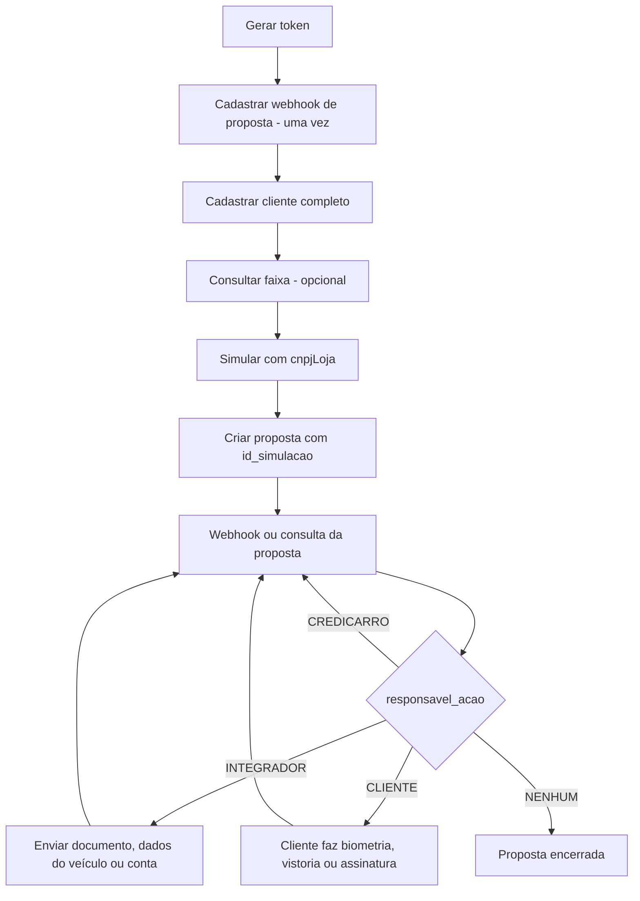
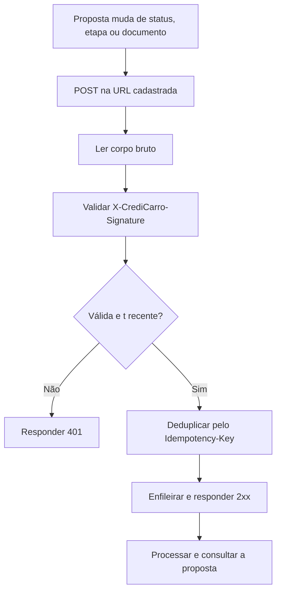

## Quando usar

Use esta skill em dois modos:

### 1. Modo integração
Quando o usuário quer **escrever código** que integra o Credicarro numa aplicação (.NET, Java, Node.js, Python, PHP, Go). Use o SDK oficial da linguagem (`Twila.Credicarro`, `br.com.twila:credicarro`, `@twila/credicarro`, `twila-credicarro`, `twila/credicarro`, `github.com/Twila-Digital/twila-credicarro-go-sdk`) com as regras, exemplos e boas práticas abaixo. Não invente classes nem métodos: use só o que a regra da linguagem mostra.

### 2. Agent Mode (API direta)
Quando o usuário quer **executar ações** — gerar token, cadastrar cliente, simular, criar ou consultar proposta, enviar documento, cadastrar webhook. Chame a API via `curl` no terminal. Veja [rules/agent.md](rules/agent.md) (ou o arquivo único [SKILL-AGENT.md](SKILL-AGENT.md)).

## Como usar

Antes de tratar status, etapas, documentos ou webhooks de proposta, leia [rules/proposal-steps.md](rules/proposal-steps.md). Ela define os códigos (`enum_status`, `enum_etapa`, `enum_situacao`, `enum_responsavel_acao`, biometria, documentos), o que enviar em cada etapa e o webhook de proposta.

Para **integração por código**, leia o arquivo do módulo e da linguagem:

- **Client** (instalação, configuração, ambientes, token, retry, `Idempotency-Key`, paginação, erros): [dotnet](rules/dotnet/client.md) / [java](rules/java/client.md) / [node](rules/node/client.md) / [python](rules/python/client.md) / [php](rules/php/client.md) / [go](rules/go/client.md)
- **Customers** (cadastro unificado, dados pessoais, endereço, ocupação e renda): [dotnet](rules/dotnet/customers.md) / [java](rules/java/customers.md) / [node](rules/node/customers.md) / [python](rules/python/customers.md) / [php](rules/php/customers.md) / [go](rules/go/customers.md)
- **Simulations** (faixas, simulação de financiamento e refinanciamento, consulta, listagem, rotas `/v1`): [dotnet](rules/dotnet/simulations.md) / [java](rules/java/simulations.md) / [node](rules/node/simulations.md) / [python](rules/python/simulations.md) / [php](rules/php/simulations.md) / [go](rules/go/simulations.md)
- **Proposals** (criar, consultar, listar, ações pendentes, documentos, dados do veículo, conta de recebimento, rotas `/v1`): [dotnet](rules/dotnet/proposals.md) / [java](rules/java/proposals.md) / [node](rules/node/proposals.md) / [python](rules/python/proposals.md) / [php](rules/php/proposals.md) / [go](rules/go/proposals.md)
- **Webhooks** (cadastrar, listar, editar, excluir, verificar assinatura, endpoint de recebimento): [dotnet](rules/dotnet/webhooks.md) / [java](rules/java/webhooks.md) / [node](rules/node/webhooks.md) / [python](rules/python/webhooks.md) / [php](rules/php/webhooks.md) / [go](rules/go/webhooks.md)
- **Security** (credenciais, logs, LGPD, webhooks, resiliência): [dotnet](rules/dotnet/security.md) / [java](rules/java/security.md) / [node](rules/node/security.md) / [python](rules/python/security.md) / [php](rules/php/security.md) / [go](rules/go/security.md)

Ferramentas de apoio:
- [tools/auth.md](tools/auth.md) — token de acesso, cache, renovação e erros de autenticação.
- [tools/environments.md](tools/environments.md) — staging x produção, variáveis de ambiente e o que testar.
- [tools/production.md](tools/production.md) — checklist antes de ir para produção.
- [tools/ecosystem.md](tools/ecosystem.md) — documentação oficial, SDKs, servidor MCP e suporte.
- [tools/sdks/dotnet.md](tools/sdks/dotnet.md) / [java.md](tools/sdks/java.md) / [node.md](tools/sdks/node.md) / [python.md](tools/sdks/python.md) / [php.md](tools/sdks/php.md) / [go.md](tools/sdks/go.md) — instalação e compatibilidade de cada SDK.

## Índice de arquivos

**Regras por linguagem** — [rules/dotnet/](rules/dotnet), [rules/java/](rules/java), [rules/node/](rules/node), [rules/python/](rules/python), [rules/php/](rules/php), [rules/go/](rules/go) — cada uma com `client.md`, `customers.md`, `simulations.md`, `proposals.md`, `webhooks.md` e `security.md`.

**Exemplos por linguagem** — [examples/dotnet/](examples/dotnet), [examples/java/](examples/java), [examples/node/](examples/node), [examples/python/](examples/python), [examples/php/](examples/php), [examples/go/](examples/go) — cada um com `client`, `customers`, `simulations`, `proposals` e `webhooks`.

**Regra de negócio compartilhada**
- [rules/proposal-steps.md](rules/proposal-steps.md) — status, etapas, situação, responsável, biometria, documentos e webhook de proposta.

**Agent Mode**
- [rules/agent.md](rules/agent.md) — uso direto da API via `curl`.
- [SKILL-AGENT.md](SKILL-AGENT.md) — versão autossuficiente do Agent Mode, para ferramentas que carregam um único arquivo.

**Ferramentas**
- [tools/auth.md](tools/auth.md), [tools/environments.md](tools/environments.md), [tools/production.md](tools/production.md), [tools/ecosystem.md](tools/ecosystem.md), [tools/sdks/](tools/sdks)

**Utilitários**
- [utils/faq.md](utils/faq.md) — perguntas frequentes.
- [utils/glossary.md](utils/glossary.md) — glossário de termos de crédito, da proposta e da API.

**Raiz**
- [README.md](README.md) — visão geral, instalação e estrutura.
- [SKILL.md](SKILL.md) — metadados e guia de uso (este arquivo).
- [SKILL-CONSOLIDATED.md](SKILL-CONSOLIDATED.md) — todos os arquivos acima concatenados, para ferramentas que só carregam um arquivo de contexto.

## Documentação visual

### Fluxo da proposta

### Recebimento de webhook

